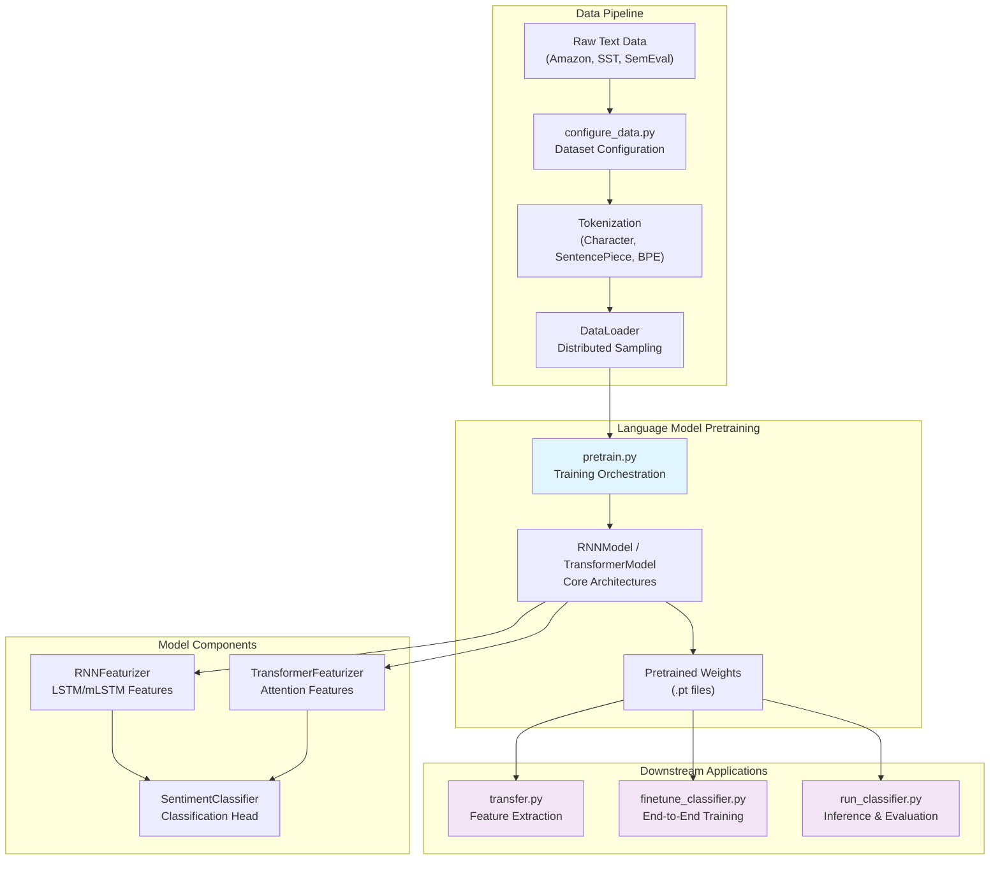
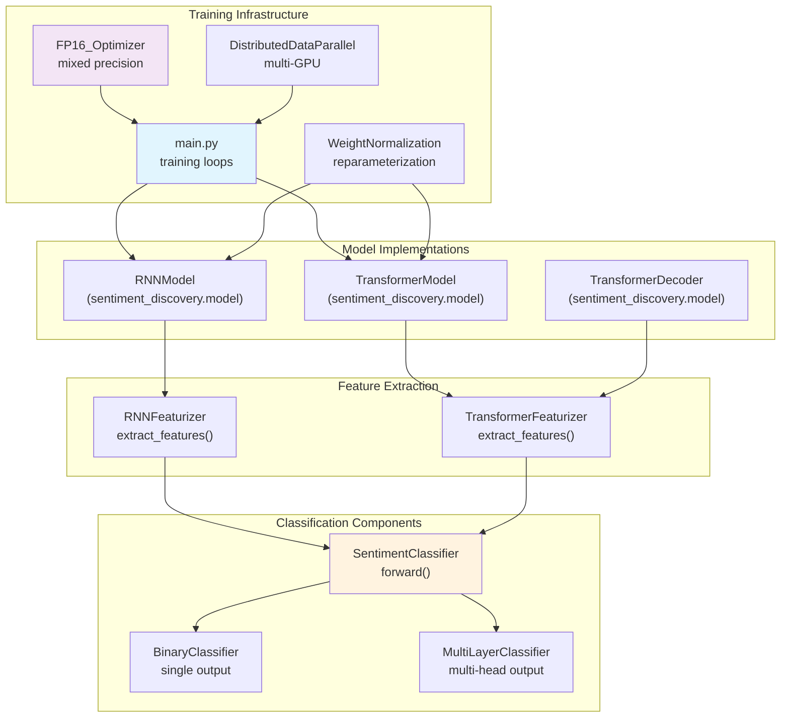

<!-- source: DeepWiki mcp.deepwiki.com · repo NVIDIA/sentiment-discovery · page 1 Overview · fetched 2026-10-26 -->

# Overview

Relevant source files

The following files were used as context for generating this wiki page:

- [README.md](README.md)
- [data/semeval/test.csv](data/semeval/test.csv)
- [data/semeval/train.csv](data/semeval/train.csv)
- [data/semeval/val.csv](data/semeval/val.csv)

This document provides a technical overview of the sentiment-discovery repository, a PyTorch-based system for large-scale unsupervised language model pretraining and sentiment analysis. The system implements techniques for training language models on unlabeled text data and transferring the learned representations to downstream sentiment classification tasks.

**Note:** This repository has been deprecated in favor of [Megatron-LM](https://github.com/NVIDIA/Megatron-LM), but remains valuable for understanding established pretraining and transfer learning methodologies.

The system covers the complete machine learning pipeline from data preprocessing through model pretraining to downstream task evaluation. For detailed configuration options, see [Configuration and Arguments](#6.3). For reproduction of research results, see [Reproduction Guide](#5.1).

## System Architecture

The sentiment-discovery system follows a two-stage approach: unsupervised language model pretraining followed by supervised task adaptation. The architecture consists of modular components that can be combined for different use cases.

### High-Level Workflow

**System Architecture Overview**
This diagram shows the main execution flow from raw data through pretraining to downstream applications. The system separates concerns between data processing, model training, and task-specific inference.

Sources: [README.md:107-196](), [README.md:28-63]()

### Core Model Architecture

**Model Architecture Components**
This diagram maps natural language model concepts to specific code entities, showing how different model types connect to feature extractors and classification heads.

Sources: [README.md:129-196](), [README.md:81-102]()

## Core Components

### Language Models
The system implements multiple neural architecture types through the `sentiment_discovery.model` module:

- **RNNModel**: Supports LSTM, mLSTM, and GRU variants with weight normalization
- **TransformerModel**: Encoder-decoder architecture with learned positional embeddings  
- **TransformerDecoder**: GPT-style autoregressive decoder

Each model type can be configured through command-line arguments processed by `arguments.py` and instantiated via the training scripts.

### Feature Extractors
Feature extraction is handled by specialized classes that convert trained language models into feature representations:

- **RNNFeaturizer**: Extracts hidden state features from RNN-based models
- **TransformerFeaturizer**: Extracts attention-based features from Transformer models

These extractors enable transfer learning by providing fixed or fine-tunable representations for downstream tasks.

### Data Processing
The data pipeline centers around `configure_data.py`, which handles:

- **Tokenization**: Character-level, SentencePiece, and BPE tokenization options
- **Dataset Loading**: CSV and JSON formats with lazy loading for large datasets
- **Distributed Sampling**: Sharded data loading for multi-GPU training

## Main Workflows

### Language Model Pretraining
Primary entry point: `pretrain.py`

Trains language models on large text corpora using unsupervised objectives. Supports distributed training across multiple GPUs and mixed-precision training through NVIDIA Apex integration.

| Model Type | Architecture | Key Features |
|------------|-------------|--------------|
| mLSTM | Recurrent | Weight normalization, 4096-d hidden |
| Transformer | Attention | 12 layers, 768-d embeddings |

### Transfer Learning  
Primary entry point: `transfer.py`

Extracts fixed features from pretrained models and trains lightweight classifiers (typically logistic regression) on top. Includes feature selection to identify the most relevant neurons for sentiment classification.

### End-to-End Finetuning
Primary entry point: `finetune_classifier.py`

Trains classification models end-to-end, backpropagating through both the classifier and language model encoder. Supports:

- Multi-label and multi-head classification
- Auxiliary language modeling loss
- Automatic threshold selection based on validation metrics

### Model Inference
Primary entry point: `run_classifier.py`

Performs inference on new data using trained classification models. Outputs prediction probabilities saved as `.npy` files.

## Key Capabilities

The system provides several advanced features for large-scale language model training and evaluation:

**Mixed Precision Training**: FP16 training support through NVIDIA Apex, reducing memory usage and accelerating training on modern GPUs.

**Distributed Training**: Multi-GPU and multi-node training capabilities with automatic gradient synchronization.

**Flexible Tokenization**: Support for character-level, subword (SentencePiece), and byte-pair encoding tokenization schemes.

**Comprehensive Evaluation**: Built-in metrics including F1-score, Matthews correlation coefficient, Jaccard index, and automatic threshold selection.

**Research Reproducibility**: Predefined experiment scripts for reproducing paper results on standard benchmarks (SST, IMDB, SemEval).

The system demonstrates competitive performance on sentiment analysis benchmarks while providing a flexible framework for experimenting with different architectures and training procedures.

Sources: [README.md:1-63](), [README.md:107-196](), [data/semeval/train.csv:1-10](), [data/semeval/test.csv:1-10]()

---

