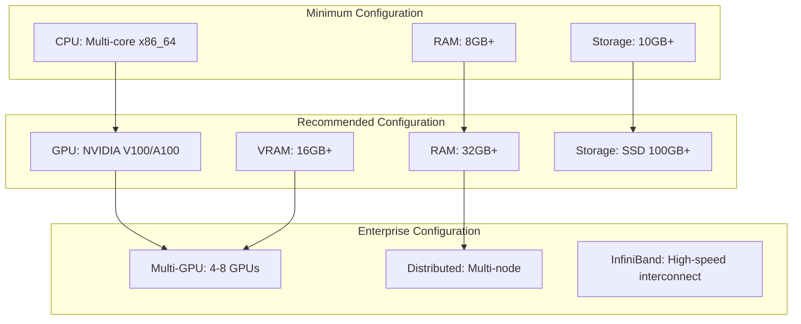
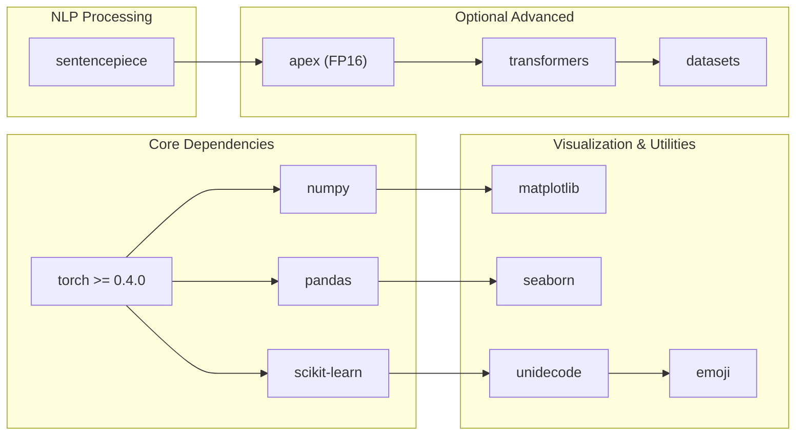
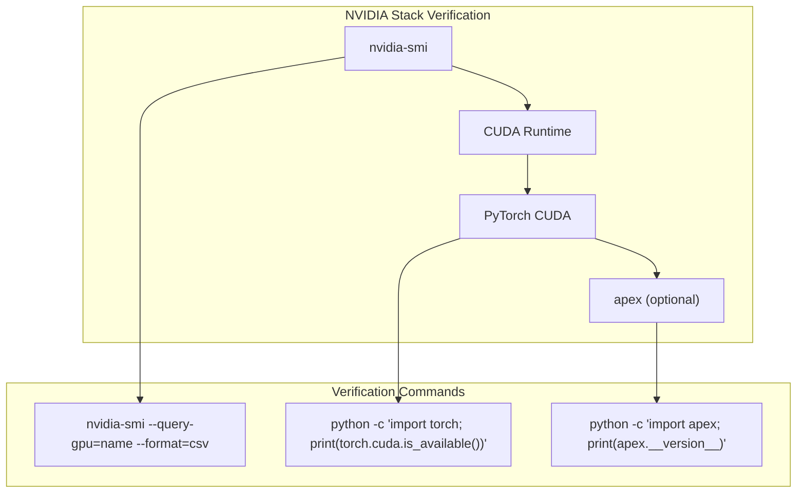

<!-- source: DeepWiki mcp.deepwiki.com · repo NVIDIA/sentiment-discovery · page 1.1 Installation and Setup · fetched 2026-10-26 -->

# Installation and Setup

<details>
<summary>Relevant source files</summary>

The following files were used as context for generating this wiki page:

- [setup.py](setup.py)

</details>


This document provides comprehensive instructions for installing the sentiment-discovery package and setting up the required environment. It covers system requirements, dependency management, installation procedures, and environment verification steps.

For information about basic usage workflows after installation, see [Quick Start Guide](#1.2). For advanced distributed training setup, see [Distributed Training](#6.1).

## System Requirements

The sentiment-discovery package requires specific versions of core dependencies and has been designed to work with modern deep learning hardware configurations.

### Core Dependencies

The package enforces strict version requirements for PyTorch compatibility as defined in [`setup.py:9-11`]():

| Component | Requirement | Purpose |
|-----------|-------------|---------|
| PyTorch | ≥ 0.4.0 | Core deep learning framework |
| Python | ≥ 3.6 | Runtime environment |
| CUDA | ≥ 9.0 (recommended) | GPU acceleration |
| NVIDIA Apex | Optional | Mixed precision training |

### Hardware Requirements



**Installation Hardware Compatibility Matrix**

Sources: [`setup.py:5-11`]()

## Installation Process

### Standard Installation

The package uses standard Python packaging tools with dependency resolution handled by `setuptools`. The installation process includes automatic PyTorch version validation.

#### Step 1: Environment Preparation

```bash
# Create virtual environment (recommended)
python -m venv sentiment_discovery_env
source sentiment_discovery_env/bin/activate  # Linux/Mac
# or
sentiment_discovery_env\Scripts\activate     # Windows
```

#### Step 2: PyTorch Installation

Install PyTorch first to ensure compatibility:

```bash
# CPU-only version
pip install torch torchvision torchaudio --index-url https://download.pytorch.org/whl/cpu

# CUDA version (recommended)
pip install torch torchvision torchaudio --index-url https://download.pytorch.org/whl/cu118
```

#### Step 3: Package Installation

```bash
# Install from source (recommended for development)
git clone https://github.com/NVIDIA/sentiment-discovery.git
cd sentiment-discovery
pip install -e .

# Or install dependencies only
pip install -r requirements.txt  # if requirements.txt exists
```

### Dependency Installation Flow



**Dependency Resolution and Installation Order**

Sources: [`setup.py:19-28`]()

### Development Installation

For contributors and researchers who need to modify the codebase:

```bash
# Clone with development dependencies
git clone https://github.com/NVIDIA/sentiment-discovery.git
cd sentiment-discovery

# Install in editable mode
pip install -e .

# Install additional development tools (optional)
pip install pytest black flake8 jupyter
```

## Environment Configuration

### GPU Support Setup

The package automatically detects CUDA availability but requires proper NVIDIA driver installation:



**GPU Environment Verification Process**

### Mixed Precision Training Setup

For optimal training performance with NVIDIA Apex:

```bash
# Install NVIDIA Apex (optional but recommended)
git clone https://github.com/NVIDIA/apex
cd apex
pip install -v --disable-pip-version-check --no-cache-dir --global-option="--cpp_ext" --global-option="--cuda_ext" ./
```

Sources: [System diagrams](), [`setup.py:1-29`]()

## Installation Verification

### Basic Functionality Test

Create a simple verification script to ensure proper installation:

```python
# test_installation.py
import sentiment_discovery
import torch
import numpy as np
import pandas as pd
import sentencepiece as spm

print(f"sentiment_discovery available: {sentiment_discovery.__name__}")
print(f"PyTorch version: {torch.__version__}")
print(f"CUDA available: {torch.cuda.is_available()}")
print(f"CUDA device count: {torch.cuda.device_count()}")

# Test basic imports from main modules
try:
    from sentiment_discovery.model import RNNModel, TransformerModel
    from sentiment_discovery.data_utils import Tokenizer
    print("Core modules imported successfully")
except ImportError as e:
    print(f"Import error: {e}")
```

### Component Verification Matrix

| Component | Verification Command | Expected Output |
|-----------|---------------------|-----------------|
| Package | `python -c "import sentiment_discovery"` | No errors |
| PyTorch | `python -c "import torch; print(torch.__version__)"` | Version ≥ 0.4.0 |
| CUDA | `python -c "import torch; print(torch.cuda.is_available())"` | `True` (if GPU present) |
| SentencePiece | `python -c "import sentencepiece"` | No errors |
| Core Models | `python -c "from sentiment_discovery.model import RNNModel"` | No errors |

### Advanced Verification

For distributed training and advanced features:

```bash
# Test distributed capabilities
python -c "import torch.distributed as dist; print('Distributed available:', dist.is_available())"

# Test mixed precision (if apex installed)
python -c "try: import apex; print('Apex version:', apex.__version__); except: print('Apex not available')"

# Memory and compute verification
python -c "import torch; print('GPU memory:', torch.cuda.get_device_properties(0).total_memory if torch.cuda.is_available() else 'N/A')"
```

Sources: [`setup.py:5-11`](), [System integration diagrams]()

## Troubleshooting Common Issues

### PyTorch Version Conflicts

The package enforces PyTorch version requirements through runtime checks:

```python
# From setup.py lines 9-11
if TORCH_MAJOR == 0 and TORCH_MINOR < 4:
    raise RuntimeError("Sentiment Discovery requires Pytorch 0.4 or newer.")
```

**Resolution**: Upgrade PyTorch to a compatible version before installation.

### CUDA Compatibility Issues

Common CUDA-related installation problems:

| Issue | Symptom | Solution |
|-------|---------|----------|
| Driver mismatch | `CUDA driver version is insufficient` | Update NVIDIA drivers |
| CUDA not found | `torch.cuda.is_available() = False` | Install CUDA toolkit |
| cuDNN missing | Runtime errors during training | Install cuDNN libraries |
| Memory errors | OOM during model loading | Reduce batch size or use FP16 |

### Dependency Resolution

For package conflicts or missing dependencies:

```bash
# Clean installation
pip uninstall sentiment_discovery
pip cache purge
pip install -e . --force-reinstall --no-deps
pip install <missing_dependency>
```

Sources: [`setup.py:9-11`](), [System requirements analysis]()

## Next Steps

After successful installation:

1. **Basic Usage**: See [Quick Start Guide](#1.2) for common workflows
2. **Data Setup**: Configure data processing with [Data Processing System](#2.1)  
3. **Model Training**: Begin with [Language Model Pretraining](#3.1)
4. **Advanced Features**: Explore [Distributed Training](#6.1) and [Mixed Precision Training](#6.2)

The installation provides access to all core components including data processing utilities, model architectures, training infrastructure, and evaluation tools as outlined in the system architecture diagrams.

Sources: [`setup.py:1-29`](), [High-level system workflow overview](), [System integration diagrams]()

---

