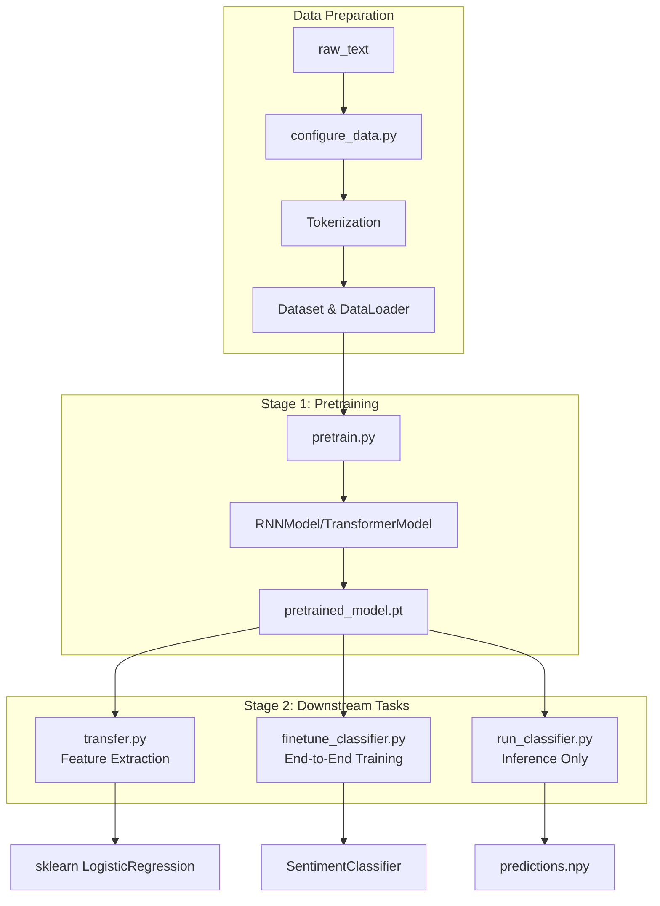
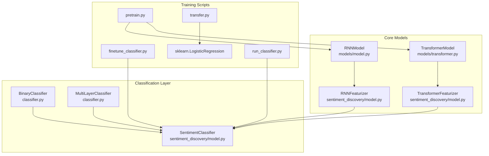
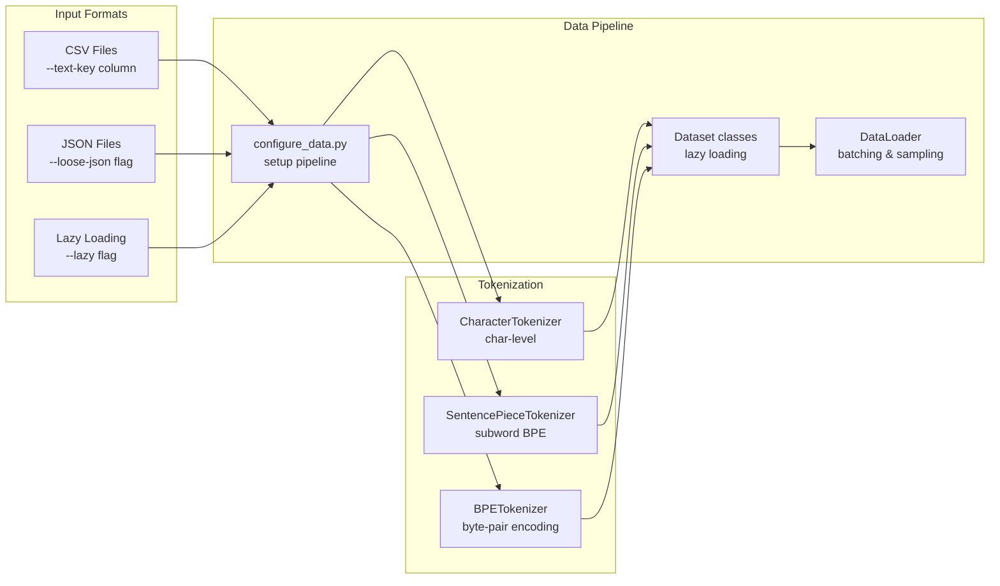

<!-- source: DeepWiki mcp.deepwiki.com · repo NVIDIA/sentiment-discovery · page 1.2 Quick Start Guide · fetched 2026-10-26 -->

# Quick Start Guide

<details>
<summary>Relevant source files</summary>

The following files were used as context for generating this wiki page:

- [README.md](README.md)
- [data/semeval/test.csv](data/semeval/test.csv)
- [data/semeval/train.csv](data/semeval/train.csv)
- [data/semeval/val.csv](data/semeval/val.csv)
- [experiments/run_se_multihead.sh](experiments/run_se_multihead.sh)
- [experiments/run_se_singlehead.sh](experiments/run_se_singlehead.sh)

</details>


This guide provides step-by-step instructions for the most common workflows in the sentiment-discovery repository: language model pretraining, transfer learning, classifier finetuning, and inference. For detailed configuration options, see [Configuration and Arguments](#6.3). For distributed training setup, see [Distributed Training](#6.1).

## Overview

The sentiment-discovery repository implements a two-stage approach for sentiment analysis:

1. **Unsupervised Pretraining**: Train language models on large text corpora using `pretrain.py`
2. **Downstream Application**: Apply pretrained models to sentiment tasks using three approaches:
   - **Feature extraction** with `transfer.py` 
   - **End-to-end finetuning** with `finetune_classifier.py`
   - **Inference** with `run_classifier.py`

## Main Workflow Overview



Sources: [README.md:107-149](), [pretrain.py](), [transfer.py](), [finetune_classifier.py](), [run_classifier.py]()

## Prerequisites and Installation

Install the package and dependencies:

```bash
python3 setup.py install
```

**Required Dependencies:**
- PyTorch (>= 0.4.1)
- scikit-learn  
- pandas
- sentencepiece
- numpy

Sources: [README.md:66-79]()

## Quick Start: Running Pretrained Models

### Classification with Pretrained Models

The fastest way to get started is using the provided pretrained models for classification:

```bash
# Download pretrained models (see README for links)
python3 run_classifier.py --load_model ama_sst.pt                           # Binary SST classification
python3 run_classifier.py --load_model ama_sst.pt --fp16                    # FP16 inference
python3 run_classifier.py --load_model ama_sst.pt --text-key <column> --data <file.csv>  # Custom data
```

### Model Architecture and Code Mapping



Sources: [sentiment_discovery/model.py](), [models/model.py](), [models/transformer.py](), [classifier.py](), [pretrain.py](), [finetune_classifier.py](), [transfer.py](), [run_classifier.py]()

## Training Your Own Models

### 1. Language Model Pretraining

Train a language model on your text corpus as the foundation for downstream tasks:

```bash
# Basic mLSTM training
python3 pretrain.py --data ./data/amazon/reviews.json --lazy --loose-json \
  --text-key reviewText --label-key overall --split 1000,1,1

# Transformer with SentencePiece tokenization  
python3 pretrain.py --tokenizer-type SentencePieceTokenizer --vocab-size 32000 \
  --tokenizer-path ama_32k_tokenizer.model --model transformer \
  --decoder-layers 12 --decoder-embed-dim 768 --decoder-ffn-embed-dim 3072 \
  --decoder-learned-pos --decoder-attention-heads 8

# Distributed training
python3 -m multiproc pretrain.py

# FP16 training
python3 pretrain.py --fp16 --dynamic-loss-scale
```

**Key Parameters:**
- `--model`: `LSTM`, `mLSTM`, or `transformer`
- `--tokenizer-type`: `CharacterTokenizer`, `SentencePieceTokenizer`, or `BPETokenizer`
- `--data`: Path to training data (JSON or CSV)
- `--text-key`: Column name containing text
- `--split`: Train/validation/test split ratios

Sources: [README.md:129-149](), [pretrain.py]()

### 2. Transfer Learning (Feature Extraction)

Use pretrained language model features with sklearn for quick sentiment classification:

```bash
# Basic transfer learning on SST
python3 transfer.py --load mlstm.pt

# Multi-neuron feature selection
python3 transfer.py --load mlstm.pt --neurons 5

# Custom dataset
python3 transfer.py --load mlstm.pt --data custom_train.csv --val custom_val.csv --test custom_test.csv
```

This approach:
1. Extracts features from the pretrained language model using `RNNFeaturizer` or `TransformerFeaturizer`
2. Trains `sklearn.LogisticRegression` on extracted features
3. Performs feature selection to identify the most predictive neurons

Sources: [README.md:157-169](), [transfer.py]()

### 3. End-to-End Finetuning

For more complex classification tasks, finetune the entire model end-to-end:

```bash
# Basic finetuning with auxiliary language modeling loss
python3 finetune_classifier.py --load mlstm.pt --lr 2e-5 --aux-lm-loss --aux-lm-loss-weight .02

# Automatic threshold selection based on F1 score
python3 finetune_classifier.py --load mlstm.pt --automatic-thresholding --threshold-metric f1

# Multi-label classification with multiple heads
python3 finetune_classifier.py --non-binary-cols l1 l2 l3 --lr 2e-5 \
  --classifier-hidden-layers 2048 1024 3 --heads-per-class 4 \
  --aux-head-variance-loss-weight 1.0 --data train.csv --val val.csv --test test.csv
```

**Key Features:**
- Supports multi-label, multi-layer, and multi-head classification
- Automatic threshold selection for optimal performance
- Auxiliary losses for improved training (language modeling, head variance)
- Comprehensive metrics: F1, Matthews correlation, Jaccard index, precision, recall

Sources: [README.md:173-195](), [finetune_classifier.py]()

## Working with Datasets

### Supported Data Formats

The repository includes preprocessed datasets and supports custom data:

| Dataset | Location | Purpose |
|---------|----------|---------|
| Binary SST | `data/sst/` | Binary sentiment classification |
| IMDB Reviews | `data/imdb/` | Movie review sentiment |
| SemEval Emotions | `data/semeval/` | Multi-label emotion classification |
| Amazon Reviews | External download | Large-scale pretraining |

### SemEval Emotion Classification Example

```bash
# Multi-head emotion classification
python3 experiments/run_clf_multihead.py --text-key Tweet \
  --train data/semeval/train.csv --val data/semeval/val.csv --test data/semeval/test.csv \
  --process-fn process_tweet

# Single-head approach  
python3 experiments/run_clf_single_head.py --text-key Tweet \
  --train data/semeval/train.csv --val data/semeval/val.csv --test data/semeval/test.csv \
  --process-fn process_tweet
```

The SemEval dataset contains 8 emotion labels: anger, anticipation, disgust, fear, joy, love, optimism, pessimism, sadness, surprise, trust.

Sources: [README.md:104-105](), [data/semeval/train.csv:1-11](), [experiments/run_se_multihead.sh](), [experiments/run_se_singlehead.sh]()

### Data Processing Pipeline



Sources: [configure_data.py](), [README.md:139-143]()

## Advanced Features

### Mixed Precision Training

Enable FP16 training for faster training and reduced memory usage:

```bash
python3 pretrain.py --fp16 --dynamic-loss-scale
python3 finetune_classifier.py --load model.pt --fp16
```

### Distributed Training

Scale training across multiple GPUs:

```bash
python3 -m multiproc pretrain.py --distributed
```

### Model Architectures

The repository supports multiple architectures through the `--model` parameter:

- **mLSTM**: Multiplicative LSTM with weight normalization
- **LSTM**: Standard LSTM
- **transformer**: Transformer decoder architecture

For detailed architecture specifications and distributed training setup, see [Model Architectures](#2.2) and [Distributed Training](#6.1).

Sources: [README.md:134-148](), [README.md:12]()

---

