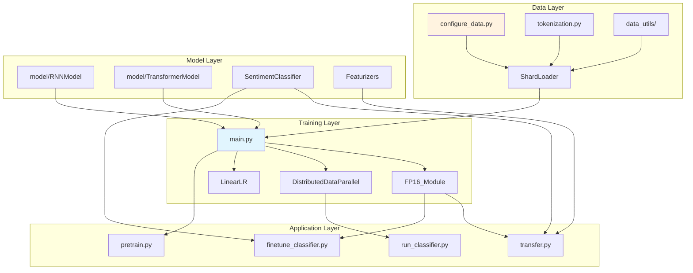
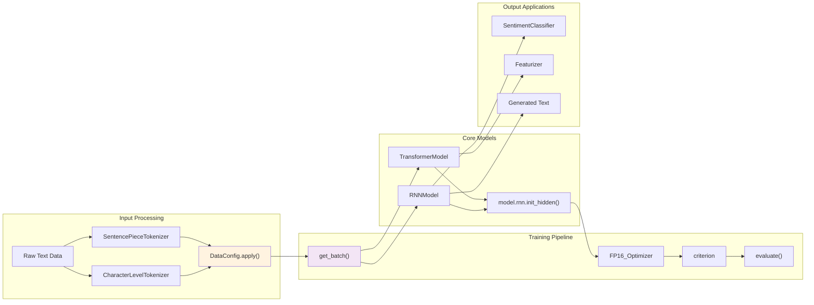
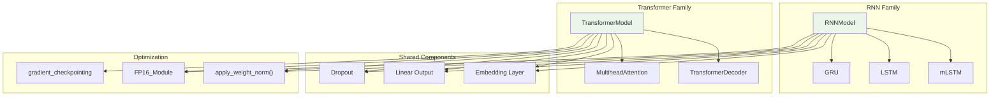
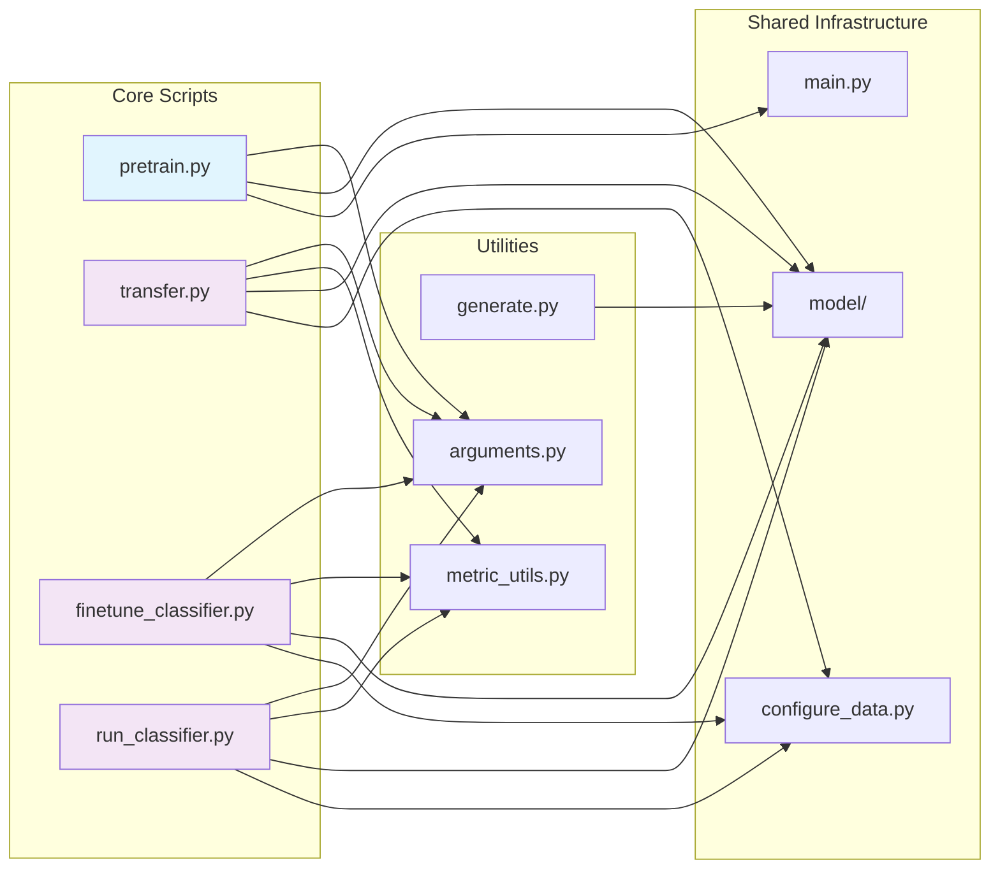

<!-- source: DeepWiki mcp.deepwiki.com · repo NVIDIA/sentiment-discovery · page 2 Core Components · fetched 2026-10-26 -->

# Core Components

<details>
<summary>Relevant source files</summary>

The following files were used as context for generating this wiki page:

- [README.md](README.md)
- [configure_data.py](configure_data.py)
- [data/semeval/test.csv](data/semeval/test.csv)
- [data/semeval/train.csv](data/semeval/train.csv)
- [data/semeval/val.csv](data/semeval/val.csv)
- [data_utils/tokenization.py](data_utils/tokenization.py)
- [generate.py](generate.py)
- [main.py](main.py)

</details>


This document provides an overview of the main system components in the sentiment-discovery repository and their relationships. It covers the fundamental building blocks that enable unsupervised language model pretraining, transfer learning, and sentiment classification workflows.

For detailed information about specific subsystems, see [Data Processing System](#2.1), [Model Architectures](#2.2), and [Training Infrastructure](#2.3). For usage patterns and workflows, see [Usage Workflows](#3).

## System Architecture Overview

The sentiment-discovery system follows a modular architecture with four primary component layers that work together to enable large-scale language modeling and sentiment analysis.

### High-Level Component Architecture



**Sources:** [main.py:1-425](), [configure_data.py:1-181](), [data_utils/tokenization.py:1-275]()

### Component Data Flow



**Sources:** [main.py:231-240](), [main.py:154-157](), [configure_data.py:27-95]()

## Data Processing Components

The data processing system handles tokenization, dataset creation, and batch loading for both unsupervised pretraining and supervised classification tasks.

### Tokenization System

| Component | Class | Purpose |
|-----------|-------|---------|
| Character-level | `CharacterLevelTokenizer` | Maps text to character IDs (256 vocab) |
| Subword | `SentencePieceTokenizer` | Learned BPE/unigram tokenization |
| Base | `Tokenizer` | Abstract interface with `EncodeAsIds()` |

The tokenization system provides a unified interface through the `Tokenizer` base class, with implementations supporting both character-level and learned subword tokenization via SentencePiece.

**Sources:** [data_utils/tokenization.py:122-165](), [data_utils/tokenization.py:189-275]()

### Data Configuration

The `configure_data()` function and `DataConfig` class orchestrate the data pipeline setup:

- **Dataset Creation**: Handles CSV, JSON, and lazy loading patterns
- **Loader Configuration**: Sets up distributed, sharded data loading  
- **Tokenizer Integration**: Connects tokenization with dataset processing
- **Split Management**: Manages train/validation/test splits

Key entry point: `DataConfig.apply()` which returns `(train_data, val_data, test_data), tokenizer`

**Sources:** [configure_data.py:121-181](), [configure_data.py:27-95]()

## Model Architecture Components

The model layer provides neural network architectures for both language modeling and classification tasks.

### Language Models



**Sources:** [main.py:157](), [model/__init__.py]()

### Classification Components

The system provides classification heads that can be combined with pretrained language model encoders:

- **SentimentClassifier**: Combines language model encoder with classification head
- **BinaryClassifier**: Single-layer classification for binary tasks
- **MultiLayerClassifier**: MLP with multi-head support for complex tasks

**Sources:** Referenced in [README.md:174-195]()

## Training Infrastructure

### Training Orchestration

The training infrastructure centers around `main.py` which provides:

- **Batch Processing**: `get_batch()` function for sequence preparation
- **Hidden State Management**: `init_hidden()` for RNN state initialization  
- **Loss Computation**: Cross-entropy loss with distributed reduction
- **Optimization**: Support for FP16 and distributed training

Key training loop components:
```python
# From main.py training function
data, targets, reset_mask = get_batch(batch)
output, hidden = model(data, reset_mask=reset_mask)
loss = criterion(output.view(-1, ntokens), targets.view(-1))
```

**Sources:** [main.py:267-369](), [main.py:231-240](), [main.py:242-243]()

### Optimization Features

| Feature | Implementation | Purpose |
|---------|---------------|---------|
| Mixed Precision | `FP16_Module`, `FP16_Optimizer` | Memory efficiency |
| Distributed Training | `DistributedDataParallel` | Multi-GPU scaling |
| Learning Rate Scheduling | `LinearLR` | Training stability |
| Gradient Clipping | `clip_grad_norm()` | Prevent exploding gradients |

**Sources:** [main.py:183-194](), [main.py:196-208](), [main.py:305-309]()

## Application Entry Points

The system provides four main entry points for different use cases:

### Training and Inference Scripts



- **`pretrain.py`**: Unsupervised language model training
- **`transfer.py`**: Feature extraction and transfer learning  
- **`finetune_classifier.py`**: End-to-end classifier finetuning
- **`run_classifier.py`**: Model inference and evaluation

**Sources:** [README.md:134-195](), [main.py:1-25]()

## Component Interactions

The core components interact through well-defined interfaces:

1. **Data → Training**: `configure_data()` produces data loaders consumed by training scripts
2. **Models → Optimization**: Language models are wrapped with `FP16_Module` and `DistributedDataParallel`  
3. **Training → Applications**: Pretrained models are loaded by transfer/finetuning scripts
4. **Tokenizers → Data**: Tokenization is integrated into dataset creation pipeline

This modular design enables flexible composition of components for different research and application scenarios while maintaining code reusability across the supervised and unsupervised learning workflows.

**Sources:** [configure_data.py:12-26](), [main.py:109-213]()

---

