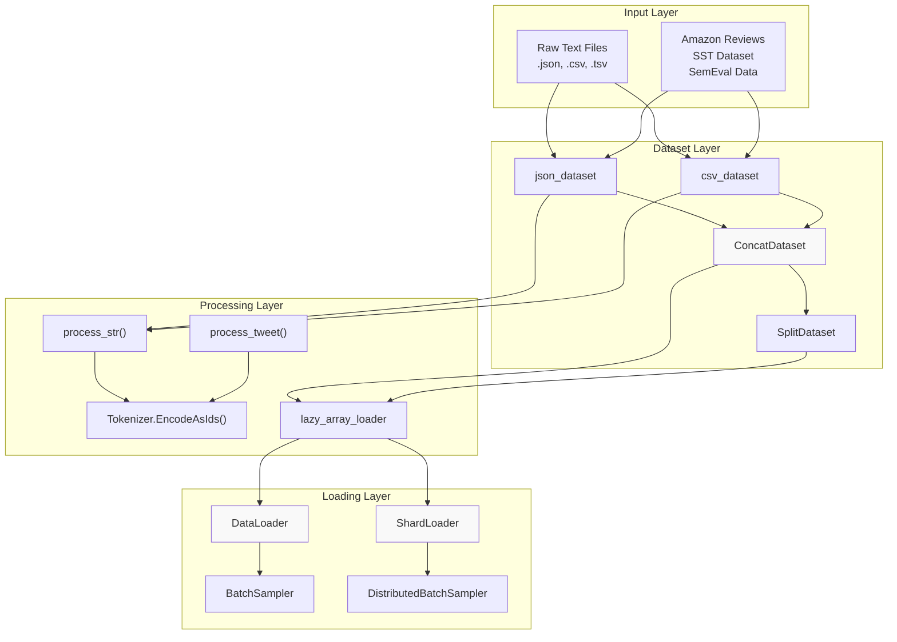
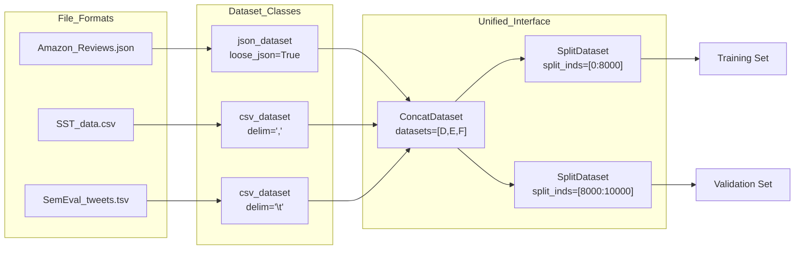
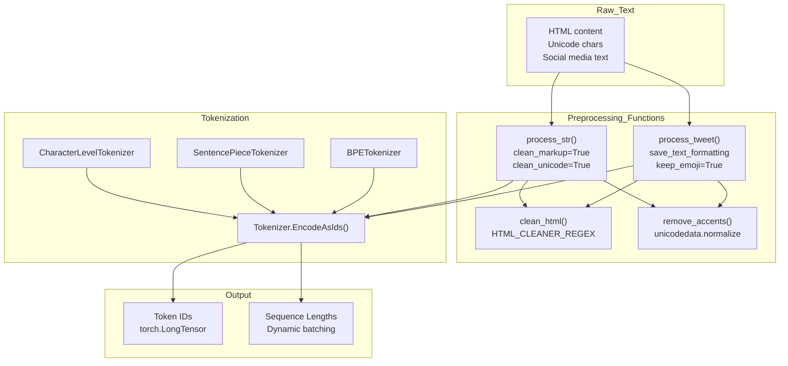
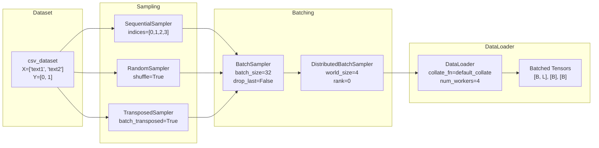
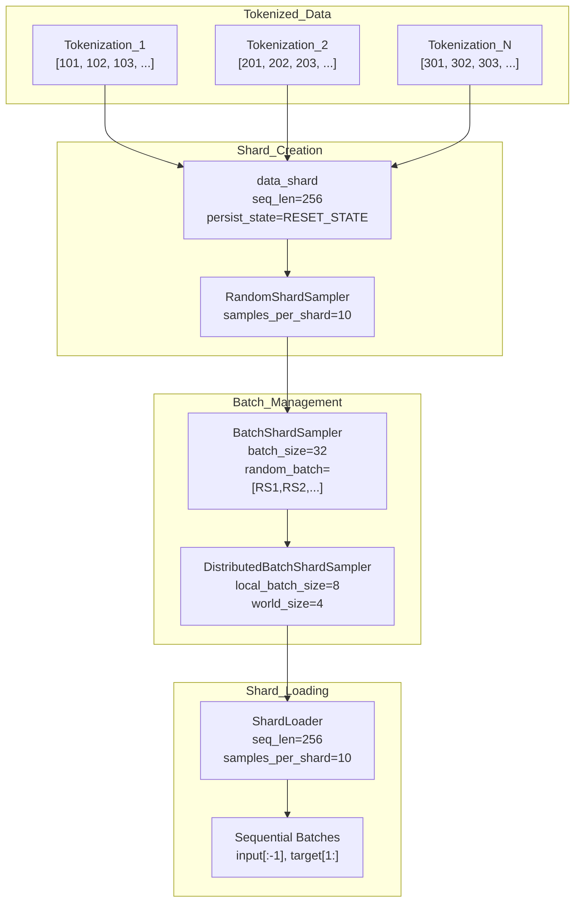
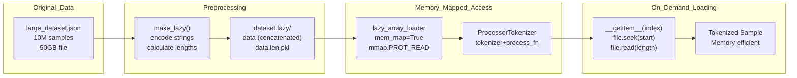
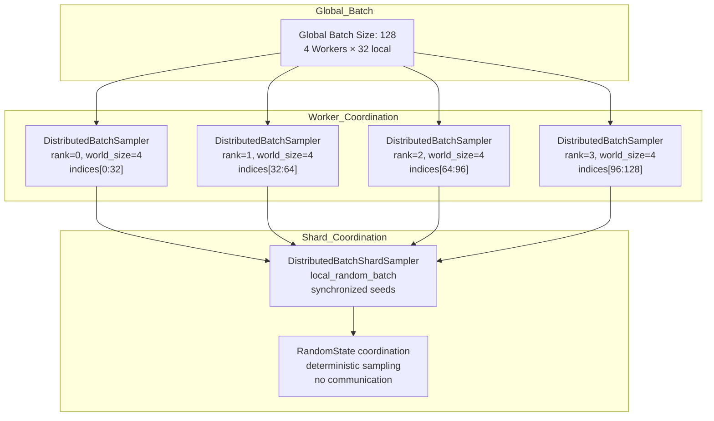
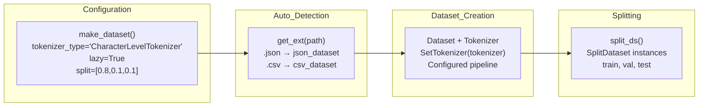

<!-- source: DeepWiki mcp.deepwiki.com · repo NVIDIA/sentiment-discovery · page 2.1 Data Processing System · fetched 2026-10-26 -->

# Data Processing System

Relevant source files

The following files were used as context for generating this wiki page:

- [data_utils/__init__.py](data_utils/__init__.py)
- [data_utils/datasets.py](data_utils/datasets.py)
- [data_utils/lazy_loader.py](data_utils/lazy_loader.py)
- [data_utils/loaders.py](data_utils/loaders.py)
- [data_utils/preprocess.py](data_utils/preprocess.py)
- [data_utils/samplers.py](data_utils/samplers.py)

## Purpose and Scope

The Data Processing System provides comprehensive infrastructure for loading, preprocessing, and batching text data for language model training and sentiment analysis tasks. This system handles diverse input formats (JSON, CSV, TSV), implements efficient tokenization pipelines, and supports both supervised classification and unsupervised language modeling workflows.

For information about model architectures that consume the processed data, see [Model Architectures](#2.2). For training orchestration that uses these data pipelines, see [Training Infrastructure](#2.3).

## System Architecture Overview

The data processing system consists of four main layers that transform raw text files into batched tensors ready for model training:

**Data Processing Architecture**

This architecture enables scalable processing of large text corpora through lazy loading, distributed sampling, and efficient batching strategies optimized for both classification and language modeling tasks.

Sources: [data_utils/__init__.py:21-64](), [data_utils/datasets.py:180-394](), [data_utils/loaders.py:91-320]()

## Dataset Classes and File Format Support

The system provides specialized dataset classes for different input formats, all implementing the PyTorch `Dataset` interface:

| Dataset Class | File Formats | Key Features | Use Cases |
|---------------|--------------|--------------|-----------|
| `json_dataset` | `.json` | Loose JSON support, streaming | Large JSON dumps, research datasets |
| `csv_dataset` | `.csv`, `.tsv` | Pandas integration, label binarization | Structured sentiment data |
| `ConcatDataset` | Multiple files | Concatenates datasets on-the-fly | Multi-corpus training |
| `SplitDataset` | Any dataset | Efficient subset indexing | Train/validation splits |

**Dataset Class Hierarchy and File Format Support**

The dataset classes automatically handle text and label extraction using configurable keys (`text_key`, `label_key`) and support preprocessing functions for domain-specific text cleaning.

Sources: [data_utils/datasets.py:180-274](), [data_utils/datasets.py:275-394](), [data_utils/datasets.py:41-105](), [data_utils/datasets.py:106-178]()

## Preprocessing and Tokenization Pipeline

Text preprocessing transforms raw strings into tokenized sequences through a configurable pipeline:

**Text Preprocessing and Tokenization Pipeline**

The preprocessing functions handle domain-specific challenges like HTML cleaning, emoji processing, and social media text normalization, while tokenizers convert processed text into numerical representations.

Sources: [data_utils/preprocess.py:38-66](), [data_utils/preprocess.py:144-231](), [data_utils/preprocess.py:17-33](), [data_utils/tokenization.py:1-10]()

## Data Loading Infrastructure

The loading infrastructure provides two specialized data loaders optimized for different training paradigms:

### Standard Classification Loading

**Standard DataLoader Architecture for Classification**

Sources: [data_utils/loaders.py:91-137](), [data_utils/samplers.py:75-129](), [data_utils/samplers.py:11-74]()

### Sequence Modeling with Shards

For unsupervised language modeling, the system uses a specialized shard-based approach:

**ShardLoader Architecture for Language Modeling**

The shard-based approach maintains sequence continuity across batch boundaries, essential for autoregressive language modeling where hidden states persist between sequences.

Sources: [data_utils/loaders.py:139-320](), [data_utils/datasets.py:395-521](), [data_utils/samplers.py:165-310]()

## Lazy Loading and Memory Management

For large datasets that don't fit in memory, the system provides lazy loading through the `lazy_array_loader`:

**Lazy Loading Architecture**

The lazy loader memory-maps large files and loads individual samples on-demand, enabling training on datasets larger than available RAM while maintaining fast random access.

Sources: [data_utils/lazy_loader.py:68-147](), [data_utils/lazy_loader.py:29-53](), [data_utils/lazy_loader.py:10-28]()

## Distributed Training Support

The data processing system provides comprehensive distributed training support through specialized samplers and loaders:

### Distributed Sampling Strategy

**Distributed Sampling Coordination**

The distributed samplers ensure consistent data loading across workers without requiring inter-process communication by using deterministic random number generation with coordinated seeds.

Sources: [data_utils/samplers.py:11-74](), [data_utils/samplers.py:282-310](), [data_utils/loaders.py:170-188]()

## Configuration and Factory Functions

The system provides high-level factory functions for easy dataset creation:

| Function | Purpose | Key Parameters |
|----------|---------|----------------|
| `make_dataset()` | Create dataset with tokenizer | `path`, `seq_length`, `lazy`, `split` |
| `get_dataset()` | Auto-detect file format | `path`, `text_key`, `label_key` |
| `split_ds()` | Create train/val/test splits | `split=[0.8, 0.1, 0.1]`, `shuffle=True` |

**Dataset Factory and Configuration System**

The factory functions automatically handle file format detection, tokenizer creation, and dataset splitting based on configuration parameters.

Sources: [data_utils/__init__.py:32-64](), [data_utils/__init__.py:21-30](), [data_utils/datasets.py:147-178]()

## Performance Optimizations

The data processing system implements several key optimizations for large-scale training:

- **Memory Mapping**: Files are memory-mapped for zero-copy access [data_utils/lazy_loader.py:86-87]()
- **Batch Transposition**: `TransposedSampler` improves cache locality for sequence modeling [data_utils/samplers.py:130-163]()
- **Wrap-Around Batching**: Maintains sequence continuity across epoch boundaries [data_utils/samplers.py:22-24]()
- **Multiprocessing**: Parallel data loading with configurable worker processes [data_utils/loaders.py:234-320]()
- **Pin Memory**: GPU transfer optimization for faster training [data_utils/loaders.py:317-319]()

These optimizations enable efficient training on large corpora while maintaining flexibility for different model architectures and training paradigms.

Sources: [data_utils/loaders.py:91-320](), [data_utils/samplers.py:11-310](), [data_utils/lazy_loader.py:68-147]()

---

