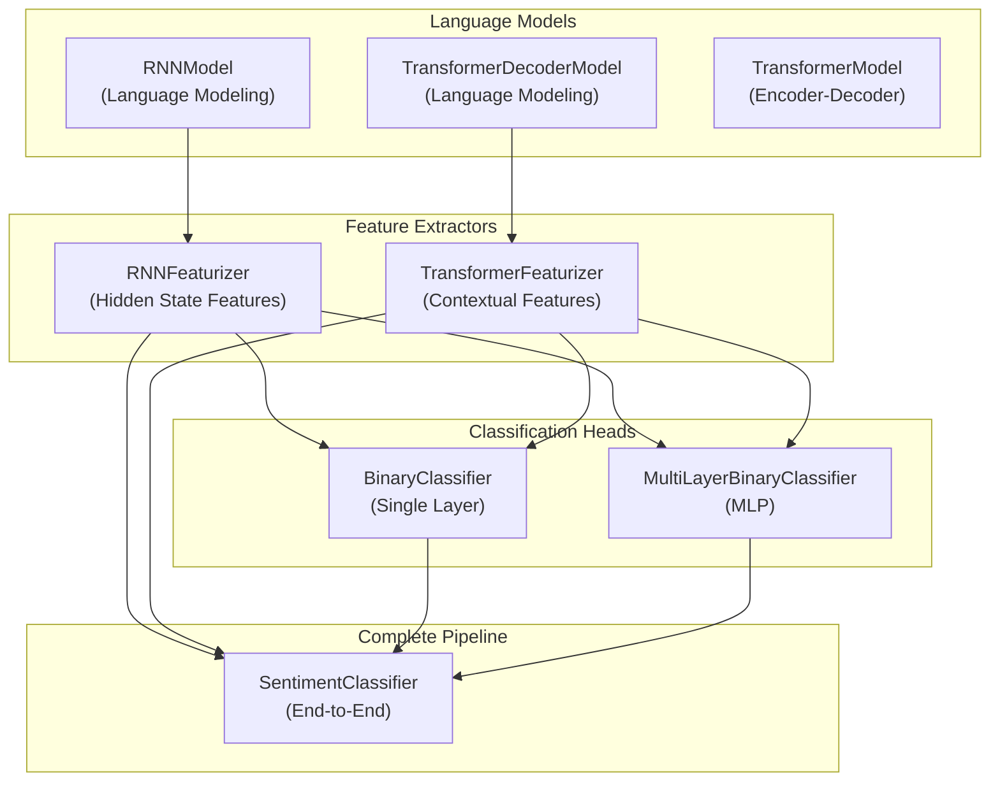
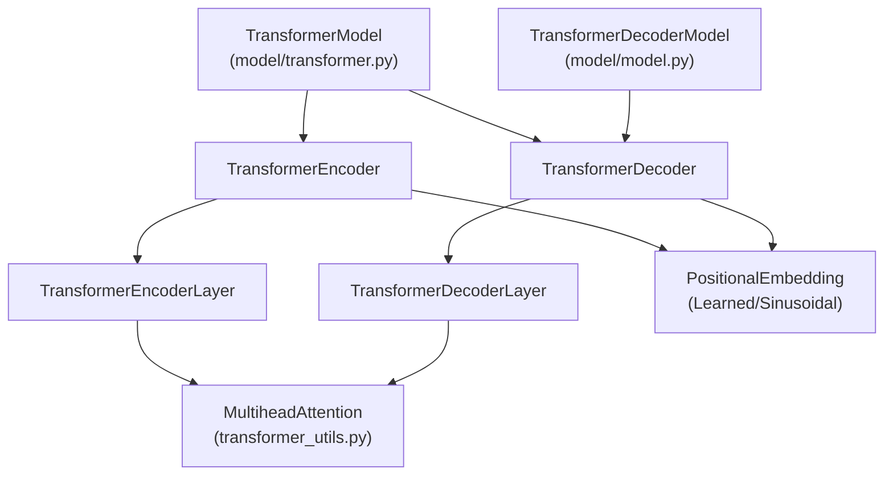
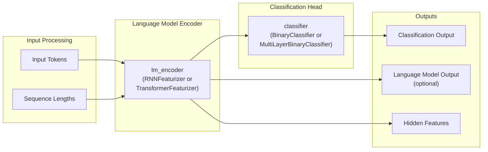

<!-- source: DeepWiki mcp.deepwiki.com · repo NVIDIA/sentiment-discovery · page 2.2 Model Architectures · fetched 2026-10-26 -->

# Model Architectures

<details>
<summary>Relevant source files</summary>

The following files were used as context for generating this wiki page:

- [LICENSE](LICENSE)
- [learning_rates.py](learning_rates.py)
- [model/__init__.py](model/__init__.py)
- [model/model.py](model/model.py)
- [model/sentiment_classifier.py](model/sentiment_classifier.py)
- [model/transformer.py](model/transformer.py)
- [model/transformer_utils.py](model/transformer_utils.py)

</details>


This document covers the neural network architectures implemented in the sentiment discovery repository, including language models, feature extractors, and classification components. These models form the foundation for both unsupervised pretraining and downstream sentiment analysis tasks.

For information about training these models, see [Training Infrastructure](#2.3). For guidance on using pretrained models for downstream tasks, see [Transfer Learning](#3.2) and [Classifier Finetuning](#3.3).

## Architecture Overview

The system implements a modular architecture where language models serve as feature extractors for downstream classification tasks. The core design follows a two-stage approach: unsupervised language model pretraining followed by supervised adaptation.

**Model Architecture System Overview**



Sources: [model/model.py:12-303](), [model/sentiment_classifier.py:10-356](), [model/transformer.py:21-402]()

## Core Language Models

### RNN-Based Models

The `RNNModel` class implements the fundamental recurrent neural network architecture for language modeling. It consists of an embedding layer, recurrent layers, and a linear decoder.

| Component | Class | Purpose |
|-----------|-------|---------|
| Main Model | `RNNModel` | Complete language model with encoder-decoder structure |
| RNN Core | `RNN` (from `RNN_utils`) | Recurrent computation (LSTM, mLSTM, GRU) |
| Embedding | `nn.Embedding` | Token to vector mapping |
| Decoder | `nn.Linear` | Hidden state to vocabulary projection |

Key features:
- **Weight Tying**: Optional parameter sharing between encoder and decoder [model/model.py:27-30]()
- **Dropout**: Configurable dropout for regularization [model/model.py:17]()
- **Multiple RNN Types**: Support for LSTM, mLSTM, and GRU variants [model/model.py:20]()

The model supports gradient checkpointing and distributed training through the `chkpt_grad` parameter in the forward pass [model/model.py:37]().

Sources: [model/model.py:12-59]()

### Transformer-Based Models

The repository implements several transformer variants optimized for different use cases:

**Transformer Model Hierarchy**



#### TransformerModel
Complete encoder-decoder architecture with separate encoder and decoder stacks [model/transformer.py:21-100]().

#### TransformerDecoderModel
Decoder-only model optimized for language modeling tasks [model/model.py:195-278](). Features:
- **Gradient Checkpointing**: Memory-efficient training via chunked computation [model/transformer.py:300-307]()
- **Generation Optimization**: Fast inference mode with weight norm removal [model/model.py:250-277]()
- **Mixture of Softmax**: Optional MoS layer for improved output modeling [model/transformer.py:246-251]()

Sources: [model/transformer.py:21-402](), [model/model.py:195-303]()

## Feature Extractors

Feature extractors convert language model representations into fixed-size vectors suitable for downstream tasks.

### RNNFeaturizer

The `RNNFeaturizer` extracts features from RNN hidden states with several pooling strategies:

| Pooling Method | Configuration | Purpose |
|----------------|---------------|---------|
| Last Hidden State | Default | Final sequence representation |
| All Layers | `all_layers=True` | Concatenate all layer outputs |
| Max Pooling | `concat_max=True` | Maximum activation across sequence |
| Mean Pooling | `concat_mean=True` | Average activation across sequence |
| Min Pooling | `concat_min=True` | Minimum activation across sequence |

The featurizer handles variable-length sequences through the `seq_len` parameter and supports auxiliary language modeling loss for joint training [model/model.py:76-78]().

Sources: [model/model.py:61-184]()

### TransformerFeaturizer

The `TransformerFeaturizer` wraps `TransformerDecoderModel` to extract contextual representations. It selects features at specific sequence positions using advanced indexing [model/model.py:290]().

Key capabilities:
- **Position-Specific Extraction**: Uses `seq_len` to extract features at sequence ends
- **Attention Weights**: Optional attention weight extraction via `get_hidden` parameter
- **Auxiliary LM Loss**: Joint training with language modeling objective

Sources: [model/model.py:279-303]()

## Classification Components

### BinaryClassifier

Simple single-layer binary classifier with configurable thresholding:

```python
# Core architecture
nn.Linear(num_features, 1) -> nn.Sigmoid() -> threshold_predictions()
```

Features:
- **Neuron Selection**: Dynamic feature subset selection [model/sentiment_classifier.py:46-60]()
- **Adaptive Thresholding**: Configurable decision boundaries [model/sentiment_classifier.py:65-75]()
- **Device Management**: Automatic GPU/CPU tensor handling [model/sentiment_classifier.py:21-29]()

Sources: [model/sentiment_classifier.py:10-96]()

### MultiLayerBinaryClassifier

Multi-layer perceptron with advanced capabilities:

| Feature | Implementation | Purpose |
|---------|----------------|---------|
| Multiple Heads | `heads_per_class` parameter | Ensemble predictions per class |
| Nonlinearity Options | `NONLINEARITY_MAP` | ReLU, GELU, PReLU, etc. |
| Dropout | Configurable per layer | Regularization |
| Threshold Types | Double/dual thresholding | Multi-class decision boundaries |

The classifier supports uncertainty estimation through head variance computation [model/sentiment_classifier.py:171-181]().

Sources: [model/sentiment_classifier.py:106-229]()

## Complete Model Pipeline

### SentimentClassifier

The `SentimentClassifier` integrates language model encoders with classification heads to create end-to-end models:

**SentimentClassifier Architecture**



The model automatically selects the appropriate encoder based on `model_type` parameter [model/sentiment_classifier.py:275-282]() and supports:

- **Joint Training**: Simultaneous language modeling and classification [model/sentiment_classifier.py:309]()
- **Feature Selection**: Neuron-level feature pruning [model/sentiment_classifier.py:312-313]()
- **Multi-head Output**: Ensemble predictions with uncertainty estimates [model/sentiment_classifier.py:295]()

Sources: [model/sentiment_classifier.py:269-356]()

## Supporting Components

### Attention Mechanisms

The `MultiheadAttention` class implements the core attention mechanism used throughout transformer models:

- **Scaled Dot-Product Attention**: Standard attention computation with scaling [model/transformer_utils.py:99]()
- **Incremental State**: Efficient caching for autoregressive generation [model/transformer_utils.py:71-108]()
- **Masking Support**: Future timestep masking and padding mask handling [model/transformer_utils.py:124-135]()

Sources: [model/transformer_utils.py:20-242]()

### Positional Embeddings

Two positional embedding variants are supported:

| Type | Class | Use Case |
|------|-------|----------|
| Learned | `LearnedPositionalEmbedding` | Trainable position encodings |
| Sinusoidal | `SinusoidalPositionalEmbedding` | Fixed mathematical encodings |

Both handle left/right padding and support incremental decoding [model/transformer_utils.py:244-330]().

### Utility Functions

Key utility functions support model operations:

- **Weight Initialization**: Xavier uniform initialization for linear layers [model/transformer_utils.py:349-353]()
- **Layer Normalization**: Standard layer norm with proper initialization [model/transformer_utils.py:345-347]()
- **GeLU Activation**: Gaussian Error Linear Unit implementation [model/transformer_utils.py:332-337]()

Sources: [model/transformer_utils.py:244-413]()

---

