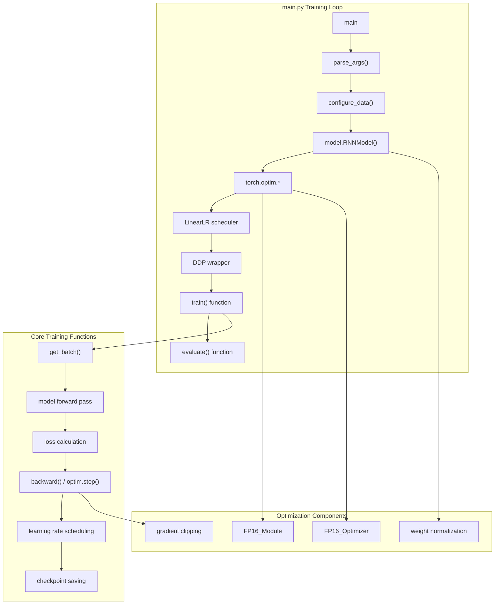
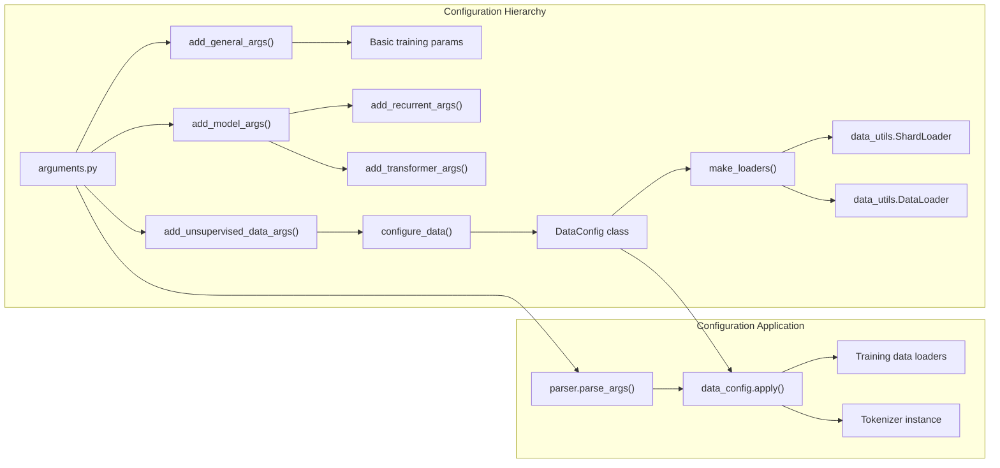
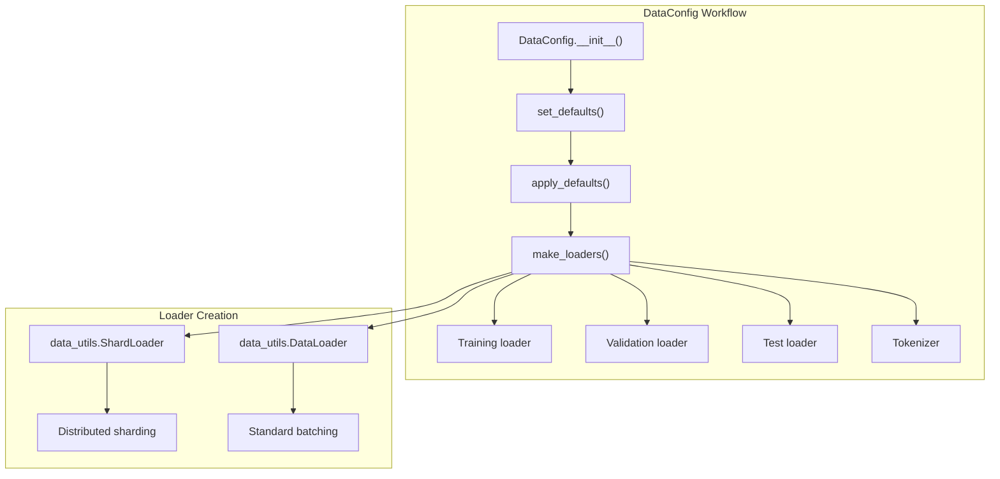
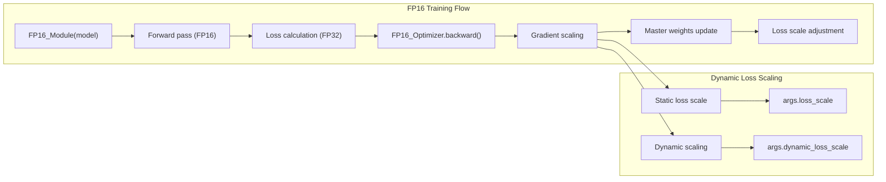
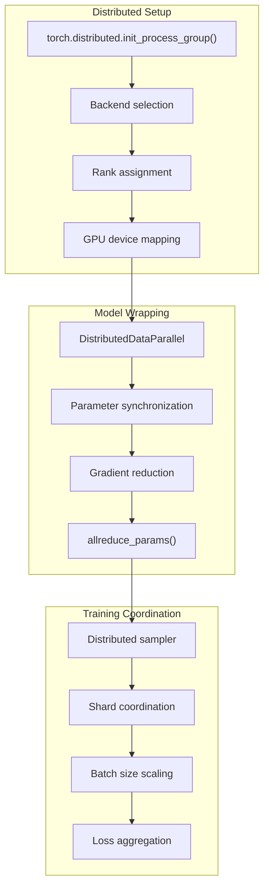
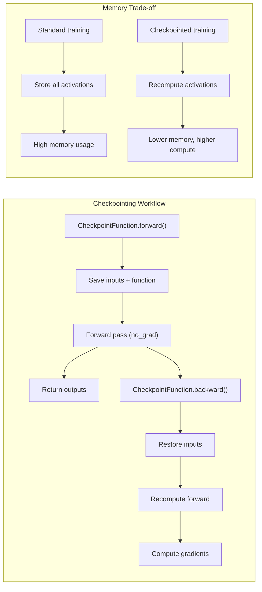
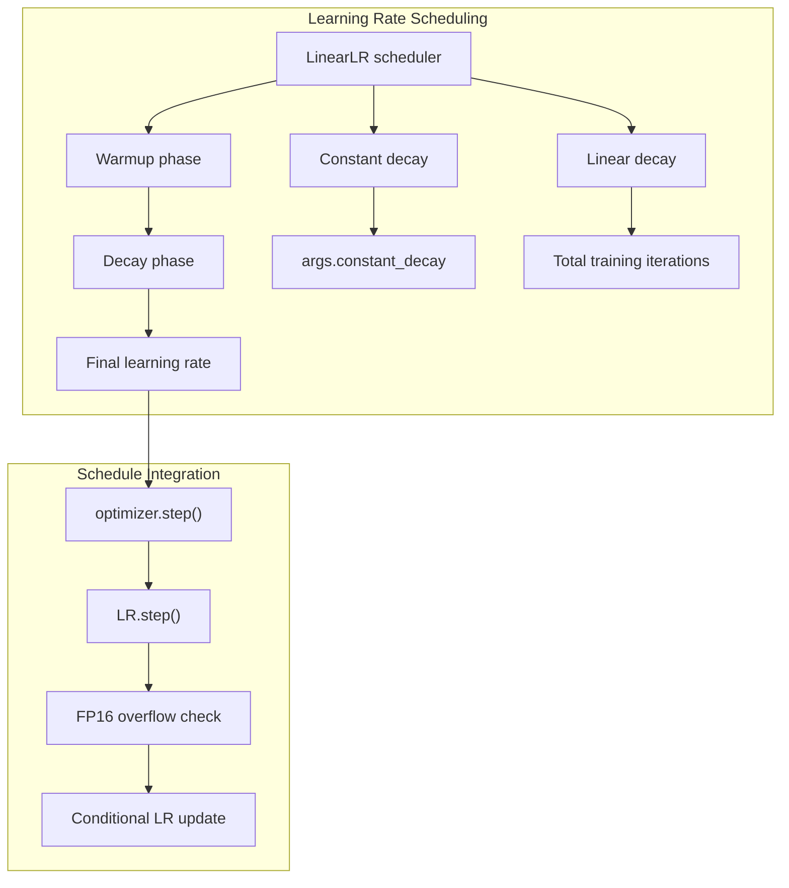
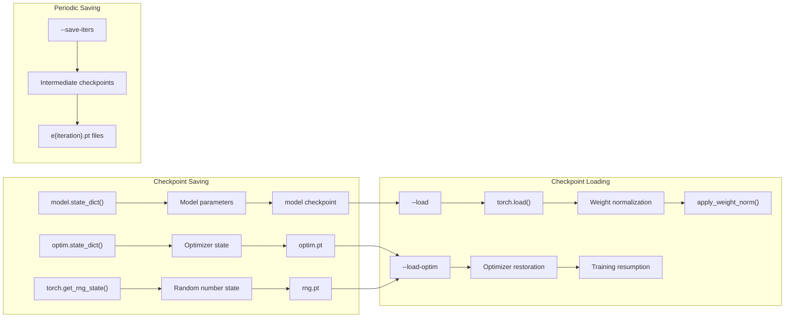

<!-- source: DeepWiki mcp.deepwiki.com · repo NVIDIA/sentiment-discovery · page 2.3 Training Infrastructure · fetched 2026-10-26 -->

# Training Infrastructure

Relevant source files

The following files were used as context for generating this wiki page:

- [arguments.py](arguments.py)
- [configure_data.py](configure_data.py)
- [data_utils/tokenization.py](data_utils/tokenization.py)
- [experiments/run_sk_imdb.sh](experiments/run_sk_imdb.sh)
- [experiments/run_sk_sst.sh](experiments/run_sk_sst.sh)
- [generate.py](generate.py)
- [logreg_utils.py](logreg_utils.py)
- [main.py](main.py)
- [model/checkpoint.py](model/checkpoint.py)

This document covers the training orchestration, configuration management, and optimization utilities that form the backbone of the sentiment discovery training system. The training infrastructure provides a flexible framework for distributed training, mixed precision optimization, and sophisticated learning rate scheduling.

For information about the neural network architectures themselves, see [Model Architectures](#2.2). For details about specific training workflows like pretraining and finetuning, see [Language Model Pretraining](#3.1) and [Classifier Finetuning](#3.3).

## Training Orchestration System

The primary training orchestration is handled by the `main.py` script, which provides a complete training loop with support for distributed training, mixed precision, and sophisticated optimization techniques.

**Training Loop Architecture**

The main training orchestration follows this pattern:

| Component | Function | Key Features |
|-----------|----------|--------------|
| `train()` | [main.py:267-370]() | Main training loop with logging, checkpointing |
| `evaluate()` | [main.py:245-265]() | Validation/test evaluation loop |
| `get_batch()` | [main.py:231-240]() | Batch preparation and GPU transfer |
| `init_hidden()` | [main.py:242-243]() | Hidden state initialization for RNNs |

**Sources:** [main.py:1-425](), [model/__init__.py]()

## Configuration Management System

The configuration system provides a hierarchical approach to managing training parameters, with specialized argument groups for different training scenarios.

**Configuration Components**

The configuration system is built around modular argument groups:

| Module | Purpose | Key Functions |
|--------|---------|---------------|
| `add_general_args()` | [arguments.py:11-60]() | Core training parameters (lr, epochs, distributed) |
| `add_model_args()` | [arguments.py:89-94]() | Model-specific configurations |
| `add_recurrent_args()` | [arguments.py:96-116]() | RNN/LSTM specific parameters |
| `add_transformer_args()` | [arguments.py:118-162]() | Transformer architecture parameters |
| `configure_data()` | [configure_data.py:121-180]() | Data loading and preprocessing setup |

**DataConfig System**

The `DataConfig` class provides a flexible system for managing data loading configurations:

**Sources:** [arguments.py:1-303](), [configure_data.py:1-181]()

## Optimization Utilities

The training infrastructure provides several optimization utilities for memory efficiency and training stability.

### Mixed Precision Training

Mixed precision training is supported through the `FP16_Module` and `FP16_Optimizer` classes:

The FP16 training workflow is controlled by these key parameters:

| Parameter | Location | Purpose |
|-----------|----------|---------|
| `--fp16` | [main.py:57-58]() | Enable mixed precision training |
| `--loss-scale` | [main.py:63-64]() | Static loss scaling factor |
| `--dynamic-loss-scale` | [main.py:59-60]() | Enable adaptive loss scaling |

**Sources:** [main.py:183-195](), [main.py:294-325]()

### Distributed Training

Distributed training support includes both data parallel and model parallel strategies:

Key distributed training parameters:

| Parameter | Purpose | Default |
|-----------|---------|---------|
| `--world-size` | [main.py:65-66]() | Number of distributed workers |
| `--distributed-backend` | [main.py:67-68]() | Communication backend (gloo/nccl) |
| `--rank` | [main.py:69-70]() | Worker rank identifier |

**Sources:** [main.py:108-116](), [main.py:211-212](), [main.py:299-302]()

### Gradient Checkpointing

Gradient checkpointing is available through the `checkpoint.py` module for memory-efficient training:

The checkpointing system provides two main functions:

| Function | Purpose | Use Case |
|----------|---------|----------|
| `checkpoint()` | [model/checkpoint.py:67-110]() | Checkpoint single function |
| `checkpoint_sequential()` | [model/checkpoint.py:113-167]() | Checkpoint sequential modules |

**Sources:** [model/checkpoint.py:1-167]()

## Learning Rate Scheduling

The training infrastructure supports sophisticated learning rate scheduling through the `LinearLR` scheduler:

Learning rate scheduling parameters:

| Parameter | Location | Purpose |
|-----------|----------|---------|
| `--lr` | [main.py:30-31]() | Initial learning rate |
| `--constant-decay` | [main.py:32-34]() | Fixed decay iterations |
| Learning rate warmup | [main.py:196-208]() | Gradual learning rate increase |

**Sources:** [main.py:196-208](), [main.py:316-325]()

## Model Persistence and Checkpointing

The training infrastructure provides comprehensive model checkpointing with support for optimizer state and training resumption:

**Checkpoint Management**

The checkpointing system handles several types of state:

| State Type | File Pattern | Purpose |
|------------|--------------|---------|
| Model weights | `{model_name}.pt` | Core model parameters |
| Optimizer state | `optim.pt` | Adam/SGD internal state |
| RNG state | `rng.pt` | Reproducible random generation |
| Intermediate saves | `e{iter}.pt` | Training progress snapshots |

Key checkpointing parameters:

| Parameter | Purpose | Default |
|-----------|---------|---------|
| `--save` | [main.py:47-48]() | Final model save path |
| `--load` | [main.py:49-50]() | Model checkpoint to load |
| `--save-iters` | [main.py:53-54]() | Periodic save interval |
| `--save-optim` | [main.py:55-56]() | Save optimizer state |

**Sources:** [main.py:165-178](), [main.py:340-355](), [main.py:401-416]()

---

