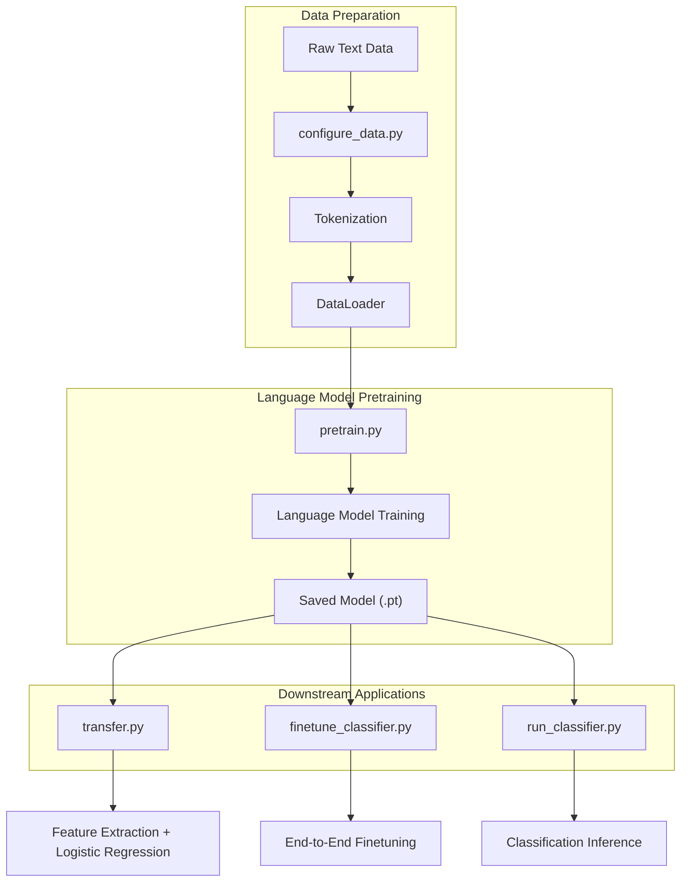
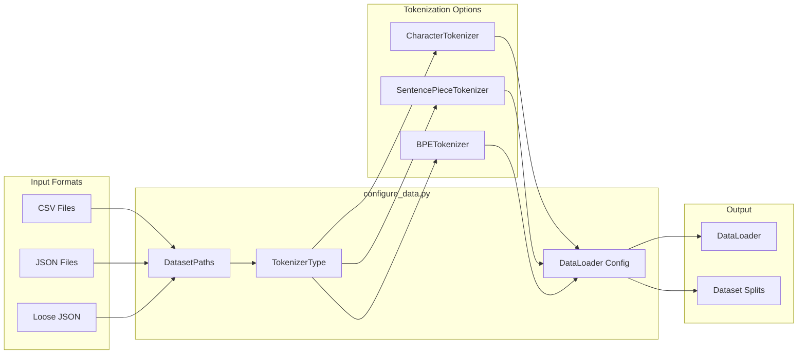
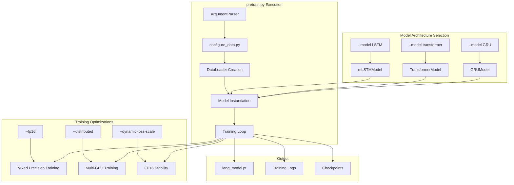
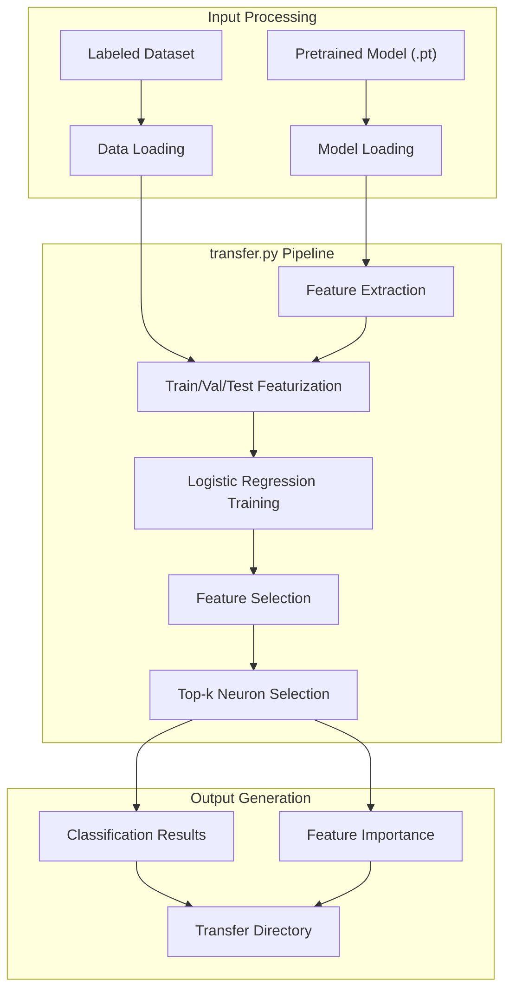
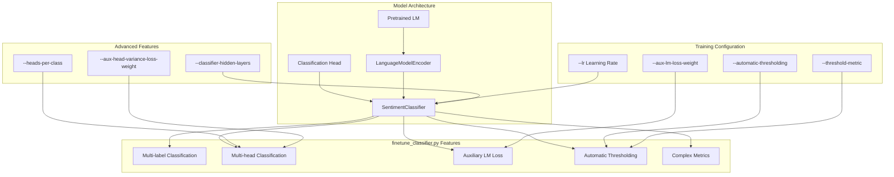
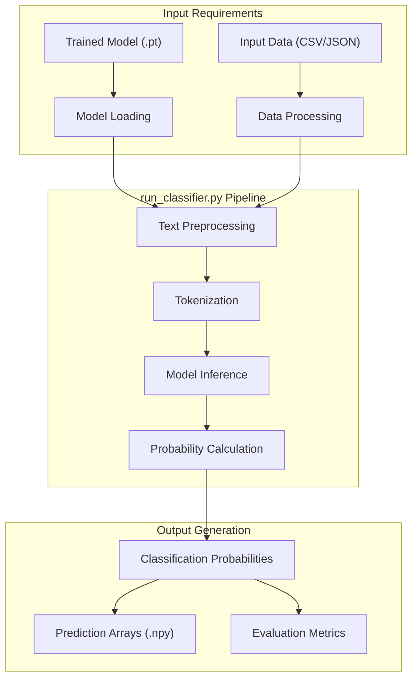
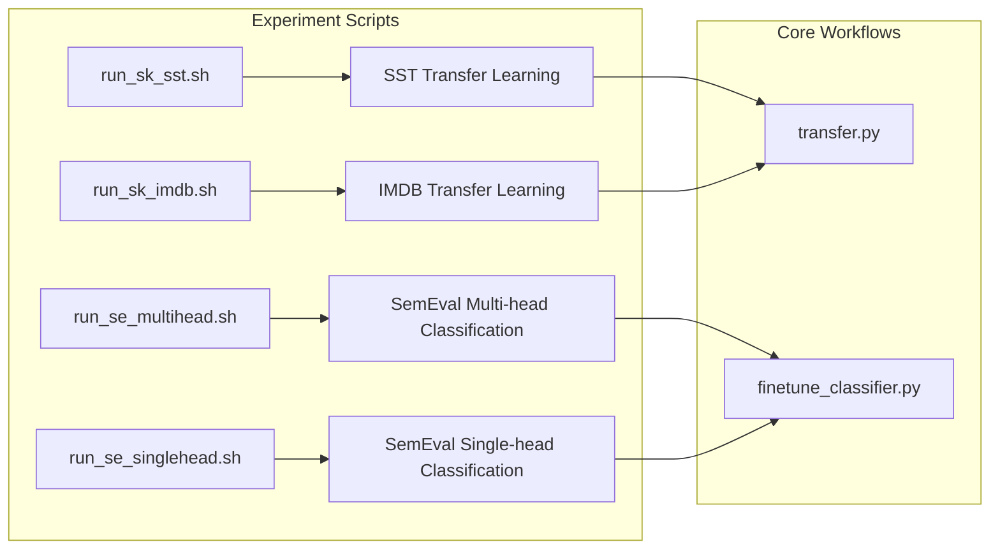

<!-- source: DeepWiki mcp.deepwiki.com · repo NVIDIA/sentiment-discovery · page 3 Usage Workflows · fetched 2026-10-26 -->

# Usage Workflows

<details>
<summary>Relevant source files</summary>

The following files were used as context for generating this wiki page:

- [README.md](README.md)
- [data/semeval/test.csv](data/semeval/test.csv)
- [data/semeval/train.csv](data/semeval/train.csv)
- [data/semeval/val.csv](data/semeval/val.csv)

</details>


This document provides detailed guides for the main usage workflows in the sentiment discovery system. It covers the complete pipeline from data preparation through model pretraining to downstream applications including transfer learning, classifier finetuning, and inference.

For information about the core system components and model architectures, see [Core Components](#2). For specific experimental configurations and benchmarks, see [Experiments and Benchmarks](#4).

## Workflow Overview

The sentiment discovery system follows a two-stage approach: unsupervised language model pretraining followed by supervised adaptation for downstream tasks. The system supports multiple pathways for applying pretrained models to classification tasks.



**Main Workflow Scripts**
| Script | Purpose | Input | Output |
|--------|---------|-------|--------|
| `pretrain.py` | Unsupervised language model training | Raw text data | Pretrained model (.pt) |
| `transfer.py` | Feature-based transfer learning | Pretrained model + labeled data | Sklearn classifier |
| `finetune_classifier.py` | End-to-end classifier finetuning | Pretrained model + labeled data | Finetuned classifier |
| `run_classifier.py` | Inference on new data | Trained classifier + test data | Predictions (.npy) |

Sources: [README.md:107-196](), [README.md:29-44]()

## Data Preparation Workflow

All workflows begin with data preparation using the `configure_data.py` system. The system supports multiple data formats and tokenization methods.



**Key Configuration Arguments**
- `--data`: Path to training data file
- `--text-key`: Column name for text data  
- `--label-key`: Column name for labels
- `--tokenizer-type`: CharacterTokenizer, SentencePieceTokenizer, or BPE
- `--vocab-size`: Vocabulary size for subword tokenization
- `--split`: Train/validation/test split ratios

Sources: [README.md:134-149]()

## Language Model Pretraining Pipeline

The pretraining workflow trains language models on large text corpora using `pretrain.py`. The system supports both recurrent (mLSTM) and transformer architectures with distributed training capabilities.



**Common Pretraining Commands**
```bash
# Basic mLSTM training
python3 pretrain.py --model LSTM --nhid 4096

# Transformer with SentencePiece tokenization  
python3 pretrain.py --model transformer --tokenizer-type SentencePieceTokenizer --vocab-size 32000

# Distributed FP16 training
python3 -m multiproc pretrain.py --fp16 --dynamic-loss-scale
```

Sources: [README.md:129-156](), [README.md:134-149]()

## Transfer Learning Workflow

The `transfer.py` script implements feature-based transfer learning by extracting representations from pretrained language models and training sklearn classifiers on top.



**Key Transfer Learning Parameters**
- `--load`: Path to pretrained model
- `--neurons`: Number of top neurons for feature selection (default: 1)
- `--data`, `--val`, `--test`: Dataset file paths
- `--fp16`: Use mixed precision for feature extraction

**Example Transfer Commands**
```bash
# Basic transfer to SST
python3 transfer.py --load mlstm.pt

# Multi-neuron transfer
python3 transfer.py --load mlstm.pt --neurons 5

# Custom dataset transfer
python3 transfer.py --load transformer.pt --data train.csv --val val.csv --test test.csv
```

Sources: [README.md:157-172]()

## Classifier Finetuning Workflow  

The `finetune_classifier.py` script performs end-to-end finetuning where gradients flow from the classification loss back into the language model encoder.



**Finetuning Command Examples**
```bash
# Basic finetuning with auxiliary LM loss
python3 finetune_classifier.py --load mlstm.pt --lr 2e-5 --aux-lm-loss --aux-lm-loss-weight 0.02

# Multi-head classification with automatic thresholding
python3 finetune_classifier.py --load transformer.pt --automatic-thresholding --threshold-metric f1 --heads-per-class 4

# Multi-layer classifier for custom dataset
python3 finetune_classifier.py --load mlstm.pt --data train.csv --val val.csv --test test.csv --classifier-hidden-layers 2048 1024 3
```

**Supported Metrics**
- F1-score
- Matthews Correlation Coefficient  
- Jaccard Index
- Recall, Precision, Accuracy

Sources: [README.md:173-196]()

## Inference and Evaluation Workflow

The `run_classifier.py` script performs classification inference on new data using trained models and saves probability outputs.



**Inference Command Examples**
```bash
# Basic classification on SST
python3 run_classifier.py --load ama_sst.pt

# FP16 inference
python3 run_classifier.py --load ama_sst_16.pt --fp16

# Custom dataset classification  
python3 run_classifier.py --load model.pt --text-key tweet_text --data custom_data.csv
```

**Key Arguments**
- `--load_model`: Path to trained classifier
- `--text-key`: Column name containing text to classify
- `--data`: Input data file path
- `--fp16`: Enable mixed precision inference

Sources: [README.md:116-128]()

## Multi-Dataset Training Scripts

The system includes shell scripts for reproducible experiments across multiple datasets:



**Available Experiment Scripts**
- `bash ./experiments/run_sk_sst.sh`: mLSTM transfer learning on SST
- `bash ./experiments/run_sk_imdb.sh`: mLSTM transfer learning on IMDB  
- `bash ./experiments/run_se_multihead.sh`: Multi-head transformer finetuning on SemEval
- `bash ./experiments/train_mlstm_singlenode.sh`: Single-node mLSTM pretraining
- `bash ./experiments/train_transformer_singlenode.sh`: Single-node transformer pretraining

Sources: [README.md:147-148](), [README.md:167-168](), [README.md:190]()

---

