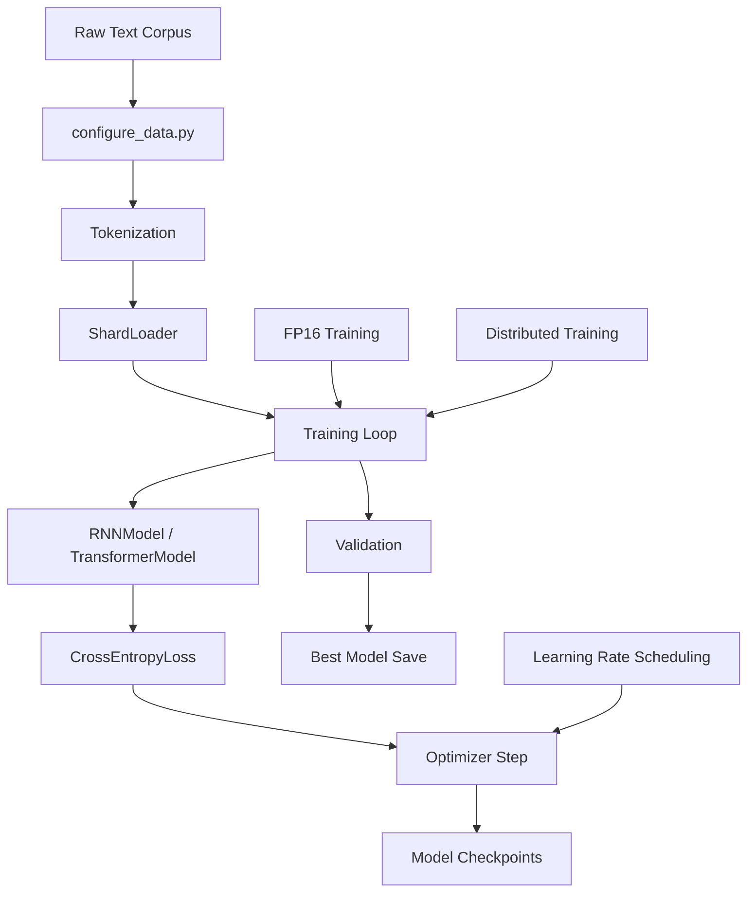
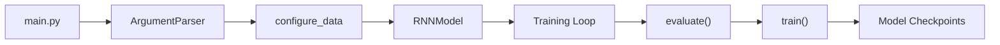
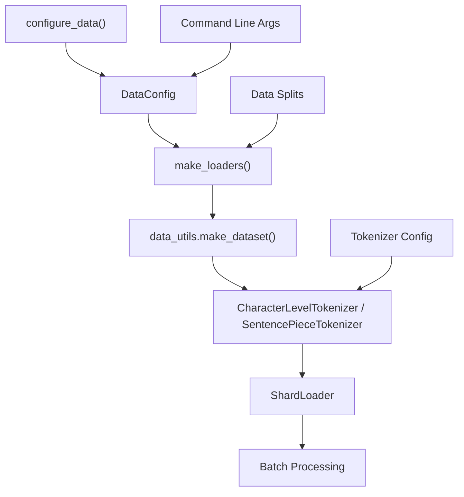
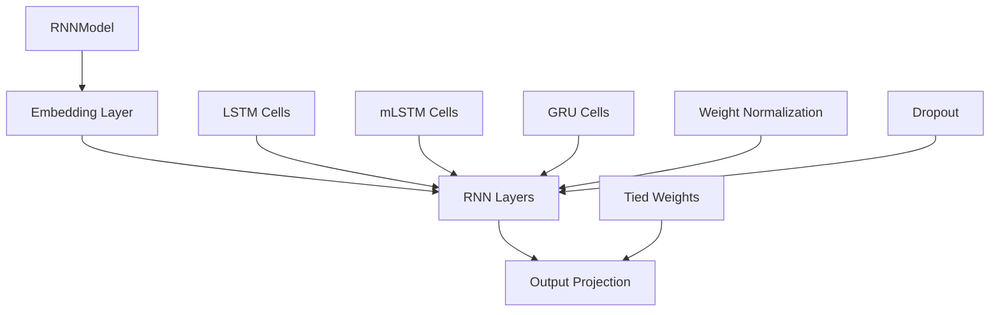
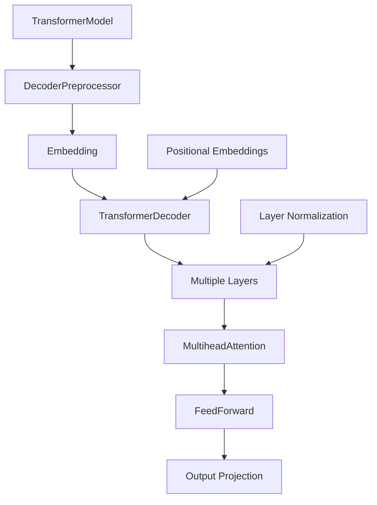
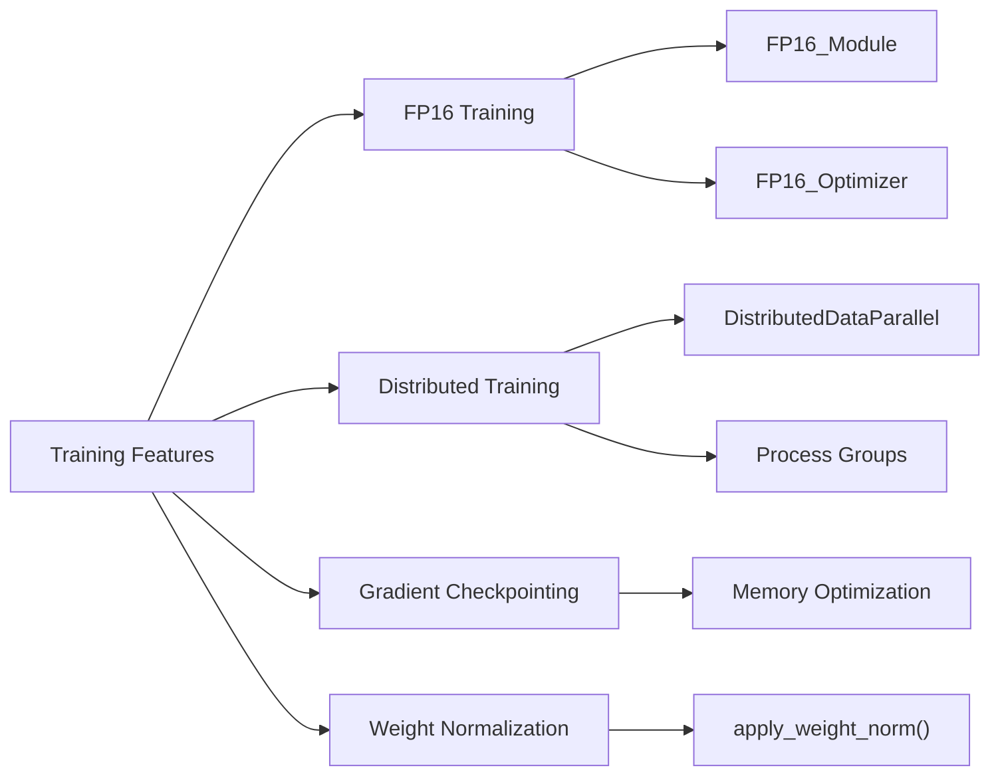
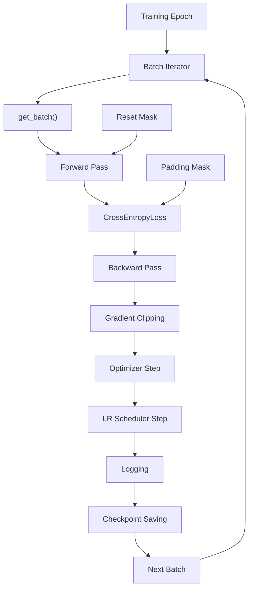
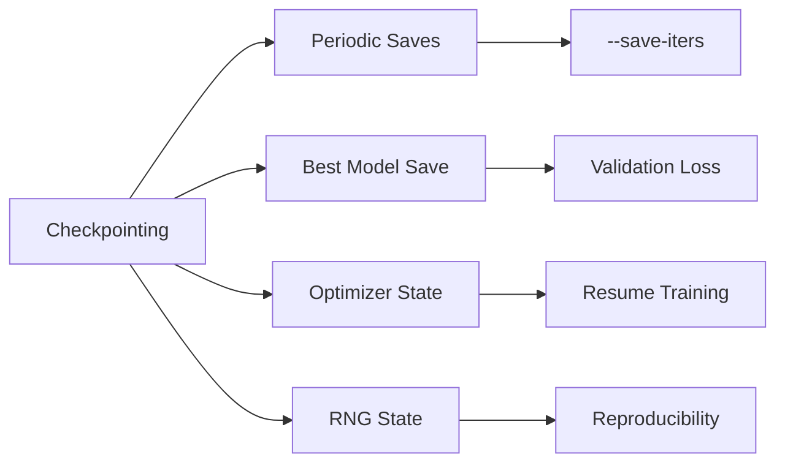

<!-- source: DeepWiki mcp.deepwiki.com · repo NVIDIA/sentiment-discovery · page 3.1 Language Model Pretraining · fetched 2026-10-26 -->

# Language Model Pretraining

<details>
<summary>Relevant source files</summary>

The following files were used as context for generating this wiki page:

- [configure_data.py](configure_data.py)
- [data_utils/tokenization.py](data_utils/tokenization.py)
- [finetune_classifier.py](finetune_classifier.py)
- [generate.py](generate.py)
- [main.py](main.py)
- [pretrain.py](pretrain.py)

</details>


This page covers the complete guide to unsupervised pretraining of language models in the sentiment-discovery repository. The pretraining phase trains neural language models on large unlabeled text corpora to learn general language representations that can later be adapted for downstream tasks.

For information about using pretrained models for downstream tasks, see [Transfer Learning](#3.2) and [Classifier Finetuning](#3.3). For running inference with trained models, see [Model Inference and Evaluation](#3.4).

## Overview

The pretraining system supports both RNN-based architectures (LSTM, mLSTM, GRU) and Transformer-based models. The training process uses next-token prediction as the objective, where models learn to predict the next character or subword token in a sequence.



**Pretraining Workflow Overview**

Sources: [main.py:1-425](), [pretrain.py:1-403](), [configure_data.py:1-181]()

## Entry Points

The system provides two main entry points for pretraining:

| Script | Purpose | Architecture Support |
|--------|---------|---------------------|
| `main.py` | Legacy pretraining script | RNN models (LSTM, mLSTM, GRU) |
| `pretrain.py` | Modern pretraining script | Both RNN and Transformer models |

### main.py

The original pretraining script focuses on RNN architectures with comprehensive argument parsing and training infrastructure:



**main.py Script Architecture**

Key components:
- `RNNModel` creation with configurable architecture [main.py:157]()
- `get_batch()` function for data processing [main.py:231-240]()
- `train()` function with distributed training support [main.py:267-369]()
- `evaluate()` function for validation [main.py:245-265]()

### pretrain.py

The modern pretraining script with enhanced support for Transformer models:


**pretrain.py Script Architecture**

Key features:
- `setup_model_and_optim()` function for model initialization [pretrain.py:27-109]()
- Support for both `TransformerModel` and `RNNModel` [pretrain.py:29-34]()
- Enhanced learning rate scheduling [pretrain.py:94-102]()

Sources: [main.py:21-103](), [pretrain.py:285-290]()

## Data Pipeline

The data pipeline handles tokenization, sharding, and batch preparation for efficient training on large corpora.

### Configuration System

The `configure_data()` function sets up the data processing pipeline:



**Data Configuration Pipeline**

Key configuration options:
- `--data-set-type='L2R'` for left-to-right language modeling [configure_data.py:42]()
- `--seq-length` for maximum sequence length [main.py:83-84]()
- `--num-shards` for dataset sharding [main.py:91-93]()

### Tokenization

Two tokenizer types are supported:

| Tokenizer | Class | Use Case |
|-----------|-------|----------|
| Character-level | `CharacterLevelTokenizer` | Simple character-based tokenization |
| SentencePiece | `SentencePieceTokenizer` | Subword tokenization with configurable vocab |

The tokenizers handle command tokens and provide encoding/decoding functionality [data_utils/tokenization.py:122-275]().

### Batch Processing

The `get_batch()` function processes data for training:

- Separates input text and target sequences [main.py:237-238]()
- Handles reset masks for RNN hidden state management [main.py:239]()
- Supports padding masks for variable-length sequences [pretrain.py:137]()

Sources: [configure_data.py:6-120](), [data_utils/tokenization.py:7-275](), [main.py:231-240]()

## Model Architectures

### RNN Models

The `RNNModel` class supports multiple RNN architectures:



**RNN Model Architecture**

Configuration parameters:
- `--model`: Architecture type (LSTM, mLSTM, GRU) [main.py:22-23]()
- `--emsize`: Embedding dimension [main.py:24-25]()
- `--nhid`: Hidden state dimension [main.py:26-27]()
- `--nlayers`: Number of layers [main.py:28-29]()

### Transformer Models

The `TransformerModel` supports decoder-only architectures:



**Transformer Model Architecture**

Key components:
- `DecoderPreprocessor` for input processing [pretrain.py:31]()
- `TransformerDecoder` with configurable layers [pretrain.py:32]()
- Support for learned positional embeddings

Sources: [main.py:157](), [pretrain.py:29-36]()

## Training Configuration

### Optimization

The training system supports multiple optimizers and learning rate schedules:

| Component | Options | Configuration |
|-----------|---------|---------------|
| Optimizer | Adam, SGD | `--optim` parameter |
| LR Schedule | Linear, Cosine, STLR | `--decay-style`, `--stlr-cut-frac` |
| Warmup | Linear warmup | `--warmup` parameter |

### Advanced Features



**Advanced Training Features**

Key capabilities:
- **FP16 Training**: Mixed precision with dynamic loss scaling [main.py:57-65]()
- **Distributed Training**: Multi-GPU support with gradient synchronization [main.py:112-115]()
- **Gradient Clipping**: Prevents exploding gradients [main.py:305-309]()

Sources: [main.py:57-77](), [pretrain.py:69-76](), [main.py:299-314]()

## Training Process

The training loop implements the standard language modeling objective:

### Training Loop



**Training Loop Flow**

Key training steps:
1. **Batch Processing**: Convert text to input/target pairs [main.py:287-288]()
2. **Forward Pass**: Model prediction with hidden state management [main.py:290]()
3. **Loss Calculation**: Cross-entropy loss with padding mask [pretrain.py:196-199]()
4. **Backpropagation**: Gradient computation and clipping [main.py:296-309]()
5. **Parameter Updates**: Optimizer step and learning rate scheduling [main.py:314-325]()

### Evaluation

The `evaluate()` function computes validation perplexity:

- Disables dropout for evaluation [main.py:247]()
- Processes validation batches without gradient computation [main.py:251-264]()
- Computes average loss and perplexity [main.py:265]()

Sources: [main.py:267-369](), [pretrain.py:170-282](), [main.py:245-265]()

## Checkpointing and Model Saving

### Checkpoint Management

The system provides comprehensive checkpointing capabilities:



**Checkpoint Management System**

Key features:
- **Periodic Checkpoints**: Save model every N iterations [main.py:340-355]()
- **Best Model Tracking**: Save model with lowest validation loss [main.py:401-403]()
- **Optimizer State**: Support for training resumption [main.py:51-52]()
- **RNG State**: Ensures reproducible training [main.py:352-353]()

### Model Loading

Loading pretrained models supports:
- State dictionary loading with error handling [main.py:172-177]()
- Weight normalization compatibility [main.py:175-177]()
- Optimizer state restoration [main.py:192-194]()

### Directory Structure

Checkpoints are organized as:
```
model_name/
├── e1000.pt      # Periodic checkpoint
├── e2000.pt      # Periodic checkpoint  
├── optim.pt      # Optimizer state
└── rng.pt        # RNG state
```

Sources: [main.py:340-355](), [main.py:375-417](), [pretrain.py:252-267]()

---

