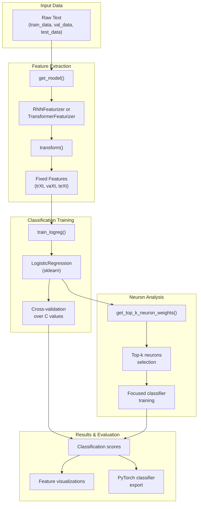
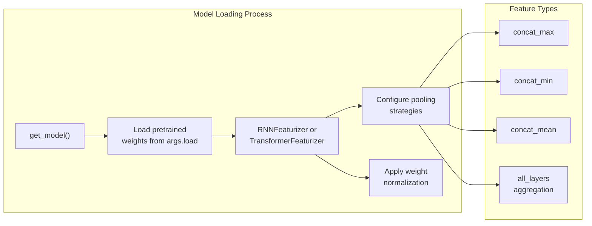
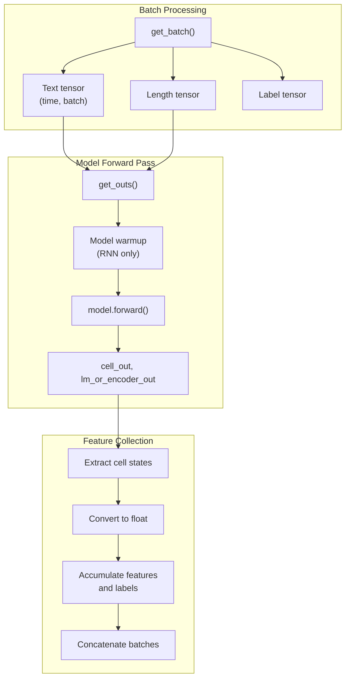
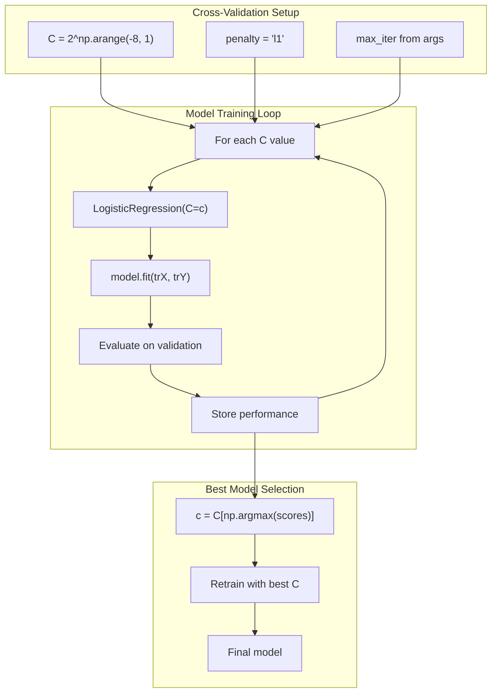
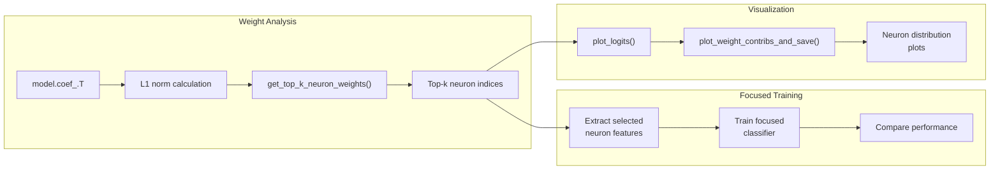
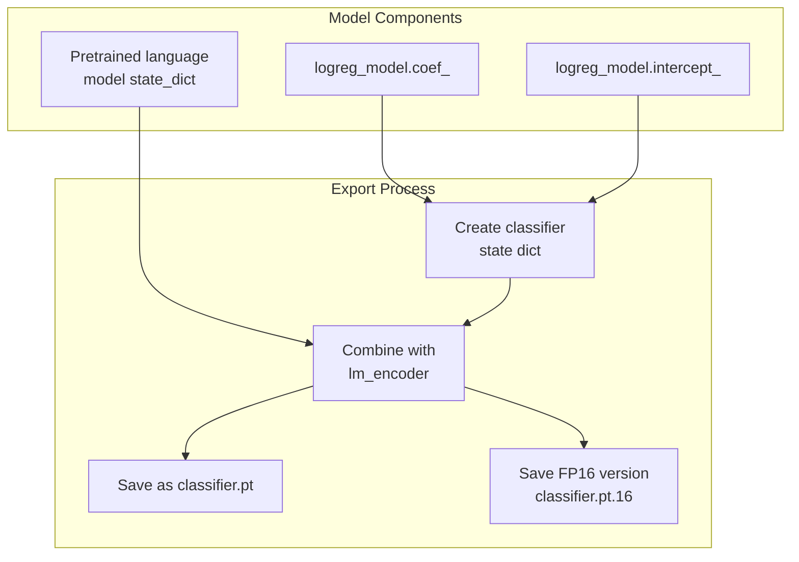

<!-- source: DeepWiki mcp.deepwiki.com · repo NVIDIA/sentiment-discovery · page 3.2 Transfer Learning · fetched 2026-10-26 -->

# Transfer Learning

<details>
<summary>Relevant source files</summary>

The following files were used as context for generating this wiki page:

- [experiments/run_sk_imdb.sh](experiments/run_sk_imdb.sh)
- [experiments/run_sk_sst.sh](experiments/run_sk_sst.sh)
- [logreg_utils.py](logreg_utils.py)
- [model/checkpoint.py](model/checkpoint.py)
- [transfer.py](transfer.py)

</details>


This document covers the feature extraction and transfer learning workflow using pretrained language models. The transfer learning approach extracts fixed features from pretrained models and trains lightweight classifiers on top of them, providing a computationally efficient alternative to end-to-end finetuning.

For information about unsupervised pretraining of language models, see [Language Model Pretraining](#3.1). For end-to-end finetuning approaches, see [Classifier Finetuning](#3.3). For model inference and evaluation workflows, see [Model Inference and Evaluation](#3.4).

## Overview

Transfer learning in this codebase follows a two-stage approach: first extract features from pretrained language models, then train logistic regression classifiers on these features. This approach is implemented primarily in `transfer.py` and provides several advantages:

- **Computational efficiency**: Feature extraction is done once, then multiple classifiers can be trained quickly
- **Interpretability**: Neuron-level analysis reveals which model components are most important for sentiment
- **Flexibility**: Different classification heads can be tested without recomputing features

## Transfer Learning Workflow

The complete transfer learning pipeline processes text through pretrained language models to extract meaningful representations, then trains classifiers on these features.



**Transfer Learning Pipeline Flow**: The workflow starts with raw text data, extracts features using pretrained models, trains logistic regression classifiers, and analyzes the most important neurons for sentiment classification.

Sources: [transfer.py:27-46](), [transfer.py:231-243]()

## Feature Extraction Process

The `transform()` function extracts features from pretrained language models by processing text batches and collecting the final hidden states or cell states from the models.

### Model Loading and Configuration

The `get_model()` function loads pretrained language models and configures them for feature extraction:

| Model Type | Featurizer Class | Key Configuration |
|------------|------------------|-------------------|
| RNN-based | `RNNFeaturizer` | `all_layers`, `concat_pools`, `residuals` |
| Transformer | `TransformerFeaturizer` | `get_hidden` parameter |



**Model Configuration for Feature Extraction**: The system supports different pooling strategies and layer aggregation methods to create rich feature representations.

Sources: [transfer.py:48-81](), [model.py:RNNFeaturizer](), [model.py:TransformerFeaturizer]()

### Batch Processing and Feature Extraction

The `transform()` function processes text data in batches to extract features efficiently:



**Feature Extraction Process**: Text batches are processed through the pretrained model to extract final hidden states, which are accumulated across all batches.

Sources: [transfer.py:83-145](), [transfer.py:95-108](), [transfer.py:110-117]()

## Logistic Regression Training

The extracted features are used to train logistic regression classifiers through the `train_logreg()` function, which performs cross-validation to find optimal regularization parameters.

### Cross-Validation Process

| Parameter | Purpose | Range |
|-----------|---------|--------|
| `C` | Regularization strength | `2^(-8)` to `2^0` |
| `penalty` | Regularization type | `l1` (default) |
| `max_iter` | Training iterations | User-specified |

The training process handles both binary and multi-class classification scenarios:



**Cross-Validation for Regularization**: The system tests multiple regularization strengths to find the optimal balance between model complexity and generalization.

Sources: [logreg_utils.py:20-86](), [logreg_utils.py:44-56]()

## Neuron Analysis and Interpretability

The transfer learning workflow includes detailed analysis of which neurons (features) are most important for sentiment classification through the `get_top_k_neuron_weights()` function.

### Top-K Neuron Selection

The system identifies the most important neurons based on L1 norm of logistic regression weights:

```python
# Key algorithm from get_top_k_neuron_weights()
weights = model.coef_.T
weight_penalties = np.linalg.norm(weights, ord=1, axis=1)
k_indices = np.argmax(weight_penalties)  # for k=1
```

### Neuron Analysis Workflow



**Neuron Analysis Pipeline**: The system identifies important neurons, trains focused classifiers, and generates visualizations to understand model behavior.

Sources: [transfer.py:158-180](), [transfer.py:310-340](), [transfer.py:182-224]()

## Results Storage and Export

The transfer learning process generates comprehensive results including trained models, performance metrics, and visualizations.

### Output Files Structure

| File Type | Purpose | Format |
|-----------|---------|--------|
| `*Xt.npy`, `*Y.npy` | Cached features and labels | NumPy arrays |
| `*_score.txt` | Performance metrics | Text files |
| `*_probs.pkl` | Prediction probabilities | Pickle files |
| `classifier.pt` | PyTorch model export | PyTorch state dict |
| `logit_vis/` | Neuron visualizations | PNG images |

### PyTorch Model Export

The system exports trained classifiers as PyTorch models for inference:



**Model Export Structure**: The exported PyTorch model contains both the feature extractor and the trained classifier for end-to-end inference.

Sources: [transfer.py:294-308](), [transfer.py:235-242]()

## Usage Examples

### Basic Transfer Learning

The most common usage pattern loads a pretrained model and applies it to a sentiment classification dataset:

```bash
# SST dataset transfer learning
python3 transfer.py --load mlstm.pt --save-results sst

# IMDB dataset with custom configuration  
python3 transfer.py --load mlstm.pt --save-results imdb \
    --data ./data/imdb/train.json --test ./data/imdb/test.json \
    --split .8 --batch-size 64 --fp16
```

### Command Line Arguments

Key arguments for transfer learning configuration:

| Argument | Purpose | Default |
|----------|---------|---------|
| `--load` | Pretrained model path | Required |
| `--save-results` | Output directory name | Required |
| `--neurons` | Number of top neurons to analyze | 1 |
| `--use-cached` | Use cached features if available | False |
| `--fp16` | Use half precision | False |

Sources: [experiments/run_sk_sst.sh:1-3](), [experiments/run_sk_imdb.sh:1-3](), [transfer.py:25-46]()

---

