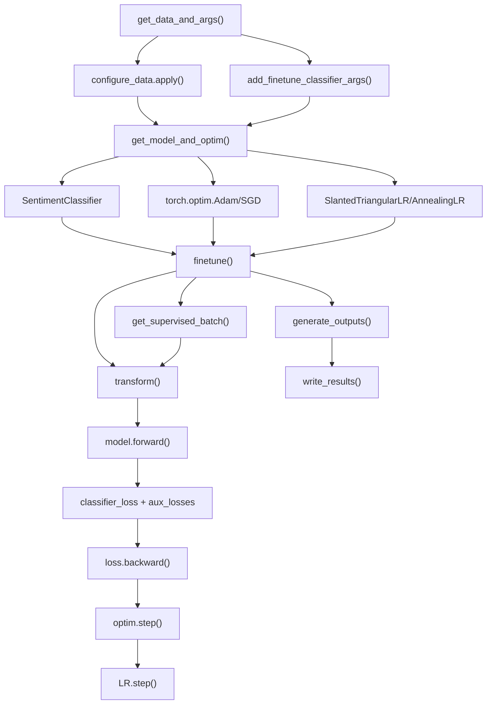
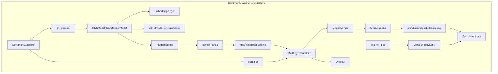
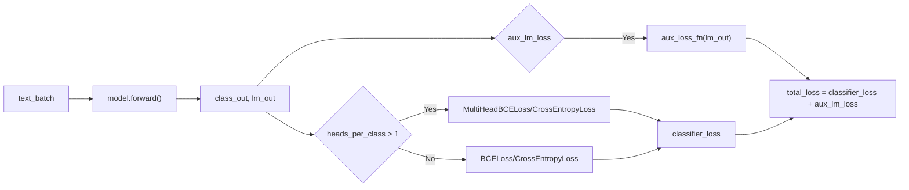
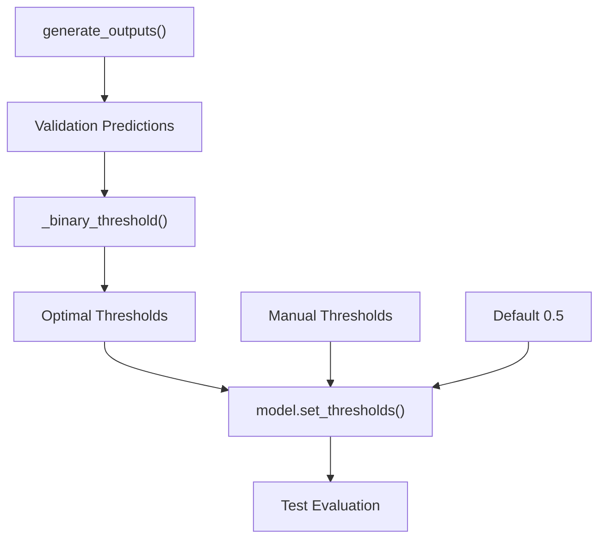
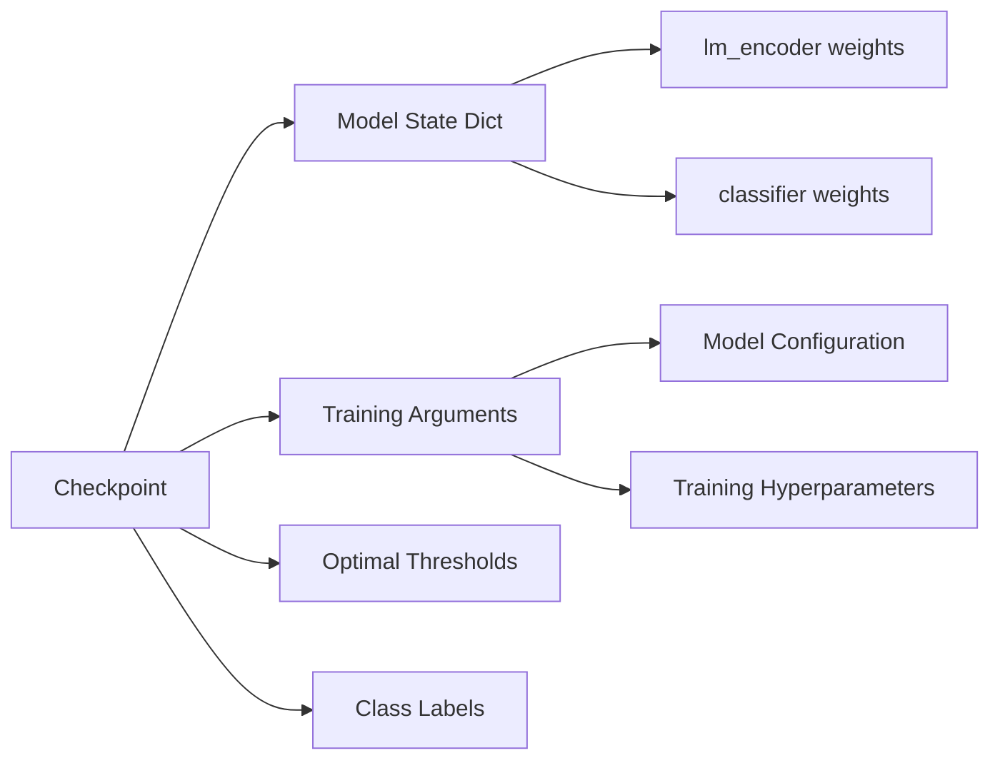
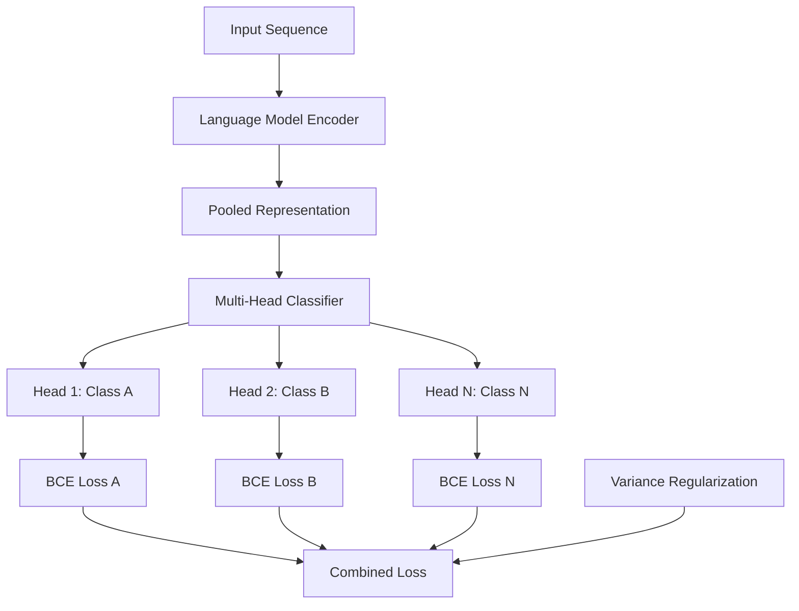

<!-- source: DeepWiki mcp.deepwiki.com · repo NVIDIA/sentiment-discovery · page 3.3 Classifier Finetuning · fetched 2026-10-26 -->

# Classifier Finetuning

Relevant source files

The following files were used as context for generating this wiki page:

- [finetune_classifier.py](finetune_classifier.py)
- [pretrain.py](pretrain.py)
- [run_classifier.py](run_classifier.py)

This document covers end-to-end finetuning of classification models for downstream tasks, where both the pretrained language model encoder and the classification head are jointly trained on labeled data. For feature extraction using frozen pretrained models, see [Transfer Learning](#3.2). For model inference and evaluation, see [Model Inference and Evaluation](#3.4).

## Overview

Classifier finetuning adapts pretrained language models to specific classification tasks by continuing training on task-specific labeled data. Unlike transfer learning which freezes the language model and only trains a classifier head, finetuning updates all model parameters to achieve better task-specific performance.

The process loads a pretrained language model, adds a classification head, and trains the complete model end-to-end using supervised learning objectives. The system supports both binary and multi-class classification, with options for multi-head architectures and auxiliary losses.

## Finetuning Workflow

**Classifier Finetuning Workflow**

The finetuning process follows a supervised training loop with data loading, model forward passes, loss computation, and parameter updates.

Sources: [finetune_classifier.py:30-48](), [finetune_classifier.py:50-127](), [finetune_classifier.py:181-346]()

## Model Architecture

**SentimentClassifier Model Architecture**

The `SentimentClassifier` combines a pretrained language model encoder with a classification head. The encoder processes input sequences and the classifier head maps pooled representations to class predictions.

Sources: [model.py](), [finetune_classifier.py:55-61]()

## Training Process

### Batch Processing

The `get_supervised_batch()` function processes training batches for supervised learning:

| Component | Description | Code Reference |
|-----------|-------------|----------------|
| Text Tokenization | Converts text to token IDs | [finetune_classifier.py:134-137]() |
| Sequence Length Clipping | Limits sequences to `max_seq_len` | [finetune_classifier.py:140-142]() |
| Label Processing | Handles binary/multi-class labels | [finetune_classifier.py:143-147]() |
| CUDA Transfer | Moves tensors to GPU | [finetune_classifier.py:148-150]() |

### Forward Pass and Loss Computation

The `transform()` function handles model forward passes with different training modes:

**Loss Computation Flow**

Multiple loss components can be combined during training, including primary classification loss and auxiliary language modeling loss.

Sources: [finetune_classifier.py:152-179](), [finetune_classifier.py:268-289]()

### Learning Rate Scheduling

The system supports multiple learning rate schedules:

| Schedule Type | Implementation | Use Case |
|---------------|----------------|----------|
| Slanted Triangular | `SlantedTriangularLR` | ULMFiT-style training |
| Cosine Annealing | `AnnealingLR` with cosine decay | Smooth decay |
| Linear Warmup | `AnnealingLR` with linear warmup | Stable initialization |
| Constant | `ConstantLR` | Fixed learning rate |

Sources: [finetune_classifier.py:101-126]()

## Configuration and Arguments

### Key Training Arguments

| Argument | Purpose | Default/Options |
|----------|---------|-----------------|
| `--epochs` | Number of training epochs | Required |
| `--lr` | Learning rate | Required |
| `--optim` | Optimizer choice | `adam`, `sgd` |
| `--batch_size` | Training batch size | Required |
| `--freeze_lm` | Freeze language model parameters | `False` |
| `--use_logreg` | Use logistic regression instead of neural classifier | `False` |

### Loss Configuration

| Argument | Purpose | Impact |
|----------|---------|--------|
| `--aux_lm_loss` | Enable auxiliary language modeling loss | Maintains language modeling capability |
| `--aux_lm_loss_weight` | Weight for auxiliary LM loss | Controls balance between objectives |
| `--aux_head_variance_loss_weight` | Regularization for multi-head variance | Reduces head disagreement |

Sources: [arguments.py](), [finetune_classifier.py:215-218]()

## Evaluation and Metrics

### Threshold Selection

The system supports automatic threshold selection for optimal classification performance:

**Threshold Selection Process**

Thresholds can be automatically optimized on validation data or manually specified.

### Supported Metrics

| Metric | Code Symbol | Usage |
|--------|-------------|-------|
| F1-Score | `f1` | Primary metric for imbalanced data |
| Jaccard Index | `jacc` | Intersection over union |
| Matthews Correlation | `mcc` | Balanced metric for binary classification |
| Accuracy | `acc` | Simple accuracy |
| Precision/Recall | `precision`/`recall` | Component metrics |

Sources: [finetune_classifier.py:356-367](), [metric_utils.py]()

## Model Saving and Loading

### Checkpoint Structure

The system saves comprehensive checkpoints including:

**Checkpoint Components**

Saved models include all necessary information for reproduction and inference.

### Loading Pretrained Models

The system supports loading from different checkpoint types:

| Load Type | Flag | Behavior |
|-----------|------|----------|
| Pretrained LM | `--load` without `--load_finetuned` | Loads only language model encoder |
| Finetuned Model | `--load` with `--load_finetuned` | Loads complete finetuned model |
| Weight Normalized | Automatic detection | Handles weight normalization compatibility |

Sources: [finetune_classifier.py:67-87](), [finetune_classifier.py:604-632]()

## Multi-Head Classification

For multi-label classification tasks, the system supports multi-head architectures:

**Multi-Head Classification Architecture**

Multiple classification heads enable independent prediction for different classes or labels.

Sources: [finetune_classifier.py:206-214](), [finetune_classifier.py:271-275]()

---

