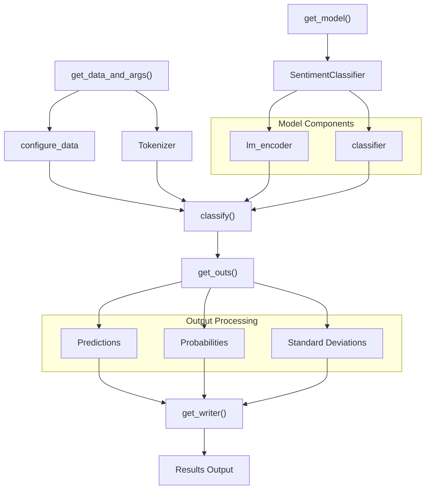
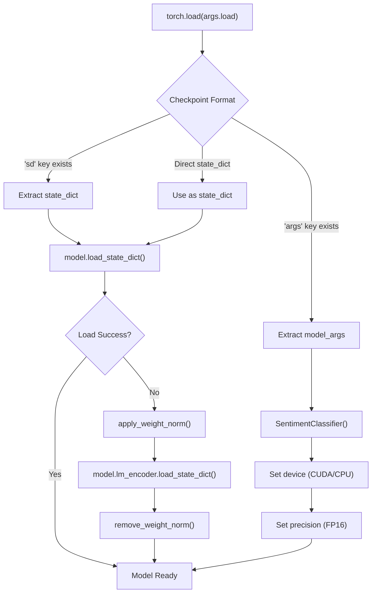
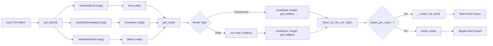
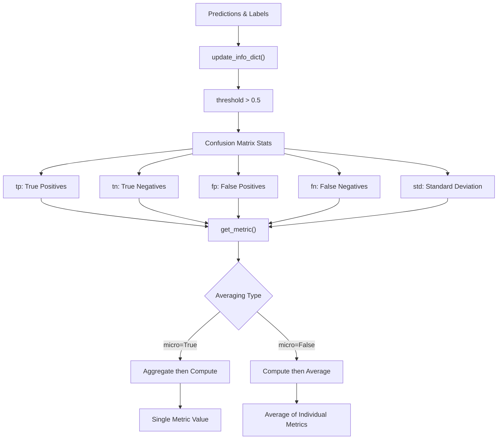
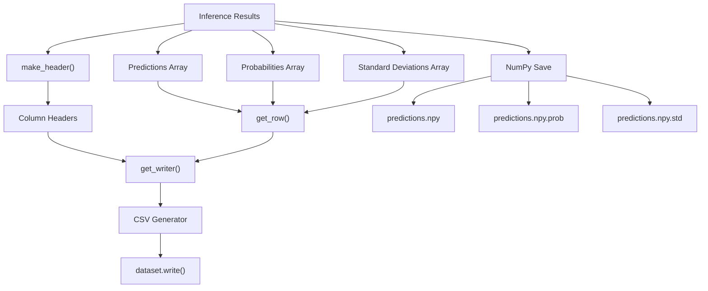

<!-- source: DeepWiki mcp.deepwiki.com · repo NVIDIA/sentiment-discovery · page 3.4 Model Inference and Evaluation · fetched 2026-10-26 -->

# Model Inference and Evaluation

<details>
<summary>Relevant source files</summary>

The following files were used as context for generating this wiki page:

- [metric_utils.py](metric_utils.py)
- [run_classifier.py](run_classifier.py)

</details>


This document covers how to run trained models for inference on new data and evaluate their performance using the sentiment discovery framework. This includes loading pretrained models, processing input data, generating predictions with confidence estimates, and computing comprehensive evaluation metrics.

For information about training models from scratch, see [Language Model Pretraining](#3.1). For feature extraction workflows, see [Transfer Learning](#3.2). For end-to-end model training, see [Classifier Finetuning](#3.3).

## Inference Workflow Overview

The inference system processes text data through trained sentiment classifiers to generate predictions, probability estimates, and uncertainty measures. The workflow integrates model loading, data preprocessing, batch inference, and result formatting.

**Inference Pipeline Architecture**


Sources: [run_classifier.py:22-41](), [run_classifier.py:43-95](), [run_classifier.py:98-184]()

## Model Loading and Configuration

The inference system loads pretrained models with their original training configurations while allowing runtime parameter overrides. Model loading handles both standard PyTorch checkpoints and weight-normalized parameters.

### Model Loading Process

**Model Loading Workflow**


The `get_model()` function handles model instantiation and checkpoint loading:

| Parameter | Purpose | Default |
|-----------|---------|---------|
| `args.load` | Path to model checkpoint | Required |
| `args.model` | Model architecture type | `'transformer'` or RNN |
| `args.fp16` | Enable half-precision inference | `False` |
| `args.neurons` | Limit active neurons (debugging) | `0` (disabled) |

Sources: [run_classifier.py:43-95]()

### Configuration Parameter Inheritance

The system preserves training-time hyperparameters while allowing inference-specific overrides:

```python
# Core model parameters inherited from checkpoint
model_args.data_size          # Vocabulary size
model_args.classifier_hidden_layers  # Classifier architecture
model_args.heads_per_class    # Multi-head classification setup
model_args.use_softmax        # Output probability format
model_args.classes            # Target class labels
```

Sources: [run_classifier.py:54-72]()

## Inference Execution

The `classify()` function processes batches of text data through the loaded model to generate predictions with uncertainty estimates. The system supports both single-head and multi-head classification outputs.

### Batch Processing Pipeline

**Inference Data Flow**


### Output Processing

The inference system generates three types of outputs:

| Output Type | Description | Shape |
|-------------|-------------|-------|
| `labels` | Predicted class labels | `(n_samples, n_classes)` |
| `label_probs` | Class probabilities | `(n_samples, n_classes)` |
| `stds` | Prediction uncertainties | `(n_samples, n_classes)` |

For multi-head models (`heads_per_class > 1`), the system computes uncertainty estimates across multiple prediction heads. Single-head models return zero standard deviations.

Sources: [run_classifier.py:98-184]()

### Performance Monitoring

The inference loop tracks processing statistics:

```python
# Timing metrics
s_per_batch = total_time / (i+1)           # Seconds per batch
timeleft = (len_ds - (i+1)) * s_per_batch  # Estimated time remaining
ch_per_s = float(num_char) / elapsed_time  # Characters per second
```

Sources: [run_classifier.py:171-173]()

## Evaluation Metrics

The `metric_utils` module provides comprehensive evaluation capabilities for binary and multi-class classification tasks. Metrics support both micro and macro averaging across classes.

### Metric Computation System

**Metric Calculation Pipeline**


### Available Metrics

The system supports standard classification metrics:

| Metric | Function | Formula |
|--------|----------|---------|
| Accuracy | `get_accuracy()` | `(tp + tn) / (tp + tn + fp + fn)` |
| Precision | `get_precision()` | `tp / (tp + fp)` |
| Recall | `get_recall()` | `tp / (tp + fn)` |
| F1 Score | `get_f1()` | `2 * tp / (2 * tp + fp + fn)` |
| Jaccard Index | `get_jaccard_index()` | `tp / (tp + fp + fn)` |
| Matthews Correlation | `get_mcc()` | `(tp*tn - fp*fn) / sqrt((tp+fp)(tp+fn)(tn+fp)(tn+fn))` |
| Variance | `get_variance()` | `std / total` |

### Micro vs Macro Averaging

The evaluation system supports two averaging strategies:

- **Micro averaging**: Aggregates confusion matrix statistics across all classes, then computes metrics
- **Macro averaging**: Computes metrics for each class individually, then averages the results

Sources: [metric_utils.py:1-94]()

## Result Output and Formatting

The inference system provides flexible output formatting for predictions, probabilities, and uncertainty estimates. Results can be saved as NumPy arrays or formatted CSV files.

### Output Generation Pipeline

**Result Formatting Workflow**


### Header Generation

The `make_header()` function creates column names based on model configuration:

| Configuration | Header Format | Example |
|---------------|---------------|---------|
| Single-head binary | `[class + ' pred', class + ' prob']` | `['positive pred', 'positive prob']` |
| Multi-head binary | `[class + ' pred', class + ' prob', class + ' std']` | `['positive pred', 'positive prob', 'positive std']` |
| Softmax output | `['prediction', class + ' prob']` | `['prediction', 'positive prob']` |
| Dual threshold | Additional `['neutral pred', 'neutral prob']` | For neutral class handling |

Sources: [run_classifier.py:186-214](), [run_classifier.py:216-221]()

## Command-Line Usage

The `run_classifier.py` script provides the primary interface for model inference. Key command-line arguments control model loading, data processing, and output formatting.

### Essential Arguments

| Argument | Purpose | Example |
|----------|---------|---------|
| `--load` | Path to trained model checkpoint | `--load models/classifier.pt` |
| `--data` | Input data file or directory | `--data test_data.csv` |
| `--save-probs` | Base path for NumPy output files | `--save-probs results/predictions` |
| `--write-results` | Path for formatted CSV output | `--write-results results/predictions.csv` |
| `--batch-size` | Inference batch size | `--batch-size 32` |
| `--max-seq-len` | Maximum sequence length | `--max-seq-len 512` |

### Usage Example

```bash
python run_classifier.py \
    --load checkpoints/sentiment_model.pt \
    --data datasets/test_reviews.csv \
    --save-probs results/test_predictions \
    --write-results results/test_results.csv \
    --batch-size 64 \
    --fp16
```

This command loads a trained sentiment classifier, processes test data, and saves both NumPy arrays and formatted CSV results.

Sources: [run_classifier.py:222-244]()

---

