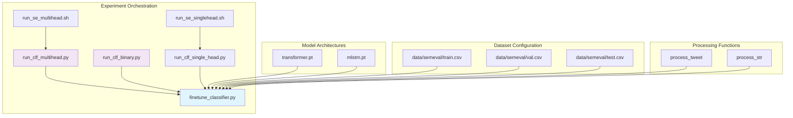
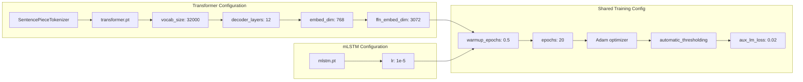
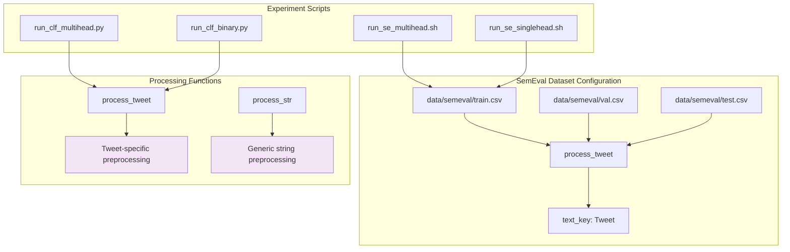

<!-- source: DeepWiki mcp.deepwiki.com · repo NVIDIA/sentiment-discovery · page 4 Experiments and Benchmarks · fetched 2026-10-26 -->

# Experiments and Benchmarks

Relevant source files

The following files were used as context for generating this wiki page:

- [experiments/run_clf_binary.py](experiments/run_clf_binary.py)
- [experiments/run_clf_multihead.py](experiments/run_clf_multihead.py)
- [experiments/run_se_multihead.sh](experiments/run_se_multihead.sh)
- [experiments/run_se_singlehead.sh](experiments/run_se_singlehead.sh)

This document covers the predefined experimental frameworks and benchmark configurations included in the sentiment-discovery repository. These experiments provide standardized ways to evaluate model performance on common sentiment analysis and emotion classification tasks.

The experiments are organized into automated scripts that configure and execute training runs for different model architectures and datasets. For detailed information about the underlying training infrastructure, see [Training Infrastructure](#2.3). For guidance on reproducing specific research results, see [Reproduction Guide](#5.1).

## Experiment Framework Overview

The experimental framework consists of Python orchestration scripts that automatically configure and execute training runs with predefined hyperparameters and model configurations. These scripts handle GPU assignment, environment setup, and systematic comparison of different model architectures.

**Experiment Framework Architecture**

The framework centers around `finetune_classifier.py` as the core training engine, with experiment scripts providing different configurations for specific tasks and model comparisons.

Sources: [experiments/run_clf_multihead.py:1-52](), [experiments/run_clf_binary.py:1-52](), [experiments/run_se_multihead.sh:1-3](), [experiments/run_se_singlehead.sh:1-3]()

## Classification Experiment Types

The framework supports two primary classification experiment types: binary sentiment classification and multi-head emotion classification. Each type has specific configurations optimized for different evaluation scenarios.

### Multi-Head Classification

Multi-head classification experiments target emotion classification tasks with multiple independent output heads. The configuration uses Plutchik's eight basic emotions as target labels.

| Configuration | Value | Purpose |
|---------------|-------|---------|
| Target Emotions | `anger`, `anticipation`, `disgust`, `fear`, `joy`, `sadness`, `surprise`, `trust` | Plutchik emotion model |
| Classifier Architecture | `4096 2048 1024 8` | Hidden layer dimensions |
| Batch Size | 16 | Training batch size |
| Dropout | 0.3 | Regularization |
| Auxiliary LM Loss Weight | 0.02 | Language modeling objective |

Sources: [experiments/run_clf_multihead.py:25-29]()

### Binary Classification

Binary classification experiments focus on positive/negative sentiment prediction with dual threshold optimization for balanced performance.

| Configuration | Value | Purpose |
|---------------|-------|---------|
| Target Labels | `positive`, `negative` | Binary sentiment categories |
| Classifier Architecture | `4096 2048 1024 2` | Hidden layer dimensions |
| Threshold Metric | `f1` | Optimization target |
| Dual Threshold | Enabled | Separate thresholds per class |

Sources: [experiments/run_clf_binary.py:25-29]()

## Model Architecture Comparison

Each experiment systematically compares Transformer and mLSTM architectures using identical training configurations to ensure fair comparison.

**Model Architecture Comparison Framework**

The comparison framework ensures identical training conditions while allowing each architecture to use its optimal configuration parameters.

### Transformer Architecture Configuration

The Transformer experiments use a 12-layer decoder architecture with SentencePiece tokenization:

- **Tokenizer**: `SentencePieceTokenizer` with `ama_32k_tokenizer.model`
- **Architecture**: 12 decoder layers, 768 embedding dimensions, 3072 FFN dimensions
- **Sequence Length**: 150 tokens maximum
- **Regularization**: 0.2 dropout across attention, ReLU, and standard layers

Sources: [experiments/run_clf_multihead.py:31-33](), [experiments/run_clf_binary.py:31-33]()

### mLSTM Architecture Configuration

The mLSTM experiments use pretrained multiplicative LSTM weights with minimal configuration:

- **Model**: Pretrained `mlstm.pt` weights
- **Learning Rate**: 1e-5
- **Architecture**: Default mLSTM configuration from pretrained model

Sources: [experiments/run_clf_multihead.py:35](), [experiments/run_clf_binary.py:35]()

## Dataset and Preprocessing Configuration

The experiments are configured for specific datasets with appropriate preprocessing functions and data splits.

**Dataset and Preprocessing Pipeline**

The preprocessing pipeline adapts to different data formats and applies appropriate text normalization for each dataset type.

### SemEval Configuration

The SemEval experiments use Twitter data with specialized preprocessing:

- **Text Field**: `Tweet` column from CSV files
- **Preprocessing**: `process_tweet` function for Twitter-specific normalization
- **Data Splits**: Separate train/validation/test CSV files

Sources: [experiments/run_se_multihead.sh:2](), [experiments/run_se_singlehead.sh:2]()

### Configurable Options

The experiment scripts support flexible configuration through command-line arguments:

| Argument | Options | Default | Purpose |
|----------|---------|---------|---------|
| `--process-fn` | `process_str`, `process_tweet` | `process_str` | Text preprocessing function |
| `--text-key` | Any string | `text` | CSV column name for text data |
| `--gpu` | Integer | 0 | GPU device assignment |

Sources: [experiments/run_clf_multihead.py:16-18](), [experiments/run_clf_binary.py:16-18]()

## Execution Environment

The experiment scripts handle GPU assignment and environment configuration automatically:

- **GPU Isolation**: `CUDA_VISIBLE_DEVICES` environment variable assignment
- **Process Management**: Subprocess execution with proper stdout/stderr handling
- **Experiment Tracking**: Formatted output with experiment identification

The scripts execute `finetune_classifier.py` with comprehensive argument sets, ensuring reproducible experimental conditions across different runs and model architectures.

Sources: [experiments/run_clf_multihead.py:22-24](), [experiments/run_clf_multihead.py:37-52](), [experiments/run_clf_binary.py:22-24](), [experiments/run_clf_binary.py:37-52]()

---

