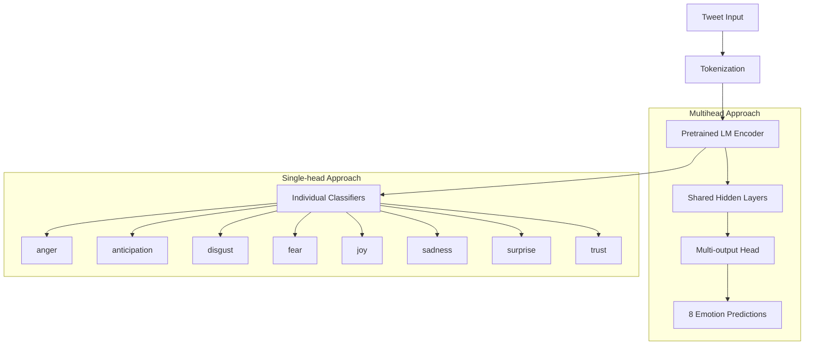
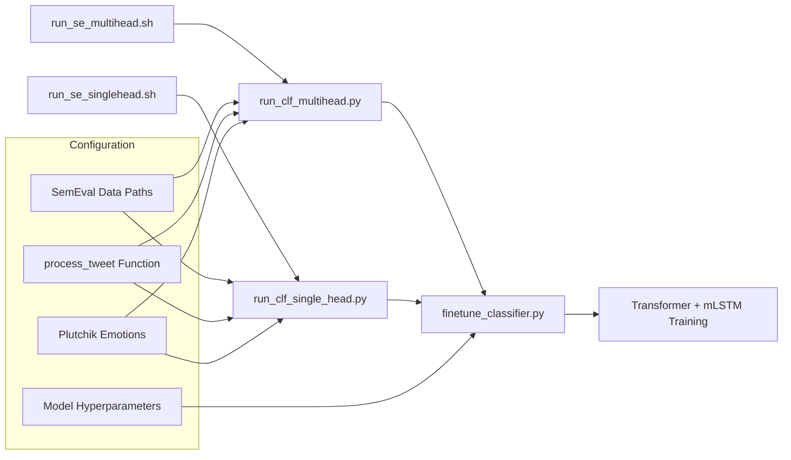

<!-- source: DeepWiki mcp.deepwiki.com · repo NVIDIA/sentiment-discovery · page 4.1 SemEval Emotion Classification · fetched 2026-10-26 -->

# SemEval Emotion Classification

<details>
<summary>Relevant source files</summary>

The following files were used as context for generating this wiki page:

- [experiments/run_clf_binary.py](experiments/run_clf_binary.py)
- [experiments/run_clf_multihead.py](experiments/run_clf_multihead.py)
- [experiments/run_clf_single_head.py](experiments/run_clf_single_head.py)
- [experiments/run_se_multihead.sh](experiments/run_se_multihead.sh)
- [experiments/run_se_singlehead.sh](experiments/run_se_singlehead.sh)

</details>


This document covers the SemEval emotion classification experiments included in the sentiment-discovery repository. These experiments focus on multi-label emotion classification on Twitter data using Plutchik's taxonomy of eight basic emotions. The experiments demonstrate both feature-based transfer learning and end-to-end finetuning approaches using pretrained language models.

For binary sentiment classification experiments, see [Sentiment Analysis Benchmarks](#4.2). For general transfer learning workflows, see [Transfer Learning](#3.2) and [Classifier Finetuning](#3.3).

## Overview

The SemEval emotion classification experiments implement multi-label emotion recognition on Twitter data, targeting the eight emotions from Plutchik's wheel: anger, anticipation, disgust, fear, joy, sadness, surprise, and trust. The system provides two distinct experimental approaches:

- **Multihead Classification**: A single model with multiple output heads predicting all emotions simultaneously
- **Single-head Classification**: Individual binary classifiers trained separately for each emotion

Both approaches leverage pretrained language models (Transformer and mLSTM) and include auxiliary language modeling objectives to maintain representation quality during finetuning.

## Experimental Architecture

### Multihead vs Single-head Approaches

The system implements two complementary strategies for emotion classification:



**Sources:** [experiments/run_clf_multihead.py:25-29](), [experiments/run_clf_single_head.py:25-29]()

### Experiment Execution Workflow



**Sources:** [experiments/run_se_multihead.sh:2](), [experiments/run_se_singlehead.sh:2](), [experiments/run_clf_multihead.py:27-29](), [experiments/run_clf_single_head.py:27-29]()

## Data Format and Preprocessing

### Dataset Structure

The SemEval experiments expect CSV files with the following structure:

| Field | Description | Example |
|-------|-------------|---------|
| `Tweet` | Raw tweet text | "I'm so happy today!" |
| `anger` | Binary emotion label | 0 or 1 |
| `anticipation` | Binary emotion label | 0 or 1 |
| `disgust` | Binary emotion label | 0 or 1 |
| `fear` | Binary emotion label | 0 or 1 |
| `joy` | Binary emotion label | 0 or 1 |
| `sadness` | Binary emotion label | 0 or 1 |
| `surprise` | Binary emotion label | 0 or 1 |
| `trust` | Binary emotion label | 0 or 1 |

### Preprocessing Pipeline

The experiments use tweet-specific preprocessing through the `process_tweet` function, which handles Twitter-specific elements like mentions, hashtags, and URLs. The text is accessed via the `Tweet` column key.

**Sources:** [experiments/run_se_multihead.sh:2](), [experiments/run_se_singlehead.sh:2](), [experiments/run_clf_multihead.py:16-18]()

## Model Configurations

### Transformer Configuration

The Transformer model uses the following configuration:

| Parameter | Value | Purpose |
|-----------|-------|---------|
| `tokenizer-type` | SentencePieceTokenizer | Subword tokenization |
| `vocab-size` | 32000 | Vocabulary size |
| `decoder-layers` | 12 | Model depth |
| `decoder-embed-dim` | 768 | Hidden dimension |
| `decoder-ffn-embed-dim` | 3072 | Feed-forward dimension |
| `max-seq-len` | 150 | Maximum sequence length |
| `dropout` | 0.2 | Regularization |
| `lr` | 1e-5 | Learning rate |

### mLSTM Configuration

The mLSTM model uses a simpler configuration with the same learning rate of `1e-5` and loads from `mlstm.pt`.

### Shared Training Parameters

Both models share common training hyperparameters:

| Parameter | Value | Purpose |
|-----------|-------|---------|
| `epochs` | 20 | Training duration |
| `warmup-epochs` | 0.5 | Learning rate warmup |
| `batch-size` | 16 | Mini-batch size |
| `optim` | Adam | Optimizer |
| `aux-lm-loss-weight` | 0.02 | Auxiliary LM loss scaling |
| `classifier-dropout` | 0.3 | Classifier regularization |

**Sources:** [experiments/run_clf_multihead.py:31-33](), [experiments/run_clf_multihead.py:27-29](), [experiments/run_clf_single_head.py:31-33]()

## Running the Experiments

### Multihead Emotion Classification

To run the multihead experiments:

```bash
bash experiments/run_se_multihead.sh
```

This executes both Transformer and mLSTM models with the following classifier architecture:
- Hidden layers: [4096, 2048, 1024, 8]
- 8 output neurons for the eight emotions
- Automatic thresholding for optimal decision boundaries

### Single-head Emotion Classification

To run individual emotion classifiers:

```bash
bash experiments/run_se_singlehead.sh
```

This trains 16 separate models (8 emotions × 2 architectures) with:
- Single hidden layer classifier
- Individual automatic thresholding per emotion
- Dedicated model saving for each emotion

### Custom Data Paths

Both experiment scripts accept custom data paths:

```bash
python experiments/run_clf_multihead.py \
    --train data/custom/train.csv \
    --val data/custom/val.csv \
    --test data/custom/test.csv \
    --text-key Tweet \
    --process-fn process_tweet
```

**Sources:** [experiments/run_se_multihead.sh:2](), [experiments/run_se_singlehead.sh:2](), [experiments/run_clf_multihead.py:11-18]()

## Technical Implementation Details

### Auxiliary Language Model Loss

Both experimental approaches include auxiliary language modeling loss (`--aux-lm-loss`) with weight `0.02` to maintain language representation quality during task-specific finetuning. This prevents catastrophic forgetting of the pretrained representations.

### Automatic Thresholding

The experiments use automatic threshold selection (`--automatic-thresholding`) to optimize decision boundaries for each emotion. The multihead approach uses all available metrics, while single-head classifiers can specify threshold optimization metrics.

### Model Versioning

The multihead experiments include model version names for result tracking:
- `transformer_multihead` for Transformer models
- `mlstm_multihead` for mLSTM models

### GPU Management

The experiment scripts include GPU selection and environment variable management for distributed execution across multiple devices.

**Sources:** [experiments/run_clf_multihead.py:27-35](), [experiments/run_clf_single_head.py:27-29](), [experiments/run_clf_multihead.py:22-23]()

---

