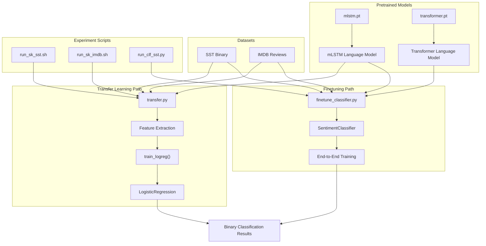
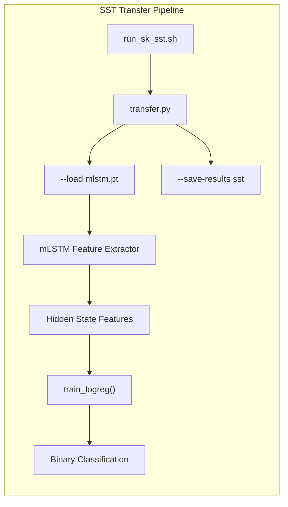
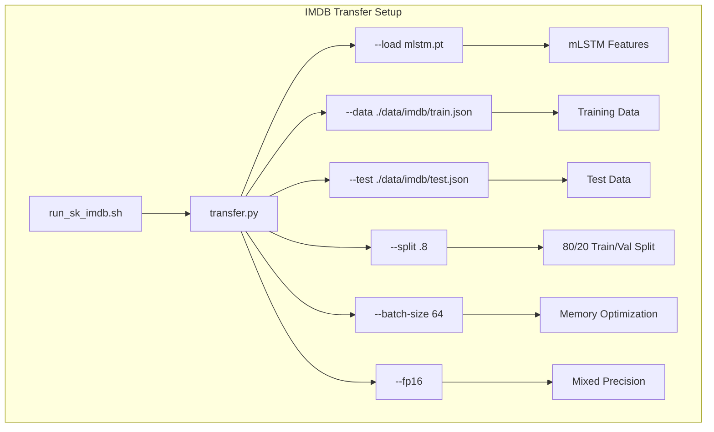
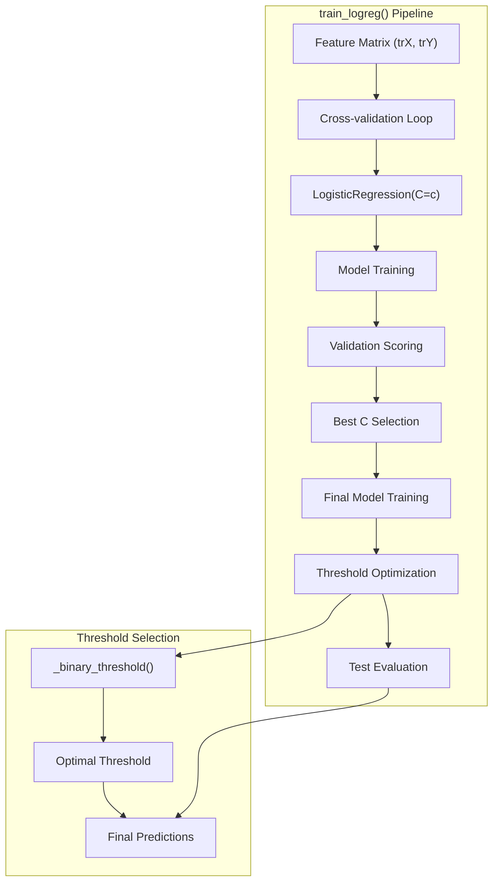
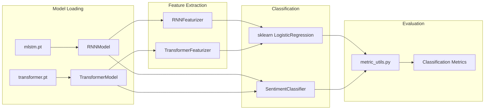

<!-- source: DeepWiki mcp.deepwiki.com · repo NVIDIA/sentiment-discovery · page 4.2 Sentiment Analysis Benchmarks · fetched 2026-10-26 -->

# Sentiment Analysis Benchmarks

Relevant source files

The following files were used as context for generating this wiki page:

- [experiments/run_clf_sst.py](experiments/run_clf_sst.py)
- [experiments/run_sk_imdb.sh](experiments/run_sk_imdb.sh)
- [experiments/run_sk_sst.sh](experiments/run_sk_sst.sh)
- [logreg_utils.py](logreg_utils.py)
- [model/checkpoint.py](model/checkpoint.py)

This page documents the binary sentiment classification experiments and benchmarks implemented in the sentiment discovery repository. It covers the experimental setup, datasets, and evaluation approaches for sentiment analysis tasks using pretrained language models.

For multi-label emotion classification experiments, see [SemEval Emotion Classification](#4.1). For general evaluation metrics and tools, see [Metrics and Evaluation Tools](#4.3).

## Overview

The sentiment analysis benchmarks focus on binary sentiment classification using two primary datasets: Stanford Sentiment Treebank (SST) and IMDB movie reviews. The system supports two main experimental approaches:

1. **Transfer Learning**: Feature extraction from pretrained models followed by logistic regression
2. **End-to-End Finetuning**: Direct finetuning of pretrained models with classification heads

## Experimental Architecture

**Sources**: [experiments/run_sk_sst.sh:1-3](), [experiments/run_sk_imdb.sh:1-3](), [experiments/run_clf_sst.py:1-42](), [logreg_utils.py:20-23]()

## Stanford Sentiment Treebank (SST) Experiments

### Transfer Learning Approach

The transfer learning approach for SST uses the `run_sk_sst.sh` script to extract features from pretrained mLSTM models and train logistic regression classifiers.

**Command**: `python3 transfer.py --load mlstm.pt --save-results sst`

**Sources**: [experiments/run_sk_sst.sh:2]()

### End-to-End Finetuning Approach

The finetuning approach uses `run_clf_sst.py` to perform end-to-end training with both Transformer and mLSTM architectures.

| Model | Learning Rate | Architecture Details | Special Parameters |
|-------|---------------|---------------------|-------------------|
| Transformer | 1e-5 | 12 layers, 768 embed dim, 3072 FFN | SentencePiece tokenization, dropout 0.2 |
| mLSTM | 1e-5 | Pretrained weights | Standard configuration |

**Base Configuration**:
- Warmup epochs: 0.5
- Total epochs: 20
- Optimizer: Adam
- Batch size: 16
- Auxiliary LM loss weight: 0.02
- Automatic thresholding with F1 metric

**Sources**: [experiments/run_clf_sst.py:17-25]()

## IMDB Dataset Experiments

The IMDB experiments use transfer learning with the `run_sk_imdb.sh` script, focusing on feature extraction from pretrained mLSTM models.

**Command**: `python3 transfer.py --load mlstm.pt --save-results imdb --data ./data/imdb/train.json --test ./data/imdb/test.json --split .8 --batch-size 64 --fp16`

**Sources**: [experiments/run_sk_imdb.sh:2]()

## Logistic Regression Training

The `train_logreg` function in `logreg_utils.py` handles the machine learning pipeline for transfer learning experiments.

### Key Features

| Feature | Description | Parameters |
|---------|-------------|------------|
| Cross-validation | C parameter optimization | `C=2**np.arange(-8, 1).astype(np.float)` |
| Automatic thresholding | Optimal threshold selection | `automatic_thresholding=True, threshold_metric='acc'` |
| Multi-class support | Handles binary and multi-label | `n_classes` detection |
| Feature selection | Neuron dropping/selection | `neurons`, `drop_neurons` |

### Training Pipeline

**Sources**: [logreg_utils.py:20-154](), [logreg_utils.py:44-56](), [logreg_utils.py:130-132]()

## Model Integration

The sentiment analysis benchmarks integrate with the broader system architecture through standardized interfaces:

The benchmarks utilize the model architectures documented in [Model Architectures](#2.2) and the training infrastructure from [Training Infrastructure](#2.3). Results are evaluated using tools described in [Metrics and Evaluation Tools](#4.3).

**Sources**: [experiments/run_clf_sst.py:21-25](), [experiments/run_sk_sst.sh:2](), [logreg_utils.py:17-18]()

---

