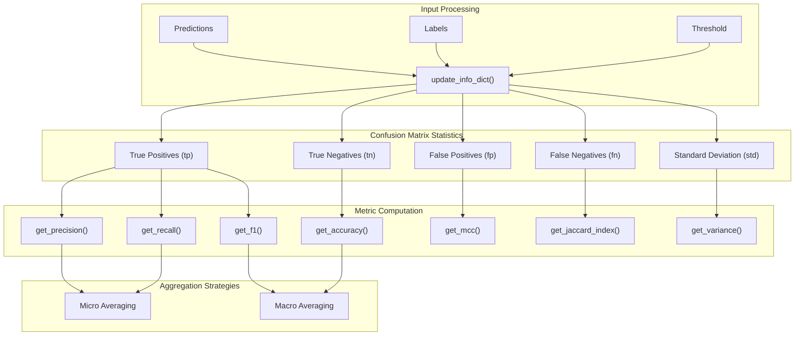
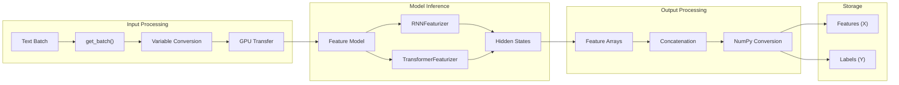
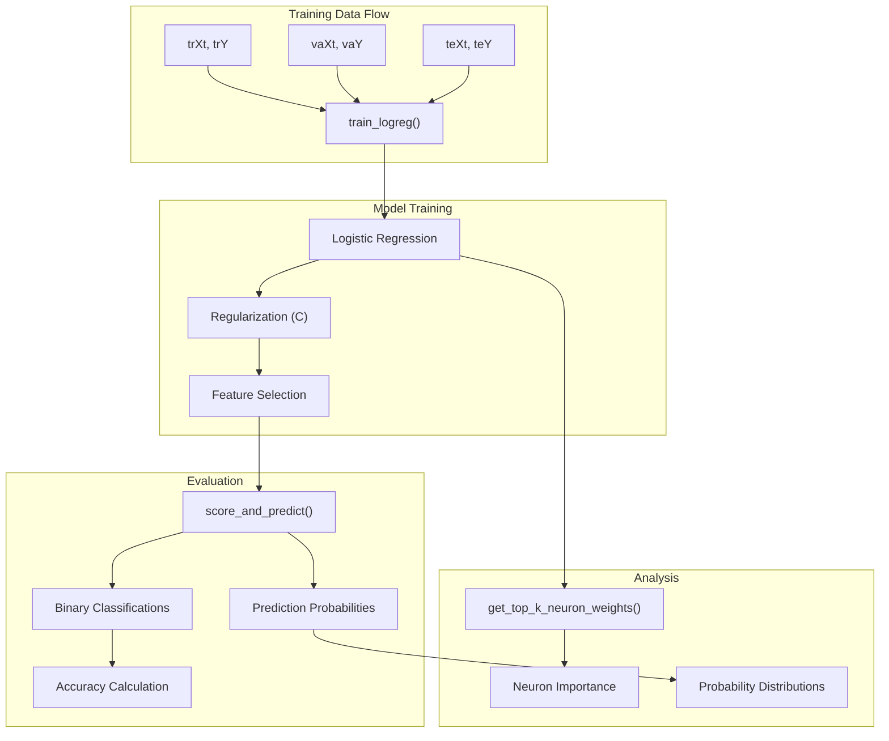
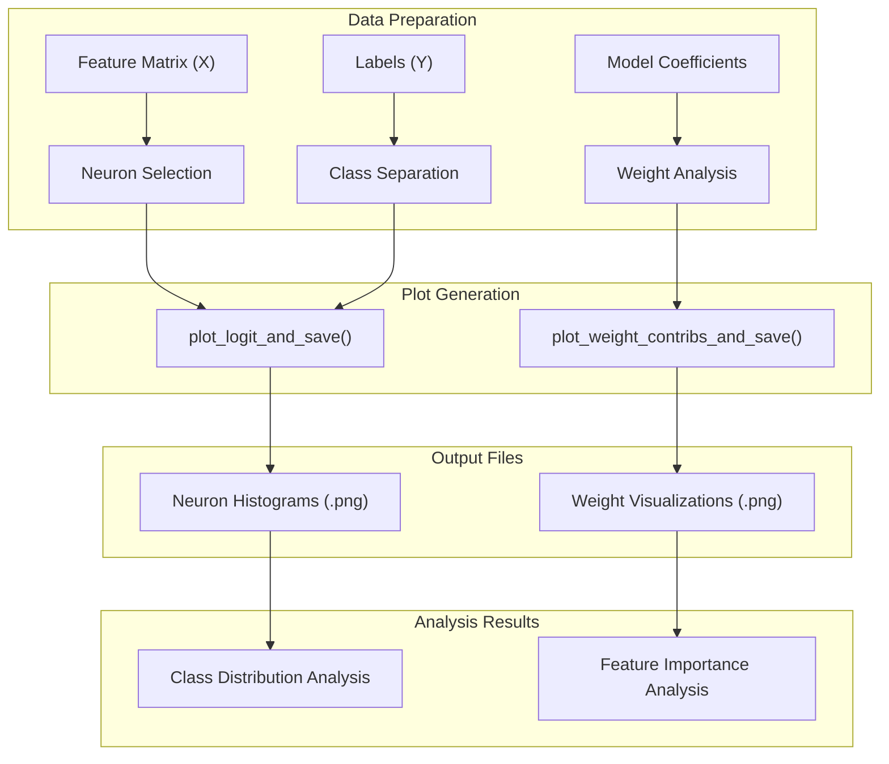
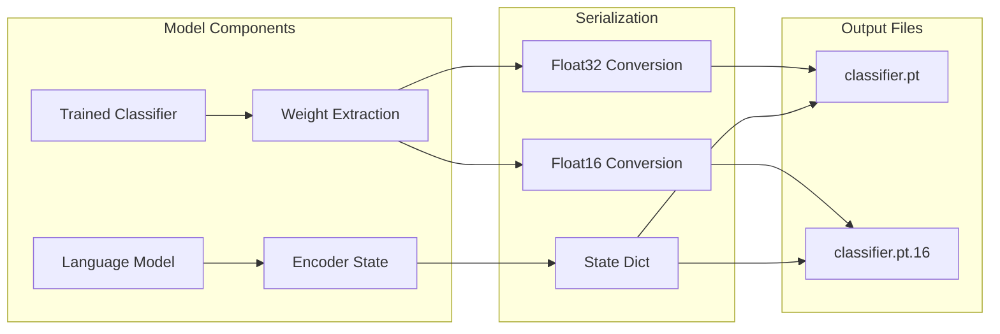

<!-- source: DeepWiki mcp.deepwiki.com · repo NVIDIA/sentiment-discovery · page 4.3 Metrics and Evaluation Tools · fetched 2026-10-26 -->

# Metrics and Evaluation Tools

Relevant source files

The following files were used as context for generating this wiki page:

- [metric_utils.py](metric_utils.py)
- [transfer.py](transfer.py)

This document covers the evaluation metrics, performance analysis utilities, and model assessment tools provided by the sentiment discovery framework. These tools support both binary and multi-label classification tasks, providing comprehensive statistical measures and visualization capabilities for model performance analysis.

For information about running specific evaluation workflows, see [Model Inference and Evaluation](#3.4). For dataset-specific benchmarking procedures, see [SemEval Emotion Classification](#4.1) and [Sentiment Analysis Benchmarks](#4.2).

## Core Metrics System

The metrics system is built around a modular architecture that computes confusion matrix statistics and derives various classification metrics from them. The system supports both micro-averaging (aggregate then compute) and macro-averaging (compute then aggregate) strategies.

### Statistical Foundation

The core metrics computation relies on maintaining running totals of confusion matrix components through the `update_info_dict()` function:

| Statistic | Description | Usage |
|-----------|-------------|-------|
| `tp` | True Positives | Correctly predicted positive cases |
| `tn` | True Negatives | Correctly predicted negative cases |
| `fp` | False Positives | Incorrectly predicted positive cases |
| `fn` | False Negatives | Incorrectly predicted negative cases |
| `std` | Standard Deviation | Variance measure for uncertainty quantification |

**Sources:** [metric_utils.py:5-17](), [metric_utils.py:25-59]()

### Available Metrics

The system provides seven core classification metrics, each implemented as a pure function that takes confusion matrix statistics as input:

| Metric | Function | Formula | Use Case |
|--------|----------|---------|----------|
| Accuracy | `get_accuracy()` | (TP + TN) / (TP + TN + FP + FN) | Overall correctness |
| Precision | `get_precision()` | TP / (TP + FP) | Positive prediction quality |
| Recall | `get_recall()` | TP / (TP + FN) | Positive case coverage |
| F1 Score | `get_f1()` | 2×TP / (2×TP + FP + FN) | Balanced precision/recall |
| MCC | `get_mcc()` | (TP×TN - FP×FN) / √((TP+FP)(TP+FN)(TN+FP)(TN+FN)) | Correlation coefficient |
| Jaccard Index | `get_jaccard_index()` | TP / (TP + FP + FN) | Set similarity |
| Variance | `get_variance()` | std / total | Uncertainty measure |

**Sources:** [metric_utils.py:63-93]()

## Transfer Learning Evaluation Pipeline

The transfer learning evaluation system provides end-to-end assessment of feature-based classification models, combining neural feature extraction with classical machine learning evaluation.

### Feature Extraction and Transformation

The `transform()` function serves as the core feature extraction pipeline, converting raw text through trained language models into numerical feature representations:

**Sources:** [transfer.py:83-145]()

### Classification and Scoring

The evaluation pipeline uses logistic regression as the downstream classifier, with built-in support for performance assessment:

**Sources:** [transfer.py:147-156](), [transfer.py:274-292]()

## Model Analysis Tools

### Neuron Importance Analysis

The system provides sophisticated analysis of individual neuron contributions to classification performance through L1-norm based importance ranking:

| Function | Purpose | Algorithm |
|----------|---------|-----------|
| `get_top_k_neuron_weights()` | Identify most important neurons | L1-norm ranking with efficient k-selection |
| `plot_logits()` | Visualize neuron activations | Histogram plotting by class |
| `plot_weight_contribs_and_save()` | Display weight distributions | Normalized coefficient visualization |

The neuron selection algorithm uses different strategies based on the number of neurons requested:
- k=1: Direct maximum selection O(n)
- k≥log(n): Full sorting O(n log n)  
- k<log(n): Partial selection O(n + k log k)

**Sources:** [transfer.py:158-180](), [transfer.py:182-224]()

### Visualization System

**Sources:** [transfer.py:194-224]()

## Output Storage and Persistence

The evaluation system maintains comprehensive records of all analysis results through a structured file output system:

### Result Files

| File Type | Content | Purpose |
|-----------|---------|---------|
| `*_score.txt` | Performance metrics | Numerical results storage |
| `*_probs.pkl` | Prediction probabilities | Detailed prediction analysis |
| `neurons.pkl` | Model coefficients | Weight analysis |
| `neuron_bias.pkl` | Model intercepts | Bias term analysis |
| `classifier.pt` | PyTorch model | Full model persistence |
| `*.png` | Visualization plots | Visual analysis results |

### Model Serialization

The system supports both full-precision and half-precision model serialization:

**Sources:** [transfer.py:294-308](), [transfer.py:241-375]()

The metrics and evaluation tools provide a comprehensive foundation for assessing model performance across different tasks and datasets, with built-in support for statistical rigor, visualization, and reproducible analysis workflows.

---

