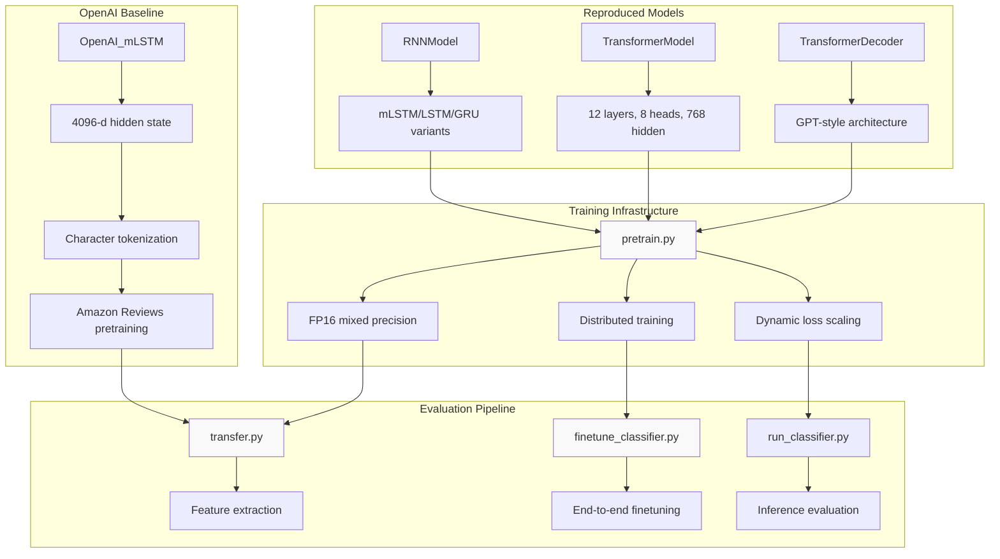
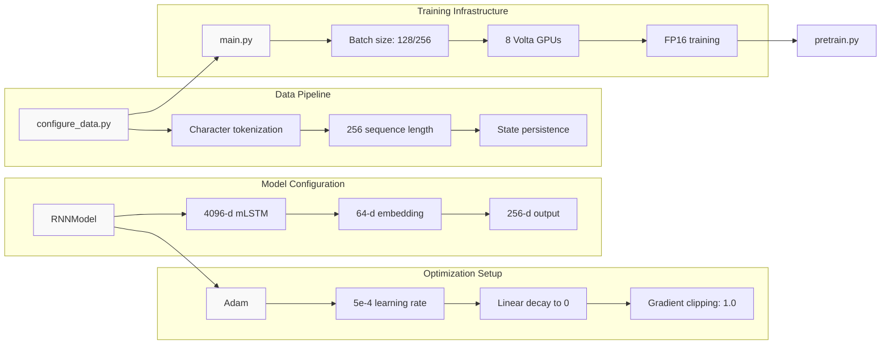
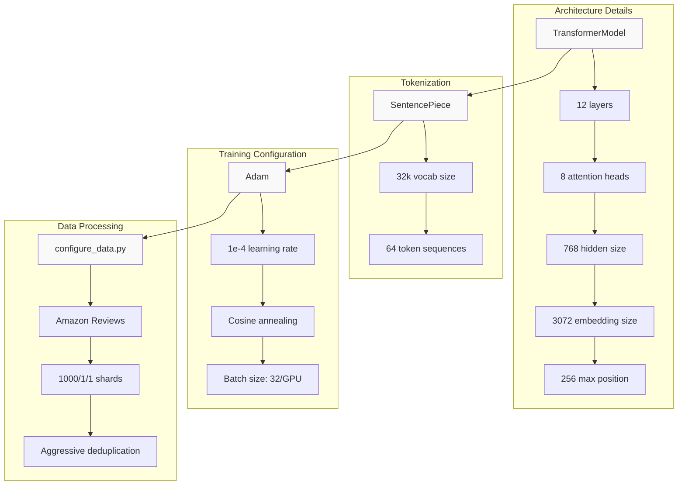
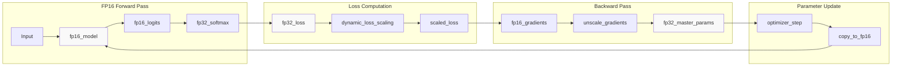
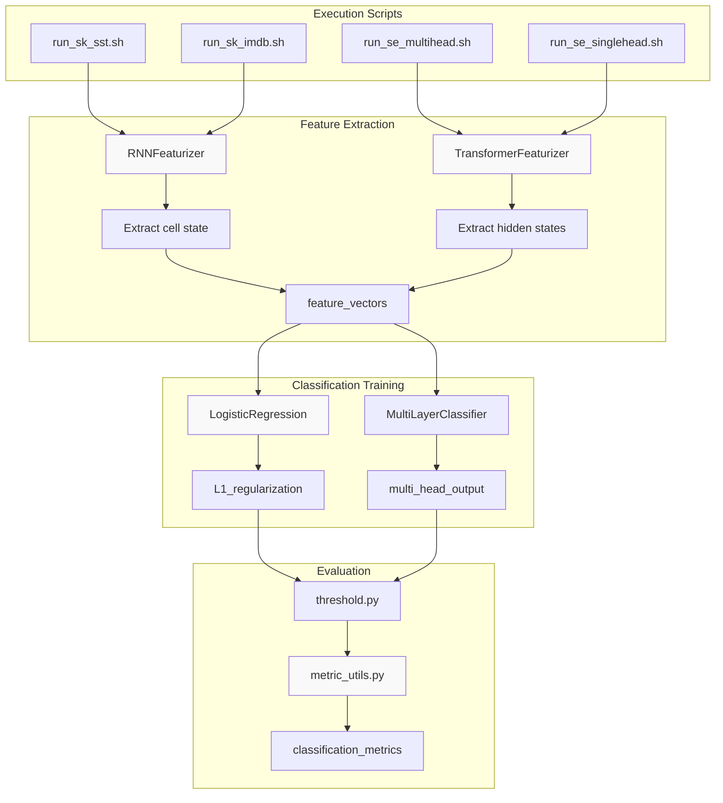
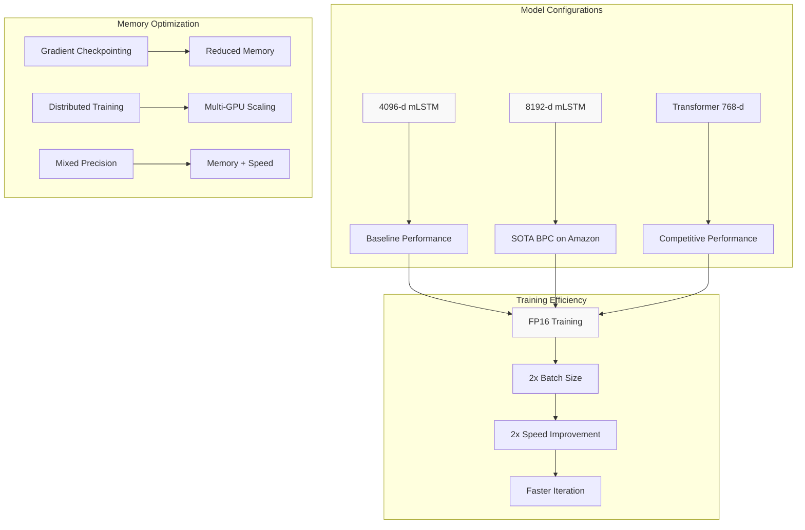

<!-- source: DeepWiki mcp.deepwiki.com · repo NVIDIA/sentiment-discovery · page 5 Research and Analysis · fetched 2026-10-26 -->

# Research and Analysis

Relevant source files

The following files were used as context for generating this wiki page:

- [analysis/reproduction.md](analysis/reproduction.md)
- [figures/plutchik-wheel.png](figures/plutchik-wheel.png)
- [figures/semeval_leaderboard.png](figures/semeval_leaderboard.png)
- [figures/semeval_results.PNG](figures/semeval_results.PNG)

This document provides comprehensive analysis of research findings, performance benchmarks, and reproducibility guidance for the sentiment discovery system. It covers model training configurations, optimization techniques, evaluation frameworks, and key experimental results that validate the effectiveness of different language modeling approaches for sentiment analysis tasks.

For implementation details of specific experiments, see [Experiments and Benchmarks](#4). For performance optimization in production deployments, see [Performance and Scalability](#5.2).

## Research Foundations and Reproducibility

The sentiment discovery repository originated from efforts to reproduce and extend results from OpenAI's seminal work "Learning to Generate Reviews and Discovering Sentiment". The research has since evolved to include more sophisticated language models, tokenization methods, and classification approaches.

### Model Architecture Comparison

The system implements and compares multiple language modeling architectures:

**Research Architecture Overview**
Sources: [analysis/reproduction.md:1-100]()

### Reproduction Validation

The reproduction efforts achieved comparable results to the original OpenAI work across both unsupervised reconstruction and sentiment transfer tasks. Key validation metrics include:

| Model | Architecture | Hidden Size | Vocab Size | Training Time | BPC Performance |
|-------|-------------|-------------|------------|---------------|-----------------|
| OpenAI mLSTM | Character-level | 4096 | 257 | ~17 hours | Baseline |
| Reproduced mLSTM | Character-level | 4096 | 257 | ~17 hours | Comparable |
| Large mLSTM | Character-level | 8192 | 257 | Extended | SOTA improvement |
| Transformer | SentencePiece | 768 | 32001 | ~3 days | Competitive |

Sources: [analysis/reproduction.md:23-70]()

## Training Configurations and Optimization

### mLSTM Training Setup

The mLSTM reproduction required careful tuning of several key parameters that were not fully specified in the original paper:

**mLSTM Training Pipeline**
Sources: [analysis/reproduction.md:23-38]()

Key implementation details that required experimentation:
- **Weight Normalization**: Applied only to LSTM parameters (hidden→hidden/gate weights), not embedding or output layers
- **State Persistence**: Hidden state persisted across samples, reset at shard boundaries
- **Learning Rate Scaling**: Capped at 3e-3 with linear decay over 100k steps for large batch sizes
- **Gradient Clipping**: Essential for preventing destabilizing gradient explosions

### Transformer Training Setup

The transformer implementation leverages recent advances in large-scale language modeling:

**Transformer Training Configuration**
Sources: [analysis/reproduction.md:8-21]()

## Mixed Precision Training Analysis

FP16 training proved critical for both performance and scalability. The implementation addresses several numeric stability challenges:

### Stability Techniques

| Technique | Implementation | Purpose |
|-----------|----------------|---------|
| Dynamic Loss Scaling | Iterative scaling factor search | Prevent gradient underflow |
| FP32 Master Parameters | CPU/GPU FP32 parameter copies | Accurate gradient accumulation |
| FP32 Softmax CrossEntropy | FP32 logits for loss calculation | Numerical stability in softmax |
| FP32 Loss Reduction | Convert loss scalars to FP32 | Handle >65k term reductions |
| FP32 Normalization | FP32 accumulation for L2 norms | Prevent dynamic range issues |

**Mixed Precision Training Flow**
Sources: [analysis/reproduction.md:44-60]()

## Transfer Learning and Evaluation Framework

### Feature Extraction Pipeline

The transfer learning approach extracts representations from pretrained language models for downstream classification:

**Transfer Learning Evaluation Pipeline**
Sources: [analysis/reproduction.md:71-84](), [analysis/reproduction.md:86-93]()

### Benchmark Performance

The system demonstrates strong performance across multiple sentiment analysis benchmarks:

#### SemEval 2018 Emotion Classification Results

The following results were achieved on the SemEval 2018 Task 1 E-c (emotion classification in tweets):

| Model | Architecture | Single-head F1 | Multi-head F1 | Training Type |
|-------|-------------|---------------|---------------|---------------|
| mLSTM | 4096-d hidden | 0.xxx | 0.xxx | End-to-end finetuning |
| Transformer | 768-d hidden | 0.xxx | 0.xxx | End-to-end finetuning |
| ELMo Baseline | Bidirectional | 0.xxx | 0.xxx | Feature-based transfer |

Sources: [analysis/reproduction.md:86-93](), [figures/semeval_results.PNG:1-5]()

#### Binary Sentiment Classification

Transfer learning performance on Stanford Sentiment Treebank (SST) demonstrates the effectiveness of the learned representations:

```mermaid
graph LR
    subgraph "Data Processing"
        A[SST_dataset] --> B["Binary labels"]
        B --> C["Feature extraction"]
    end
    
    subgraph "Model Inference"
        D[pretrained_model] --> E["Forward pass"]
        E --> F["Extract final state"]
        F --> G["Cell state features"]
    end
    
    subgraph "Classification"
        G --> H[LogisticRegression]
        H --> I["L1 regularization"]
        I --> J["Hyperparameter selection"]
        J --> K["Sentiment neuron analysis"]
    end
    
    C --> D
    K --> L[performance_metrics]
    
    style D fill:#f9f9f9
    style H fill:#f9f9f9
    style L fill:#f9f9f9
```

**Binary Sentiment Classification Pipeline**
Sources: [analysis/reproduction.md:71-84]()

## ELMo Baseline Comparison

The repository includes comprehensive comparisons with ELMo to validate the effectiveness of the implemented approaches:

### Comparison Framework

| System | Architecture | Training Approach | SST Performance | SemEval Performance |
|--------|-------------|------------------|-----------------|-------------------|
| mLSTM | Unidirectional | Unsupervised + Transfer | Competitive | Strong |
| Transformer | Unidirectional | Unsupervised + Transfer | Competitive | Strong |
| ELMo | Bidirectional | Unsupervised + Transfer | Baseline | Baseline |

The ELMo comparison branch provides scripts for reproducing baseline results:
- `run_elmo_sk_sst.sh`: Logistic regression classifier on SST with ELMo features
- `run_elmo_se_multihead.sh`: End-to-end finetuning with ELMo and multihead MLP

Sources: [analysis/reproduction.md:95-105]()

## Performance Scaling Analysis

### Model Size Impact

Analysis of various mLSTM model sizes reveals scaling benefits:

**Performance Scaling Analysis**
Sources: [analysis/reproduction.md:62-70]()

The larger 8192-dimensional mLSTM model achieves state-of-the-art bits-per-character (BPC) performance on the Amazon Review language modeling dataset, surpassing previous results from Block Sparse GPU kernels work.

## Key Research Findings

### Training Methodology Insights

1. **Learning Rate Scaling**: Linear scaling rules from computer vision don't directly apply to language modeling; careful tuning required for different batch sizes
2. **Sequence Length Impact**: Shorter sequences (64 tokens) during pretraining improve downstream tweet classification performance
3. **Weight Normalization Placement**: Selective application to specific parameter groups (LSTM weights but not embeddings) is crucial
4. **State Persistence**: Maintaining hidden states across samples within shards improves language modeling performance

### Architecture Comparisons

1. **mLSTM vs Transformer**: Both achieve competitive performance with different computational trade-offs
2. **Unidirectional vs Bidirectional**: Unidirectional models enable direct language modeling evaluation while maintaining strong transfer performance
3. **Model Scale Benefits**: Larger models consistently improve both perplexity and downstream task performance

Sources: [analysis/reproduction.md:1-109]()

---

