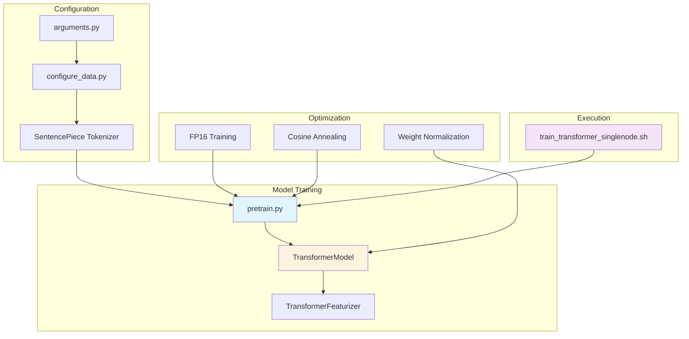
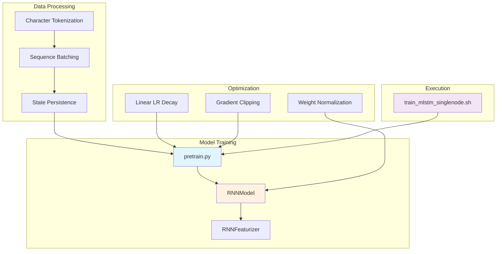
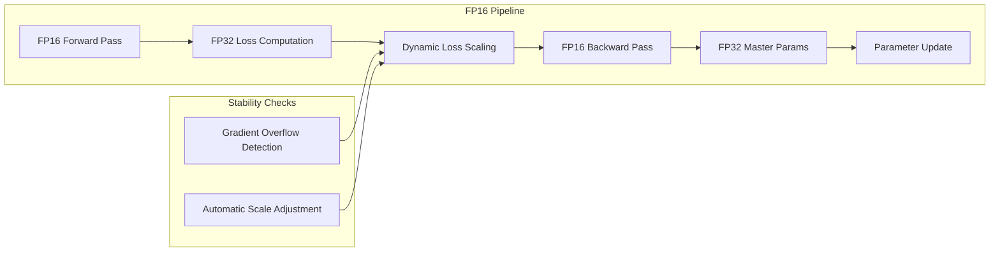
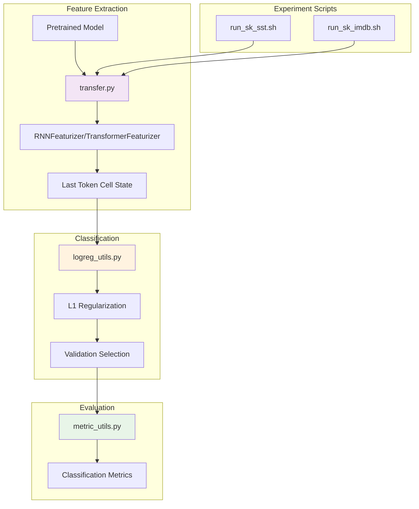
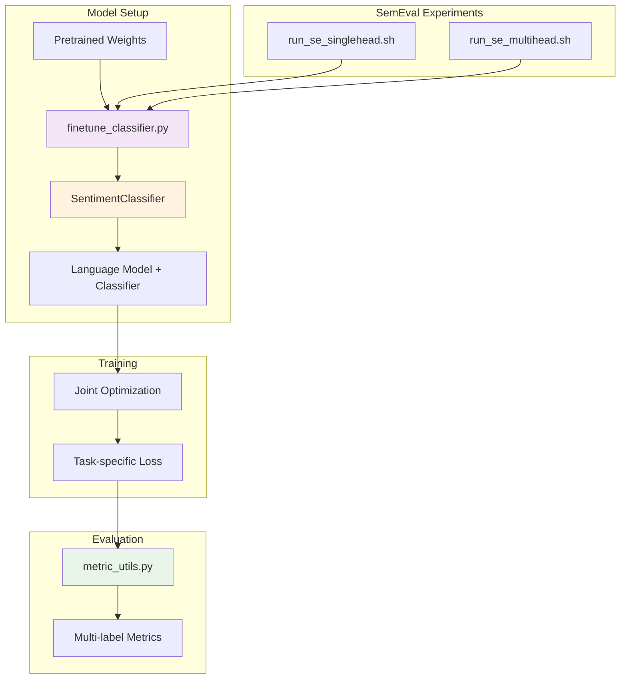

<!-- source: DeepWiki mcp.deepwiki.com · repo NVIDIA/sentiment-discovery · page 5.1 Reproduction Guide · fetched 2026-10-26 -->

# Reproduction Guide

Relevant source files

The following files were used as context for generating this wiki page:

- [analysis/reproduction.md](analysis/reproduction.md)
- [figures/loss.png](figures/loss.png)
- [figures/plutchik-wheel.png](figures/plutchik-wheel.png)
- [figures/reproduction_graph.png](figures/reproduction_graph.png)
- [figures/semeval_leaderboard.png](figures/semeval_leaderboard.png)
- [figures/semeval_results.PNG](figures/semeval_results.PNG)

This document provides comprehensive instructions for reproducing the research results presented in the sentiment-discovery repository. It covers model training configurations, evaluation procedures, and specific experiment scripts needed to replicate published findings on language modeling, sentiment analysis, and transfer learning tasks.

For information about the underlying model architectures, see [Model Architectures](#2.2). For details about distributed training and optimization techniques, see [Distributed Training](#6.1) and [Mixed Precision Training](#6.2).

## Training Configurations

The repository supports reproduction of results for two primary model architectures: Transformer and mLSTM (multiplicative LSTM). Each requires specific hyperparameter configurations to achieve published performance.

### Transformer Training Configuration

The Transformer model configuration replicates the setup used in "Practical Text Classification With Large Pre-Trained Language Models":

**Model Architecture:**
- 12 layers, 8 attention heads
- Hidden size: 768, embedding size: 3072
- Positional embeddings up to sequence length 256
- Weight normalization applied to transformer and output head parameters (not embeddings)

**Training Setup:**
- Optimizer: Adam with 1e-4 learning rate
- Learning rate schedule: Cosine annealing
- Tokenization: SentencePiece with 32k vocabulary (32001 total including padding)
- Sequence length: 64 tokens
- Batch size: 32 per GPU
- Hardware requirement: 8 V100 GPUs (DGX-1V)
- Training time: ~3 days with FP16

**Training Workflow:**

Sources: [analysis/reproduction.md:8-21](), [experiments/train_transformer_singlenode.sh]()

### mLSTM Training Configuration

The mLSTM configuration replicates OpenAI's "Learning to Generate Reviews and Discovering Sentiment" setup:

**Model Architecture:**
- 4096-dimensional mLSTM hidden state
- 64-dimensional character embeddings
- 256-dimensional output layer
- Weight normalization applied only to LSTM parameters (hidden-to-hidden and gate weights)

**Training Setup:**
- Optimizer: Adam with 5e-4 learning rate per batch of 128
- Learning rate schedule: Linear decay to 0 over epoch
- Gradient clipping: Maximum norm of 1.0
- Tokenization: Character-level with vocabulary size 257
- Sequence length: 256 tokens
- State persistence: Hidden state persisted across samples, reset at shard start
- Batch size: 128 (FP32) or 256 (FP16) per GPU
- Hardware requirement: 8 Volta-class GPUs
- Training time: ~17 hours with FP16

**Training Workflow:**

Sources: [analysis/reproduction.md:23-38]()

## Mixed Precision Training

FP16 training is critical for both model configurations, providing significant speedup and memory efficiency. The implementation includes several stability techniques:

### FP16 Optimization Techniques

**Numerical Stability:**
- Dynamic loss scaling with iterative scaling factor adjustment
- FP32 master parameters for gradient accumulation
- FP32 softmax cross-entropy computation
- FP32 loss reduction for operations exceeding 65k terms
- FP32 normalization for L2 norms greater than 256

**Implementation Details:**

The FP16 training achieves convergence comparable to FP32 while providing 2x speedup in computation and enabling 2x larger batch sizes.

Sources: [analysis/reproduction.md:44-60]()

## Evaluation Workflows

### Transfer Learning Evaluation

Transfer learning evaluation extracts features from pretrained models for downstream classification tasks using logistic regression.

**Feature Extraction Process:**
1. Forward pass through pretrained language model
2. Extract cell state (not hidden state) from last token
3. Train logistic regression with L1 regularization
4. Use validation set for hyperparameter selection
5. Identify "sentiment neuron" with largest L1 penalty

**Transfer Learning Workflow:**

**Commands:**
- Stanford Sentiment Treebank: `bash ./experiments/run_sk_sst.sh`
- IMDB Dataset: `bash ./experiments/run_sk_imdb.sh`

Sources: [analysis/reproduction.md:71-84]()

### Fine-tuning Evaluation

End-to-end fine-tuning performs joint training of the language model and classification head for downstream tasks.

**Fine-tuning Process:**
1. Initialize with pretrained language model weights
2. Add classification head (`SentimentClassifier`)
3. Joint training with task-specific loss
4. Support for both single-head and multi-head classification

**Fine-tuning Workflow:**

**SemEval 2018 Task 1 E-c Commands:**
- Single-head classification: `./experiments/run_se_singlehead.sh`
- Multi-head classification: `./experiments/run_se_multihead.sh`

Sources: [analysis/reproduction.md:86-94]()

### ELMo Baseline Comparison

The repository includes ELMo baseline experiments for comparison with the developed models.

**ELMo Integration:**
- Utilizes AllenNLP's ELMo implementation
- Supports both transfer learning and end-to-end fine-tuning
- No auxiliary language modeling loss (due to bidirectional nature)

**Commands:**
- SST transfer learning: `bash ./run_elmo_sk_sst.sh`
- SemEval multi-head fine-tuning: `bash ./run_elmo_se_multihead.sh`

Sources: [analysis/reproduction.md:95-105]()

## Experiment Execution Guide

### Data Preparation

All experiments use the Aggressively Deduplicated Amazon Review dataset with 1000/1/1 train/test/validation shards. Data configuration is handled through:

| Component | File | Purpose |
|-----------|------|---------|
| Data Pipeline | `configure_data.py` | Dataset loading and preprocessing |
| Tokenization | Various tokenizers | Character, SentencePiece, BPE support |
| Arguments | `arguments.py` | Command-line configuration |

### Training Commands

| Model | Script | Duration | Hardware |
|-------|--------|----------|----------|
| Transformer | `./experiments/train_transformer_singlenode.sh` | ~3 days | 8 V100 GPUs |
| mLSTM | `./experiments/train_mlstm_singlenode.sh` | ~17 hours | 8 Volta GPUs |

### Evaluation Commands

| Task | Dataset | Script | Type |
|------|---------|--------|------|
| Sentiment Transfer | SST | `./experiments/run_sk_sst.sh` | Feature extraction |
| Sentiment Transfer | IMDB | `./experiments/run_sk_imdb.sh` | Feature extraction |
| Emotion Classification | SemEval | `./experiments/run_se_singlehead.sh` | Single-head fine-tuning |
| Emotion Classification | SemEval | `./experiments/run_se_multihead.sh` | Multi-head fine-tuning |

### Performance Monitoring

Training progress and evaluation metrics are handled through:
- `metric_utils.py`: Classification metrics computation
- `threshold.py`: Automatic threshold selection for multi-label tasks
- Loss tracking and convergence monitoring

Sources: [analysis/reproduction.md:1-107](), [experiments/]() directory structure

---

