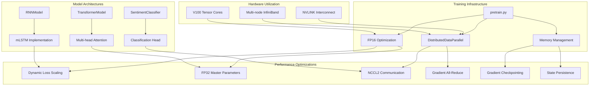
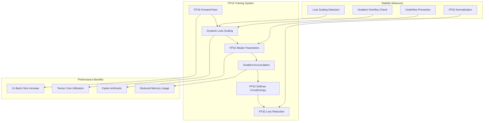
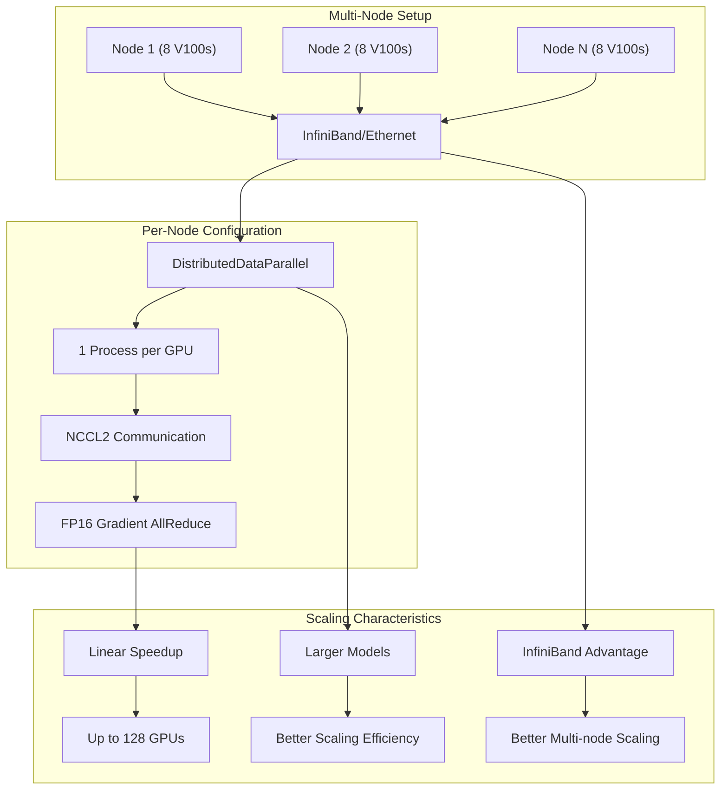
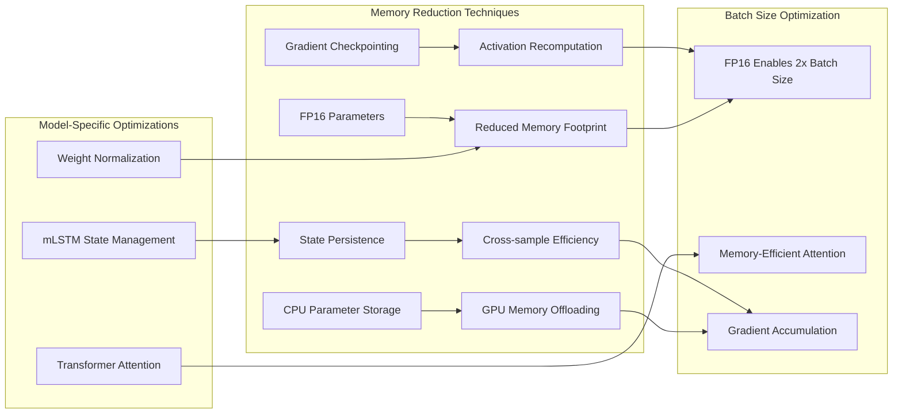
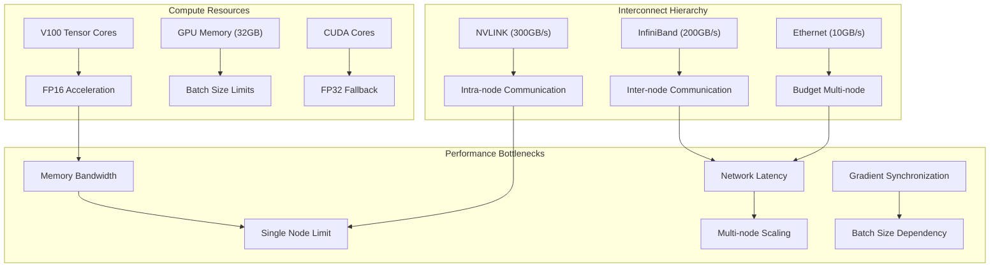
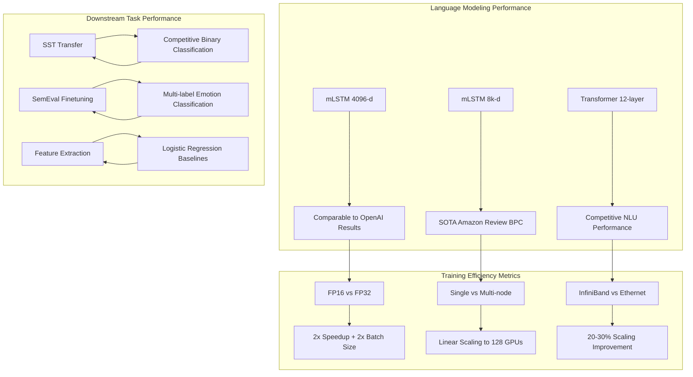

<!-- source: DeepWiki mcp.deepwiki.com · repo NVIDIA/sentiment-discovery · page 5.2 Performance and Scalability · fetched 2026-10-26 -->

# Performance and Scalability

Relevant source files

The following files were used as context for generating this wiki page:

- [analysis/reproduction.md](analysis/reproduction.md)
- [analysis/scale.md](analysis/scale.md)
- [figures/plutchik-wheel.png](figures/plutchik-wheel.png)
- [figures/semeval_leaderboard.png](figures/semeval_leaderboard.png)
- [figures/semeval_results.PNG](figures/semeval_results.PNG)

This page covers the performance characteristics and scalability patterns of the sentiment-discovery training infrastructure. It analyzes training performance optimizations, distributed scaling behavior, memory optimization techniques, and hardware configuration considerations for both language model pretraining and downstream task finetuning.

For information about reproducing specific research results, see [Reproduction Guide](#5.1). For detailed distributed training setup instructions, see [Distributed Training](#6.1). For mixed precision training configuration, see [Mixed Precision Training](#6.2).

## Training Performance Overview

The sentiment-discovery system achieves high training throughput through several key optimizations: mixed precision (FP16) training, distributed data parallelism, and efficient memory management. Performance characteristics vary significantly between model architectures and training configurations.

### Model-Specific Performance Characteristics

| Model Type | Training Time | Batch Size | Hardware | Key Optimizations |
|------------|---------------|------------|----------|-------------------|
| mLSTM (4096-d) | ~17 hours | 128-256 per GPU | 8 V100 GPUs | FP16, gradient clipping, state persistence |
| Transformer (12-layer) | ~3 days | 32 per GPU | 8 V100 GPUs | FP16, cosine annealing, weight normalization |
| Large mLSTM (8k) | Extended | 256 per GPU | Multi-node | FP16, distributed scaling |

**Training Performance Scaling Pipeline**

Sources: [analysis/reproduction.md:20-38](), [analysis/scale.md:1-10]()

## Mixed Precision (FP16) Training

FP16 training provides critical performance improvements, enabling 2x larger batch sizes and significantly faster computation. The implementation addresses numeric stability challenges through several techniques.

### FP16 Optimization Techniques

**Core FP16 Components**

| Technique | Purpose | Implementation |
|-----------|---------|----------------|
| Dynamic Loss Scaling | Prevent gradient underflow | Iterative scaling constant detection |
| FP32 Master Parameters | Accumulate gradient updates | CPU storage option for memory efficiency |
| FP32 Softmax CrossEntropy | Numerical stability | Intermediary FP32 logits |
| FP32 Loss Reduction | Avoid dynamic range issues | Convert >65k term reductions to FP32 |
| FP32 Normalization | Handle large L2 norms | Accumulate in FP32 for norms >256 |

The FP16 implementation achieves convergence comparable to FP32 training while providing substantial speedup. Training time reduction examples include mLSTM models completing in approximately 17 hours compared to significantly longer FP32 training.

Sources: [analysis/reproduction.md:44-60](), [analysis/reproduction.md:49-56]()

## Distributed Training Scalability

The system implements distributed data parallelism using PyTorch's `DistributedDataParallel` with one process per GPU to avoid GIL limitations. Scaling behavior varies with model size and interconnect technology.

### Distributed Scaling Performance

**Distributed Training Architecture**

### Scaling Performance Analysis

The system demonstrates different scaling characteristics based on configuration:

| Configuration | Scaling Efficiency | Bottleneck | Optimal Use Case |
|---------------|-------------------|------------|------------------|
| Single Node (8 V100) | ~100% | Memory bandwidth | Development, small models |
| Multi-node InfiniBand | ~85-95% | Network latency | Large models, production |
| Multi-node Ethernet | ~70-80% | Network bandwidth | Budget constraints |
| Large Models (8k mLSTM) | ~90%+ | Compute-bound | State-of-the-art training |

**Key Scaling Insights:**
- **Linear scaling**: Achieved up to 128 GPUs across 16 DGX-1V nodes
- **Interconnect impact**: InfiniBand (200GB/s) significantly outperforms Ethernet (10GB/s) for multi-node scaling
- **Model size benefit**: Larger models scale better due to higher compute-to-communication ratio
- **GIL avoidance**: One process per GPU eliminates Python GIL bottlenecks

Sources: [analysis/scale.md:1-10](), [analysis/scale.md:12-14]()

## Memory Optimization Techniques

Memory optimization enables training larger models and larger batch sizes through several complementary techniques.

### Memory Management Strategies

**Memory Optimization Pipeline**

### Memory Efficiency Techniques

| Technique | Memory Savings | Trade-off | Implementation |
|-----------|----------------|-----------|----------------|
| FP16 Parameters | ~50% parameter memory | Numerical precision | Automatic mixed precision |
| Gradient Checkpointing | ~60% activation memory | 20% compute overhead | Selective recomputation |
| CPU Master Parameters | Variable GPU memory | CPU-GPU transfer cost | Optional FP32 storage |
| State Persistence | Reduces per-sample overhead | Sequence dependency | Cross-sample hidden states |

**Batch Size Scaling:**
- **mLSTM**: 128 (FP32) → 256 (FP16) per GPU
- **Transformer**: 32 per GPU standard configuration
- **Large models**: Up to 256 per GPU with FP16

Sources: [analysis/reproduction.md:34](), [analysis/reproduction.md:51]()

## Hardware Configuration and Bottlenecks

The system's performance characteristics depend heavily on hardware configuration, particularly GPU memory, interconnect bandwidth, and compute capability.

### Hardware Performance Matrix

**Hardware Utilization Pattern**

### Performance Bottleneck Analysis

| Bottleneck Type | Symptoms | Mitigation Strategy | Implementation |
|-----------------|----------|-------------------|----------------|
| Memory Bandwidth | GPU utilization <80% | Increase batch size, FP16 | Larger batches per GPU |
| Network Latency | Poor multi-node scaling | Larger models, InfiniBand | Compute-to-communication ratio |
| Gradient Sync | Scaling plateau | Gradient accumulation | Reduce sync frequency |
| I/O Bandwidth | Data loading delays | Prefetching, CPU preprocessing | Efficient data pipelines |

**Recommended Hardware Configurations:**
- **Development**: Single DGX-1V (8 V100s) with NVLINK
- **Production**: Multi-node DGX with InfiniBand interconnect
- **Budget**: Multi-GPU servers with high-bandwidth Ethernet

Sources: [analysis/reproduction.md:18](), [analysis/scale.md:4-8]()

## Performance Benchmarks

The system achieves state-of-the-art performance across multiple metrics, with specific benchmarks for different model architectures and training configurations.

### Training Performance Benchmarks

**Benchmark Performance Comparison**

### Specific Performance Numbers

| Model Configuration | Training Time | Throughput | Scaling Efficiency | Downstream Performance |
|-------------------|---------------|------------|-------------------|----------------------|
| mLSTM 4096-d (FP16) | 17 hours | ~2x FP32 speed | 95% to 8 GPUs | Matches OpenAI results |
| Transformer 12-layer | 3 days | Tensor Core optimized | 90% to 8 GPUs | Competitive NLU |
| mLSTM 8k-d (Multi-node) | Extended | Linear to 128 GPUs | 85% multi-node | SOTA language modeling |

**Performance Validation:**
- Reproduction results match original OpenAI mLSTM performance
- FP16 convergence equivalent to FP32 with significant speedup
- Distributed scaling maintains training quality across configurations

Sources: [analysis/reproduction.md:40-42](), [analysis/reproduction.md:58-60](), [analysis/scale.md:6-8]()

---

