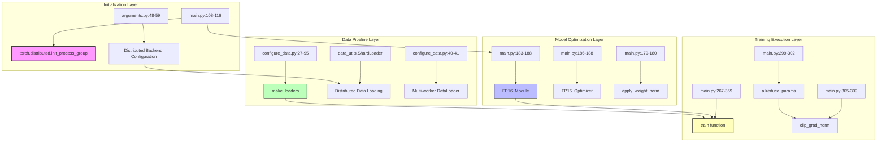
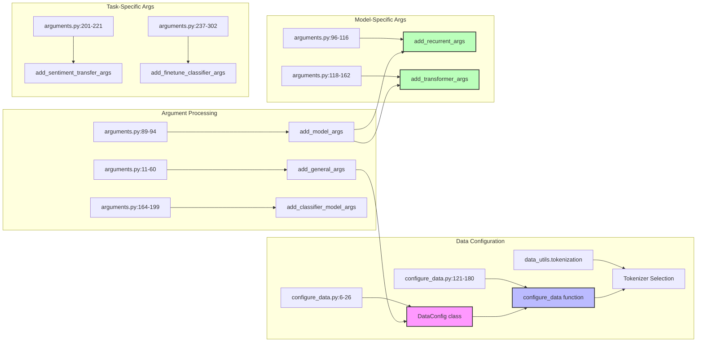
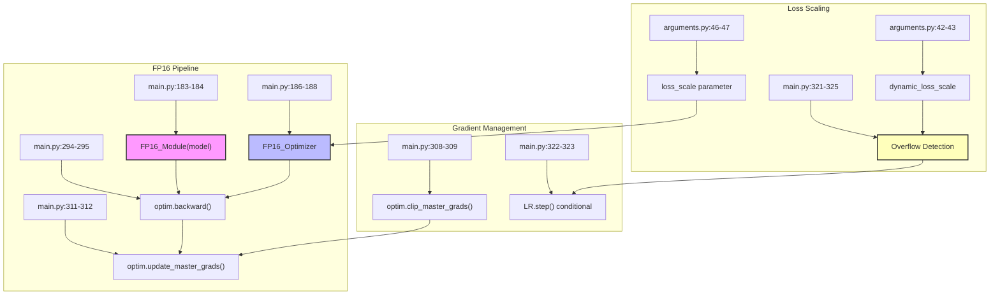

<!-- source: DeepWiki mcp.deepwiki.com · repo NVIDIA/sentiment-discovery · page 6 Advanced Topics · fetched 2026-10-26 -->

# Advanced Topics

Relevant source files

The following files were used as context for generating this wiki page:

- [arguments.py](arguments.py)
- [configure_data.py](configure_data.py)
- [data_utils/tokenization.py](data_utils/tokenization.py)
- [generate.py](generate.py)
- [main.py](main.py)

This section covers advanced features and technical implementation details for power users of the sentiment discovery framework. These topics include distributed training, mixed precision optimization, sophisticated configuration management, and performance tuning techniques that enable large-scale language model training and deployment.

For basic usage patterns and common workflows, see [Usage Workflows](#3). For research-focused analysis and reproduction guides, see [Research and Analysis](#5).

## System Architecture for Advanced Features

The sentiment discovery framework implements several sophisticated optimization techniques that enable efficient training of large language models. The system supports distributed training across multiple GPUs and nodes, mixed precision computation for memory efficiency, and advanced data loading strategies for high-throughput training.

### Advanced Training Pipeline

The training pipeline integrates distributed processing, mixed precision computation, and advanced gradient management. The `main.py:108-116` initialization handles multi-node setup, while `FP16_Module` and `FP16_Optimizer` provide memory-efficient computation.

Sources: [main.py:108-116](), [main.py:183-188](), [configure_data.py:27-95](), [main.py:267-369]()

### Configuration Management System

The configuration system uses modular argument groups that compose based on model type and task requirements. The `DataConfig` class in `configure_data.py:6-26` provides flexible data pipeline configuration, while task-specific argument functions enable specialized workflows.

Sources: [arguments.py:11-60](), [arguments.py:89-94](), [configure_data.py:6-26](), [configure_data.py:121-180]()

## Core Advanced Capabilities

### Distributed Training Infrastructure

The system implements sophisticated distributed training through PyTorch's native distributed capabilities. Key components include:

| Component | Implementation | Purpose |
|-----------|----------------|---------|
| **Process Group** | `main.py:114-115` | Multi-node communication setup |
| **Data Parallelism** | `main.py:211-212` | Model replication across devices |
| **Gradient Synchronization** | `main.py:299-302` | Parameter consistency via allreduce |
| **Rank Management** | `arguments.py:52-53` | Worker identification and coordination |

The distributed backend supports both `gloo` and `nccl` backends through `arguments.py:50-51`, with automatic device assignment in `main.py:109-110`.

Sources: [main.py:109-116](), [main.py:211-212](), [main.py:299-302](), [arguments.py:50-53]()

### Mixed Precision Training System

Mixed precision training reduces memory usage and increases training speed through the `FP16_Module` and `FP16_Optimizer` classes:

The FP16 system automatically handles gradient scaling, overflow detection, and master weight management to maintain training stability while reducing memory footprint.

Sources: [main.py:183-188](), [main.py:294-295](), [main.py:308-325](), [arguments.py:42-47]()

### Advanced Data Loading Strategies

The data loading system supports multiple sophisticated patterns:

#### Shard-Based Loading
- **Implementation**: `configure_data.py:42-44` configures `ShardLoader` for large datasets
- **State Persistence**: `arguments.py:75-76` controls hidden state management across shards
- **Distributed Sharding**: `configure_data.py:40-41` enables multi-worker data parallelism

#### Tokenization Flexibility
- **Character-Level**: `tokenization.py:122-165` provides `CharacterLevelTokenizer`
- **SentencePiece**: `tokenization.py:189-275` supports subword tokenization
- **Dynamic Training**: `tokenization.py:220-242` trains tokenizers on-demand

Sources: [configure_data.py:40-44](), [arguments.py:75-76](), [tokenization.py:122-165](), [tokenization.py:189-275]()

### Model Generation and Analysis

The framework includes advanced generation capabilities through `generate.py`:

#### Neuron-Level Control
- **Neuron Selection**: `generate.py:98-118` identifies maximally weighted neurons
- **Activation Overwriting**: `generate.py:120-126` enables controlled generation
- **Visualization**: `generate.py:180-204` creates activation heatmaps

#### Generation Pipeline
- **Temperature Sampling**: `generate.py:140-146` provides controllable randomness
- **Hidden State Manipulation**: `generate.py:128-138` enables fine-grained control
- **Text Processing**: `generate.py:148-162` handles input conditioning

Sources: [generate.py:98-118](), [generate.py:120-126](), [generate.py:140-146](), [generate.py:180-204]()

## Performance Optimization Features

### Memory Management
- **Gradient Checkpointing**: `arguments.py:56-57` enables memory-time tradeoffs
- **Weight Normalization**: `main.py:179-180` and `main.py:413-416` provide parameter reparameterization
- **Dynamic Batch Sizing**: `configure_data.py:29-36` adapts to world size

### Computational Efficiency  
- **Lazy Loading**: `arguments.py:73-74` defers data loading until needed
- **Multi-Worker Data Loading**: `configure_data.py:38-39` parallelizes preprocessing
- **Optimized Attention**: Transformer implementations use efficient attention mechanisms

### Training Stability
- **Gradient Clipping**: `main.py:305-309` prevents exploding gradients  
- **Learning Rate Scheduling**: Integration with `LinearLR` and other schedulers
- **Loss Scaling**: Automatic and manual loss scaling for FP16 training

Sources: [arguments.py:56-57](), [main.py:179-180](), [configure_data.py:29-39](), [main.py:305-309]()

The advanced features enable scaling language model training from single-GPU experiments to large-scale distributed training while maintaining training stability and computational efficiency. These capabilities support both research experimentation and production deployment scenarios.

---

