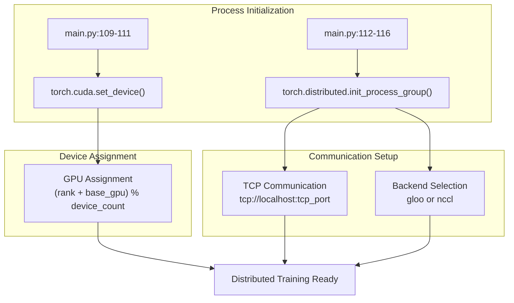
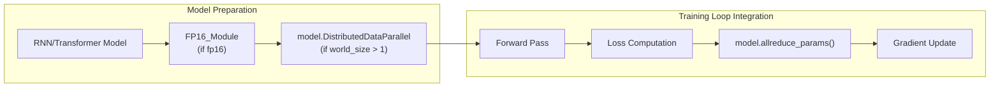
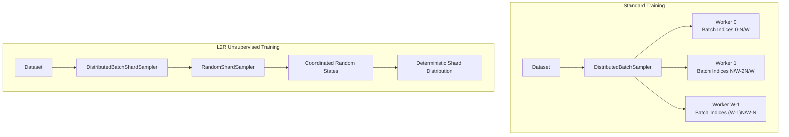
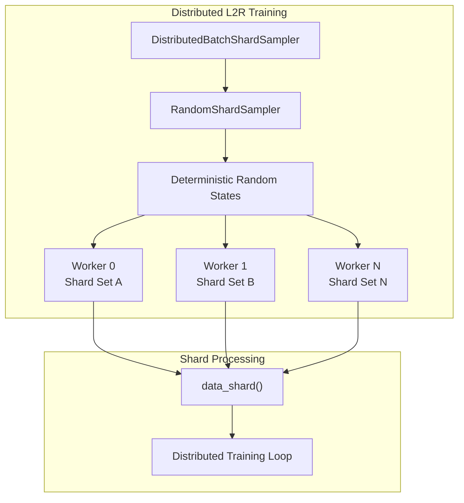

<!-- source: DeepWiki mcp.deepwiki.com · repo NVIDIA/sentiment-discovery · page 6.1 Distributed Training · fetched 2026-10-26 -->

# Distributed Training

<details>
<summary>Relevant source files</summary>

The following files were used as context for generating this wiki page:

- [configure_data.py](configure_data.py)
- [data_utils/loaders.py](data_utils/loaders.py)
- [data_utils/preprocess.py](data_utils/preprocess.py)
- [data_utils/samplers.py](data_utils/samplers.py)
- [data_utils/tokenization.py](data_utils/tokenization.py)
- [generate.py](generate.py)
- [main.py](main.py)

</details>


This document covers the multi-GPU and multi-node distributed training capabilities in the sentiment-discovery system. It explains how to configure and execute distributed training jobs using PyTorch's distributed package, including data parallelization, gradient synchronization, and process coordination.

For mixed precision training techniques that complement distributed training, see [Mixed Precision Training](#6.2). For general training configuration options, see [Configuration and Arguments](#6.3).

## Overview

The system supports distributed training across multiple GPUs and nodes using PyTorch's `torch.distributed` package with the `DistributedDataParallel` (DDP) pattern. The implementation provides automatic process group initialization, data distribution, gradient synchronization, and model checkpointing coordination.

### Key Components

The distributed training system consists of several integrated components:

| Component | Purpose | Key Classes |
|-----------|---------|-------------|
| Process Management | Initialize and coordinate distributed workers | `torch.distributed.init_process_group` |
| Model Parallelization | Wrap models for distributed training | `model.DistributedDataParallel` |
| Data Distribution | Distribute data across workers | `DistributedBatchSampler`, `DistributedBatchShardSampler` |
| Gradient Synchronization | Coordinate parameter updates | `model.allreduce_params()` |

Sources: [main.py:65-76](), [main.py:108-116](), [main.py:210-212](), [data_utils/samplers.py:11-74]()

## Process Group Initialization

### Command Line Configuration

Distributed training is configured through command-line arguments that specify the distributed topology:

```bash
python main.py \
    --world_size 4 \
    --rank 0 \
    --distributed_backend nccl \
    --base-gpu 0 \
    --tcp-port 6000
```

| Argument | Description | Default |
|----------|-------------|---------|
| `--world_size` | Total number of distributed workers | 1 |
| `--rank` | Rank of current worker (0 to world_size-1) | -1 |
| `--distributed_backend` | Communication backend (`gloo` or `nccl`) | `gloo` |
| `--base-gpu` | Base GPU device ID | 0 |
| `--tcp-port` | TCP port for process coordination | 6000 |

Sources: [main.py:65-76]()

### Process Group Setup

The system automatically initializes the distributed process group and assigns GPU devices:



The process group initialization occurs when `world_size > 1`, using TCP-based communication for worker coordination.

Sources: [main.py:108-116]()

## Model Parallelization

### DistributedDataParallel Wrapper

Models are automatically wrapped with `DistributedDataParallel` when distributed training is enabled:



The DDP wrapper handles:
- Forward pass distribution across workers
- Gradient reduction and synchronization
- Parameter broadcast to maintain consistency

Sources: [main.py:210-212](), [main.py:299-302]()

### Gradient Synchronization

During training, gradients are synchronized using all-reduce operations:

```python
# Loss reduction across workers
if distributed:
    torch.distributed.all_reduce(loss.data)
    loss.data /= args.world_size
    model.allreduce_params()
```

This ensures all workers have consistent gradients before the optimizer step.

Sources: [main.py:299-302]()

## Data Distribution

### Distributed Batch Sampling

The system uses specialized samplers to distribute data across workers without overlap:



The `DistributedBatchSampler` extracts worker-specific portions of each batch, while `DistributedBatchShardSampler` coordinates random shard sampling for unsupervised training.

Sources: [data_utils/samplers.py:11-74](), [data_utils/samplers.py:282-310]()

### Data Loader Configuration

Data loaders automatically adjust batch sizes and enable distributed sampling:

```python
# Batch size scaling
batch_size = opt.batch_size * opt.world_size
eval_batch_size = opt.eval_batch_size * opt.world_size

# Distributed loader arguments
data_loader_args = {
    'distributed': opt.world_size > 1,
    'rank': opt.rank, 
    'world_size': opt.world_size,
    'drop_last': opt.world_size > 1
}
```

This ensures each worker processes the appropriate data subset while maintaining global batch size consistency.

Sources: [configure_data.py:29-41]()

## Checkpointing and Synchronization

### Model Saving Coordination

Only the primary worker (rank 0) saves model checkpoints to prevent file conflicts:

```python
# Save only from primary worker
if args.save_iters and total_iters % args.save_iters == 0 and args.rank < 1:
    with open(model_path, 'wb') as f:
        torch.save(model.state_dict(), f)
```

This pattern is used for both periodic checkpoints and final model saving.

Sources: [main.py:340-343](), [main.py:401-403]()

### GPU Synchronization

CUDA synchronization ensures consistent timing and state across workers:

```python
if args.cuda:
    torch.cuda.synchronize()
```

This is particularly important during checkpointing operations.

Sources: [main.py:354-355]()

## Training Execution Patterns

### Multi-GPU Single Node

For single-node multi-GPU training, workers are typically launched using:

```bash
# Launch 4 workers on single node
for rank in {0..3}; do
    python main.py --world_size 4 --rank $rank --base-gpu 0 &
done
wait
```

### Multi-Node Training

Multi-node training requires coordination across machines:

```bash
# Node 0 (master)
python main.py --world_size 8 --rank 0 --tcp-port 6000

# Node 1
python main.py --world_size 8 --rank 4 --tcp-port 6000
```

The TCP port and master node address must be consistent across all workers.

Sources: [main.py:114-115]()

## Performance Considerations

### Backend Selection

| Backend | Use Case | Performance Characteristics |
|---------|----------|---------------------------|
| `nccl` | GPU-to-GPU communication | Optimized for NVIDIA GPUs, fastest for multi-GPU |
| `gloo` | CPU-based communication | More stable, works with CPU training |

### Memory Management

Distributed training impacts memory usage through:
- Model replication across workers
- Gradient buffer storage for synchronization
- Communication buffer allocation

The system integrates with FP16 training to reduce memory overhead while maintaining distributed coordination.

Sources: [main.py:67-68]()

## Integration with Other Systems

### L2R Unsupervised Training

The distributed system provides specialized support for Language Model (L2R) training through coordinated shard sampling:



This ensures each worker processes different data shards without communication overhead.

Sources: [data_utils/samplers.py:282-310](), [data_utils/loaders.py:170-188]()

### Mixed Precision Integration

Distributed training seamlessly integrates with FP16 operations, maintaining gradient synchronization while using reduced precision arithmetic. See [Mixed Precision Training](#6.2) for detailed coverage of this integration.

Sources: [main.py:294-325]()

---

