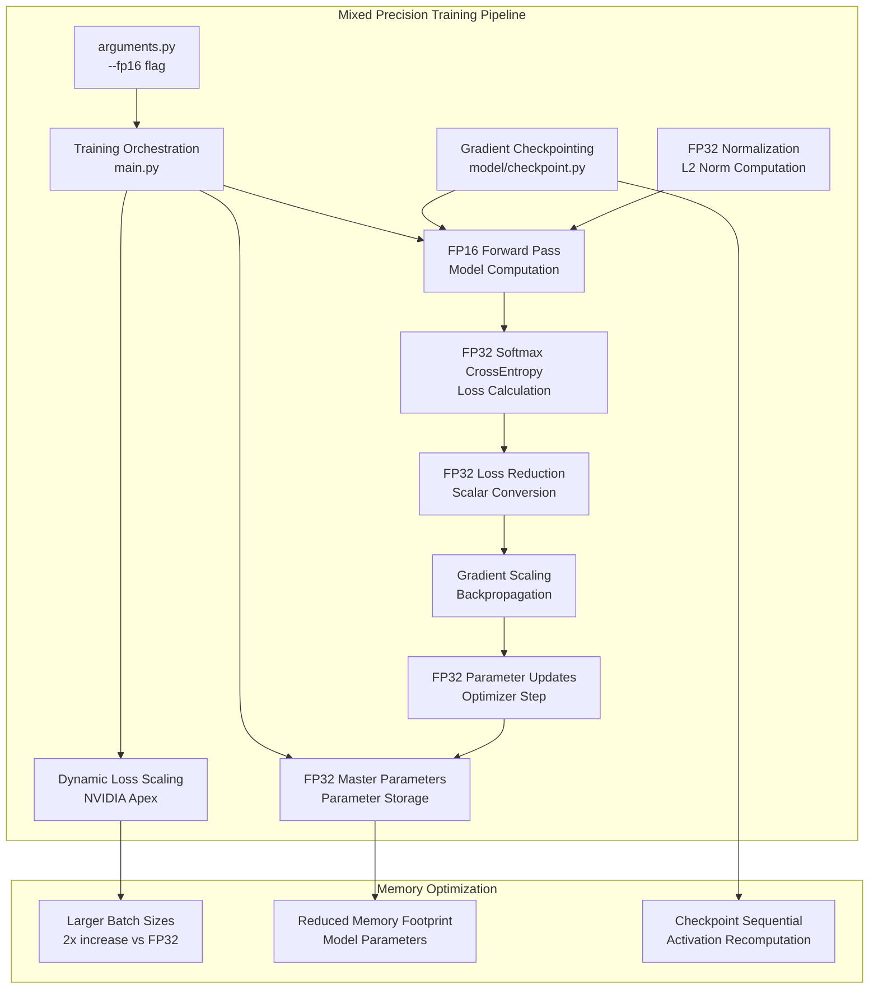
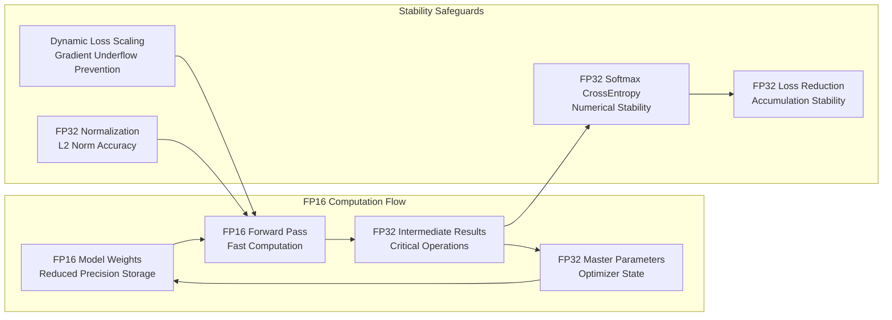
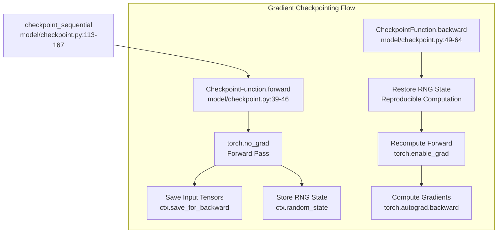
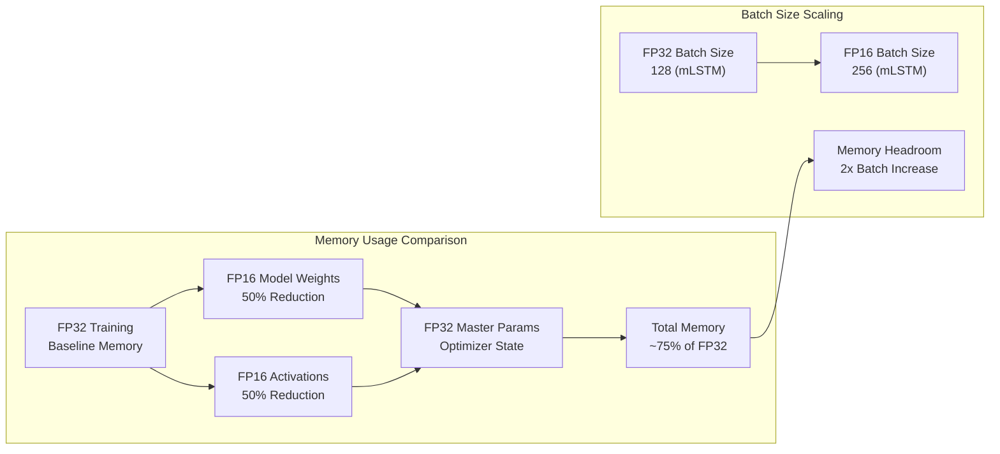

<!-- source: DeepWiki mcp.deepwiki.com · repo NVIDIA/sentiment-discovery · page 6.2 Mixed Precision Training · fetched 2026-10-26 -->

# Mixed Precision Training

<details>
<summary>Relevant source files</summary>

The following files were used as context for generating this wiki page:

- [analysis/reproduction.md](analysis/reproduction.md)
- [experiments/run_sk_imdb.sh](experiments/run_sk_imdb.sh)
- [experiments/run_sk_sst.sh](experiments/run_sk_sst.sh)
- [figures/plutchik-wheel.png](figures/plutchik-wheel.png)
- [figures/semeval_leaderboard.png](figures/semeval_leaderboard.png)
- [figures/semeval_results.PNG](figures/semeval_results.PNG)
- [logreg_utils.py](logreg_utils.py)
- [model/checkpoint.py](model/checkpoint.py)

</details>


This document covers the mixed precision (FP16) training implementation and optimization strategies used in the sentiment discovery codebase. Mixed precision training enables faster computation and larger batch sizes while maintaining model convergence quality. For information about distributed training setup, see [Distributed Training](#6.1). For general training configuration, see [Configuration and Arguments](#6.3).

## Overview

Mixed precision training in this codebase utilizes FP16 arithmetic to achieve significant performance improvements while maintaining numerical stability through carefully implemented safeguards. The implementation provides approximately 2x speedup from faster arithmetic and an additional 2x speedup from larger batch sizes, enabling training of larger models within memory constraints.

Sources: [analysis/reproduction.md:44-61]()

## Architecture and Integration

### Training Pipeline Integration



**Mixed Precision Training Components**: This diagram shows how FP16 training integrates with the broader training pipeline, highlighting key numerical stability techniques and memory optimizations.

Sources: [analysis/reproduction.md:44-61](), [model/checkpoint.py:67-167]()

### Numerical Stability Techniques



**Numerical Stability Architecture**: This diagram illustrates the flow between FP16 and FP32 operations, showing where precision is maintained for critical computations.

Sources: [analysis/reproduction.md:49-56]()

## Implementation Details

### Dynamic Loss Scaling

The implementation uses dynamic loss scaling to prevent gradient underflow during backpropagation. This technique iteratively finds an optimal scaling constant to preserve small gradients that would otherwise be lost in FP16 precision.

```python
# Dynamic loss scaling prevents gradient underflow
# Implemented via NVIDIA Apex integration
# Scales gradients before backprop, unscales before optimizer step
```

Sources: [analysis/reproduction.md:50]()

### FP32 Master Parameters

The system maintains FP32 copies of model parameters for gradient accumulation, providing minimal computational overhead while ensuring numerical accuracy in parameter updates.

```python
# FP32 master parameters for accurate gradient accumulation
# Elementwise additions are fast in FP32
# Can be stored on CPU to save GPU memory
```

Sources: [analysis/reproduction.md:51]()

### Critical FP32 Operations

Specific operations require FP32 precision to maintain numerical stability:

- **Softmax CrossEntropy**: Uses FP32 intermediate logits to handle harsh exponentiation
- **Loss Reduction**: Converts loss scalars to FP32 for averaging operations over 65k+ terms
- **L2 Normalization**: Computes norms in FP32 when values exceed 256 to avoid dynamic range issues

Sources: [analysis/reproduction.md:52-56]()

## Gradient Checkpointing Integration

The `CheckpointFunction` class provides memory-efficient training by trading compute for memory, which complements mixed precision training for larger models.

### Checkpointing Implementation



**Gradient Checkpointing Flow**: Shows how gradient checkpointing works with mixed precision to enable larger model training through memory-compute tradeoffs.

Sources: [model/checkpoint.py:36-167]()

## Performance Characteristics

### Training Speed Improvements

The mixed precision implementation delivers measurable performance gains:

- **2x speedup** from FP16 arithmetic operations
- **2x additional speedup** from larger batch sizes (128→256 for mLSTM, 32→64+ for other models)
- **Reduced training time**: mLSTM training reduced from extended periods to approximately 17 hours
- **Larger model capability**: Enables training of 8k hidden state models

Sources: [analysis/reproduction.md:34-37](), [analysis/reproduction.md:20](), [analysis/reproduction.md:65]()

### Memory Efficiency



**Memory Efficiency Gains**: Illustrates how mixed precision reduces memory usage while enabling larger batch sizes for improved training efficiency.

Sources: [analysis/reproduction.md:34-35](), [analysis/reproduction.md:45]()

## Convergence Validation

The implementation maintains training convergence comparable to FP32 training across different model architectures:

- **mLSTM models**: Achieve convergence metrics matching OpenAI's FP32 results
- **Transformer models**: 3-day training time with maintained performance
- **Large models**: Successfully trains 8k hidden state models that exceed previous state-of-the-art

The convergence validation ensures that performance gains don't compromise model quality.

Sources: [analysis/reproduction.md:58-70]()

## Configuration and Usage

Mixed precision training is enabled through command-line arguments and integrates with existing training scripts:

```bash
# Example usage in transfer learning
python3 transfer.py --load mlstm.pt --data ./data/imdb/train.json --fp16
```

The `--fp16` flag activates the complete mixed precision training pipeline including dynamic loss scaling, FP32 master parameters, and numerical stability safeguards.

Sources: [experiments/run_sk_imdb.sh:2]()

---

