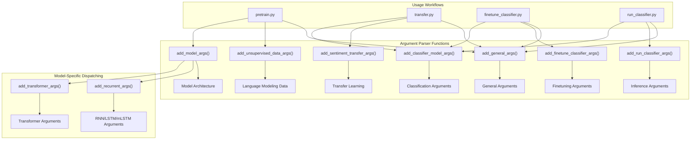
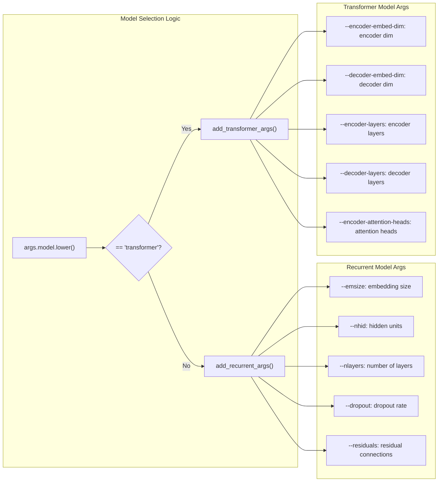
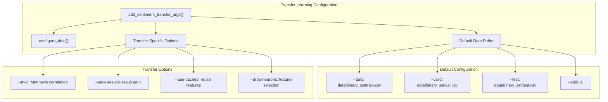
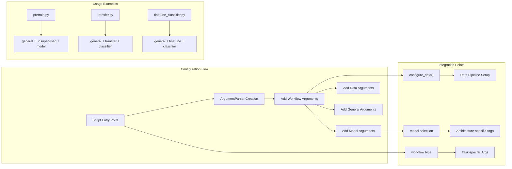

<!-- source: DeepWiki mcp.deepwiki.com · repo NVIDIA/sentiment-discovery · page 6.3 Configuration and Arguments · fetched 2026-10-26 -->

# Configuration and Arguments

Relevant source files

The following files were used as context for generating this wiki page:

- [arguments.py](arguments.py)

This document provides a comprehensive reference for all command-line arguments and configuration options available in the sentiment-discovery system. The configuration system is centralized in `arguments.py` and provides modular argument groups for different training workflows including language model pretraining, transfer learning, classifier finetuning, and model inference.

For information about data-specific configuration options, see [Data Processing System](#2.1). For distributed training setup, see [Distributed Training](#6.1). For mixed precision configuration, see [Mixed Precision Training](#6.2).

## Configuration System Architecture

The argument system is organized into modular functions that add specific argument groups to an argument parser. Each workflow (pretraining, transfer, finetuning, etc.) combines relevant argument groups to create its complete configuration interface.

**Argument Configuration Architecture**

Sources: [arguments.py:11-302]()

## Core Argument Groups

### General Arguments (`add_general_args`)

The general argument group contains fundamental training parameters used across all workflows.

| Argument | Type | Default | Description |
|----------|------|---------|-------------|
| `--model` | str | 'mLSTM' | Model type: RNNTanh, RNNReLU, LSTM, mLSTM, GRU |
| `--lr` | float | 5e-4 | Initial learning rate |
| `--constant-decay` | int | None | Iterations to decay LR over |
| `--clip` | float | 0 | Gradient clipping threshold |
| `--epochs` | int | 1 | Maximum epochs to train |
| `--tied` | flag | False | Tie word embedding and softmax weights |
| `--seed` | int | 1234 | Random seed |
| `--save` | str | 'lang_model.pt' | Path to save final model |
| `--load` | str | None | Path to load model checkpoint |
| `--save-iters` | int | 10000 | Model checkpoint save interval |

#### Mixed Precision and Optimization

| Argument | Type | Default | Description |
|----------|------|---------|-------------|
| `--fp16` | flag | False | Enable mixed precision training |
| `--dynamic-loss-scale` | flag | False | Dynamic loss scaling for FP16 |
| `--loss-scale` | float | 1 | Static loss scaling factor |
| `--optim` | str | 'Adam' | PyTorch optimizer (Adam, SGD, etc.) |
| `--chkpt-grad` | flag | False | Gradient checkpointing for memory |

#### Distributed Training

| Argument | Type | Default | Description |
|----------|------|---------|-------------|
| `--world-size` | int | 1 | Number of distributed workers |
| `--distributed-backend` | str | 'gloo' | Backend: gloo or nccl |
| `--rank` | int | -1 | Distributed worker rank |
| `--multinode-init` | flag | False | Initialize multinode training |

Sources: [arguments.py:11-60]()

### Language Modeling Data Arguments (`add_unsupervised_data_args`)

These arguments configure data loading and processing for unsupervised language model pretraining.

| Argument | Type | Default | Description |
|----------|------|---------|-------------|
| `--seq-length` | int | 256 | Maximum sequence length for training |
| `--eval-seq-length` | int | 256 | Maximum sequence length for evaluation |
| `--lazy` | flag | False | Enable lazy dataset evaluation |
| `--persist-state` | int | 1 | State persistence: 0=reset per sample, 1=reset per shard, -1=never reset |
| `--train-iters` | int | 1000 | Training iterations per epoch |
| `--eval-iters` | int | 100 | Evaluation iterations per epoch |

#### Learning Rate Scheduling

| Argument | Type | Default | Description |
|----------|------|---------|-------------|
| `--decay-style` | str | None | LR decay: constant, linear, cosine, exponential |
| `--stlr-cut-frac` | float | None | Slanted triangular LR peak fraction |
| `--warmup` | float | 0 | Warmup percentage of training iterations |

Sources: [arguments.py:62-87]()

## Model Architecture Arguments

The system dynamically selects architecture-specific arguments based on the `--model` parameter through `add_model_args()`.

**Model Architecture Configuration Flow**

Sources: [arguments.py:89-95]()

### Recurrent Model Arguments (`add_recurrent_args`)

| Argument | Type | Default | Description |
|----------|------|---------|-------------|
| `--emsize` | int | 64 | Word embedding dimension |
| `--nhid` | int | 4096 | Hidden units per layer |
| `--nlayers` | int | 1 | Number of RNN layers |
| `--dropout` | float | 0.0 | Dropout probability |
| `--residuals` | flag | False | Enable residual connections |

#### Neural Alphabet Encoding

| Argument | Type | Default | Description |
|----------|------|---------|-------------|
| `--neural-alphabet` | flag | False | Enable neural alphabet encoder |
| `--alphabet-size` | int | 128 | Neural alphabet size |
| `--ncontext` | int | 2 | Context characters for neural alphabet |

#### Transfer Learning Specific

| Argument | Type | Default | Description |
|----------|------|---------|-------------|
| `--num-hidden-warmup` | int | 0 | Hidden state warmup passes |

Sources: [arguments.py:96-116]()

### Transformer Model Arguments (`add_transformer_args`)

#### Encoder Configuration

| Argument | Type | Default | Description |
|----------|------|---------|-------------|
| `--encoder-embed-dim` | int | 64 | Encoder embedding dimension |
| `--encoder-ffn-embed-dim` | int | 256 | Encoder FFN dimension |
| `--encoder-layers` | int | 6 | Number of encoder layers |
| `--encoder-attention-heads` | int | 8 | Encoder attention heads |
| `--encoder-normalize-before` | flag | False | Pre-layer normalization |
| `--encoder-learned-pos` | flag | False | Learned positional embeddings |

#### Decoder Configuration

| Argument | Type | Default | Description |
|----------|------|---------|-------------|
| `--decoder-embed-dim` | int | 64 | Decoder embedding dimension |
| `--decoder-ffn-embed-dim` | int | 256 | Decoder FFN dimension |
| `--decoder-layers` | int | 6 | Number of decoder layers |
| `--decoder-attention-heads` | int | 8 | Decoder attention heads |
| `--decoder-normalize-before` | flag | False | Pre-layer normalization |
| `--decoder-learned-pos` | flag | False | Learned positional embeddings |

#### Dropout Configuration

| Argument | Type | Default | Description |
|----------|------|---------|-------------|
| `--dropout` | float | 0.1 | General dropout probability |
| `--attention-dropout` | float | 0.0 | Attention weight dropout |
| `--relu-dropout` | float | 0.1 | FFN ReLU dropout |

#### Embedding Sharing

| Argument | Type | Default | Description |
|----------|------|---------|-------------|
| `--share-decoder-input-output-embed` | flag | False | Share decoder input/output embeddings |
| `--share-all-embeddings` | flag | False | Share encoder/decoder/output embeddings |
| `--use-final-embed` | flag | False | Use final timestep for classification |

Sources: [arguments.py:118-162]()

## Classification Arguments

### Base Classifier Arguments (`add_classifier_model_args`)

These arguments configure the classification layer and feature extraction for sentiment analysis tasks.

#### Model Architecture

| Argument | Type | Default | Description |
|----------|------|---------|-------------|
| `--max-seq-len` | int | None | Maximum sequence length for classification |
| `--classifier-hidden-layers` | list | None | Hidden layer sizes for MLP classifier |
| `--classifier-hidden-activation` | str | 'PReLU' | Activation function for hidden layers |
| `--classifier-dropout` | float | 0.1 | Dropout in classifier layers |
| `--neurons` | int | 1 | Number of neurons to extract as features |
| `--heads-per-class` | int | 1 | Multiple heads per class for regularization |

#### Feature Extraction Configuration

| Argument | Type | Default | Description |
|----------|------|---------|-------------|
| `--all-layers` | flag | False | Extract features from all layers |
| `--get-hidden` | flag | False | Use hidden state as features |
| `--concat-max` | flag | False | Concatenate max pooling |
| `--concat-min` | flag | False | Concatenate min pooling |
| `--concat-mean` | flag | False | Concatenate mean pooling |

#### Multi-label Classification

| Argument | Type | Default | Description |
|----------|------|---------|-------------|
| `--use-softmax` | flag | False | Use softmax for classification |
| `--double-thresh` | flag | False | Report all metrics simultaneously |
| `--dual-thresh` | flag | False | Enable positive/negative/neutral labels |
| `--joint-binary-train` | flag | False | Train with dual thresholds and binary classes |

Sources: [arguments.py:164-199]()

## Workflow-Specific Arguments

### Transfer Learning Arguments (`add_sentiment_transfer_args`)

**Transfer Learning Configuration Structure**

| Argument | Type | Default | Description |
|----------|------|---------|-------------|
| `--mcc` | flag | False | Use Matthews correlation coefficient |
| `--save-results` | str | 'sentiment' | Path to save transfer results |
| `--no-test-eval` | flag | False | Skip test evaluation |
| `--write-results` | str | '' | Write model results to file |
| `--use-cached` | flag | False | Reuse cached featurizations |
| `--drop-neurons` | flag | False | Drop top neurons instead of keeping |

Sources: [arguments.py:201-221]()

### Classifier Inference Arguments (`add_run_classifier_args`)

| Argument | Type | Default | Description |
|----------|------|---------|-------------|
| `--save_probs` | str | 'clf_results.npy' | Path to save predicted probabilities |
| `--write-results` | str | '' | Path for CSV results output |

Sources: [arguments.py:223-235]()

### Finetuning Arguments (`add_finetune_classifier_args`)

#### Training Configuration

| Argument | Type | Default | Description |
|----------|------|---------|-------------|
| `--use-logreg` | flag | False | Use scikit-learn logistic regression |
| `--lr-decay` | float | 1.0 | Learning rate decay multiplier per epoch |
| `--momentum` | float | 0.0 | SGD momentum |
| `--weight-decay` | float | 0 | Weight decay for optimization |
| `--freeze-lm` | flag | False | Freeze language model parameters |

#### Learning Rate Scheduling

| Argument | Type | Default | Description |
|----------|------|---------|-------------|
| `--stlr-cut-frac` | float | None | Slanted triangular LR peak fraction |
| `--cos-cut-frac` | float | None | Cosine LR peak fraction |
| `--decay-style` | str | None | LR decay: constant, linear, cosine, exponential |
| `--warmup-epochs` | float | 0.0 | Warmup epochs |
| `--decay-epochs` | float | -1 | Decay epochs (-1 for all training) |

#### Auxiliary Losses and Multi-head Training

| Argument | Type | Default | Description |
|----------|------|---------|-------------|
| `--aux-lm-loss` | flag | False | Use auxiliary language modeling loss |
| `--aux-lm-loss-weight` | float | 1.0 | Weight for auxiliary LM loss |
| `--aux-head-variance-loss-weight` | float | 0 | Force head diversity loss weight |
| `--use-class-multihead-average` | flag | False | Average multihead outputs per class |

#### Evaluation and Thresholding

| Argument | Type | Default | Description |
|----------|------|---------|-------------|
| `--report-metric` | str | 'f1' | Primary metric: jacc, acc, f1, mcc, precision, recall |
| `--threshold-metric` | str | 'f1' | Metric for threshold selection |
| `--automatic-thresholding` | flag | False | Auto-select classification thresholds |
| `--micro` | flag | False | Use micro-averaging for metrics |
| `--all-metrics` | flag | False | Report all metrics simultaneously |
| `--global-tweaks` | int | 0 | Tweak individual thresholds toward global average |

#### Model Saving and Loading

| Argument | Type | Default | Description |
|----------|------|---------|-------------|
| `--save-finetune` | flag | False | Save models at every finetuning epoch |
| `--model-version-name` | str | 'classifier' | Model versioning name |
| `--load-finetuned` | flag | False | Load previously finetuned checkpoint |
| `--no-test-eval` | flag | False | Skip test metrics, write results to disk |

Sources: [arguments.py:237-302]()

## Configuration Integration Patterns

The argument system integrates with other components through standardized patterns:

**Configuration Integration Architecture**

This modular approach allows each script to compose exactly the arguments it needs while maintaining consistency across the codebase.

Sources: [arguments.py:1-302]()