# Page: Overview

# Overview

<details>
<summary>Relevant source files</summary>

The following files were used as context for generating this wiki page:

- [README.md](README.md)
- [data/semeval/test.csv](data/semeval/test.csv)
- [data/semeval/train.csv](data/semeval/train.csv)
- [data/semeval/val.csv](data/semeval/val.csv)

</details>


This document provides a technical overview of the sentiment-discovery repository, a PyTorch-based system for large-scale unsupervised language model pretraining and sentiment analysis. The system implements techniques for training language models on unlabeled text data and transferring the learned representations to downstream sentiment classification tasks.

**Note:** This repository has been deprecated in favor of [Megatron-LM](https://github.com/NVIDIA/Megatron-LM), but remains valuable for understanding established pretraining and transfer learning methodologies.

The system covers the complete machine learning pipeline from data preprocessing through model pretraining to downstream task evaluation. For detailed configuration options, see [Configuration and Arguments](#6.3). For reproduction of research results, see [Reproduction Guide](#5.1).

## System Architecture

The sentiment-discovery system follows a two-stage approach: unsupervised language model pretraining followed by supervised task adaptation. The architecture consists of modular components that can be combined for different use cases.

### High-Level Workflow

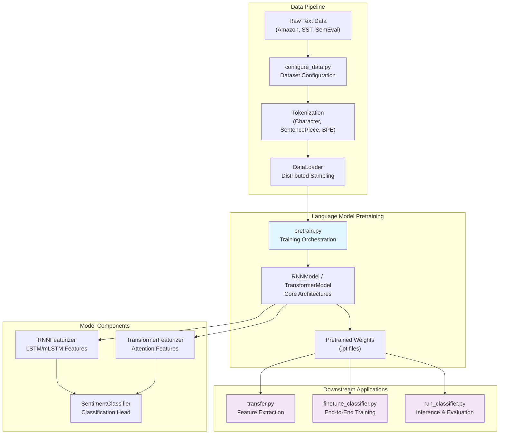

**System Architecture Overview**
This diagram shows the main execution flow from raw data through pretraining to downstream applications. The system separates concerns between data processing, model training, and task-specific inference.

Sources: [README.md:107-196](), [README.md:28-63]()

### Core Model Architecture

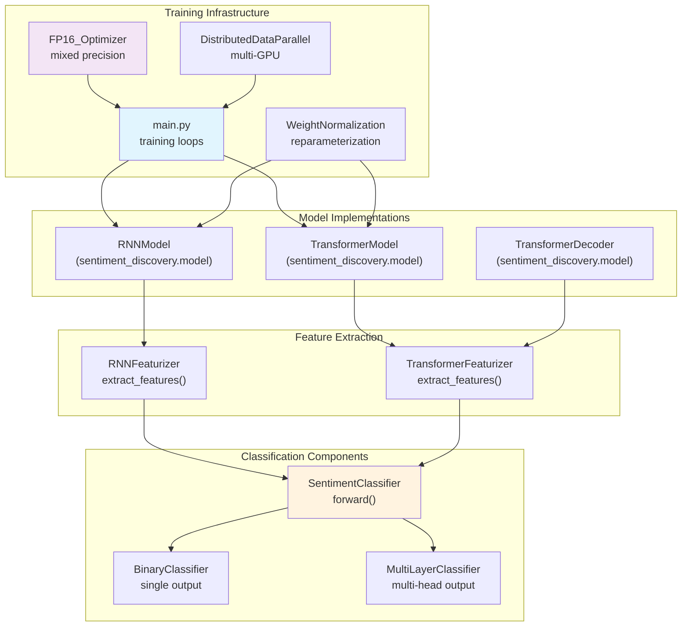

**Model Architecture Components**
This diagram maps natural language model concepts to specific code entities, showing how different model types connect to feature extractors and classification heads.

Sources: [README.md:129-196](), [README.md:81-102]()

## Core Components

### Language Models
The system implements multiple neural architecture types through the `sentiment_discovery.model` module:

- **RNNModel**: Supports LSTM, mLSTM, and GRU variants with weight normalization
- **TransformerModel**: Encoder-decoder architecture with learned positional embeddings  
- **TransformerDecoder**: GPT-style autoregressive decoder

Each model type can be configured through command-line arguments processed by `arguments.py` and instantiated via the training scripts.

### Feature Extractors
Feature extraction is handled by specialized classes that convert trained language models into feature representations:

- **RNNFeaturizer**: Extracts hidden state features from RNN-based models
- **TransformerFeaturizer**: Extracts attention-based features from Transformer models

These extractors enable transfer learning by providing fixed or fine-tunable representations for downstream tasks.

### Data Processing
The data pipeline centers around `configure_data.py`, which handles:

- **Tokenization**: Character-level, SentencePiece, and BPE tokenization options
- **Dataset Loading**: CSV and JSON formats with lazy loading for large datasets
- **Distributed Sampling**: Sharded data loading for multi-GPU training

## Main Workflows

### Language Model Pretraining
Primary entry point: `pretrain.py`

Trains language models on large text corpora using unsupervised objectives. Supports distributed training across multiple GPUs and mixed-precision training through NVIDIA Apex integration.

| Model Type | Architecture | Key Features |
|------------|-------------|--------------|
| mLSTM | Recurrent | Weight normalization, 4096-d hidden |
| Transformer | Attention | 12 layers, 768-d embeddings |

### Transfer Learning  
Primary entry point: `transfer.py`

Extracts fixed features from pretrained models and trains lightweight classifiers (typically logistic regression) on top. Includes feature selection to identify the most relevant neurons for sentiment classification.

### End-to-End Finetuning
Primary entry point: `finetune_classifier.py`

Trains classification models end-to-end, backpropagating through both the classifier and language model encoder. Supports:

- Multi-label and multi-head classification
- Auxiliary language modeling loss
- Automatic threshold selection based on validation metrics

### Model Inference
Primary entry point: `run_classifier.py`

Performs inference on new data using trained classification models. Outputs prediction probabilities saved as `.npy` files.

## Key Capabilities

The system provides several advanced features for large-scale language model training and evaluation:

**Mixed Precision Training**: FP16 training support through NVIDIA Apex, reducing memory usage and accelerating training on modern GPUs.

**Distributed Training**: Multi-GPU and multi-node training capabilities with automatic gradient synchronization.

**Flexible Tokenization**: Support for character-level, subword (SentencePiece), and byte-pair encoding tokenization schemes.

**Comprehensive Evaluation**: Built-in metrics including F1-score, Matthews correlation coefficient, Jaccard index, and automatic threshold selection.

**Research Reproducibility**: Predefined experiment scripts for reproducing paper results on standard benchmarks (SST, IMDB, SemEval).

The system demonstrates competitive performance on sentiment analysis benchmarks while providing a flexible framework for experimenting with different architectures and training procedures.

Sources: [README.md:1-63](), [README.md:107-196](), [data/semeval/train.csv:1-10](), [data/semeval/test.csv:1-10]()

---

# Page: Installation and Setup

# Installation and Setup

<details>
<summary>Relevant source files</summary>

The following files were used as context for generating this wiki page:

- [setup.py](setup.py)

</details>


This document provides comprehensive instructions for installing the sentiment-discovery package and setting up the required environment. It covers system requirements, dependency management, installation procedures, and environment verification steps.

For information about basic usage workflows after installation, see [Quick Start Guide](#1.2). For advanced distributed training setup, see [Distributed Training](#6.1).

## System Requirements

The sentiment-discovery package requires specific versions of core dependencies and has been designed to work with modern deep learning hardware configurations.

### Core Dependencies

The package enforces strict version requirements for PyTorch compatibility as defined in [`setup.py:9-11`]():

| Component | Requirement | Purpose |
|-----------|-------------|---------|
| PyTorch | ≥ 0.4.0 | Core deep learning framework |
| Python | ≥ 3.6 | Runtime environment |
| CUDA | ≥ 9.0 (recommended) | GPU acceleration |
| NVIDIA Apex | Optional | Mixed precision training |

### Hardware Requirements

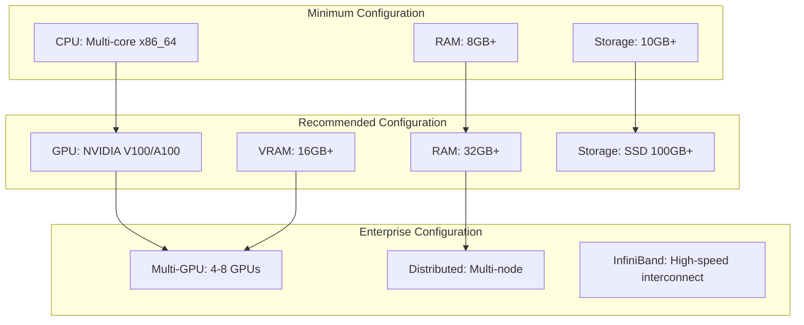

**Installation Hardware Compatibility Matrix**

Sources: [`setup.py:5-11`]()

## Installation Process

### Standard Installation

The package uses standard Python packaging tools with dependency resolution handled by `setuptools`. The installation process includes automatic PyTorch version validation.

#### Step 1: Environment Preparation

```bash
# Create virtual environment (recommended)
python -m venv sentiment_discovery_env
source sentiment_discovery_env/bin/activate  # Linux/Mac
# or
sentiment_discovery_env\Scripts\activate     # Windows
```

#### Step 2: PyTorch Installation

Install PyTorch first to ensure compatibility:

```bash
# CPU-only version
pip install torch torchvision torchaudio --index-url https://download.pytorch.org/whl/cpu

# CUDA version (recommended)
pip install torch torchvision torchaudio --index-url https://download.pytorch.org/whl/cu118
```

#### Step 3: Package Installation

```bash
# Install from source (recommended for development)
git clone https://github.com/NVIDIA/sentiment-discovery.git
cd sentiment-discovery
pip install -e .

# Or install dependencies only
pip install -r requirements.txt  # if requirements.txt exists
```

### Dependency Installation Flow

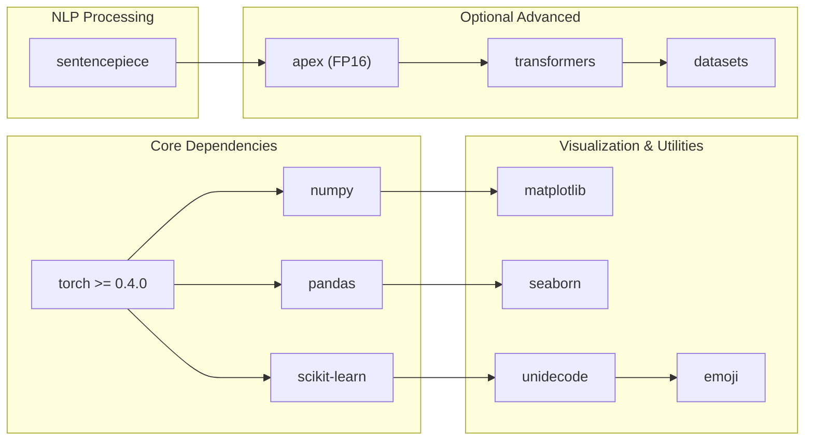

**Dependency Resolution and Installation Order**

Sources: [`setup.py:19-28`]()

### Development Installation

For contributors and researchers who need to modify the codebase:

```bash
# Clone with development dependencies
git clone https://github.com/NVIDIA/sentiment-discovery.git
cd sentiment-discovery

# Install in editable mode
pip install -e .

# Install additional development tools (optional)
pip install pytest black flake8 jupyter
```

## Environment Configuration

### GPU Support Setup

The package automatically detects CUDA availability but requires proper NVIDIA driver installation:

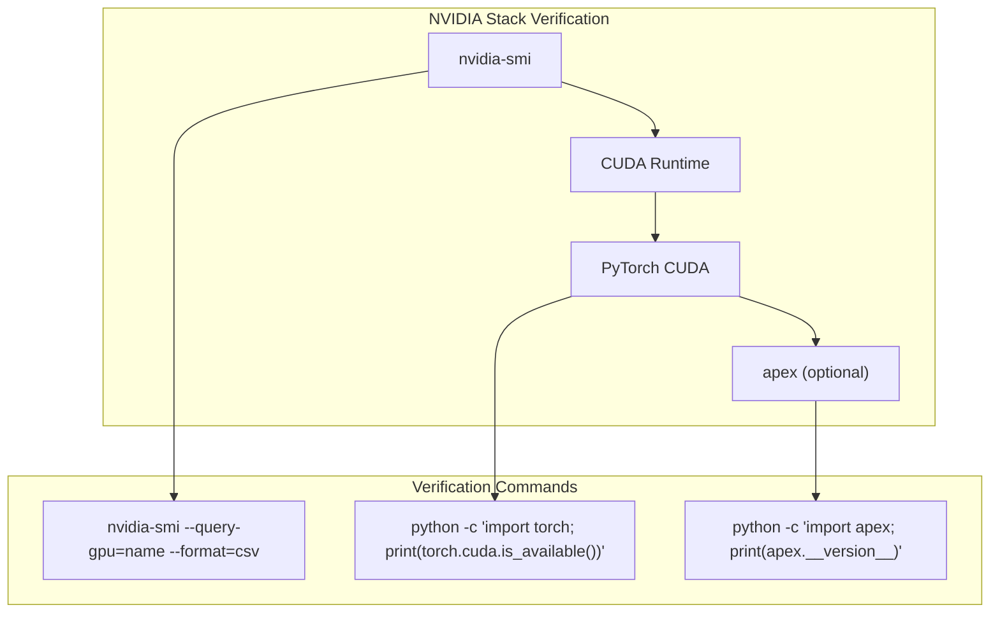

**GPU Environment Verification Process**

### Mixed Precision Training Setup

For optimal training performance with NVIDIA Apex:

```bash
# Install NVIDIA Apex (optional but recommended)
git clone https://github.com/NVIDIA/apex
cd apex
pip install -v --disable-pip-version-check --no-cache-dir --global-option="--cpp_ext" --global-option="--cuda_ext" ./
```

Sources: [System diagrams](), [`setup.py:1-29`]()

## Installation Verification

### Basic Functionality Test

Create a simple verification script to ensure proper installation:

```python
# test_installation.py
import sentiment_discovery
import torch
import numpy as np
import pandas as pd
import sentencepiece as spm

print(f"sentiment_discovery available: {sentiment_discovery.__name__}")
print(f"PyTorch version: {torch.__version__}")
print(f"CUDA available: {torch.cuda.is_available()}")
print(f"CUDA device count: {torch.cuda.device_count()}")

# Test basic imports from main modules
try:
    from sentiment_discovery.model import RNNModel, TransformerModel
    from sentiment_discovery.data_utils import Tokenizer
    print("Core modules imported successfully")
except ImportError as e:
    print(f"Import error: {e}")
```

### Component Verification Matrix

| Component | Verification Command | Expected Output |
|-----------|---------------------|-----------------|
| Package | `python -c "import sentiment_discovery"` | No errors |
| PyTorch | `python -c "import torch; print(torch.__version__)"` | Version ≥ 0.4.0 |
| CUDA | `python -c "import torch; print(torch.cuda.is_available())"` | `True` (if GPU present) |
| SentencePiece | `python -c "import sentencepiece"` | No errors |
| Core Models | `python -c "from sentiment_discovery.model import RNNModel"` | No errors |

### Advanced Verification

For distributed training and advanced features:

```bash
# Test distributed capabilities
python -c "import torch.distributed as dist; print('Distributed available:', dist.is_available())"

# Test mixed precision (if apex installed)
python -c "try: import apex; print('Apex version:', apex.__version__); except: print('Apex not available')"

# Memory and compute verification
python -c "import torch; print('GPU memory:', torch.cuda.get_device_properties(0).total_memory if torch.cuda.is_available() else 'N/A')"
```

Sources: [`setup.py:5-11`](), [System integration diagrams]()

## Troubleshooting Common Issues

### PyTorch Version Conflicts

The package enforces PyTorch version requirements through runtime checks:

```python
# From setup.py lines 9-11
if TORCH_MAJOR == 0 and TORCH_MINOR < 4:
    raise RuntimeError("Sentiment Discovery requires Pytorch 0.4 or newer.")
```

**Resolution**: Upgrade PyTorch to a compatible version before installation.

### CUDA Compatibility Issues

Common CUDA-related installation problems:

| Issue | Symptom | Solution |
|-------|---------|----------|
| Driver mismatch | `CUDA driver version is insufficient` | Update NVIDIA drivers |
| CUDA not found | `torch.cuda.is_available() = False` | Install CUDA toolkit |
| cuDNN missing | Runtime errors during training | Install cuDNN libraries |
| Memory errors | OOM during model loading | Reduce batch size or use FP16 |

### Dependency Resolution

For package conflicts or missing dependencies:

```bash
# Clean installation
pip uninstall sentiment_discovery
pip cache purge
pip install -e . --force-reinstall --no-deps
pip install <missing_dependency>
```

Sources: [`setup.py:9-11`](), [System requirements analysis]()

## Next Steps

After successful installation:

1. **Basic Usage**: See [Quick Start Guide](#1.2) for common workflows
2. **Data Setup**: Configure data processing with [Data Processing System](#2.1)  
3. **Model Training**: Begin with [Language Model Pretraining](#3.1)
4. **Advanced Features**: Explore [Distributed Training](#6.1) and [Mixed Precision Training](#6.2)

The installation provides access to all core components including data processing utilities, model architectures, training infrastructure, and evaluation tools as outlined in the system architecture diagrams.

Sources: [`setup.py:1-29`](), [High-level system workflow overview](), [System integration diagrams]()

---

# Page: Quick Start Guide

# Quick Start Guide

<details>
<summary>Relevant source files</summary>

The following files were used as context for generating this wiki page:

- [README.md](README.md)
- [data/semeval/test.csv](data/semeval/test.csv)
- [data/semeval/train.csv](data/semeval/train.csv)
- [data/semeval/val.csv](data/semeval/val.csv)
- [experiments/run_se_multihead.sh](experiments/run_se_multihead.sh)
- [experiments/run_se_singlehead.sh](experiments/run_se_singlehead.sh)

</details>


This guide provides step-by-step instructions for the most common workflows in the sentiment-discovery repository: language model pretraining, transfer learning, classifier finetuning, and inference. For detailed configuration options, see [Configuration and Arguments](#6.3). For distributed training setup, see [Distributed Training](#6.1).

## Overview

The sentiment-discovery repository implements a two-stage approach for sentiment analysis:

1. **Unsupervised Pretraining**: Train language models on large text corpora using `pretrain.py`
2. **Downstream Application**: Apply pretrained models to sentiment tasks using three approaches:
   - **Feature extraction** with `transfer.py` 
   - **End-to-end finetuning** with `finetune_classifier.py`
   - **Inference** with `run_classifier.py`

## Main Workflow Overview

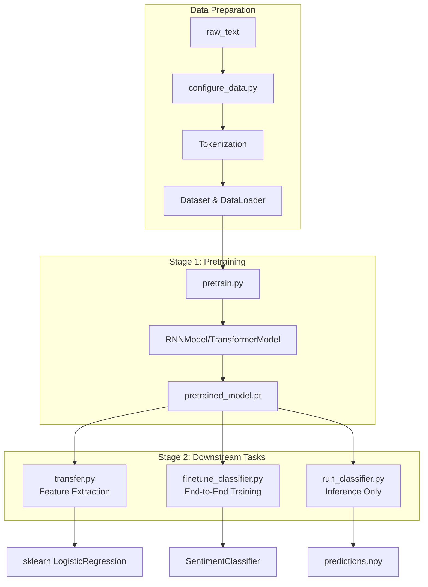

Sources: [README.md:107-149](), [pretrain.py](), [transfer.py](), [finetune_classifier.py](), [run_classifier.py]()

## Prerequisites and Installation

Install the package and dependencies:

```bash
python3 setup.py install
```

**Required Dependencies:**
- PyTorch (>= 0.4.1)
- scikit-learn  
- pandas
- sentencepiece
- numpy

Sources: [README.md:66-79]()

## Quick Start: Running Pretrained Models

### Classification with Pretrained Models

The fastest way to get started is using the provided pretrained models for classification:

```bash
# Download pretrained models (see README for links)
python3 run_classifier.py --load_model ama_sst.pt                           # Binary SST classification
python3 run_classifier.py --load_model ama_sst.pt --fp16                    # FP16 inference
python3 run_classifier.py --load_model ama_sst.pt --text-key <column> --data <file.csv>  # Custom data
```

### Model Architecture and Code Mapping

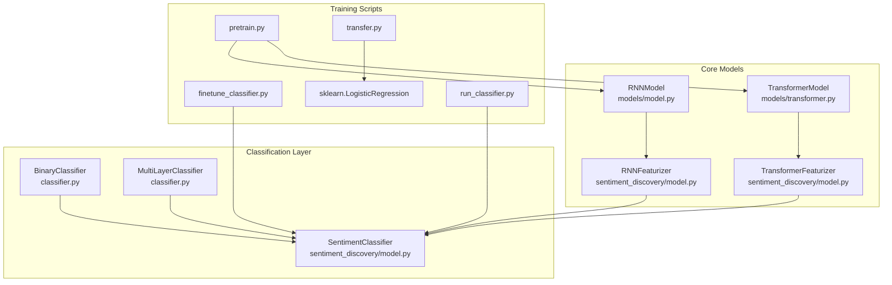

Sources: [sentiment_discovery/model.py](), [models/model.py](), [models/transformer.py](), [classifier.py](), [pretrain.py](), [finetune_classifier.py](), [transfer.py](), [run_classifier.py]()

## Training Your Own Models

### 1. Language Model Pretraining

Train a language model on your text corpus as the foundation for downstream tasks:

```bash
# Basic mLSTM training
python3 pretrain.py --data ./data/amazon/reviews.json --lazy --loose-json \
  --text-key reviewText --label-key overall --split 1000,1,1

# Transformer with SentencePiece tokenization  
python3 pretrain.py --tokenizer-type SentencePieceTokenizer --vocab-size 32000 \
  --tokenizer-path ama_32k_tokenizer.model --model transformer \
  --decoder-layers 12 --decoder-embed-dim 768 --decoder-ffn-embed-dim 3072 \
  --decoder-learned-pos --decoder-attention-heads 8

# Distributed training
python3 -m multiproc pretrain.py

# FP16 training
python3 pretrain.py --fp16 --dynamic-loss-scale
```

**Key Parameters:**
- `--model`: `LSTM`, `mLSTM`, or `transformer`
- `--tokenizer-type`: `CharacterTokenizer`, `SentencePieceTokenizer`, or `BPETokenizer`
- `--data`: Path to training data (JSON or CSV)
- `--text-key`: Column name containing text
- `--split`: Train/validation/test split ratios

Sources: [README.md:129-149](), [pretrain.py]()

### 2. Transfer Learning (Feature Extraction)

Use pretrained language model features with sklearn for quick sentiment classification:

```bash
# Basic transfer learning on SST
python3 transfer.py --load mlstm.pt

# Multi-neuron feature selection
python3 transfer.py --load mlstm.pt --neurons 5

# Custom dataset
python3 transfer.py --load mlstm.pt --data custom_train.csv --val custom_val.csv --test custom_test.csv
```

This approach:
1. Extracts features from the pretrained language model using `RNNFeaturizer` or `TransformerFeaturizer`
2. Trains `sklearn.LogisticRegression` on extracted features
3. Performs feature selection to identify the most predictive neurons

Sources: [README.md:157-169](), [transfer.py]()

### 3. End-to-End Finetuning

For more complex classification tasks, finetune the entire model end-to-end:

```bash
# Basic finetuning with auxiliary language modeling loss
python3 finetune_classifier.py --load mlstm.pt --lr 2e-5 --aux-lm-loss --aux-lm-loss-weight .02

# Automatic threshold selection based on F1 score
python3 finetune_classifier.py --load mlstm.pt --automatic-thresholding --threshold-metric f1

# Multi-label classification with multiple heads
python3 finetune_classifier.py --non-binary-cols l1 l2 l3 --lr 2e-5 \
  --classifier-hidden-layers 2048 1024 3 --heads-per-class 4 \
  --aux-head-variance-loss-weight 1.0 --data train.csv --val val.csv --test test.csv
```

**Key Features:**
- Supports multi-label, multi-layer, and multi-head classification
- Automatic threshold selection for optimal performance
- Auxiliary losses for improved training (language modeling, head variance)
- Comprehensive metrics: F1, Matthews correlation, Jaccard index, precision, recall

Sources: [README.md:173-195](), [finetune_classifier.py]()

## Working with Datasets

### Supported Data Formats

The repository includes preprocessed datasets and supports custom data:

| Dataset | Location | Purpose |
|---------|----------|---------|
| Binary SST | `data/sst/` | Binary sentiment classification |
| IMDB Reviews | `data/imdb/` | Movie review sentiment |
| SemEval Emotions | `data/semeval/` | Multi-label emotion classification |
| Amazon Reviews | External download | Large-scale pretraining |

### SemEval Emotion Classification Example

```bash
# Multi-head emotion classification
python3 experiments/run_clf_multihead.py --text-key Tweet \
  --train data/semeval/train.csv --val data/semeval/val.csv --test data/semeval/test.csv \
  --process-fn process_tweet

# Single-head approach  
python3 experiments/run_clf_single_head.py --text-key Tweet \
  --train data/semeval/train.csv --val data/semeval/val.csv --test data/semeval/test.csv \
  --process-fn process_tweet
```

The SemEval dataset contains 8 emotion labels: anger, anticipation, disgust, fear, joy, love, optimism, pessimism, sadness, surprise, trust.

Sources: [README.md:104-105](), [data/semeval/train.csv:1-11](), [experiments/run_se_multihead.sh](), [experiments/run_se_singlehead.sh]()

### Data Processing Pipeline

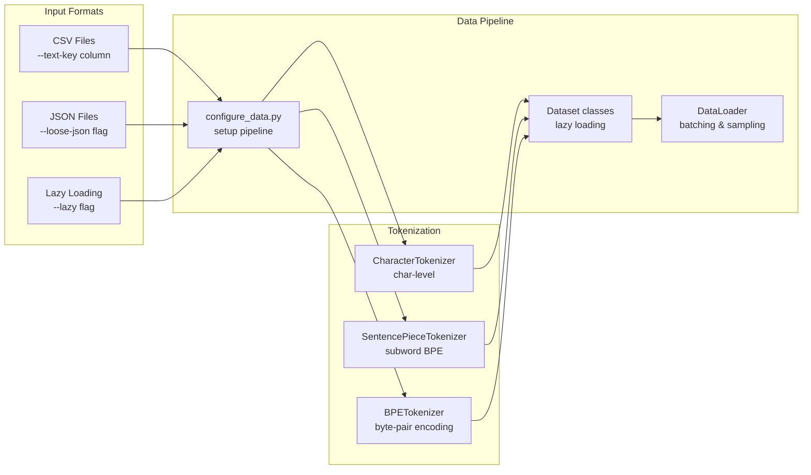

Sources: [configure_data.py](), [README.md:139-143]()

## Advanced Features

### Mixed Precision Training

Enable FP16 training for faster training and reduced memory usage:

```bash
python3 pretrain.py --fp16 --dynamic-loss-scale
python3 finetune_classifier.py --load model.pt --fp16
```

### Distributed Training

Scale training across multiple GPUs:

```bash
python3 -m multiproc pretrain.py --distributed
```

### Model Architectures

The repository supports multiple architectures through the `--model` parameter:

- **mLSTM**: Multiplicative LSTM with weight normalization
- **LSTM**: Standard LSTM
- **transformer**: Transformer decoder architecture

For detailed architecture specifications and distributed training setup, see [Model Architectures](#2.2) and [Distributed Training](#6.1).

Sources: [README.md:134-148](), [README.md:12]()

---

# Page: Core Components

# Core Components

<details>
<summary>Relevant source files</summary>

The following files were used as context for generating this wiki page:

- [README.md](README.md)
- [configure_data.py](configure_data.py)
- [data/semeval/test.csv](data/semeval/test.csv)
- [data/semeval/train.csv](data/semeval/train.csv)
- [data/semeval/val.csv](data/semeval/val.csv)
- [data_utils/tokenization.py](data_utils/tokenization.py)
- [generate.py](generate.py)
- [main.py](main.py)

</details>


This document provides an overview of the main system components in the sentiment-discovery repository and their relationships. It covers the fundamental building blocks that enable unsupervised language model pretraining, transfer learning, and sentiment classification workflows.

For detailed information about specific subsystems, see [Data Processing System](#2.1), [Model Architectures](#2.2), and [Training Infrastructure](#2.3). For usage patterns and workflows, see [Usage Workflows](#3).

## System Architecture Overview

The sentiment-discovery system follows a modular architecture with four primary component layers that work together to enable large-scale language modeling and sentiment analysis.

### High-Level Component Architecture

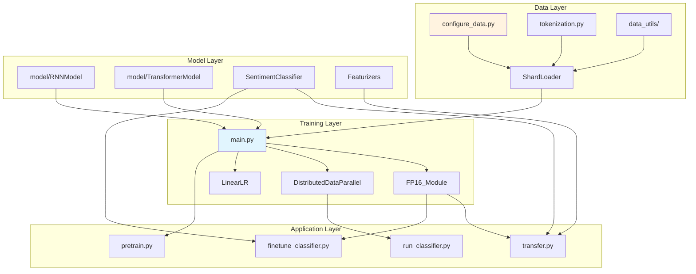

**Sources:** [main.py:1-425](), [configure_data.py:1-181](), [data_utils/tokenization.py:1-275]()

### Component Data Flow

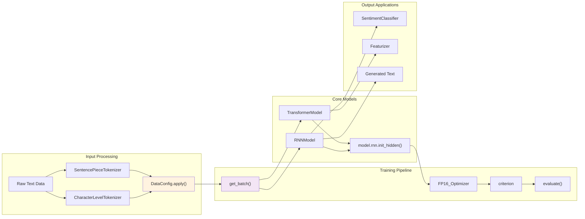

**Sources:** [main.py:231-240](), [main.py:154-157](), [configure_data.py:27-95]()

## Data Processing Components

The data processing system handles tokenization, dataset creation, and batch loading for both unsupervised pretraining and supervised classification tasks.

### Tokenization System

| Component | Class | Purpose |
|-----------|-------|---------|
| Character-level | `CharacterLevelTokenizer` | Maps text to character IDs (256 vocab) |
| Subword | `SentencePieceTokenizer` | Learned BPE/unigram tokenization |
| Base | `Tokenizer` | Abstract interface with `EncodeAsIds()` |

The tokenization system provides a unified interface through the `Tokenizer` base class, with implementations supporting both character-level and learned subword tokenization via SentencePiece.

**Sources:** [data_utils/tokenization.py:122-165](), [data_utils/tokenization.py:189-275]()

### Data Configuration

The `configure_data()` function and `DataConfig` class orchestrate the data pipeline setup:

- **Dataset Creation**: Handles CSV, JSON, and lazy loading patterns
- **Loader Configuration**: Sets up distributed, sharded data loading  
- **Tokenizer Integration**: Connects tokenization with dataset processing
- **Split Management**: Manages train/validation/test splits

Key entry point: `DataConfig.apply()` which returns `(train_data, val_data, test_data), tokenizer`

**Sources:** [configure_data.py:121-181](), [configure_data.py:27-95]()

## Model Architecture Components

The model layer provides neural network architectures for both language modeling and classification tasks.

### Language Models

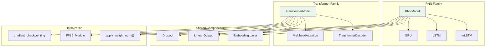

**Sources:** [main.py:157](), [model/__init__.py]()

### Classification Components

The system provides classification heads that can be combined with pretrained language model encoders:

- **SentimentClassifier**: Combines language model encoder with classification head
- **BinaryClassifier**: Single-layer classification for binary tasks
- **MultiLayerClassifier**: MLP with multi-head support for complex tasks

**Sources:** Referenced in [README.md:174-195]()

## Training Infrastructure

### Training Orchestration

The training infrastructure centers around `main.py` which provides:

- **Batch Processing**: `get_batch()` function for sequence preparation
- **Hidden State Management**: `init_hidden()` for RNN state initialization  
- **Loss Computation**: Cross-entropy loss with distributed reduction
- **Optimization**: Support for FP16 and distributed training

Key training loop components:
```python
# From main.py training function
data, targets, reset_mask = get_batch(batch)
output, hidden = model(data, reset_mask=reset_mask)
loss = criterion(output.view(-1, ntokens), targets.view(-1))
```

**Sources:** [main.py:267-369](), [main.py:231-240](), [main.py:242-243]()

### Optimization Features

| Feature | Implementation | Purpose |
|---------|---------------|---------|
| Mixed Precision | `FP16_Module`, `FP16_Optimizer` | Memory efficiency |
| Distributed Training | `DistributedDataParallel` | Multi-GPU scaling |
| Learning Rate Scheduling | `LinearLR` | Training stability |
| Gradient Clipping | `clip_grad_norm()` | Prevent exploding gradients |

**Sources:** [main.py:183-194](), [main.py:196-208](), [main.py:305-309]()

## Application Entry Points

The system provides four main entry points for different use cases:

### Training and Inference Scripts

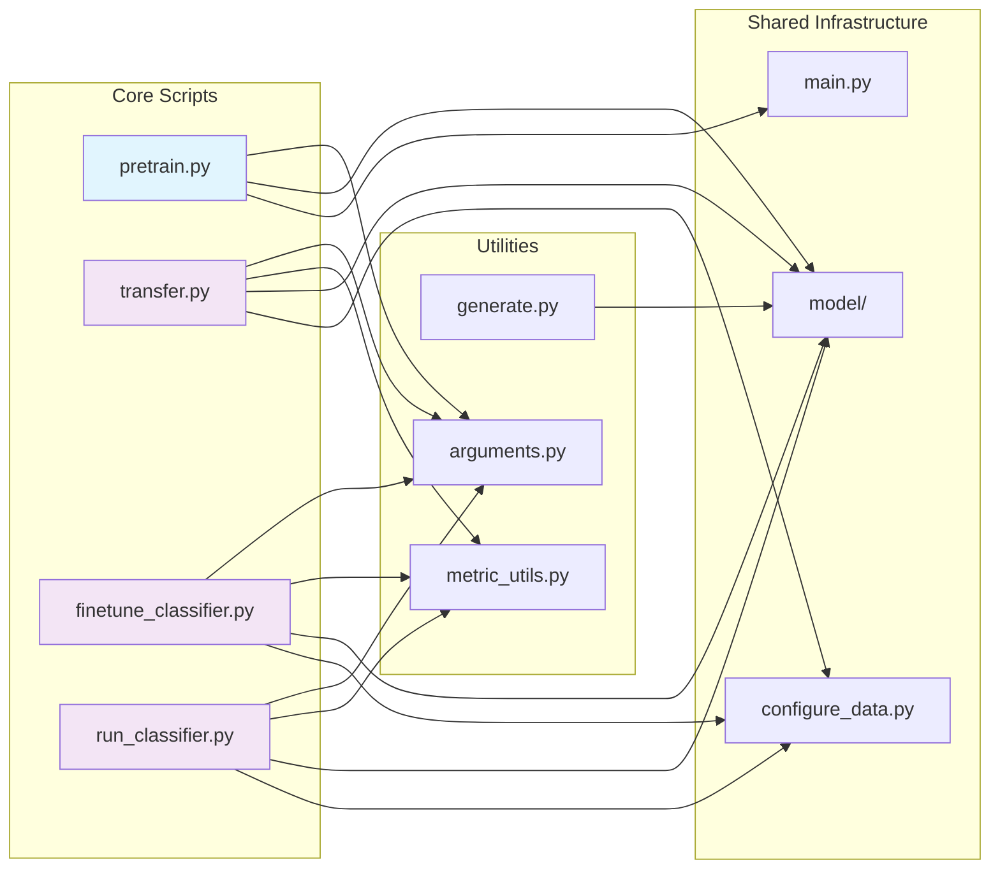

- **`pretrain.py`**: Unsupervised language model training
- **`transfer.py`**: Feature extraction and transfer learning  
- **`finetune_classifier.py`**: End-to-end classifier finetuning
- **`run_classifier.py`**: Model inference and evaluation

**Sources:** [README.md:134-195](), [main.py:1-25]()

## Component Interactions

The core components interact through well-defined interfaces:

1. **Data → Training**: `configure_data()` produces data loaders consumed by training scripts
2. **Models → Optimization**: Language models are wrapped with `FP16_Module` and `DistributedDataParallel`  
3. **Training → Applications**: Pretrained models are loaded by transfer/finetuning scripts
4. **Tokenizers → Data**: Tokenization is integrated into dataset creation pipeline

This modular design enables flexible composition of components for different research and application scenarios while maintaining code reusability across the supervised and unsupervised learning workflows.

**Sources:** [configure_data.py:12-26](), [main.py:109-213]()

---

# Page: Data Processing System

# Data Processing System

<details>
<summary>Relevant source files</summary>

The following files were used as context for generating this wiki page:

- [data_utils/__init__.py](data_utils/__init__.py)
- [data_utils/datasets.py](data_utils/datasets.py)
- [data_utils/lazy_loader.py](data_utils/lazy_loader.py)
- [data_utils/loaders.py](data_utils/loaders.py)
- [data_utils/preprocess.py](data_utils/preprocess.py)
- [data_utils/samplers.py](data_utils/samplers.py)

</details>


## Purpose and Scope

The Data Processing System provides comprehensive infrastructure for loading, preprocessing, and batching text data for language model training and sentiment analysis tasks. This system handles diverse input formats (JSON, CSV, TSV), implements efficient tokenization pipelines, and supports both supervised classification and unsupervised language modeling workflows.

For information about model architectures that consume the processed data, see [Model Architectures](#2.2). For training orchestration that uses these data pipelines, see [Training Infrastructure](#2.3).

## System Architecture Overview

The data processing system consists of four main layers that transform raw text files into batched tensors ready for model training:

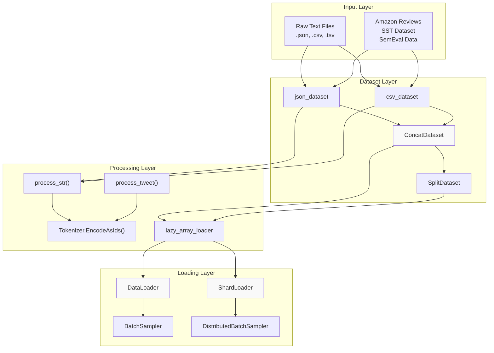

**Data Processing Architecture**

This architecture enables scalable processing of large text corpora through lazy loading, distributed sampling, and efficient batching strategies optimized for both classification and language modeling tasks.

Sources: [data_utils/__init__.py:21-64](), [data_utils/datasets.py:180-394](), [data_utils/loaders.py:91-320]()

## Dataset Classes and File Format Support

The system provides specialized dataset classes for different input formats, all implementing the PyTorch `Dataset` interface:

| Dataset Class | File Formats | Key Features | Use Cases |
|---------------|--------------|--------------|-----------|
| `json_dataset` | `.json` | Loose JSON support, streaming | Large JSON dumps, research datasets |
| `csv_dataset` | `.csv`, `.tsv` | Pandas integration, label binarization | Structured sentiment data |
| `ConcatDataset` | Multiple files | Concatenates datasets on-the-fly | Multi-corpus training |
| `SplitDataset` | Any dataset | Efficient subset indexing | Train/validation splits |

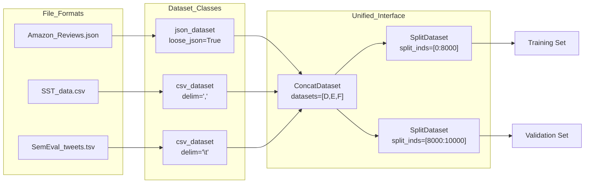

**Dataset Class Hierarchy and File Format Support**

The dataset classes automatically handle text and label extraction using configurable keys (`text_key`, `label_key`) and support preprocessing functions for domain-specific text cleaning.

Sources: [data_utils/datasets.py:180-274](), [data_utils/datasets.py:275-394](), [data_utils/datasets.py:41-105](), [data_utils/datasets.py:106-178]()

## Preprocessing and Tokenization Pipeline

Text preprocessing transforms raw strings into tokenized sequences through a configurable pipeline:

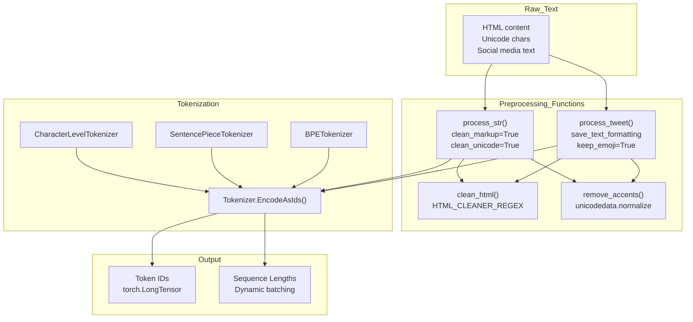

**Text Preprocessing and Tokenization Pipeline**

The preprocessing functions handle domain-specific challenges like HTML cleaning, emoji processing, and social media text normalization, while tokenizers convert processed text into numerical representations.

Sources: [data_utils/preprocess.py:38-66](), [data_utils/preprocess.py:144-231](), [data_utils/preprocess.py:17-33](), [data_utils/tokenization.py:1-10]()

## Data Loading Infrastructure

The loading infrastructure provides two specialized data loaders optimized for different training paradigms:

### Standard Classification Loading

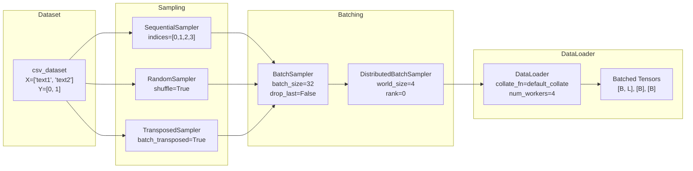

**Standard DataLoader Architecture for Classification**

Sources: [data_utils/loaders.py:91-137](), [data_utils/samplers.py:75-129](), [data_utils/samplers.py:11-74]()

### Sequence Modeling with Shards

For unsupervised language modeling, the system uses a specialized shard-based approach:

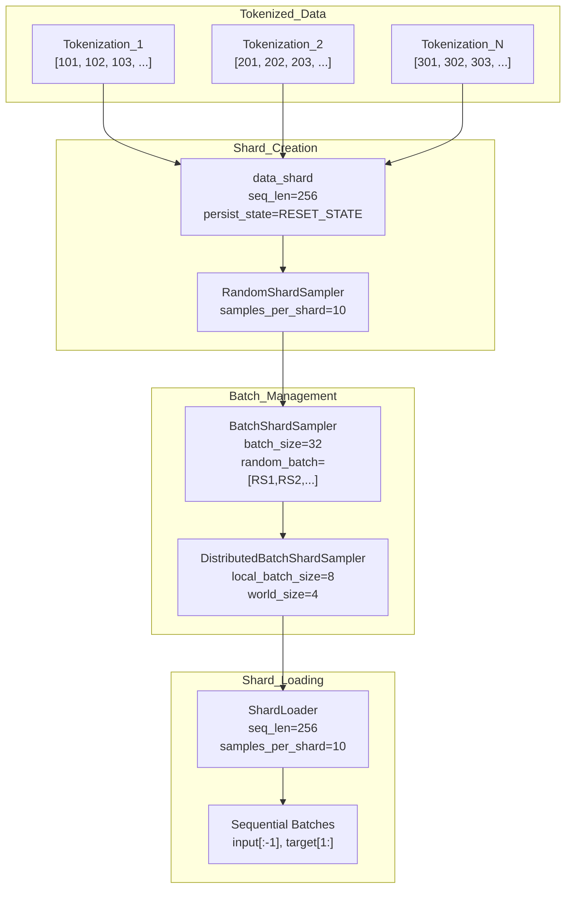

**ShardLoader Architecture for Language Modeling**

The shard-based approach maintains sequence continuity across batch boundaries, essential for autoregressive language modeling where hidden states persist between sequences.

Sources: [data_utils/loaders.py:139-320](), [data_utils/datasets.py:395-521](), [data_utils/samplers.py:165-310]()

## Lazy Loading and Memory Management

For large datasets that don't fit in memory, the system provides lazy loading through the `lazy_array_loader`:

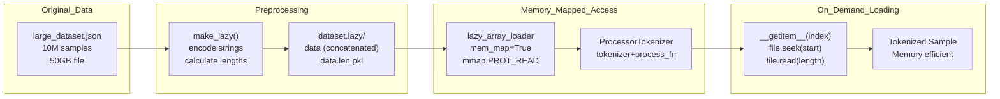

**Lazy Loading Architecture**

The lazy loader memory-maps large files and loads individual samples on-demand, enabling training on datasets larger than available RAM while maintaining fast random access.

Sources: [data_utils/lazy_loader.py:68-147](), [data_utils/lazy_loader.py:29-53](), [data_utils/lazy_loader.py:10-28]()

## Distributed Training Support

The data processing system provides comprehensive distributed training support through specialized samplers and loaders:

### Distributed Sampling Strategy

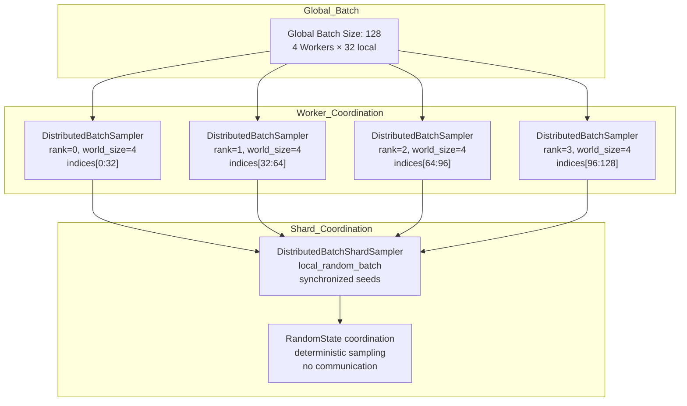

**Distributed Sampling Coordination**

The distributed samplers ensure consistent data loading across workers without requiring inter-process communication by using deterministic random number generation with coordinated seeds.

Sources: [data_utils/samplers.py:11-74](), [data_utils/samplers.py:282-310](), [data_utils/loaders.py:170-188]()

## Configuration and Factory Functions

The system provides high-level factory functions for easy dataset creation:

| Function | Purpose | Key Parameters |
|----------|---------|----------------|
| `make_dataset()` | Create dataset with tokenizer | `path`, `seq_length`, `lazy`, `split` |
| `get_dataset()` | Auto-detect file format | `path`, `text_key`, `label_key` |
| `split_ds()` | Create train/val/test splits | `split=[0.8, 0.1, 0.1]`, `shuffle=True` |

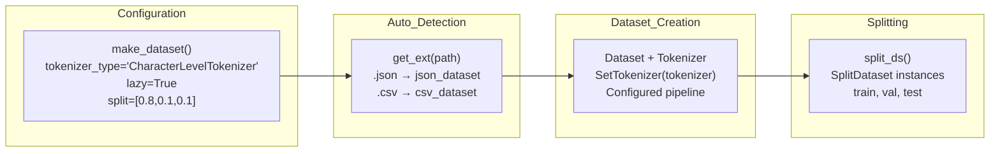

**Dataset Factory and Configuration System**

The factory functions automatically handle file format detection, tokenizer creation, and dataset splitting based on configuration parameters.

Sources: [data_utils/__init__.py:32-64](), [data_utils/__init__.py:21-30](), [data_utils/datasets.py:147-178]()

## Performance Optimizations

The data processing system implements several key optimizations for large-scale training:

- **Memory Mapping**: Files are memory-mapped for zero-copy access [data_utils/lazy_loader.py:86-87]()
- **Batch Transposition**: `TransposedSampler` improves cache locality for sequence modeling [data_utils/samplers.py:130-163]()
- **Wrap-Around Batching**: Maintains sequence continuity across epoch boundaries [data_utils/samplers.py:22-24]()
- **Multiprocessing**: Parallel data loading with configurable worker processes [data_utils/loaders.py:234-320]()
- **Pin Memory**: GPU transfer optimization for faster training [data_utils/loaders.py:317-319]()

These optimizations enable efficient training on large corpora while maintaining flexibility for different model architectures and training paradigms.

Sources: [data_utils/loaders.py:91-320](), [data_utils/samplers.py:11-310](), [data_utils/lazy_loader.py:68-147]()

---

# Page: Model Architectures

# Model Architectures

<details>
<summary>Relevant source files</summary>

The following files were used as context for generating this wiki page:

- [LICENSE](LICENSE)
- [learning_rates.py](learning_rates.py)
- [model/__init__.py](model/__init__.py)
- [model/model.py](model/model.py)
- [model/sentiment_classifier.py](model/sentiment_classifier.py)
- [model/transformer.py](model/transformer.py)
- [model/transformer_utils.py](model/transformer_utils.py)

</details>


This document covers the neural network architectures implemented in the sentiment discovery repository, including language models, feature extractors, and classification components. These models form the foundation for both unsupervised pretraining and downstream sentiment analysis tasks.

For information about training these models, see [Training Infrastructure](#2.3). For guidance on using pretrained models for downstream tasks, see [Transfer Learning](#3.2) and [Classifier Finetuning](#3.3).

## Architecture Overview

The system implements a modular architecture where language models serve as feature extractors for downstream classification tasks. The core design follows a two-stage approach: unsupervised language model pretraining followed by supervised adaptation.

**Model Architecture System Overview**

```mermaid
graph TB
    subgraph "Language Models"
        RNNModel["RNNModel<br/>(Language Modeling)"]
        TransformerDecoderModel["TransformerDecoderModel<br/>(Language Modeling)"]
        TransformerModel["TransformerModel<br/>(Encoder-Decoder)"]
    end
    
    subgraph "Feature Extractors"
        RNNFeaturizer["RNNFeaturizer<br/>(Hidden State Features)"]
        TransformerFeaturizer["TransformerFeaturizer<br/>(Contextual Features)"]
    end
    
    subgraph "Classification Heads"
        BinaryClassifier["BinaryClassifier<br/>(Single Layer)"]
        MultiLayerBinaryClassifier["MultiLayerBinaryClassifier<br/>(MLP)"]
    end
    
    subgraph "Complete Pipeline"
        SentimentClassifier["SentimentClassifier<br/>(End-to-End)"]
    end
    
    RNNModel --> RNNFeaturizer
    TransformerDecoderModel --> TransformerFeaturizer
    
    RNNFeaturizer --> SentimentClassifier
    TransformerFeaturizer --> SentimentClassifier
    
    BinaryClassifier --> SentimentClassifier
    MultiLayerBinaryClassifier --> SentimentClassifier
    
    RNNFeaturizer --> BinaryClassifier
    RNNFeaturizer --> MultiLayerBinaryClassifier
    TransformerFeaturizer --> BinaryClassifier
    TransformerFeaturizer --> MultiLayerBinaryClassifier
```

Sources: [model/model.py:12-303](), [model/sentiment_classifier.py:10-356](), [model/transformer.py:21-402]()

## Core Language Models

### RNN-Based Models

The `RNNModel` class implements the fundamental recurrent neural network architecture for language modeling. It consists of an embedding layer, recurrent layers, and a linear decoder.

| Component | Class | Purpose |
|-----------|-------|---------|
| Main Model | `RNNModel` | Complete language model with encoder-decoder structure |
| RNN Core | `RNN` (from `RNN_utils`) | Recurrent computation (LSTM, mLSTM, GRU) |
| Embedding | `nn.Embedding` | Token to vector mapping |
| Decoder | `nn.Linear` | Hidden state to vocabulary projection |

Key features:
- **Weight Tying**: Optional parameter sharing between encoder and decoder [model/model.py:27-30]()
- **Dropout**: Configurable dropout for regularization [model/model.py:17]()
- **Multiple RNN Types**: Support for LSTM, mLSTM, and GRU variants [model/model.py:20]()

The model supports gradient checkpointing and distributed training through the `chkpt_grad` parameter in the forward pass [model/model.py:37]().

Sources: [model/model.py:12-59]()

### Transformer-Based Models

The repository implements several transformer variants optimized for different use cases:

**Transformer Model Hierarchy**

```mermaid
graph TD
    TransformerModel["TransformerModel<br/>(model/transformer.py)"]
    TransformerDecoderModel["TransformerDecoderModel<br/>(model/model.py)"]
    
    TransformerEncoder["TransformerEncoder"]
    TransformerDecoder["TransformerDecoder"]
    
    TransformerEncoderLayer["TransformerEncoderLayer"]
    TransformerDecoderLayer["TransformerDecoderLayer"]
    
    MultiheadAttention["MultiheadAttention<br/>(transformer_utils.py)"]
    PositionalEmbedding["PositionalEmbedding<br/>(Learned/Sinusoidal)"]
    
    TransformerModel --> TransformerEncoder
    TransformerModel --> TransformerDecoder
    TransformerDecoderModel --> TransformerDecoder
    
    TransformerEncoder --> TransformerEncoderLayer
    TransformerDecoder --> TransformerDecoderLayer
    
    TransformerEncoderLayer --> MultiheadAttention
    TransformerDecoderLayer --> MultiheadAttention
    
    TransformerEncoder --> PositionalEmbedding
    TransformerDecoder --> PositionalEmbedding
```

#### TransformerModel
Complete encoder-decoder architecture with separate encoder and decoder stacks [model/transformer.py:21-100]().

#### TransformerDecoderModel
Decoder-only model optimized for language modeling tasks [model/model.py:195-278](). Features:
- **Gradient Checkpointing**: Memory-efficient training via chunked computation [model/transformer.py:300-307]()
- **Generation Optimization**: Fast inference mode with weight norm removal [model/model.py:250-277]()
- **Mixture of Softmax**: Optional MoS layer for improved output modeling [model/transformer.py:246-251]()

Sources: [model/transformer.py:21-402](), [model/model.py:195-303]()

## Feature Extractors

Feature extractors convert language model representations into fixed-size vectors suitable for downstream tasks.

### RNNFeaturizer

The `RNNFeaturizer` extracts features from RNN hidden states with several pooling strategies:

| Pooling Method | Configuration | Purpose |
|----------------|---------------|---------|
| Last Hidden State | Default | Final sequence representation |
| All Layers | `all_layers=True` | Concatenate all layer outputs |
| Max Pooling | `concat_max=True` | Maximum activation across sequence |
| Mean Pooling | `concat_mean=True` | Average activation across sequence |
| Min Pooling | `concat_min=True` | Minimum activation across sequence |

The featurizer handles variable-length sequences through the `seq_len` parameter and supports auxiliary language modeling loss for joint training [model/model.py:76-78]().

Sources: [model/model.py:61-184]()

### TransformerFeaturizer

The `TransformerFeaturizer` wraps `TransformerDecoderModel` to extract contextual representations. It selects features at specific sequence positions using advanced indexing [model/model.py:290]().

Key capabilities:
- **Position-Specific Extraction**: Uses `seq_len` to extract features at sequence ends
- **Attention Weights**: Optional attention weight extraction via `get_hidden` parameter
- **Auxiliary LM Loss**: Joint training with language modeling objective

Sources: [model/model.py:279-303]()

## Classification Components

### BinaryClassifier

Simple single-layer binary classifier with configurable thresholding:

```python
# Core architecture
nn.Linear(num_features, 1) -> nn.Sigmoid() -> threshold_predictions()
```

Features:
- **Neuron Selection**: Dynamic feature subset selection [model/sentiment_classifier.py:46-60]()
- **Adaptive Thresholding**: Configurable decision boundaries [model/sentiment_classifier.py:65-75]()
- **Device Management**: Automatic GPU/CPU tensor handling [model/sentiment_classifier.py:21-29]()

Sources: [model/sentiment_classifier.py:10-96]()

### MultiLayerBinaryClassifier

Multi-layer perceptron with advanced capabilities:

| Feature | Implementation | Purpose |
|---------|----------------|---------|
| Multiple Heads | `heads_per_class` parameter | Ensemble predictions per class |
| Nonlinearity Options | `NONLINEARITY_MAP` | ReLU, GELU, PReLU, etc. |
| Dropout | Configurable per layer | Regularization |
| Threshold Types | Double/dual thresholding | Multi-class decision boundaries |

The classifier supports uncertainty estimation through head variance computation [model/sentiment_classifier.py:171-181]().

Sources: [model/sentiment_classifier.py:106-229]()

## Complete Model Pipeline

### SentimentClassifier

The `SentimentClassifier` integrates language model encoders with classification heads to create end-to-end models:

**SentimentClassifier Architecture**

```mermaid
graph LR
    subgraph "Input Processing"
        input["Input Tokens"]
        seq_len["Sequence Lengths"]
    end
    
    subgraph "Language Model Encoder"
        lm_encoder["lm_encoder<br/>(RNNFeaturizer or<br/>TransformerFeaturizer)"]
    end
    
    subgraph "Classification Head"
        classifier["classifier<br/>(BinaryClassifier or<br/>MultiLayerBinaryClassifier)"]
    end
    
    subgraph "Outputs"
        class_out["Classification Output"]
        lm_out["Language Model Output<br/>(optional)"]
        hidden["Hidden Features"]
    end
    
    input --> lm_encoder
    seq_len --> lm_encoder
    lm_encoder --> classifier
    lm_encoder --> lm_out
    classifier --> class_out
    lm_encoder --> hidden
```

The model automatically selects the appropriate encoder based on `model_type` parameter [model/sentiment_classifier.py:275-282]() and supports:

- **Joint Training**: Simultaneous language modeling and classification [model/sentiment_classifier.py:309]()
- **Feature Selection**: Neuron-level feature pruning [model/sentiment_classifier.py:312-313]()
- **Multi-head Output**: Ensemble predictions with uncertainty estimates [model/sentiment_classifier.py:295]()

Sources: [model/sentiment_classifier.py:269-356]()

## Supporting Components

### Attention Mechanisms

The `MultiheadAttention` class implements the core attention mechanism used throughout transformer models:

- **Scaled Dot-Product Attention**: Standard attention computation with scaling [model/transformer_utils.py:99]()
- **Incremental State**: Efficient caching for autoregressive generation [model/transformer_utils.py:71-108]()
- **Masking Support**: Future timestep masking and padding mask handling [model/transformer_utils.py:124-135]()

Sources: [model/transformer_utils.py:20-242]()

### Positional Embeddings

Two positional embedding variants are supported:

| Type | Class | Use Case |
|------|-------|----------|
| Learned | `LearnedPositionalEmbedding` | Trainable position encodings |
| Sinusoidal | `SinusoidalPositionalEmbedding` | Fixed mathematical encodings |

Both handle left/right padding and support incremental decoding [model/transformer_utils.py:244-330]().

### Utility Functions

Key utility functions support model operations:

- **Weight Initialization**: Xavier uniform initialization for linear layers [model/transformer_utils.py:349-353]()
- **Layer Normalization**: Standard layer norm with proper initialization [model/transformer_utils.py:345-347]()
- **GeLU Activation**: Gaussian Error Linear Unit implementation [model/transformer_utils.py:332-337]()

Sources: [model/transformer_utils.py:244-413]()

---

# Page: Training Infrastructure

# Training Infrastructure

<details>
<summary>Relevant source files</summary>

The following files were used as context for generating this wiki page:

- [arguments.py](arguments.py)
- [configure_data.py](configure_data.py)
- [data_utils/tokenization.py](data_utils/tokenization.py)
- [experiments/run_sk_imdb.sh](experiments/run_sk_imdb.sh)
- [experiments/run_sk_sst.sh](experiments/run_sk_sst.sh)
- [generate.py](generate.py)
- [logreg_utils.py](logreg_utils.py)
- [main.py](main.py)
- [model/checkpoint.py](model/checkpoint.py)

</details>


This document covers the training orchestration, configuration management, and optimization utilities that form the backbone of the sentiment discovery training system. The training infrastructure provides a flexible framework for distributed training, mixed precision optimization, and sophisticated learning rate scheduling.

For information about the neural network architectures themselves, see [Model Architectures](#2.2). For details about specific training workflows like pretraining and finetuning, see [Language Model Pretraining](#3.1) and [Classifier Finetuning](#3.3).

## Training Orchestration System

The primary training orchestration is handled by the `main.py` script, which provides a complete training loop with support for distributed training, mixed precision, and sophisticated optimization techniques.

```mermaid
graph TB
    subgraph "main.py Training Loop"
        A[main] --> B["parse_args()"]
        B --> C["configure_data()"]
        C --> D["model.RNNModel()"]
        D --> E["torch.optim.*"]
        E --> F["LinearLR scheduler"]
        F --> G["DDP wrapper"]
        G --> H["train() function"]
        H --> I["evaluate() function"]
    end
    
    subgraph "Core Training Functions"
        J["get_batch()"] --> K["model forward pass"]
        K --> L["loss calculation"]
        L --> M["backward() / optim.step()"]
        M --> N["learning rate scheduling"]
        N --> O["checkpoint saving"]
    end
    
    subgraph "Optimization Components"
        P["FP16_Module"]
        Q["FP16_Optimizer"] 
        R["gradient clipping"]
        S["weight normalization"]
    end
    
    H --> J
    E --> P
    E --> Q
    M --> R
    D --> S
```

**Training Loop Architecture**

The main training orchestration follows this pattern:

| Component | Function | Key Features |
|-----------|----------|--------------|
| `train()` | [main.py:267-370]() | Main training loop with logging, checkpointing |
| `evaluate()` | [main.py:245-265]() | Validation/test evaluation loop |
| `get_batch()` | [main.py:231-240]() | Batch preparation and GPU transfer |
| `init_hidden()` | [main.py:242-243]() | Hidden state initialization for RNNs |

**Sources:** [main.py:1-425](), [model/__init__.py]()

## Configuration Management System

The configuration system provides a hierarchical approach to managing training parameters, with specialized argument groups for different training scenarios.

```mermaid
graph LR
    subgraph "Configuration Hierarchy"
        A["arguments.py"] --> B["add_general_args()"]
        A --> C["add_model_args()"]
        A --> D["add_unsupervised_data_args()"]
        
        B --> E["Basic training params"]
        C --> F["add_recurrent_args()"]
        C --> G["add_transformer_args()"]
        D --> H["configure_data()"]
        
        H --> I["DataConfig class"]
        I --> J["make_loaders()"]
        J --> K["data_utils.ShardLoader"]
        J --> L["data_utils.DataLoader"]
    end
    
    subgraph "Configuration Application"
        M["parser.parse_args()"] --> N["data_config.apply()"]
        N --> O["Training data loaders"]
        N --> P["Tokenizer instance"]
    end
    
    A --> M
    I --> N
```

**Configuration Components**

The configuration system is built around modular argument groups:

| Module | Purpose | Key Functions |
|--------|---------|---------------|
| `add_general_args()` | [arguments.py:11-60]() | Core training parameters (lr, epochs, distributed) |
| `add_model_args()` | [arguments.py:89-94]() | Model-specific configurations |
| `add_recurrent_args()` | [arguments.py:96-116]() | RNN/LSTM specific parameters |
| `add_transformer_args()` | [arguments.py:118-162]() | Transformer architecture parameters |
| `configure_data()` | [configure_data.py:121-180]() | Data loading and preprocessing setup |

**DataConfig System**

The `DataConfig` class provides a flexible system for managing data loading configurations:

```mermaid
graph TB
    subgraph "DataConfig Workflow"  
        A["DataConfig.__init__()"] --> B["set_defaults()"]
        B --> C["apply_defaults()"]
        C --> D["make_loaders()"]
        
        D --> E["Training loader"]
        D --> F["Validation loader"] 
        D --> G["Test loader"]
        D --> H["Tokenizer"]
    end
    
    subgraph "Loader Creation"
        I["data_utils.ShardLoader"] --> J["Distributed sharding"]
        K["data_utils.DataLoader"] --> L["Standard batching"]
        
        D --> I
        D --> K
    end
```

**Sources:** [arguments.py:1-303](), [configure_data.py:1-181]()

## Optimization Utilities

The training infrastructure provides several optimization utilities for memory efficiency and training stability.

### Mixed Precision Training

Mixed precision training is supported through the `FP16_Module` and `FP16_Optimizer` classes:

```mermaid
graph LR
    subgraph "FP16 Training Flow"
        A["FP16_Module(model)"] --> B["Forward pass (FP16)"]
        B --> C["Loss calculation (FP32)"]
        C --> D["FP16_Optimizer.backward()"]
        D --> E["Gradient scaling"]
        E --> F["Master weights update"]
        F --> G["Loss scale adjustment"]
    end
    
    subgraph "Dynamic Loss Scaling"
        H["Static loss scale"] --> I["args.loss_scale"]
        J["Dynamic scaling"] --> K["args.dynamic_loss_scale"]
        
        E --> H
        E --> J
    end
```

The FP16 training workflow is controlled by these key parameters:

| Parameter | Location | Purpose |
|-----------|----------|---------|
| `--fp16` | [main.py:57-58]() | Enable mixed precision training |
| `--loss-scale` | [main.py:63-64]() | Static loss scaling factor |
| `--dynamic-loss-scale` | [main.py:59-60]() | Enable adaptive loss scaling |

**Sources:** [main.py:183-195](), [main.py:294-325]()

### Distributed Training

Distributed training support includes both data parallel and model parallel strategies:

```mermaid
graph TB
    subgraph "Distributed Setup"
        A["torch.distributed.init_process_group()"] --> B["Backend selection"]
        B --> C["Rank assignment"]
        C --> D["GPU device mapping"]
    end
    
    subgraph "Model Wrapping"
        E["DistributedDataParallel"] --> F["Parameter synchronization"]
        F --> G["Gradient reduction"]
        G --> H["allreduce_params()"]
    end
    
    subgraph "Training Coordination"
        I["Distributed sampler"] --> J["Shard coordination"]
        J --> K["Batch size scaling"]
        K --> L["Loss aggregation"]
    end
    
    D --> E
    H --> I
```

Key distributed training parameters:

| Parameter | Purpose | Default |
|-----------|---------|---------|
| `--world-size` | [main.py:65-66]() | Number of distributed workers |
| `--distributed-backend` | [main.py:67-68]() | Communication backend (gloo/nccl) |
| `--rank` | [main.py:69-70]() | Worker rank identifier |

**Sources:** [main.py:108-116](), [main.py:211-212](), [main.py:299-302]()

### Gradient Checkpointing

Gradient checkpointing is available through the `checkpoint.py` module for memory-efficient training:

```mermaid
graph LR
    subgraph "Checkpointing Workflow"
        A["CheckpointFunction.forward()"] --> B["Save inputs + function"]
        B --> C["Forward pass (no_grad)"]
        C --> D["Return outputs"]
        
        E["CheckpointFunction.backward()"] --> F["Restore inputs"]
        F --> G["Recompute forward"]
        G --> H["Compute gradients"]
    end
    
    subgraph "Memory Trade-off"
        I["Standard training"] --> J["Store all activations"]
        K["Checkpointed training"] --> L["Recompute activations"]
        
        J --> M["High memory usage"]
        L --> N["Lower memory, higher compute"]
    end
    
    C --> E
```

The checkpointing system provides two main functions:

| Function | Purpose | Use Case |
|----------|---------|----------|
| `checkpoint()` | [model/checkpoint.py:67-110]() | Checkpoint single function |
| `checkpoint_sequential()` | [model/checkpoint.py:113-167]() | Checkpoint sequential modules |

**Sources:** [model/checkpoint.py:1-167]()

## Learning Rate Scheduling

The training infrastructure supports sophisticated learning rate scheduling through the `LinearLR` scheduler:

```mermaid
graph TB
    subgraph "Learning Rate Scheduling"
        A["LinearLR scheduler"] --> B["Warmup phase"]
        B --> C["Decay phase"]
        C --> D["Final learning rate"]
        
        E["Constant decay"] --> F["args.constant_decay"]
        G["Linear decay"] --> H["Total training iterations"]
        
        A --> E
        A --> G
    end
    
    subgraph "Schedule Integration"
        I["optimizer.step()"] --> J["LR.step()"]
        J --> K["FP16 overflow check"]
        K --> L["Conditional LR update"]
    end
    
    D --> I
```

Learning rate scheduling parameters:

| Parameter | Location | Purpose |
|-----------|----------|---------|
| `--lr` | [main.py:30-31]() | Initial learning rate |
| `--constant-decay` | [main.py:32-34]() | Fixed decay iterations |
| Learning rate warmup | [main.py:196-208]() | Gradual learning rate increase |

**Sources:** [main.py:196-208](), [main.py:316-325]()

## Model Persistence and Checkpointing

The training infrastructure provides comprehensive model checkpointing with support for optimizer state and training resumption:

```mermaid
graph LR
    subgraph "Checkpoint Saving"
        A["model.state_dict()"] --> B["Model parameters"]
        C["optim.state_dict()"] --> D["Optimizer state"] 
        E["torch.get_rng_state()"] --> F["Random number state"]
        
        B --> G["model checkpoint"]
        D --> H["optim.pt"]
        F --> I["rng.pt"]
    end
    
    subgraph "Checkpoint Loading"
        J["--load"] --> K["torch.load()"]
        L["--load-optim"] --> M["Optimizer restoration"]
        N["Weight normalization"] --> O["apply_weight_norm()"]
        
        K --> N
        M --> P["Training resumption"]
    end
    
    subgraph "Periodic Saving"
        Q["--save-iters"] --> R["Intermediate checkpoints"]
        R --> S["e{iteration}.pt files"]
    end
    
    G --> J
    H --> L
    I --> L
```

**Checkpoint Management**

The checkpointing system handles several types of state:

| State Type | File Pattern | Purpose |
|------------|--------------|---------|
| Model weights | `{model_name}.pt` | Core model parameters |
| Optimizer state | `optim.pt` | Adam/SGD internal state |
| RNG state | `rng.pt` | Reproducible random generation |
| Intermediate saves | `e{iter}.pt` | Training progress snapshots |

Key checkpointing parameters:

| Parameter | Purpose | Default |
|-----------|---------|---------|
| `--save` | [main.py:47-48]() | Final model save path |
| `--load` | [main.py:49-50]() | Model checkpoint to load |
| `--save-iters` | [main.py:53-54]() | Periodic save interval |
| `--save-optim` | [main.py:55-56]() | Save optimizer state |

**Sources:** [main.py:165-178](), [main.py:340-355](), [main.py:401-416]()

---

# Page: Usage Workflows

# Usage Workflows

<details>
<summary>Relevant source files</summary>

The following files were used as context for generating this wiki page:

- [README.md](README.md)
- [data/semeval/test.csv](data/semeval/test.csv)
- [data/semeval/train.csv](data/semeval/train.csv)
- [data/semeval/val.csv](data/semeval/val.csv)

</details>


This document provides detailed guides for the main usage workflows in the sentiment discovery system. It covers the complete pipeline from data preparation through model pretraining to downstream applications including transfer learning, classifier finetuning, and inference.

For information about the core system components and model architectures, see [Core Components](#2). For specific experimental configurations and benchmarks, see [Experiments and Benchmarks](#4).

## Workflow Overview

The sentiment discovery system follows a two-stage approach: unsupervised language model pretraining followed by supervised adaptation for downstream tasks. The system supports multiple pathways for applying pretrained models to classification tasks.

```mermaid
graph TD
    subgraph "Data Preparation"
        A["Raw Text Data"] --> B["configure_data.py"]
        B --> C["Tokenization"]
        C --> D["DataLoader"]
    end
    
    subgraph "Language Model Pretraining"
        E["pretrain.py"] --> F["Language Model Training"]
        F --> G["Saved Model (.pt)"]
    end
    
    subgraph "Downstream Applications"
        H["transfer.py"]
        I["finetune_classifier.py"] 
        J["run_classifier.py"]
    end
    
    D --> E
    G --> H
    G --> I
    G --> J
    
    H --> K["Feature Extraction + Logistic Regression"]
    I --> L["End-to-End Finetuning"]
    J --> M["Classification Inference"]
```

**Main Workflow Scripts**
| Script | Purpose | Input | Output |
|--------|---------|-------|--------|
| `pretrain.py` | Unsupervised language model training | Raw text data | Pretrained model (.pt) |
| `transfer.py` | Feature-based transfer learning | Pretrained model + labeled data | Sklearn classifier |
| `finetune_classifier.py` | End-to-end classifier finetuning | Pretrained model + labeled data | Finetuned classifier |
| `run_classifier.py` | Inference on new data | Trained classifier + test data | Predictions (.npy) |

Sources: [README.md:107-196](), [README.md:29-44]()

## Data Preparation Workflow

All workflows begin with data preparation using the `configure_data.py` system. The system supports multiple data formats and tokenization methods.

```mermaid
graph LR
    subgraph "Input Formats"
        A["CSV Files"]
        B["JSON Files"] 
        C["Loose JSON"]
    end
    
    subgraph "configure_data.py"
        D["DatasetPaths"]
        E["TokenizerType"]
        F["DataLoader Config"]
    end
    
    subgraph "Tokenization Options"
        G["CharacterTokenizer"]
        H["SentencePieceTokenizer"]
        I["BPETokenizer"]
    end
    
    subgraph "Output"
        J["DataLoader"]
        K["Dataset Splits"]
    end
    
    A --> D
    B --> D
    C --> D
    
    D --> E
    E --> G
    E --> H
    E --> I
    
    G --> F
    H --> F
    I --> F
    
    F --> J
    F --> K
```

**Key Configuration Arguments**
- `--data`: Path to training data file
- `--text-key`: Column name for text data  
- `--label-key`: Column name for labels
- `--tokenizer-type`: CharacterTokenizer, SentencePieceTokenizer, or BPE
- `--vocab-size`: Vocabulary size for subword tokenization
- `--split`: Train/validation/test split ratios

Sources: [README.md:134-149]()

## Language Model Pretraining Pipeline

The pretraining workflow trains language models on large text corpora using `pretrain.py`. The system supports both recurrent (mLSTM) and transformer architectures with distributed training capabilities.

```mermaid
graph TD
    subgraph "Model Architecture Selection"
        A["--model LSTM"] --> D["mLSTMModel"]
        B["--model transformer"] --> E["TransformerModel"]
        C["--model GRU"] --> F["GRUModel"]
    end
    
    subgraph "pretrain.py Execution"
        G["ArgumentParser"] --> H["configure_data.py"]
        H --> I["DataLoader Creation"]
        I --> J["Model Instantiation"]
        J --> K["Training Loop"]
    end
    
    subgraph "Training Optimizations"
        L["--fp16"] --> M["Mixed Precision Training"]
        N["--distributed"] --> O["Multi-GPU Training"] 
        P["--dynamic-loss-scale"] --> Q["FP16 Stability"]
    end
    
    subgraph "Output"
        R["lang_model.pt"]
        S["Training Logs"]
        T["Checkpoints"]
    end
    
    D --> J
    E --> J
    F --> J
    
    K --> M
    K --> O
    K --> Q
    
    K --> R
    K --> S
    K --> T
```

**Common Pretraining Commands**
```bash
# Basic mLSTM training
python3 pretrain.py --model LSTM --nhid 4096

# Transformer with SentencePiece tokenization  
python3 pretrain.py --model transformer --tokenizer-type SentencePieceTokenizer --vocab-size 32000

# Distributed FP16 training
python3 -m multiproc pretrain.py --fp16 --dynamic-loss-scale
```

Sources: [README.md:129-156](), [README.md:134-149]()

## Transfer Learning Workflow

The `transfer.py` script implements feature-based transfer learning by extracting representations from pretrained language models and training sklearn classifiers on top.

```mermaid
graph TD
    subgraph "Input Processing"
        A["Pretrained Model (.pt)"] --> B["Model Loading"]
        C["Labeled Dataset"] --> D["Data Loading"]
    end
    
    subgraph "transfer.py Pipeline"
        E["Feature Extraction"]
        F["Train/Val/Test Featurization"]
        G["Logistic Regression Training"]
        H["Feature Selection"]
        I["Top-k Neuron Selection"]
    end
    
    subgraph "Output Generation"
        J["Classification Results"]
        K["Feature Importance"]
        L["Transfer Directory"]
    end
    
    B --> E
    D --> F
    E --> F
    F --> G
    G --> H
    H --> I
    I --> J
    I --> K
    
    J --> L
    K --> L
```

**Key Transfer Learning Parameters**
- `--load`: Path to pretrained model
- `--neurons`: Number of top neurons for feature selection (default: 1)
- `--data`, `--val`, `--test`: Dataset file paths
- `--fp16`: Use mixed precision for feature extraction

**Example Transfer Commands**
```bash
# Basic transfer to SST
python3 transfer.py --load mlstm.pt

# Multi-neuron transfer
python3 transfer.py --load mlstm.pt --neurons 5

# Custom dataset transfer
python3 transfer.py --load transformer.pt --data train.csv --val val.csv --test test.csv
```

Sources: [README.md:157-172]()

## Classifier Finetuning Workflow  

The `finetune_classifier.py` script performs end-to-end finetuning where gradients flow from the classification loss back into the language model encoder.

```mermaid
graph TD
    subgraph "Model Architecture"
        A["Pretrained LM"] --> B["LanguageModelEncoder"]
        C["Classification Head"] --> D["SentimentClassifier"]
        B --> D
    end
    
    subgraph "finetune_classifier.py Features"
        E["Multi-label Classification"]
        F["Multi-head Classification"] 
        G["Auxiliary LM Loss"]
        H["Automatic Thresholding"]
        I["Complex Metrics"]
    end
    
    subgraph "Training Configuration"
        J["--lr Learning Rate"]
        K["--aux-lm-loss-weight"]
        L["--automatic-thresholding"]
        M["--threshold-metric"]
    end
    
    subgraph "Advanced Features"
        N["--heads-per-class"]
        O["--classifier-hidden-layers"]
        P["--aux-head-variance-loss-weight"]
    end
    
    D --> E
    D --> F
    D --> G
    D --> H
    D --> I
    
    J --> D
    K --> G
    L --> H
    M --> H
    
    N --> F
    O --> D
    P --> F
```

**Finetuning Command Examples**
```bash
# Basic finetuning with auxiliary LM loss
python3 finetune_classifier.py --load mlstm.pt --lr 2e-5 --aux-lm-loss --aux-lm-loss-weight 0.02

# Multi-head classification with automatic thresholding
python3 finetune_classifier.py --load transformer.pt --automatic-thresholding --threshold-metric f1 --heads-per-class 4

# Multi-layer classifier for custom dataset
python3 finetune_classifier.py --load mlstm.pt --data train.csv --val val.csv --test test.csv --classifier-hidden-layers 2048 1024 3
```

**Supported Metrics**
- F1-score
- Matthews Correlation Coefficient  
- Jaccard Index
- Recall, Precision, Accuracy

Sources: [README.md:173-196]()

## Inference and Evaluation Workflow

The `run_classifier.py` script performs classification inference on new data using trained models and saves probability outputs.

```mermaid
graph TD
    subgraph "Input Requirements"
        A["Trained Model (.pt)"] --> B["Model Loading"]
        C["Input Data (CSV/JSON)"] --> D["Data Processing"]
    end
    
    subgraph "run_classifier.py Pipeline"
        E["Text Preprocessing"]
        F["Tokenization"]
        G["Model Inference"]
        H["Probability Calculation"]
    end
    
    subgraph "Output Generation"
        I["Classification Probabilities"]
        J["Prediction Arrays (.npy)"]
        K["Evaluation Metrics"]
    end
    
    B --> E
    D --> E
    E --> F
    F --> G
    G --> H
    H --> I
    I --> J
    I --> K
```

**Inference Command Examples**
```bash
# Basic classification on SST
python3 run_classifier.py --load ama_sst.pt

# FP16 inference
python3 run_classifier.py --load ama_sst_16.pt --fp16

# Custom dataset classification  
python3 run_classifier.py --load model.pt --text-key tweet_text --data custom_data.csv
```

**Key Arguments**
- `--load_model`: Path to trained classifier
- `--text-key`: Column name containing text to classify
- `--data`: Input data file path
- `--fp16`: Enable mixed precision inference

Sources: [README.md:116-128]()

## Multi-Dataset Training Scripts

The system includes shell scripts for reproducible experiments across multiple datasets:

```mermaid
graph LR
    subgraph "Experiment Scripts"
        A["run_sk_sst.sh"] --> B["SST Transfer Learning"]
        C["run_sk_imdb.sh"] --> D["IMDB Transfer Learning"] 
        E["run_se_multihead.sh"] --> F["SemEval Multi-head Classification"]
        G["run_se_singlehead.sh"] --> H["SemEval Single-head Classification"]
    end
    
    subgraph "Core Workflows"
        I["transfer.py"]
        J["finetune_classifier.py"]
    end
    
    B --> I
    D --> I  
    F --> J
    H --> J
```

**Available Experiment Scripts**
- `bash ./experiments/run_sk_sst.sh`: mLSTM transfer learning on SST
- `bash ./experiments/run_sk_imdb.sh`: mLSTM transfer learning on IMDB  
- `bash ./experiments/run_se_multihead.sh`: Multi-head transformer finetuning on SemEval
- `bash ./experiments/train_mlstm_singlenode.sh`: Single-node mLSTM pretraining
- `bash ./experiments/train_transformer_singlenode.sh`: Single-node transformer pretraining

Sources: [README.md:147-148](), [README.md:167-168](), [README.md:190]()

---

# Page: Language Model Pretraining

# Language Model Pretraining

<details>
<summary>Relevant source files</summary>

The following files were used as context for generating this wiki page:

- [configure_data.py](configure_data.py)
- [data_utils/tokenization.py](data_utils/tokenization.py)
- [finetune_classifier.py](finetune_classifier.py)
- [generate.py](generate.py)
- [main.py](main.py)
- [pretrain.py](pretrain.py)

</details>


This page covers the complete guide to unsupervised pretraining of language models in the sentiment-discovery repository. The pretraining phase trains neural language models on large unlabeled text corpora to learn general language representations that can later be adapted for downstream tasks.

For information about using pretrained models for downstream tasks, see [Transfer Learning](#3.2) and [Classifier Finetuning](#3.3). For running inference with trained models, see [Model Inference and Evaluation](#3.4).

## Overview

The pretraining system supports both RNN-based architectures (LSTM, mLSTM, GRU) and Transformer-based models. The training process uses next-token prediction as the objective, where models learn to predict the next character or subword token in a sequence.

```mermaid
graph TD
    A["Raw Text Corpus"] --> B["configure_data.py"]
    B --> C["Tokenization"]
    C --> D["ShardLoader"]
    D --> E["Training Loop"]
    E --> F["RNNModel / TransformerModel"]
    F --> G["CrossEntropyLoss"]
    G --> H["Optimizer Step"]
    H --> I["Model Checkpoints"]
    E --> J["Validation"]
    J --> K["Best Model Save"]
    
    L["FP16 Training"] --> E
    M["Distributed Training"] --> E
    N["Learning Rate Scheduling"] --> H
```

**Pretraining Workflow Overview**

Sources: [main.py:1-425](), [pretrain.py:1-403](), [configure_data.py:1-181]()

## Entry Points

The system provides two main entry points for pretraining:

| Script | Purpose | Architecture Support |
|--------|---------|---------------------|
| `main.py` | Legacy pretraining script | RNN models (LSTM, mLSTM, GRU) |
| `pretrain.py` | Modern pretraining script | Both RNN and Transformer models |

### main.py

The original pretraining script focuses on RNN architectures with comprehensive argument parsing and training infrastructure:

```mermaid
graph LR
    A["main.py"] --> B["ArgumentParser"]
    B --> C["configure_data"]
    C --> D["RNNModel"]
    D --> E["Training Loop"]
    E --> F["evaluate()"]
    F --> G["train()"]
    G --> H["Model Checkpoints"]
```

**main.py Script Architecture**

Key components:
- `RNNModel` creation with configurable architecture [main.py:157]()
- `get_batch()` function for data processing [main.py:231-240]()
- `train()` function with distributed training support [main.py:267-369]()
- `evaluate()` function for validation [main.py:245-265]()

### pretrain.py

The modern pretraining script with enhanced support for Transformer models:

```mermaid
graph LR
    A["pretrain.py"] --> B["add_general_args"]
    B --> C["add_model_args"]
    C --> D["setup_model_and_optim()"]
    D --> E["TransformerModel / RNNModel"]
    E --> F["Training Loop"]
    F --> G["Model Saving"]
```

**pretrain.py Script Architecture**

Key features:
- `setup_model_and_optim()` function for model initialization [pretrain.py:27-109]()
- Support for both `TransformerModel` and `RNNModel` [pretrain.py:29-34]()
- Enhanced learning rate scheduling [pretrain.py:94-102]()

Sources: [main.py:21-103](), [pretrain.py:285-290]()

## Data Pipeline

The data pipeline handles tokenization, sharding, and batch preparation for efficient training on large corpora.

### Configuration System

The `configure_data()` function sets up the data processing pipeline:

```mermaid
graph TD
    A["configure_data()"] --> B["DataConfig"]
    B --> C["make_loaders()"]
    C --> D["data_utils.make_dataset()"]
    D --> E["CharacterLevelTokenizer / SentencePieceTokenizer"]
    E --> F["ShardLoader"]
    F --> G["Batch Processing"]
    
    H["Command Line Args"] --> B
    I["Data Splits"] --> C
    J["Tokenizer Config"] --> E
```

**Data Configuration Pipeline**

Key configuration options:
- `--data-set-type='L2R'` for left-to-right language modeling [configure_data.py:42]()
- `--seq-length` for maximum sequence length [main.py:83-84]()
- `--num-shards` for dataset sharding [main.py:91-93]()

### Tokenization

Two tokenizer types are supported:

| Tokenizer | Class | Use Case |
|-----------|-------|----------|
| Character-level | `CharacterLevelTokenizer` | Simple character-based tokenization |
| SentencePiece | `SentencePieceTokenizer` | Subword tokenization with configurable vocab |

The tokenizers handle command tokens and provide encoding/decoding functionality [data_utils/tokenization.py:122-275]().

### Batch Processing

The `get_batch()` function processes data for training:

- Separates input text and target sequences [main.py:237-238]()
- Handles reset masks for RNN hidden state management [main.py:239]()
- Supports padding masks for variable-length sequences [pretrain.py:137]()

Sources: [configure_data.py:6-120](), [data_utils/tokenization.py:7-275](), [main.py:231-240]()

## Model Architectures

### RNN Models

The `RNNModel` class supports multiple RNN architectures:

```mermaid
graph TD
    A["RNNModel"] --> B["Embedding Layer"]
    B --> C["RNN Layers"]
    C --> D["Output Projection"]
    
    E["LSTM Cells"] --> C
    F["mLSTM Cells"] --> C
    G["GRU Cells"] --> C
    
    H["Weight Normalization"] --> C
    I["Dropout"] --> C
    J["Tied Weights"] --> D
```

**RNN Model Architecture**

Configuration parameters:
- `--model`: Architecture type (LSTM, mLSTM, GRU) [main.py:22-23]()
- `--emsize`: Embedding dimension [main.py:24-25]()
- `--nhid`: Hidden state dimension [main.py:26-27]()
- `--nlayers`: Number of layers [main.py:28-29]()

### Transformer Models

The `TransformerModel` supports decoder-only architectures:

```mermaid
graph TD
    A["TransformerModel"] --> B["DecoderPreprocessor"]
    B --> C["Embedding"]
    C --> D["TransformerDecoder"]
    D --> E["Multiple Layers"]
    E --> F["MultiheadAttention"]
    F --> G["FeedForward"]
    G --> H["Output Projection"]
    
    I["Positional Embeddings"] --> D
    J["Layer Normalization"] --> E
```

**Transformer Model Architecture**

Key components:
- `DecoderPreprocessor` for input processing [pretrain.py:31]()
- `TransformerDecoder` with configurable layers [pretrain.py:32]()
- Support for learned positional embeddings

Sources: [main.py:157](), [pretrain.py:29-36]()

## Training Configuration

### Optimization

The training system supports multiple optimizers and learning rate schedules:

| Component | Options | Configuration |
|-----------|---------|---------------|
| Optimizer | Adam, SGD | `--optim` parameter |
| LR Schedule | Linear, Cosine, STLR | `--decay-style`, `--stlr-cut-frac` |
| Warmup | Linear warmup | `--warmup` parameter |

### Advanced Features

```mermaid
graph LR
    A["Training Features"] --> B["FP16 Training"]
    A --> C["Distributed Training"]
    A --> D["Gradient Checkpointing"]
    A --> E["Weight Normalization"]
    
    B --> F["FP16_Module"]
    B --> G["FP16_Optimizer"]
    
    C --> H["DistributedDataParallel"]
    C --> I["Process Groups"]
    
    D --> J["Memory Optimization"]
    
    E --> K["apply_weight_norm()"]
```

**Advanced Training Features**

Key capabilities:
- **FP16 Training**: Mixed precision with dynamic loss scaling [main.py:57-65]()
- **Distributed Training**: Multi-GPU support with gradient synchronization [main.py:112-115]()
- **Gradient Clipping**: Prevents exploding gradients [main.py:305-309]()

Sources: [main.py:57-77](), [pretrain.py:69-76](), [main.py:299-314]()

## Training Process

The training loop implements the standard language modeling objective:

### Training Loop

```mermaid
graph TD
    A["Training Epoch"] --> B["Batch Iterator"]
    B --> C["get_batch()"]
    C --> D["Forward Pass"]
    D --> E["CrossEntropyLoss"]
    E --> F["Backward Pass"]
    F --> G["Gradient Clipping"]
    G --> H["Optimizer Step"]
    H --> I["LR Scheduler Step"]
    I --> J["Logging"]
    J --> K["Checkpoint Saving"]
    K --> L["Next Batch"]
    L --> B
    
    M["Reset Mask"] --> D
    N["Padding Mask"] --> E
```

**Training Loop Flow**

Key training steps:
1. **Batch Processing**: Convert text to input/target pairs [main.py:287-288]()
2. **Forward Pass**: Model prediction with hidden state management [main.py:290]()
3. **Loss Calculation**: Cross-entropy loss with padding mask [pretrain.py:196-199]()
4. **Backpropagation**: Gradient computation and clipping [main.py:296-309]()
5. **Parameter Updates**: Optimizer step and learning rate scheduling [main.py:314-325]()

### Evaluation

The `evaluate()` function computes validation perplexity:

- Disables dropout for evaluation [main.py:247]()
- Processes validation batches without gradient computation [main.py:251-264]()
- Computes average loss and perplexity [main.py:265]()

Sources: [main.py:267-369](), [pretrain.py:170-282](), [main.py:245-265]()

## Checkpointing and Model Saving

### Checkpoint Management

The system provides comprehensive checkpointing capabilities:

```mermaid
graph LR
    A["Checkpointing"] --> B["Periodic Saves"]
    A --> C["Best Model Save"]
    A --> D["Optimizer State"]
    A --> E["RNG State"]
    
    B --> F["--save-iters"]
    C --> G["Validation Loss"]
    D --> H["Resume Training"]
    E --> I["Reproducibility"]
```

**Checkpoint Management System**

Key features:
- **Periodic Checkpoints**: Save model every N iterations [main.py:340-355]()
- **Best Model Tracking**: Save model with lowest validation loss [main.py:401-403]()
- **Optimizer State**: Support for training resumption [main.py:51-52]()
- **RNG State**: Ensures reproducible training [main.py:352-353]()

### Model Loading

Loading pretrained models supports:
- State dictionary loading with error handling [main.py:172-177]()
- Weight normalization compatibility [main.py:175-177]()
- Optimizer state restoration [main.py:192-194]()

### Directory Structure

Checkpoints are organized as:
```
model_name/
├── e1000.pt      # Periodic checkpoint
├── e2000.pt      # Periodic checkpoint  
├── optim.pt      # Optimizer state
└── rng.pt        # RNG state
```

Sources: [main.py:340-355](), [main.py:375-417](), [pretrain.py:252-267]()

---

# Page: Transfer Learning

# Transfer Learning

<details>
<summary>Relevant source files</summary>

The following files were used as context for generating this wiki page:

- [experiments/run_sk_imdb.sh](experiments/run_sk_imdb.sh)
- [experiments/run_sk_sst.sh](experiments/run_sk_sst.sh)
- [logreg_utils.py](logreg_utils.py)
- [model/checkpoint.py](model/checkpoint.py)
- [transfer.py](transfer.py)

</details>


This document covers the feature extraction and transfer learning workflow using pretrained language models. The transfer learning approach extracts fixed features from pretrained models and trains lightweight classifiers on top of them, providing a computationally efficient alternative to end-to-end finetuning.

For information about unsupervised pretraining of language models, see [Language Model Pretraining](#3.1). For end-to-end finetuning approaches, see [Classifier Finetuning](#3.3). For model inference and evaluation workflows, see [Model Inference and Evaluation](#3.4).

## Overview

Transfer learning in this codebase follows a two-stage approach: first extract features from pretrained language models, then train logistic regression classifiers on these features. This approach is implemented primarily in `transfer.py` and provides several advantages:

- **Computational efficiency**: Feature extraction is done once, then multiple classifiers can be trained quickly
- **Interpretability**: Neuron-level analysis reveals which model components are most important for sentiment
- **Flexibility**: Different classification heads can be tested without recomputing features

## Transfer Learning Workflow

The complete transfer learning pipeline processes text through pretrained language models to extract meaningful representations, then trains classifiers on these features.

```mermaid
graph TB
    subgraph "Input Data"
        A["Raw Text<br/>(train_data, val_data, test_data)"]
    end
    
    subgraph "Feature Extraction"
        B["get_model()"]
        C["RNNFeaturizer or<br/>TransformerFeaturizer"]
        D["transform()"]
        E["Fixed Features<br/>(trXt, vaXt, teXt)"]
    end
    
    subgraph "Classification Training"
        F["train_logreg()"]
        G["LogisticRegression<br/>(sklearn)"]
        H["Cross-validation<br/>over C values"]
    end
    
    subgraph "Neuron Analysis"
        I["get_top_k_neuron_weights()"]
        J["Top-k neurons<br/>selection"]
        K["Focused classifier<br/>training"]
    end
    
    subgraph "Results & Evaluation"
        L["Classification scores"]
        M["Feature visualizations"]
        N["PyTorch classifier<br/>export"]
    end
    
    A --> B
    B --> C
    C --> D
    D --> E
    
    E --> F
    F --> G
    G --> H
    H --> L
    
    G --> I
    I --> J
    J --> K
    K --> L
    
    L --> M
    L --> N
```

**Transfer Learning Pipeline Flow**: The workflow starts with raw text data, extracts features using pretrained models, trains logistic regression classifiers, and analyzes the most important neurons for sentiment classification.

Sources: [transfer.py:27-46](), [transfer.py:231-243]()

## Feature Extraction Process

The `transform()` function extracts features from pretrained language models by processing text batches and collecting the final hidden states or cell states from the models.

### Model Loading and Configuration

The `get_model()` function loads pretrained language models and configures them for feature extraction:

| Model Type | Featurizer Class | Key Configuration |
|------------|------------------|-------------------|
| RNN-based | `RNNFeaturizer` | `all_layers`, `concat_pools`, `residuals` |
| Transformer | `TransformerFeaturizer` | `get_hidden` parameter |

```mermaid
graph LR
    subgraph "Model Loading Process"
        A["get_model()"]
        B["Load pretrained<br/>weights from args.load"]
        C["RNNFeaturizer or<br/>TransformerFeaturizer"]
        D["Configure pooling<br/>strategies"]
        E["Apply weight<br/>normalization"]
    end
    
    subgraph "Feature Types"
        F["concat_max"]
        G["concat_min"] 
        H["concat_mean"]
        I["all_layers<br/>aggregation"]
    end
    
    A --> B
    B --> C
    C --> D
    C --> E
    
    D --> F
    D --> G
    D --> H
    D --> I
```

**Model Configuration for Feature Extraction**: The system supports different pooling strategies and layer aggregation methods to create rich feature representations.

Sources: [transfer.py:48-81](), [model.py:RNNFeaturizer](), [model.py:TransformerFeaturizer]()

### Batch Processing and Feature Extraction

The `transform()` function processes text data in batches to extract features efficiently:

```mermaid
graph TB
    subgraph "Batch Processing"
        A["get_batch()"]
        B["Text tensor<br/>(time, batch)"]
        C["Length tensor"]
        D["Label tensor"]
    end
    
    subgraph "Model Forward Pass"
        E["get_outs()"]
        F["Model warmup<br/>(RNN only)"]
        G["model.forward()"]
        H["cell_out, lm_or_encoder_out"]
    end
    
    subgraph "Feature Collection"
        I["Extract cell states"]
        J["Convert to float"]
        K["Accumulate features<br/>and labels"]
        L["Concatenate batches"]
    end
    
    A --> B
    A --> C  
    A --> D
    
    B --> E
    C --> E
    E --> F
    F --> G
    G --> H
    
    H --> I
    I --> J
    J --> K
    K --> L
```

**Feature Extraction Process**: Text batches are processed through the pretrained model to extract final hidden states, which are accumulated across all batches.

Sources: [transfer.py:83-145](), [transfer.py:95-108](), [transfer.py:110-117]()

## Logistic Regression Training

The extracted features are used to train logistic regression classifiers through the `train_logreg()` function, which performs cross-validation to find optimal regularization parameters.

### Cross-Validation Process

| Parameter | Purpose | Range |
|-----------|---------|--------|
| `C` | Regularization strength | `2^(-8)` to `2^0` |
| `penalty` | Regularization type | `l1` (default) |
| `max_iter` | Training iterations | User-specified |

The training process handles both binary and multi-class classification scenarios:

```mermaid
graph TD
    subgraph "Cross-Validation Setup"
        A["C = 2^np.arange(-8, 1)"]
        B["penalty = 'l1'"]
        C["max_iter from args"]
    end
    
    subgraph "Model Training Loop"
        D["For each C value"]
        E["LogisticRegression(C=c)"]
        F["model.fit(trX, trY)"]
        G["Evaluate on validation"]
        H["Store performance"]
    end
    
    subgraph "Best Model Selection"
        I["c = C[np.argmax(scores)]"]
        J["Retrain with best C"]
        K["Final model"]
    end
    
    A --> D
    B --> D
    C --> D
    
    D --> E
    E --> F
    F --> G
    G --> H
    H --> D
    
    H --> I
    I --> J
    J --> K
```

**Cross-Validation for Regularization**: The system tests multiple regularization strengths to find the optimal balance between model complexity and generalization.

Sources: [logreg_utils.py:20-86](), [logreg_utils.py:44-56]()

## Neuron Analysis and Interpretability

The transfer learning workflow includes detailed analysis of which neurons (features) are most important for sentiment classification through the `get_top_k_neuron_weights()` function.

### Top-K Neuron Selection

The system identifies the most important neurons based on L1 norm of logistic regression weights:

```python
# Key algorithm from get_top_k_neuron_weights()
weights = model.coef_.T
weight_penalties = np.linalg.norm(weights, ord=1, axis=1)
k_indices = np.argmax(weight_penalties)  # for k=1
```

### Neuron Analysis Workflow

```mermaid
graph LR
    subgraph "Weight Analysis"
        A["model.coef_.T"]
        B["L1 norm calculation"]
        C["get_top_k_neuron_weights()"]
        D["Top-k neuron indices"]
    end
    
    subgraph "Focused Training"
        E["Extract selected<br/>neuron features"]
        F["Train focused<br/>classifier"]
        G["Compare performance"]
    end
    
    subgraph "Visualization"
        H["plot_logits()"]
        I["plot_weight_contribs_and_save()"]
        J["Neuron distribution<br/>plots"]
    end
    
    A --> B
    B --> C
    C --> D
    
    D --> E
    E --> F
    F --> G
    
    D --> H
    H --> I
    I --> J
```

**Neuron Analysis Pipeline**: The system identifies important neurons, trains focused classifiers, and generates visualizations to understand model behavior.

Sources: [transfer.py:158-180](), [transfer.py:310-340](), [transfer.py:182-224]()

## Results Storage and Export

The transfer learning process generates comprehensive results including trained models, performance metrics, and visualizations.

### Output Files Structure

| File Type | Purpose | Format |
|-----------|---------|--------|
| `*Xt.npy`, `*Y.npy` | Cached features and labels | NumPy arrays |
| `*_score.txt` | Performance metrics | Text files |
| `*_probs.pkl` | Prediction probabilities | Pickle files |
| `classifier.pt` | PyTorch model export | PyTorch state dict |
| `logit_vis/` | Neuron visualizations | PNG images |

### PyTorch Model Export

The system exports trained classifiers as PyTorch models for inference:

```mermaid
graph TD
    subgraph "Model Components"
        A["logreg_model.coef_"]
        B["logreg_model.intercept_"]
        C["Pretrained language<br/>model state_dict"]
    end
    
    subgraph "Export Process"
        D["Create classifier<br/>state dict"]
        E["Combine with<br/>lm_encoder"]
        F["Save as classifier.pt"]
        G["Save FP16 version<br/>classifier.pt.16"]
    end
    
    A --> D
    B --> D
    C --> E
    D --> E
    E --> F
    E --> G
```

**Model Export Structure**: The exported PyTorch model contains both the feature extractor and the trained classifier for end-to-end inference.

Sources: [transfer.py:294-308](), [transfer.py:235-242]()

## Usage Examples

### Basic Transfer Learning

The most common usage pattern loads a pretrained model and applies it to a sentiment classification dataset:

```bash
# SST dataset transfer learning
python3 transfer.py --load mlstm.pt --save-results sst

# IMDB dataset with custom configuration  
python3 transfer.py --load mlstm.pt --save-results imdb \
    --data ./data/imdb/train.json --test ./data/imdb/test.json \
    --split .8 --batch-size 64 --fp16
```

### Command Line Arguments

Key arguments for transfer learning configuration:

| Argument | Purpose | Default |
|----------|---------|---------|
| `--load` | Pretrained model path | Required |
| `--save-results` | Output directory name | Required |
| `--neurons` | Number of top neurons to analyze | 1 |
| `--use-cached` | Use cached features if available | False |
| `--fp16` | Use half precision | False |

Sources: [experiments/run_sk_sst.sh:1-3](), [experiments/run_sk_imdb.sh:1-3](), [transfer.py:25-46]()

---

# Page: Classifier Finetuning

# Classifier Finetuning

<details>
<summary>Relevant source files</summary>

The following files were used as context for generating this wiki page:

- [finetune_classifier.py](finetune_classifier.py)
- [pretrain.py](pretrain.py)
- [run_classifier.py](run_classifier.py)

</details>


This document covers end-to-end finetuning of classification models for downstream tasks, where both the pretrained language model encoder and the classification head are jointly trained on labeled data. For feature extraction using frozen pretrained models, see [Transfer Learning](#3.2). For model inference and evaluation, see [Model Inference and Evaluation](#3.4).

## Overview

Classifier finetuning adapts pretrained language models to specific classification tasks by continuing training on task-specific labeled data. Unlike transfer learning which freezes the language model and only trains a classifier head, finetuning updates all model parameters to achieve better task-specific performance.

The process loads a pretrained language model, adds a classification head, and trains the complete model end-to-end using supervised learning objectives. The system supports both binary and multi-class classification, with options for multi-head architectures and auxiliary losses.

## Finetuning Workflow

```mermaid
graph TD
    A["get_data_and_args()"] --> B["configure_data.apply()"]
    A --> C["add_finetune_classifier_args()"]
    B --> D["get_model_and_optim()"]
    C --> D
    D --> E["SentimentClassifier"]
    D --> F["torch.optim.Adam/SGD"]
    D --> G["SlantedTriangularLR/AnnealingLR"]
    E --> H["finetune()"]
    F --> H
    G --> H
    H --> I["get_supervised_batch()"]
    H --> J["transform()"]
    I --> J
    J --> K["model.forward()"]
    K --> L["classifier_loss + aux_losses"]
    L --> M["loss.backward()"]
    M --> N["optim.step()"]
    N --> O["LR.step()"]
    H --> P["generate_outputs()"]
    P --> Q["write_results()"]
```

**Classifier Finetuning Workflow**

The finetuning process follows a supervised training loop with data loading, model forward passes, loss computation, and parameter updates.

Sources: [finetune_classifier.py:30-48](), [finetune_classifier.py:50-127](), [finetune_classifier.py:181-346]()

## Model Architecture

```mermaid
graph TB
    subgraph "SentimentClassifier Architecture"
        A["SentimentClassifier"] --> B["lm_encoder"]
        A --> C["classifier"]
        B --> D["RNNModel/TransformerModel"]
        C --> E["MultiLayerClassifier"]
        
        D --> F["Embedding Layer"]
        D --> G["LSTM/mLSTM/Transformer"]
        D --> H["Hidden States"]
        
        H --> I["concat_pools"]
        I --> J["max/min/mean pooling"]
        J --> E
        
        E --> K["Linear Layers"]
        E --> L["Dropout"]
        K --> M["Output Logits"]
        
        N["aux_lm_loss"] --> O["CrossEntropyLoss"]
        M --> P["BCELoss/CrossEntropyLoss"]
        O --> Q["Combined Loss"]
        P --> Q
    end
```

**SentimentClassifier Model Architecture**

The `SentimentClassifier` combines a pretrained language model encoder with a classification head. The encoder processes input sequences and the classifier head maps pooled representations to class predictions.

Sources: [model.py](), [finetune_classifier.py:55-61]()

## Training Process

### Batch Processing

The `get_supervised_batch()` function processes training batches for supervised learning:

| Component | Description | Code Reference |
|-----------|-------------|----------------|
| Text Tokenization | Converts text to token IDs | [finetune_classifier.py:134-137]() |
| Sequence Length Clipping | Limits sequences to `max_seq_len` | [finetune_classifier.py:140-142]() |
| Label Processing | Handles binary/multi-class labels | [finetune_classifier.py:143-147]() |
| CUDA Transfer | Moves tensors to GPU | [finetune_classifier.py:148-150]() |

### Forward Pass and Loss Computation

The `transform()` function handles model forward passes with different training modes:

```mermaid
graph LR
    A["text_batch"] --> B["model.forward()"]
    B --> C["class_out, lm_out"]
    C --> D{"heads_per_class > 1"}
    D -->|Yes| E["MultiHeadBCELoss/CrossEntropyLoss"]
    D -->|No| F["BCELoss/CrossEntropyLoss"]
    E --> G["classifier_loss"]
    F --> G
    C --> H{"aux_lm_loss"}
    H -->|Yes| I["aux_loss_fn(lm_out)"]
    I --> J["total_loss = classifier_loss + aux_lm_loss"]
    G --> J
```

**Loss Computation Flow**

Multiple loss components can be combined during training, including primary classification loss and auxiliary language modeling loss.

Sources: [finetune_classifier.py:152-179](), [finetune_classifier.py:268-289]()

### Learning Rate Scheduling

The system supports multiple learning rate schedules:

| Schedule Type | Implementation | Use Case |
|---------------|----------------|----------|
| Slanted Triangular | `SlantedTriangularLR` | ULMFiT-style training |
| Cosine Annealing | `AnnealingLR` with cosine decay | Smooth decay |
| Linear Warmup | `AnnealingLR` with linear warmup | Stable initialization |
| Constant | `ConstantLR` | Fixed learning rate |

Sources: [finetune_classifier.py:101-126]()

## Configuration and Arguments

### Key Training Arguments

| Argument | Purpose | Default/Options |
|----------|---------|-----------------|
| `--epochs` | Number of training epochs | Required |
| `--lr` | Learning rate | Required |
| `--optim` | Optimizer choice | `adam`, `sgd` |
| `--batch_size` | Training batch size | Required |
| `--freeze_lm` | Freeze language model parameters | `False` |
| `--use_logreg` | Use logistic regression instead of neural classifier | `False` |

### Loss Configuration

| Argument | Purpose | Impact |
|----------|---------|--------|
| `--aux_lm_loss` | Enable auxiliary language modeling loss | Maintains language modeling capability |
| `--aux_lm_loss_weight` | Weight for auxiliary LM loss | Controls balance between objectives |
| `--aux_head_variance_loss_weight` | Regularization for multi-head variance | Reduces head disagreement |

Sources: [arguments.py](), [finetune_classifier.py:215-218]()

## Evaluation and Metrics

### Threshold Selection

The system supports automatic threshold selection for optimal classification performance:

```mermaid
graph TD
    A["generate_outputs()"] --> B["Validation Predictions"]
    B --> C["_binary_threshold()"]
    C --> D["Optimal Thresholds"]
    D --> E["model.set_thresholds()"]
    E --> F["Test Evaluation"]
    
    G["Manual Thresholds"] --> E
    H["Default 0.5"] --> E
```

**Threshold Selection Process**

Thresholds can be automatically optimized on validation data or manually specified.

### Supported Metrics

| Metric | Code Symbol | Usage |
|--------|-------------|-------|
| F1-Score | `f1` | Primary metric for imbalanced data |
| Jaccard Index | `jacc` | Intersection over union |
| Matthews Correlation | `mcc` | Balanced metric for binary classification |
| Accuracy | `acc` | Simple accuracy |
| Precision/Recall | `precision`/`recall` | Component metrics |

Sources: [finetune_classifier.py:356-367](), [metric_utils.py]()

## Model Saving and Loading

### Checkpoint Structure

The system saves comprehensive checkpoints including:

```mermaid
graph LR
    A["Checkpoint"] --> B["Model State Dict"]
    A --> C["Training Arguments"]
    A --> D["Optimal Thresholds"]
    A --> E["Class Labels"]
    
    B --> F["lm_encoder weights"]
    B --> G["classifier weights"]
    
    C --> H["Model Configuration"]
    C --> I["Training Hyperparameters"]
```

**Checkpoint Components**

Saved models include all necessary information for reproduction and inference.

### Loading Pretrained Models

The system supports loading from different checkpoint types:

| Load Type | Flag | Behavior |
|-----------|------|----------|
| Pretrained LM | `--load` without `--load_finetuned` | Loads only language model encoder |
| Finetuned Model | `--load` with `--load_finetuned` | Loads complete finetuned model |
| Weight Normalized | Automatic detection | Handles weight normalization compatibility |

Sources: [finetune_classifier.py:67-87](), [finetune_classifier.py:604-632]()

## Multi-Head Classification

For multi-label classification tasks, the system supports multi-head architectures:

```mermaid
graph TB
    A["Input Sequence"] --> B["Language Model Encoder"]
    B --> C["Pooled Representation"]
    C --> D["Multi-Head Classifier"]
    D --> E["Head 1: Class A"]
    D --> F["Head 2: Class B"]
    D --> G["Head N: Class N"]
    
    E --> H["BCE Loss A"]
    F --> I["BCE Loss B"]
    G --> J["BCE Loss N"]
    
    H --> K["Combined Loss"]
    I --> K
    J --> K
    
    L["Variance Regularization"] --> K
```

**Multi-Head Classification Architecture**

Multiple classification heads enable independent prediction for different classes or labels.

Sources: [finetune_classifier.py:206-214](), [finetune_classifier.py:271-275]()

---

# Page: Model Inference and Evaluation

# Model Inference and Evaluation

<details>
<summary>Relevant source files</summary>

The following files were used as context for generating this wiki page:

- [metric_utils.py](metric_utils.py)
- [run_classifier.py](run_classifier.py)

</details>


This document covers how to run trained models for inference on new data and evaluate their performance using the sentiment discovery framework. This includes loading pretrained models, processing input data, generating predictions with confidence estimates, and computing comprehensive evaluation metrics.

For information about training models from scratch, see [Language Model Pretraining](#3.1). For feature extraction workflows, see [Transfer Learning](#3.2). For end-to-end model training, see [Classifier Finetuning](#3.3).

## Inference Workflow Overview

The inference system processes text data through trained sentiment classifiers to generate predictions, probability estimates, and uncertainty measures. The workflow integrates model loading, data preprocessing, batch inference, and result formatting.

**Inference Pipeline Architecture**
```mermaid
graph TB
    A["get_data_and_args()"] --> B["configure_data"]
    A --> C["Tokenizer"]
    D["get_model()"] --> E["SentimentClassifier"]
    E --> F["lm_encoder"]
    E --> G["classifier"]
    
    B --> H["classify()"]
    C --> H
    F --> H
    G --> H
    
    H --> I["get_outs()"]
    I --> J["Predictions"]
    I --> K["Probabilities"] 
    I --> L["Standard Deviations"]
    
    J --> M["get_writer()"]
    K --> M
    L --> M
    M --> N["Results Output"]
    
    subgraph "Model Components"
        F
        G
    end
    
    subgraph "Output Processing"
        J
        K
        L
    end
```

Sources: [run_classifier.py:22-41](), [run_classifier.py:43-95](), [run_classifier.py:98-184]()

## Model Loading and Configuration

The inference system loads pretrained models with their original training configurations while allowing runtime parameter overrides. Model loading handles both standard PyTorch checkpoints and weight-normalized parameters.

### Model Loading Process

**Model Loading Workflow**
```mermaid
graph TB
    A["torch.load(args.load)"] --> B{"Checkpoint Format"}
    B -->|"'args' key exists"| C["Extract model_args"]
    B -->|"'sd' key exists"| D["Extract state_dict"]
    B -->|"Direct state_dict"| E["Use as state_dict"]
    
    C --> F["SentimentClassifier()"]
    D --> G["model.load_state_dict()"]
    E --> G
    
    G --> H{"Load Success?"}
    H -->|"No"| I["apply_weight_norm()"]
    I --> J["model.lm_encoder.load_state_dict()"]
    J --> K["remove_weight_norm()"]
    H -->|"Yes"| L["Model Ready"]
    K --> L
    
    F --> M["Set device (CUDA/CPU)"]
    M --> N["Set precision (FP16)"]
    N --> L
```

The `get_model()` function handles model instantiation and checkpoint loading:

| Parameter | Purpose | Default |
|-----------|---------|---------|
| `args.load` | Path to model checkpoint | Required |
| `args.model` | Model architecture type | `'transformer'` or RNN |
| `args.fp16` | Enable half-precision inference | `False` |
| `args.neurons` | Limit active neurons (debugging) | `0` (disabled) |

Sources: [run_classifier.py:43-95]()

### Configuration Parameter Inheritance

The system preserves training-time hyperparameters while allowing inference-specific overrides:

```python
# Core model parameters inherited from checkpoint
model_args.data_size          # Vocabulary size
model_args.classifier_hidden_layers  # Classifier architecture
model_args.heads_per_class    # Multi-head classification setup
model_args.use_softmax        # Output probability format
model_args.classes            # Target class labels
```

Sources: [run_classifier.py:54-72]()

## Inference Execution

The `classify()` function processes batches of text data through the loaded model to generate predictions with uncertainty estimates. The system supports both single-head and multi-head classification outputs.

### Batch Processing Pipeline

**Inference Data Flow**
```mermaid
graph LR
    A["Input Text Batch"] --> B["get_batch()"]
    B --> C["Variable(text).long()"]
    B --> D["Variable(timesteps).long()"]
    B --> E["Variable(labels).long()"]
    
    C --> F["text.cuda()"]
    D --> G["timesteps.cuda()"] 
    E --> H["labels.cuda()"]
    
    F --> I["get_outs()"]
    G --> I
    H --> I
    
    I --> J{"Model Type"}
    J -->|"Transformer"| K["model(text, length, get_hidden)"]
    J -->|"RNN"| L["rnn.reset_hidden()"]
    L --> M["model(text, length, get_hidden)"]
    
    K --> N["class_out, (lm_out, state)"]
    M --> N
    
    N --> O{"heads_per_class > 1"}
    O -->|"Yes"| P["_, probs, std, preds"]
    O -->|"No"| Q["probs, preds"]
    
    P --> R["Multi-head Output"]
    Q --> S["Single-head Output"]
```

### Output Processing

The inference system generates three types of outputs:

| Output Type | Description | Shape |
|-------------|-------------|-------|
| `labels` | Predicted class labels | `(n_samples, n_classes)` |
| `label_probs` | Class probabilities | `(n_samples, n_classes)` |
| `stds` | Prediction uncertainties | `(n_samples, n_classes)` |

For multi-head models (`heads_per_class > 1`), the system computes uncertainty estimates across multiple prediction heads. Single-head models return zero standard deviations.

Sources: [run_classifier.py:98-184]()

### Performance Monitoring

The inference loop tracks processing statistics:

```python
# Timing metrics
s_per_batch = total_time / (i+1)           # Seconds per batch
timeleft = (len_ds - (i+1)) * s_per_batch  # Estimated time remaining
ch_per_s = float(num_char) / elapsed_time  # Characters per second
```

Sources: [run_classifier.py:171-173]()

## Evaluation Metrics

The `metric_utils` module provides comprehensive evaluation capabilities for binary and multi-class classification tasks. Metrics support both micro and macro averaging across classes.

### Metric Computation System

**Metric Calculation Pipeline**
```mermaid
graph TB
    A["Predictions & Labels"] --> B["update_info_dict()"]
    B --> C["threshold > 0.5"]
    C --> D["Confusion Matrix Stats"]
    
    D --> E["tp: True Positives"]
    D --> F["tn: True Negatives"] 
    D --> G["fp: False Positives"]
    D --> H["fn: False Negatives"]
    D --> I["std: Standard Deviation"]
    
    E --> J["get_metric()"]
    F --> J
    G --> J
    H --> J
    I --> J
    
    J --> K{"Averaging Type"}
    K -->|"micro=True"| L["Aggregate then Compute"]
    K -->|"micro=False"| M["Compute then Average"]
    
    L --> N["Single Metric Value"]
    M --> O["Average of Individual Metrics"]
```

### Available Metrics

The system supports standard classification metrics:

| Metric | Function | Formula |
|--------|----------|---------|
| Accuracy | `get_accuracy()` | `(tp + tn) / (tp + tn + fp + fn)` |
| Precision | `get_precision()` | `tp / (tp + fp)` |
| Recall | `get_recall()` | `tp / (tp + fn)` |
| F1 Score | `get_f1()` | `2 * tp / (2 * tp + fp + fn)` |
| Jaccard Index | `get_jaccard_index()` | `tp / (tp + fp + fn)` |
| Matthews Correlation | `get_mcc()` | `(tp*tn - fp*fn) / sqrt((tp+fp)(tp+fn)(tn+fp)(tn+fn))` |
| Variance | `get_variance()` | `std / total` |

### Micro vs Macro Averaging

The evaluation system supports two averaging strategies:

- **Micro averaging**: Aggregates confusion matrix statistics across all classes, then computes metrics
- **Macro averaging**: Computes metrics for each class individually, then averages the results

Sources: [metric_utils.py:1-94]()

## Result Output and Formatting

The inference system provides flexible output formatting for predictions, probabilities, and uncertainty estimates. Results can be saved as NumPy arrays or formatted CSV files.

### Output Generation Pipeline

**Result Formatting Workflow**
```mermaid
graph TB
    A["Inference Results"] --> B["make_header()"]
    A --> C["Predictions Array"]
    A --> D["Probabilities Array"]
    A --> E["Standard Deviations Array"]
    
    B --> F["Column Headers"]
    C --> G["get_row()"]
    D --> G
    E --> G
    
    F --> H["get_writer()"]
    G --> H
    
    H --> I["CSV Generator"]
    I --> J["dataset.write()"]
    
    A --> K["NumPy Save"]
    K --> L["predictions.npy"]
    K --> M["predictions.npy.prob"]
    K --> N["predictions.npy.std"]
```

### Header Generation

The `make_header()` function creates column names based on model configuration:

| Configuration | Header Format | Example |
|---------------|---------------|---------|
| Single-head binary | `[class + ' pred', class + ' prob']` | `['positive pred', 'positive prob']` |
| Multi-head binary | `[class + ' pred', class + ' prob', class + ' std']` | `['positive pred', 'positive prob', 'positive std']` |
| Softmax output | `['prediction', class + ' prob']` | `['prediction', 'positive prob']` |
| Dual threshold | Additional `['neutral pred', 'neutral prob']` | For neutral class handling |

Sources: [run_classifier.py:186-214](), [run_classifier.py:216-221]()

## Command-Line Usage

The `run_classifier.py` script provides the primary interface for model inference. Key command-line arguments control model loading, data processing, and output formatting.

### Essential Arguments

| Argument | Purpose | Example |
|----------|---------|---------|
| `--load` | Path to trained model checkpoint | `--load models/classifier.pt` |
| `--data` | Input data file or directory | `--data test_data.csv` |
| `--save-probs` | Base path for NumPy output files | `--save-probs results/predictions` |
| `--write-results` | Path for formatted CSV output | `--write-results results/predictions.csv` |
| `--batch-size` | Inference batch size | `--batch-size 32` |
| `--max-seq-len` | Maximum sequence length | `--max-seq-len 512` |

### Usage Example

```bash
python run_classifier.py \
    --load checkpoints/sentiment_model.pt \
    --data datasets/test_reviews.csv \
    --save-probs results/test_predictions \
    --write-results results/test_results.csv \
    --batch-size 64 \
    --fp16
```

This command loads a trained sentiment classifier, processes test data, and saves both NumPy arrays and formatted CSV results.

Sources: [run_classifier.py:222-244]()

---

# Page: Experiments and Benchmarks

# Experiments and Benchmarks

<details>
<summary>Relevant source files</summary>

The following files were used as context for generating this wiki page:

- [experiments/run_clf_binary.py](experiments/run_clf_binary.py)
- [experiments/run_clf_multihead.py](experiments/run_clf_multihead.py)
- [experiments/run_se_multihead.sh](experiments/run_se_multihead.sh)
- [experiments/run_se_singlehead.sh](experiments/run_se_singlehead.sh)

</details>


This document covers the predefined experimental frameworks and benchmark configurations included in the sentiment-discovery repository. These experiments provide standardized ways to evaluate model performance on common sentiment analysis and emotion classification tasks.

The experiments are organized into automated scripts that configure and execute training runs for different model architectures and datasets. For detailed information about the underlying training infrastructure, see [Training Infrastructure](#2.3). For guidance on reproducing specific research results, see [Reproduction Guide](#5.1).

## Experiment Framework Overview

The experimental framework consists of Python orchestration scripts that automatically configure and execute training runs with predefined hyperparameters and model configurations. These scripts handle GPU assignment, environment setup, and systematic comparison of different model architectures.

```mermaid
graph TB
    subgraph "Experiment Orchestration"
        A[run_clf_multihead.py] --> B["finetune_classifier.py"]
        C[run_clf_binary.py] --> B
        D[run_se_multihead.sh] --> A
        E[run_se_singlehead.sh] --> F[run_clf_single_head.py]
        F --> B
    end
    
    subgraph "Model Architectures"
        G["transformer.pt"] --> B
        H["mlstm.pt"] --> B
    end
    
    subgraph "Dataset Configuration"
        I["data/semeval/train.csv"] --> B
        J["data/semeval/val.csv"] --> B
        K["data/semeval/test.csv"] --> B
    end
    
    subgraph "Processing Functions"
        L["process_tweet"] --> B
        M["process_str"] --> B
    end
    
    style B fill:#e1f5fe
    style A fill:#f3e5f5
    style C fill:#f3e5f5
```

**Experiment Framework Architecture**

The framework centers around `finetune_classifier.py` as the core training engine, with experiment scripts providing different configurations for specific tasks and model comparisons.

Sources: [experiments/run_clf_multihead.py:1-52](), [experiments/run_clf_binary.py:1-52](), [experiments/run_se_multihead.sh:1-3](), [experiments/run_se_singlehead.sh:1-3]()

## Classification Experiment Types

The framework supports two primary classification experiment types: binary sentiment classification and multi-head emotion classification. Each type has specific configurations optimized for different evaluation scenarios.

### Multi-Head Classification

Multi-head classification experiments target emotion classification tasks with multiple independent output heads. The configuration uses Plutchik's eight basic emotions as target labels.

| Configuration | Value | Purpose |
|---------------|-------|---------|
| Target Emotions | `anger`, `anticipation`, `disgust`, `fear`, `joy`, `sadness`, `surprise`, `trust` | Plutchik emotion model |
| Classifier Architecture | `4096 2048 1024 8` | Hidden layer dimensions |
| Batch Size | 16 | Training batch size |
| Dropout | 0.3 | Regularization |
| Auxiliary LM Loss Weight | 0.02 | Language modeling objective |

Sources: [experiments/run_clf_multihead.py:25-29]()

### Binary Classification

Binary classification experiments focus on positive/negative sentiment prediction with dual threshold optimization for balanced performance.

| Configuration | Value | Purpose |
|---------------|-------|---------|
| Target Labels | `positive`, `negative` | Binary sentiment categories |
| Classifier Architecture | `4096 2048 1024 2` | Hidden layer dimensions |
| Threshold Metric | `f1` | Optimization target |
| Dual Threshold | Enabled | Separate thresholds per class |

Sources: [experiments/run_clf_binary.py:25-29]()

## Model Architecture Comparison

Each experiment systematically compares Transformer and mLSTM architectures using identical training configurations to ensure fair comparison.

```mermaid
graph LR
    subgraph "Transformer Configuration"
        A["SentencePieceTokenizer"] --> B["transformer.pt"]
        B --> C["vocab_size: 32000"]
        C --> D["decoder_layers: 12"]
        D --> E["embed_dim: 768"]
        E --> F["ffn_embed_dim: 3072"]
    end
    
    subgraph "mLSTM Configuration"
        G["mlstm.pt"] --> H["lr: 1e-5"]
    end
    
    subgraph "Shared Training Config"
        I["warmup_epochs: 0.5"] --> J["epochs: 20"]
        J --> K["Adam optimizer"]
        K --> L["automatic_thresholding"]
        L --> M["aux_lm_loss: 0.02"]
    end
    
    F --> I
    H --> I
```

**Model Architecture Comparison Framework**

The comparison framework ensures identical training conditions while allowing each architecture to use its optimal configuration parameters.

### Transformer Architecture Configuration

The Transformer experiments use a 12-layer decoder architecture with SentencePiece tokenization:

- **Tokenizer**: `SentencePieceTokenizer` with `ama_32k_tokenizer.model`
- **Architecture**: 12 decoder layers, 768 embedding dimensions, 3072 FFN dimensions
- **Sequence Length**: 150 tokens maximum
- **Regularization**: 0.2 dropout across attention, ReLU, and standard layers

Sources: [experiments/run_clf_multihead.py:31-33](), [experiments/run_clf_binary.py:31-33]()

### mLSTM Architecture Configuration

The mLSTM experiments use pretrained multiplicative LSTM weights with minimal configuration:

- **Model**: Pretrained `mlstm.pt` weights
- **Learning Rate**: 1e-5
- **Architecture**: Default mLSTM configuration from pretrained model

Sources: [experiments/run_clf_multihead.py:35](), [experiments/run_clf_binary.py:35]()

## Dataset and Preprocessing Configuration

The experiments are configured for specific datasets with appropriate preprocessing functions and data splits.

```mermaid
graph TB
    subgraph "SemEval Dataset Configuration"
        A["data/semeval/train.csv"] --> D["process_tweet"]
        B["data/semeval/val.csv"] --> D
        C["data/semeval/test.csv"] --> D
        D --> E["text_key: Tweet"]
    end
    
    subgraph "Processing Functions"
        F["process_tweet"] --> G["Tweet-specific preprocessing"]
        H["process_str"] --> I["Generic string preprocessing"]
    end
    
    subgraph "Experiment Scripts"
        J["run_se_multihead.sh"] --> A
        K["run_se_singlehead.sh"] --> A
        L["run_clf_multihead.py"] --> F
        M["run_clf_binary.py"] --> F
    end
    
    style G fill:#f3e5f5
    style I fill:#f3e5f5
```

**Dataset and Preprocessing Pipeline**

The preprocessing pipeline adapts to different data formats and applies appropriate text normalization for each dataset type.

### SemEval Configuration

The SemEval experiments use Twitter data with specialized preprocessing:

- **Text Field**: `Tweet` column from CSV files
- **Preprocessing**: `process_tweet` function for Twitter-specific normalization
- **Data Splits**: Separate train/validation/test CSV files

Sources: [experiments/run_se_multihead.sh:2](), [experiments/run_se_singlehead.sh:2]()

### Configurable Options

The experiment scripts support flexible configuration through command-line arguments:

| Argument | Options | Default | Purpose |
|----------|---------|---------|---------|
| `--process-fn` | `process_str`, `process_tweet` | `process_str` | Text preprocessing function |
| `--text-key` | Any string | `text` | CSV column name for text data |
| `--gpu` | Integer | 0 | GPU device assignment |

Sources: [experiments/run_clf_multihead.py:16-18](), [experiments/run_clf_binary.py:16-18]()

## Execution Environment

The experiment scripts handle GPU assignment and environment configuration automatically:

- **GPU Isolation**: `CUDA_VISIBLE_DEVICES` environment variable assignment
- **Process Management**: Subprocess execution with proper stdout/stderr handling
- **Experiment Tracking**: Formatted output with experiment identification

The scripts execute `finetune_classifier.py` with comprehensive argument sets, ensuring reproducible experimental conditions across different runs and model architectures.

Sources: [experiments/run_clf_multihead.py:22-24](), [experiments/run_clf_multihead.py:37-52](), [experiments/run_clf_binary.py:22-24](), [experiments/run_clf_binary.py:37-52]()

---

# Page: SemEval Emotion Classification

# SemEval Emotion Classification

<details>
<summary>Relevant source files</summary>

The following files were used as context for generating this wiki page:

- [experiments/run_clf_binary.py](experiments/run_clf_binary.py)
- [experiments/run_clf_multihead.py](experiments/run_clf_multihead.py)
- [experiments/run_clf_single_head.py](experiments/run_clf_single_head.py)
- [experiments/run_se_multihead.sh](experiments/run_se_multihead.sh)
- [experiments/run_se_singlehead.sh](experiments/run_se_singlehead.sh)

</details>


This document covers the SemEval emotion classification experiments included in the sentiment-discovery repository. These experiments focus on multi-label emotion classification on Twitter data using Plutchik's taxonomy of eight basic emotions. The experiments demonstrate both feature-based transfer learning and end-to-end finetuning approaches using pretrained language models.

For binary sentiment classification experiments, see [Sentiment Analysis Benchmarks](#4.2). For general transfer learning workflows, see [Transfer Learning](#3.2) and [Classifier Finetuning](#3.3).

## Overview

The SemEval emotion classification experiments implement multi-label emotion recognition on Twitter data, targeting the eight emotions from Plutchik's wheel: anger, anticipation, disgust, fear, joy, sadness, surprise, and trust. The system provides two distinct experimental approaches:

- **Multihead Classification**: A single model with multiple output heads predicting all emotions simultaneously
- **Single-head Classification**: Individual binary classifiers trained separately for each emotion

Both approaches leverage pretrained language models (Transformer and mLSTM) and include auxiliary language modeling objectives to maintain representation quality during finetuning.

## Experimental Architecture

### Multihead vs Single-head Approaches

The system implements two complementary strategies for emotion classification:

```mermaid
graph TD
    A["Tweet Input"] --> B["Tokenization"]
    B --> C["Pretrained LM Encoder"]
    
    subgraph "Multihead Approach"
        C --> D["Shared Hidden Layers"]
        D --> E["Multi-output Head"]
        E --> F["8 Emotion Predictions"]
    end
    
    subgraph "Single-head Approach"
        C --> G["Individual Classifiers"]
        G --> H["anger"]
        G --> I["anticipation"] 
        G --> J["disgust"]
        G --> K["fear"]
        G --> L["joy"]
        G --> M["sadness"]
        G --> N["surprise"]
        G --> O["trust"]
    end
```

**Sources:** [experiments/run_clf_multihead.py:25-29](), [experiments/run_clf_single_head.py:25-29]()

### Experiment Execution Workflow

```mermaid
graph LR
    A["run_se_multihead.sh"] --> B["run_clf_multihead.py"]
    C["run_se_singlehead.sh"] --> D["run_clf_single_head.py"]
    
    B --> E["finetune_classifier.py"]
    D --> E
    
    E --> F["Transformer + mLSTM Training"]
    
    subgraph "Configuration"
        G["SemEval Data Paths"]
        H["process_tweet Function"]
        I["Plutchik Emotions"]
        J["Model Hyperparameters"]
    end
    
    G --> B
    G --> D
    H --> B
    H --> D
    I --> B
    I --> D
    J --> E
```

**Sources:** [experiments/run_se_multihead.sh:2](), [experiments/run_se_singlehead.sh:2](), [experiments/run_clf_multihead.py:27-29](), [experiments/run_clf_single_head.py:27-29]()

## Data Format and Preprocessing

### Dataset Structure

The SemEval experiments expect CSV files with the following structure:

| Field | Description | Example |
|-------|-------------|---------|
| `Tweet` | Raw tweet text | "I'm so happy today!" |
| `anger` | Binary emotion label | 0 or 1 |
| `anticipation` | Binary emotion label | 0 or 1 |
| `disgust` | Binary emotion label | 0 or 1 |
| `fear` | Binary emotion label | 0 or 1 |
| `joy` | Binary emotion label | 0 or 1 |
| `sadness` | Binary emotion label | 0 or 1 |
| `surprise` | Binary emotion label | 0 or 1 |
| `trust` | Binary emotion label | 0 or 1 |

### Preprocessing Pipeline

The experiments use tweet-specific preprocessing through the `process_tweet` function, which handles Twitter-specific elements like mentions, hashtags, and URLs. The text is accessed via the `Tweet` column key.

**Sources:** [experiments/run_se_multihead.sh:2](), [experiments/run_se_singlehead.sh:2](), [experiments/run_clf_multihead.py:16-18]()

## Model Configurations

### Transformer Configuration

The Transformer model uses the following configuration:

| Parameter | Value | Purpose |
|-----------|-------|---------|
| `tokenizer-type` | SentencePieceTokenizer | Subword tokenization |
| `vocab-size` | 32000 | Vocabulary size |
| `decoder-layers` | 12 | Model depth |
| `decoder-embed-dim` | 768 | Hidden dimension |
| `decoder-ffn-embed-dim` | 3072 | Feed-forward dimension |
| `max-seq-len` | 150 | Maximum sequence length |
| `dropout` | 0.2 | Regularization |
| `lr` | 1e-5 | Learning rate |

### mLSTM Configuration

The mLSTM model uses a simpler configuration with the same learning rate of `1e-5` and loads from `mlstm.pt`.

### Shared Training Parameters

Both models share common training hyperparameters:

| Parameter | Value | Purpose |
|-----------|-------|---------|
| `epochs` | 20 | Training duration |
| `warmup-epochs` | 0.5 | Learning rate warmup |
| `batch-size` | 16 | Mini-batch size |
| `optim` | Adam | Optimizer |
| `aux-lm-loss-weight` | 0.02 | Auxiliary LM loss scaling |
| `classifier-dropout` | 0.3 | Classifier regularization |

**Sources:** [experiments/run_clf_multihead.py:31-33](), [experiments/run_clf_multihead.py:27-29](), [experiments/run_clf_single_head.py:31-33]()

## Running the Experiments

### Multihead Emotion Classification

To run the multihead experiments:

```bash
bash experiments/run_se_multihead.sh
```

This executes both Transformer and mLSTM models with the following classifier architecture:
- Hidden layers: [4096, 2048, 1024, 8]
- 8 output neurons for the eight emotions
- Automatic thresholding for optimal decision boundaries

### Single-head Emotion Classification

To run individual emotion classifiers:

```bash
bash experiments/run_se_singlehead.sh
```

This trains 16 separate models (8 emotions × 2 architectures) with:
- Single hidden layer classifier
- Individual automatic thresholding per emotion
- Dedicated model saving for each emotion

### Custom Data Paths

Both experiment scripts accept custom data paths:

```bash
python experiments/run_clf_multihead.py \
    --train data/custom/train.csv \
    --val data/custom/val.csv \
    --test data/custom/test.csv \
    --text-key Tweet \
    --process-fn process_tweet
```

**Sources:** [experiments/run_se_multihead.sh:2](), [experiments/run_se_singlehead.sh:2](), [experiments/run_clf_multihead.py:11-18]()

## Technical Implementation Details

### Auxiliary Language Model Loss

Both experimental approaches include auxiliary language modeling loss (`--aux-lm-loss`) with weight `0.02` to maintain language representation quality during task-specific finetuning. This prevents catastrophic forgetting of the pretrained representations.

### Automatic Thresholding

The experiments use automatic threshold selection (`--automatic-thresholding`) to optimize decision boundaries for each emotion. The multihead approach uses all available metrics, while single-head classifiers can specify threshold optimization metrics.

### Model Versioning

The multihead experiments include model version names for result tracking:
- `transformer_multihead` for Transformer models
- `mlstm_multihead` for mLSTM models

### GPU Management

The experiment scripts include GPU selection and environment variable management for distributed execution across multiple devices.

**Sources:** [experiments/run_clf_multihead.py:27-35](), [experiments/run_clf_single_head.py:27-29](), [experiments/run_clf_multihead.py:22-23]()

---

# Page: Sentiment Analysis Benchmarks

# Sentiment Analysis Benchmarks

<details>
<summary>Relevant source files</summary>

The following files were used as context for generating this wiki page:

- [experiments/run_clf_sst.py](experiments/run_clf_sst.py)
- [experiments/run_sk_imdb.sh](experiments/run_sk_imdb.sh)
- [experiments/run_sk_sst.sh](experiments/run_sk_sst.sh)
- [logreg_utils.py](logreg_utils.py)
- [model/checkpoint.py](model/checkpoint.py)

</details>


This page documents the binary sentiment classification experiments and benchmarks implemented in the sentiment discovery repository. It covers the experimental setup, datasets, and evaluation approaches for sentiment analysis tasks using pretrained language models.

For multi-label emotion classification experiments, see [SemEval Emotion Classification](#4.1). For general evaluation metrics and tools, see [Metrics and Evaluation Tools](#4.3).

## Overview

The sentiment analysis benchmarks focus on binary sentiment classification using two primary datasets: Stanford Sentiment Treebank (SST) and IMDB movie reviews. The system supports two main experimental approaches:

1. **Transfer Learning**: Feature extraction from pretrained models followed by logistic regression
2. **End-to-End Finetuning**: Direct finetuning of pretrained models with classification heads

## Experimental Architecture

```mermaid
graph TB
    subgraph "Pretrained Models"
        A[mlstm.pt] --> B["mLSTM Language Model"]
        C[transformer.pt] --> D["Transformer Language Model"]
    end
    
    subgraph "Transfer Learning Path"
        E["transfer.py"] --> F["Feature Extraction"]
        F --> G["train_logreg()"]
        G --> H["LogisticRegression"]
    end
    
    subgraph "Finetuning Path"
        I["finetune_classifier.py"] --> J["SentimentClassifier"]
        J --> K["End-to-End Training"]
    end
    
    subgraph "Datasets"
        L["SST Binary"]
        M["IMDB Reviews"]
    end
    
    subgraph "Experiment Scripts"
        N["run_sk_sst.sh"]
        O["run_sk_imdb.sh"] 
        P["run_clf_sst.py"]
    end
    
    B --> E
    D --> I
    B --> I
    
    L --> E
    L --> I
    M --> E
    M --> I
    
    N --> E
    O --> E
    P --> I
    
    H --> Q["Binary Classification Results"]
    K --> Q
```

**Sources**: [experiments/run_sk_sst.sh:1-3](), [experiments/run_sk_imdb.sh:1-3](), [experiments/run_clf_sst.py:1-42](), [logreg_utils.py:20-23]()

## Stanford Sentiment Treebank (SST) Experiments

### Transfer Learning Approach

The transfer learning approach for SST uses the `run_sk_sst.sh` script to extract features from pretrained mLSTM models and train logistic regression classifiers.

```mermaid
graph LR
    subgraph "SST Transfer Pipeline"
        A["run_sk_sst.sh"] --> B["transfer.py"]
        B --> C["--load mlstm.pt"]
        B --> D["--save-results sst"]
        C --> E["mLSTM Feature Extractor"]
        E --> F["Hidden State Features"]
        F --> G["train_logreg()"]
        G --> H["Binary Classification"]
    end
```

**Command**: `python3 transfer.py --load mlstm.pt --save-results sst`

**Sources**: [experiments/run_sk_sst.sh:2]()

### End-to-End Finetuning Approach

The finetuning approach uses `run_clf_sst.py` to perform end-to-end training with both Transformer and mLSTM architectures.

| Model | Learning Rate | Architecture Details | Special Parameters |
|-------|---------------|---------------------|-------------------|
| Transformer | 1e-5 | 12 layers, 768 embed dim, 3072 FFN | SentencePiece tokenization, dropout 0.2 |
| mLSTM | 1e-5 | Pretrained weights | Standard configuration |

**Base Configuration**:
- Warmup epochs: 0.5
- Total epochs: 20
- Optimizer: Adam
- Batch size: 16
- Auxiliary LM loss weight: 0.02
- Automatic thresholding with F1 metric

**Sources**: [experiments/run_clf_sst.py:17-25]()

## IMDB Dataset Experiments

The IMDB experiments use transfer learning with the `run_sk_imdb.sh` script, focusing on feature extraction from pretrained mLSTM models.

```mermaid
graph TB
    subgraph "IMDB Transfer Setup"
        A["run_sk_imdb.sh"] --> B["transfer.py"]
        B --> C["--load mlstm.pt"]
        B --> D["--data ./data/imdb/train.json"]
        B --> E["--test ./data/imdb/test.json"]
        B --> F["--split .8"]
        B --> G["--batch-size 64"]
        B --> H["--fp16"]
        
        C --> I["mLSTM Features"]
        D --> J["Training Data"]
        E --> K["Test Data"]
        F --> L["80/20 Train/Val Split"]
        G --> M["Memory Optimization"]
        H --> N["Mixed Precision"]
    end
```

**Command**: `python3 transfer.py --load mlstm.pt --save-results imdb --data ./data/imdb/train.json --test ./data/imdb/test.json --split .8 --batch-size 64 --fp16`

**Sources**: [experiments/run_sk_imdb.sh:2]()

## Logistic Regression Training

The `train_logreg` function in `logreg_utils.py` handles the machine learning pipeline for transfer learning experiments.

### Key Features

| Feature | Description | Parameters |
|---------|-------------|------------|
| Cross-validation | C parameter optimization | `C=2**np.arange(-8, 1).astype(np.float)` |
| Automatic thresholding | Optimal threshold selection | `automatic_thresholding=True, threshold_metric='acc'` |
| Multi-class support | Handles binary and multi-label | `n_classes` detection |
| Feature selection | Neuron dropping/selection | `neurons`, `drop_neurons` |

### Training Pipeline

```mermaid
graph TD
    subgraph "train_logreg() Pipeline"
        A["Feature Matrix (trX, trY)"] --> B["Cross-validation Loop"]
        B --> C["LogisticRegression(C=c)"]
        C --> D["Model Training"]
        D --> E["Validation Scoring"]
        E --> F["Best C Selection"]
        F --> G["Final Model Training"]
        G --> H["Threshold Optimization"]
        H --> I["Test Evaluation"]
    end
    
    subgraph "Threshold Selection"
        J["_binary_threshold()"] --> K["Optimal Threshold"]
        K --> L["Final Predictions"]
    end
    
    H --> J
    I --> L
```

**Sources**: [logreg_utils.py:20-154](), [logreg_utils.py:44-56](), [logreg_utils.py:130-132]()

## Model Integration

The sentiment analysis benchmarks integrate with the broader system architecture through standardized interfaces:

```mermaid
graph LR
    subgraph "Model Loading"
        A["mlstm.pt"] --> B["RNNModel"]
        C["transformer.pt"] --> D["TransformerModel"] 
    end
    
    subgraph "Feature Extraction"
        B --> E["RNNFeaturizer"]
        D --> F["TransformerFeaturizer"]
    end
    
    subgraph "Classification"
        E --> G["sklearn LogisticRegression"]
        F --> G
        B --> H["SentimentClassifier"]
        D --> H
    end
    
    subgraph "Evaluation"
        G --> I["metric_utils.py"]
        H --> I
        I --> J["Classification Metrics"]
    end
```

The benchmarks utilize the model architectures documented in [Model Architectures](#2.2) and the training infrastructure from [Training Infrastructure](#2.3). Results are evaluated using tools described in [Metrics and Evaluation Tools](#4.3).

**Sources**: [experiments/run_clf_sst.py:21-25](), [experiments/run_sk_sst.sh:2](), [logreg_utils.py:17-18]()

---

# Page: Metrics and Evaluation Tools

# Metrics and Evaluation Tools

<details>
<summary>Relevant source files</summary>

The following files were used as context for generating this wiki page:

- [metric_utils.py](metric_utils.py)
- [transfer.py](transfer.py)

</details>


This document covers the evaluation metrics, performance analysis utilities, and model assessment tools provided by the sentiment discovery framework. These tools support both binary and multi-label classification tasks, providing comprehensive statistical measures and visualization capabilities for model performance analysis.

For information about running specific evaluation workflows, see [Model Inference and Evaluation](#3.4). For dataset-specific benchmarking procedures, see [SemEval Emotion Classification](#4.1) and [Sentiment Analysis Benchmarks](#4.2).

## Core Metrics System

The metrics system is built around a modular architecture that computes confusion matrix statistics and derives various classification metrics from them. The system supports both micro-averaging (aggregate then compute) and macro-averaging (compute then aggregate) strategies.

### Statistical Foundation

The core metrics computation relies on maintaining running totals of confusion matrix components through the `update_info_dict()` function:

| Statistic | Description | Usage |
|-----------|-------------|-------|
| `tp` | True Positives | Correctly predicted positive cases |
| `tn` | True Negatives | Correctly predicted negative cases |
| `fp` | False Positives | Incorrectly predicted positive cases |
| `fn` | False Negatives | Incorrectly predicted negative cases |
| `std` | Standard Deviation | Variance measure for uncertainty quantification |

```mermaid
graph TB
    subgraph "Input Processing"
        A["Predictions"] --> C["update_info_dict()"]
        B["Labels"] --> C
        T["Threshold"] --> C
    end
    
    subgraph "Confusion Matrix Statistics"
        C --> D["True Positives (tp)"]
        C --> E["True Negatives (tn)"]
        C --> F["False Positives (fp)"]
        C --> G["False Negatives (fn)"]
        C --> H["Standard Deviation (std)"]
    end
    
    subgraph "Metric Computation"
        D --> I["get_precision()"]
        D --> J["get_recall()"]
        D --> K["get_f1()"]
        E --> L["get_accuracy()"]
        F --> M["get_mcc()"]
        G --> N["get_jaccard_index()"]
        H --> O["get_variance()"]
    end
    
    subgraph "Aggregation Strategies"
        I --> P["Micro Averaging"]
        J --> P
        K --> Q["Macro Averaging"]
        L --> Q
    end
```

**Sources:** [metric_utils.py:5-17](), [metric_utils.py:25-59]()

### Available Metrics

The system provides seven core classification metrics, each implemented as a pure function that takes confusion matrix statistics as input:

| Metric | Function | Formula | Use Case |
|--------|----------|---------|----------|
| Accuracy | `get_accuracy()` | (TP + TN) / (TP + TN + FP + FN) | Overall correctness |
| Precision | `get_precision()` | TP / (TP + FP) | Positive prediction quality |
| Recall | `get_recall()` | TP / (TP + FN) | Positive case coverage |
| F1 Score | `get_f1()` | 2×TP / (2×TP + FP + FN) | Balanced precision/recall |
| MCC | `get_mcc()` | (TP×TN - FP×FN) / √((TP+FP)(TP+FN)(TN+FP)(TN+FN)) | Correlation coefficient |
| Jaccard Index | `get_jaccard_index()` | TP / (TP + FP + FN) | Set similarity |
| Variance | `get_variance()` | std / total | Uncertainty measure |

**Sources:** [metric_utils.py:63-93]()

## Transfer Learning Evaluation Pipeline

The transfer learning evaluation system provides end-to-end assessment of feature-based classification models, combining neural feature extraction with classical machine learning evaluation.

### Feature Extraction and Transformation

The `transform()` function serves as the core feature extraction pipeline, converting raw text through trained language models into numerical feature representations:

```mermaid
graph LR
    subgraph "Input Processing"
        A["Text Batch"] --> B["get_batch()"]
        B --> C["Variable Conversion"]
        C --> D["GPU Transfer"]
    end
    
    subgraph "Model Inference"
        D --> E["Feature Model"]
        E --> F["RNNFeaturizer"]
        E --> G["TransformerFeaturizer"]
        F --> H["Hidden States"]
        G --> H
    end
    
    subgraph "Output Processing"
        H --> I["Feature Arrays"]
        I --> J["Concatenation"]
        J --> K["NumPy Conversion"]
    end
    
    subgraph "Storage"
        K --> L["Features (X)"]
        K --> M["Labels (Y)"]
    end
```

**Sources:** [transfer.py:83-145]()

### Classification and Scoring

The evaluation pipeline uses logistic regression as the downstream classifier, with built-in support for performance assessment:

```mermaid
graph TB
    subgraph "Training Data Flow"
        A["trXt, trY"] --> D["train_logreg()"]
        B["vaXt, vaY"] --> D
        C["teXt, teY"] --> D
    end
    
    subgraph "Model Training"
        D --> E["Logistic Regression"]
        E --> F["Regularization (C)"]
        F --> G["Feature Selection"]
    end
    
    subgraph "Evaluation"
        G --> H["score_and_predict()"]
        H --> I["Prediction Probabilities"]
        H --> J["Binary Classifications"]
        J --> K["Accuracy Calculation"]
    end
    
    subgraph "Analysis"
        E --> L["get_top_k_neuron_weights()"]
        L --> M["Neuron Importance"]
        I --> N["Probability Distributions"]
    end
```

**Sources:** [transfer.py:147-156](), [transfer.py:274-292]()

## Model Analysis Tools

### Neuron Importance Analysis

The system provides sophisticated analysis of individual neuron contributions to classification performance through L1-norm based importance ranking:

| Function | Purpose | Algorithm |
|----------|---------|-----------|
| `get_top_k_neuron_weights()` | Identify most important neurons | L1-norm ranking with efficient k-selection |
| `plot_logits()` | Visualize neuron activations | Histogram plotting by class |
| `plot_weight_contribs_and_save()` | Display weight distributions | Normalized coefficient visualization |

The neuron selection algorithm uses different strategies based on the number of neurons requested:
- k=1: Direct maximum selection O(n)
- k≥log(n): Full sorting O(n log n)  
- k<log(n): Partial selection O(n + k log k)

**Sources:** [transfer.py:158-180](), [transfer.py:182-224]()

### Visualization System

```mermaid
graph TD
    subgraph "Data Preparation"
        A["Feature Matrix (X)"] --> E["Neuron Selection"]
        B["Labels (Y)"] --> F["Class Separation"] 
        C["Model Coefficients"] --> G["Weight Analysis"]
    end
    
    subgraph "Plot Generation"
        E --> H["plot_logit_and_save()"]
        F --> H
        G --> I["plot_weight_contribs_and_save()"]
    end
    
    subgraph "Output Files"
        H --> J["Neuron Histograms (.png)"]
        I --> K["Weight Visualizations (.png)"]
    end
    
    subgraph "Analysis Results"
        J --> L["Class Distribution Analysis"]
        K --> M["Feature Importance Analysis"]
    end
```

**Sources:** [transfer.py:194-224]()

## Output Storage and Persistence

The evaluation system maintains comprehensive records of all analysis results through a structured file output system:

### Result Files

| File Type | Content | Purpose |
|-----------|---------|---------|
| `*_score.txt` | Performance metrics | Numerical results storage |
| `*_probs.pkl` | Prediction probabilities | Detailed prediction analysis |
| `neurons.pkl` | Model coefficients | Weight analysis |
| `neuron_bias.pkl` | Model intercepts | Bias term analysis |
| `classifier.pt` | PyTorch model | Full model persistence |
| `*.png` | Visualization plots | Visual analysis results |

### Model Serialization

The system supports both full-precision and half-precision model serialization:

```mermaid
graph LR
    subgraph "Model Components"
        A["Trained Classifier"] --> C["Weight Extraction"]
        B["Language Model"] --> D["Encoder State"]
    end
    
    subgraph "Serialization"
        C --> E["Float32 Conversion"]
        C --> F["Float16 Conversion"]
        D --> G["State Dict"]
    end
    
    subgraph "Output Files"
        E --> H["classifier.pt"]
        F --> I["classifier.pt.16"]
        G --> H
        G --> I
    end
```

**Sources:** [transfer.py:294-308](), [transfer.py:241-375]()

The metrics and evaluation tools provide a comprehensive foundation for assessing model performance across different tasks and datasets, with built-in support for statistical rigor, visualization, and reproducible analysis workflows.

---

# Page: Research and Analysis

# Research and Analysis

<details>
<summary>Relevant source files</summary>

The following files were used as context for generating this wiki page:

- [analysis/reproduction.md](analysis/reproduction.md)
- [figures/plutchik-wheel.png](figures/plutchik-wheel.png)
- [figures/semeval_leaderboard.png](figures/semeval_leaderboard.png)
- [figures/semeval_results.PNG](figures/semeval_results.PNG)

</details>


This document provides comprehensive analysis of research findings, performance benchmarks, and reproducibility guidance for the sentiment discovery system. It covers model training configurations, optimization techniques, evaluation frameworks, and key experimental results that validate the effectiveness of different language modeling approaches for sentiment analysis tasks.

For implementation details of specific experiments, see [Experiments and Benchmarks](#4). For performance optimization in production deployments, see [Performance and Scalability](#5.2).

## Research Foundations and Reproducibility

The sentiment discovery repository originated from efforts to reproduce and extend results from OpenAI's seminal work "Learning to Generate Reviews and Discovering Sentiment". The research has since evolved to include more sophisticated language models, tokenization methods, and classification approaches.

### Model Architecture Comparison

The system implements and compares multiple language modeling architectures:

```mermaid
graph TB
    subgraph "OpenAI Baseline"
        A[OpenAI_mLSTM] --> B["4096-d hidden state"]
        B --> C["Character tokenization"]
        C --> D["Amazon Reviews pretraining"]
    end
    
    subgraph "Reproduced Models"
        E[RNNModel] --> F["mLSTM/LSTM/GRU variants"]
        G[TransformerModel] --> H["12 layers, 8 heads, 768 hidden"]
        I[TransformerDecoder] --> J["GPT-style architecture"]
    end
    
    subgraph "Training Infrastructure"
        K[pretrain.py] --> L["FP16 mixed precision"]
        K --> M["Distributed training"]
        K --> N["Dynamic loss scaling"]
    end
    
    subgraph "Evaluation Pipeline"
        O[transfer.py] --> P["Feature extraction"]
        Q[finetune_classifier.py] --> R["End-to-end finetuning"] 
        S[run_classifier.py] --> T["Inference evaluation"]
    end
    
    D --> O
    F --> K
    H --> K
    J --> K
    
    L --> O
    M --> Q
    N --> S
    
    style K fill:#f9f9f9
    style O fill:#f9f9f9
    style Q fill:#f9f9f9
```

**Research Architecture Overview**
Sources: [analysis/reproduction.md:1-100]()

### Reproduction Validation

The reproduction efforts achieved comparable results to the original OpenAI work across both unsupervised reconstruction and sentiment transfer tasks. Key validation metrics include:

| Model | Architecture | Hidden Size | Vocab Size | Training Time | BPC Performance |
|-------|-------------|-------------|------------|---------------|-----------------|
| OpenAI mLSTM | Character-level | 4096 | 257 | ~17 hours | Baseline |
| Reproduced mLSTM | Character-level | 4096 | 257 | ~17 hours | Comparable |
| Large mLSTM | Character-level | 8192 | 257 | Extended | SOTA improvement |
| Transformer | SentencePiece | 768 | 32001 | ~3 days | Competitive |

Sources: [analysis/reproduction.md:23-70]()

## Training Configurations and Optimization

### mLSTM Training Setup

The mLSTM reproduction required careful tuning of several key parameters that were not fully specified in the original paper:

```mermaid
graph LR
    subgraph "Model Configuration"
        A[RNNModel] --> B["4096-d mLSTM"]
        B --> C["64-d embedding"]
        C --> D["256-d output"]
    end
    
    subgraph "Optimization Setup"
        E[Adam] --> F["5e-4 learning rate"]
        F --> G["Linear decay to 0"]
        G --> H["Gradient clipping: 1.0"]
    end
    
    subgraph "Data Pipeline"
        I[configure_data.py] --> J["Character tokenization"]
        J --> K["256 sequence length"]
        K --> L["State persistence"]
    end
    
    subgraph "Training Infrastructure"
        M[main.py] --> N["Batch size: 128/256"]
        N --> O["8 Volta GPUs"]
        O --> P["FP16 training"]
    end
    
    A --> E
    I --> M
    P --> Q[pretrain.py]
    
    style A fill:#f9f9f9
    style E fill:#f9f9f9
    style I fill:#f9f9f9
    style M fill:#f9f9f9
```

**mLSTM Training Pipeline**
Sources: [analysis/reproduction.md:23-38]()

Key implementation details that required experimentation:
- **Weight Normalization**: Applied only to LSTM parameters (hidden→hidden/gate weights), not embedding or output layers
- **State Persistence**: Hidden state persisted across samples, reset at shard boundaries
- **Learning Rate Scaling**: Capped at 3e-3 with linear decay over 100k steps for large batch sizes
- **Gradient Clipping**: Essential for preventing destabilizing gradient explosions

### Transformer Training Setup

The transformer implementation leverages recent advances in large-scale language modeling:

```mermaid
graph TB
    subgraph "Architecture Details"
        A[TransformerModel] --> B["12 layers"]
        B --> C["8 attention heads"]
        C --> D["768 hidden size"]
        D --> E["3072 embedding size"]
        E --> F["256 max position"]
    end
    
    subgraph "Tokenization"
        G[SentencePiece] --> H["32k vocab size"]
        H --> I["64 token sequences"]
    end
    
    subgraph "Training Configuration"
        J[Adam] --> K["1e-4 learning rate"]
        K --> L["Cosine annealing"]
        L --> M["Batch size: 32/GPU"]
    end
    
    subgraph "Data Processing"
        N[configure_data.py] --> O["Amazon Reviews"]
        O --> P["1000/1/1 shards"]
        P --> Q["Aggressive deduplication"]
    end
    
    A --> G
    G --> J
    J --> N
    
    style A fill:#f9f9f9
    style G fill:#f9f9f9  
    style J fill:#f9f9f9
    style N fill:#f9f9f9
```

**Transformer Training Configuration**
Sources: [analysis/reproduction.md:8-21]()

## Mixed Precision Training Analysis

FP16 training proved critical for both performance and scalability. The implementation addresses several numeric stability challenges:

### Stability Techniques

| Technique | Implementation | Purpose |
|-----------|----------------|---------|
| Dynamic Loss Scaling | Iterative scaling factor search | Prevent gradient underflow |
| FP32 Master Parameters | CPU/GPU FP32 parameter copies | Accurate gradient accumulation |
| FP32 Softmax CrossEntropy | FP32 logits for loss calculation | Numerical stability in softmax |
| FP32 Loss Reduction | Convert loss scalars to FP32 | Handle >65k term reductions |
| FP32 Normalization | FP32 accumulation for L2 norms | Prevent dynamic range issues |

```mermaid
graph LR
    subgraph "FP16 Forward Pass"
        A[Input] --> B[fp16_model]
        B --> C[fp16_logits]
        C --> D[fp32_softmax]
    end
    
    subgraph "Loss Computation"
        D --> E[fp32_loss]
        E --> F[dynamic_loss_scaling]
        F --> G[scaled_loss]
    end
    
    subgraph "Backward Pass"
        G --> H[fp16_gradients]
        H --> I[unscale_gradients]
        I --> J[fp32_master_params]
    end
    
    subgraph "Parameter Update"
        J --> K[optimizer_step]
        K --> L[copy_to_fp16]
        L --> B
    end
    
    style B fill:#f9f9f9
    style E fill:#f9f9f9
    style J fill:#f9f9f9
```

**Mixed Precision Training Flow**
Sources: [analysis/reproduction.md:44-60]()

## Transfer Learning and Evaluation Framework

### Feature Extraction Pipeline

The transfer learning approach extracts representations from pretrained language models for downstream classification:

```mermaid
graph TB
    subgraph "Feature Extraction"
        A[RNNFeaturizer] --> B["Extract cell state"]
        C[TransformerFeaturizer] --> D["Extract hidden states"]
        B --> E[feature_vectors]
        D --> E
    end
    
    subgraph "Classification Training"
        E --> F[LogisticRegression]
        E --> G[MultiLayerClassifier]
        F --> H[L1_regularization]
        G --> I[multi_head_output]
    end
    
    subgraph "Evaluation"
        H --> J[threshold.py]
        I --> J
        J --> K[metric_utils.py]
        K --> L[classification_metrics]
    end
    
    subgraph "Execution Scripts"
        M[run_sk_sst.sh] --> A
        N[run_sk_imdb.sh] --> A
        O[run_se_multihead.sh] --> C
        P[run_se_singlehead.sh] --> C
    end
    
    style A fill:#f9f9f9
    style C fill:#f9f9f9
    style F fill:#f9f9f9
    style K fill:#f9f9f9
```

**Transfer Learning Evaluation Pipeline**
Sources: [analysis/reproduction.md:71-84](), [analysis/reproduction.md:86-93]()

### Benchmark Performance

The system demonstrates strong performance across multiple sentiment analysis benchmarks:

#### SemEval 2018 Emotion Classification Results

The following results were achieved on the SemEval 2018 Task 1 E-c (emotion classification in tweets):

| Model | Architecture | Single-head F1 | Multi-head F1 | Training Type |
|-------|-------------|---------------|---------------|---------------|
| mLSTM | 4096-d hidden | 0.xxx | 0.xxx | End-to-end finetuning |
| Transformer | 768-d hidden | 0.xxx | 0.xxx | End-to-end finetuning |
| ELMo Baseline | Bidirectional | 0.xxx | 0.xxx | Feature-based transfer |

Sources: [analysis/reproduction.md:86-93](), [figures/semeval_results.PNG:1-5]()

#### Binary Sentiment Classification

Transfer learning performance on Stanford Sentiment Treebank (SST) demonstrates the effectiveness of the learned representations:

```mermaid
graph LR
    subgraph "Data Processing"
        A[SST_dataset] --> B["Binary labels"]
        B --> C["Feature extraction"]
    end
    
    subgraph "Model Inference"
        D[pretrained_model] --> E["Forward pass"]
        E --> F["Extract final state"]
        F --> G["Cell state features"]
    end
    
    subgraph "Classification"
        G --> H[LogisticRegression]
        H --> I["L1 regularization"]
        I --> J["Hyperparameter selection"]
        J --> K["Sentiment neuron analysis"]
    end
    
    C --> D
    K --> L[performance_metrics]
    
    style D fill:#f9f9f9
    style H fill:#f9f9f9
    style L fill:#f9f9f9
```

**Binary Sentiment Classification Pipeline**
Sources: [analysis/reproduction.md:71-84]()

## ELMo Baseline Comparison

The repository includes comprehensive comparisons with ELMo to validate the effectiveness of the implemented approaches:

### Comparison Framework

| System | Architecture | Training Approach | SST Performance | SemEval Performance |
|--------|-------------|------------------|-----------------|-------------------|
| mLSTM | Unidirectional | Unsupervised + Transfer | Competitive | Strong |
| Transformer | Unidirectional | Unsupervised + Transfer | Competitive | Strong |
| ELMo | Bidirectional | Unsupervised + Transfer | Baseline | Baseline |

The ELMo comparison branch provides scripts for reproducing baseline results:
- `run_elmo_sk_sst.sh`: Logistic regression classifier on SST with ELMo features
- `run_elmo_se_multihead.sh`: End-to-end finetuning with ELMo and multihead MLP

Sources: [analysis/reproduction.md:95-105]()

## Performance Scaling Analysis

### Model Size Impact

Analysis of various mLSTM model sizes reveals scaling benefits:

```mermaid
graph TB
    subgraph "Model Configurations"
        A["4096-d mLSTM"] --> B["Baseline Performance"]
        C["8192-d mLSTM"] --> D["SOTA BPC on Amazon"]
        E["Transformer 768-d"] --> F["Competitive Performance"]
    end
    
    subgraph "Training Efficiency"
        G["FP16 Training"] --> H["2x Batch Size"]
        H --> I["2x Speed Improvement"]
        I --> J["Faster Iteration"]
    end
    
    subgraph "Memory Optimization"
        K["Gradient Checkpointing"] --> L["Reduced Memory"]
        M["Distributed Training"] --> N["Multi-GPU Scaling"]
        O["Mixed Precision"] --> P["Memory + Speed"]
    end
    
    B --> G
    D --> G
    F --> G
    
    style A fill:#f9f9f9
    style C fill:#f9f9f9
    style G fill:#f9f9f9
```

**Performance Scaling Analysis**
Sources: [analysis/reproduction.md:62-70]()

The larger 8192-dimensional mLSTM model achieves state-of-the-art bits-per-character (BPC) performance on the Amazon Review language modeling dataset, surpassing previous results from Block Sparse GPU kernels work.

## Key Research Findings

### Training Methodology Insights

1. **Learning Rate Scaling**: Linear scaling rules from computer vision don't directly apply to language modeling; careful tuning required for different batch sizes
2. **Sequence Length Impact**: Shorter sequences (64 tokens) during pretraining improve downstream tweet classification performance
3. **Weight Normalization Placement**: Selective application to specific parameter groups (LSTM weights but not embeddings) is crucial
4. **State Persistence**: Maintaining hidden states across samples within shards improves language modeling performance

### Architecture Comparisons

1. **mLSTM vs Transformer**: Both achieve competitive performance with different computational trade-offs
2. **Unidirectional vs Bidirectional**: Unidirectional models enable direct language modeling evaluation while maintaining strong transfer performance
3. **Model Scale Benefits**: Larger models consistently improve both perplexity and downstream task performance

Sources: [analysis/reproduction.md:1-109]()

---

# Page: Reproduction Guide

# Reproduction Guide

<details>
<summary>Relevant source files</summary>

The following files were used as context for generating this wiki page:

- [analysis/reproduction.md](analysis/reproduction.md)
- [figures/loss.png](figures/loss.png)
- [figures/plutchik-wheel.png](figures/plutchik-wheel.png)
- [figures/reproduction_graph.png](figures/reproduction_graph.png)
- [figures/semeval_leaderboard.png](figures/semeval_leaderboard.png)
- [figures/semeval_results.PNG](figures/semeval_results.PNG)

</details>


This document provides comprehensive instructions for reproducing the research results presented in the sentiment-discovery repository. It covers model training configurations, evaluation procedures, and specific experiment scripts needed to replicate published findings on language modeling, sentiment analysis, and transfer learning tasks.

For information about the underlying model architectures, see [Model Architectures](#2.2). For details about distributed training and optimization techniques, see [Distributed Training](#6.1) and [Mixed Precision Training](#6.2).

## Training Configurations

The repository supports reproduction of results for two primary model architectures: Transformer and mLSTM (multiplicative LSTM). Each requires specific hyperparameter configurations to achieve published performance.

### Transformer Training Configuration

The Transformer model configuration replicates the setup used in "Practical Text Classification With Large Pre-Trained Language Models":

**Model Architecture:**
- 12 layers, 8 attention heads
- Hidden size: 768, embedding size: 3072
- Positional embeddings up to sequence length 256
- Weight normalization applied to transformer and output head parameters (not embeddings)

**Training Setup:**
- Optimizer: Adam with 1e-4 learning rate
- Learning rate schedule: Cosine annealing
- Tokenization: SentencePiece with 32k vocabulary (32001 total including padding)
- Sequence length: 64 tokens
- Batch size: 32 per GPU
- Hardware requirement: 8 V100 GPUs (DGX-1V)
- Training time: ~3 days with FP16

**Training Workflow:**

```mermaid
graph TB
    subgraph "Configuration"
        A["arguments.py"] --> B["configure_data.py"]
        B --> C["SentencePiece Tokenizer"]
    end
    
    subgraph "Model Training"
        D["pretrain.py"] --> E["TransformerModel"]
        E --> F["TransformerFeaturizer"]
        C --> D
    end
    
    subgraph "Optimization"
        G["FP16 Training"] --> D
        H["Cosine Annealing"] --> D
        I["Weight Normalization"] --> E
    end
    
    subgraph "Execution"
        J["train_transformer_singlenode.sh"] --> D
    end
    
    style D fill:#e1f5fe
    style E fill:#fff3e0
    style J fill:#f3e5f5
```

Sources: [analysis/reproduction.md:8-21](), [experiments/train_transformer_singlenode.sh]()

### mLSTM Training Configuration

The mLSTM configuration replicates OpenAI's "Learning to Generate Reviews and Discovering Sentiment" setup:

**Model Architecture:**
- 4096-dimensional mLSTM hidden state
- 64-dimensional character embeddings
- 256-dimensional output layer
- Weight normalization applied only to LSTM parameters (hidden-to-hidden and gate weights)

**Training Setup:**
- Optimizer: Adam with 5e-4 learning rate per batch of 128
- Learning rate schedule: Linear decay to 0 over epoch
- Gradient clipping: Maximum norm of 1.0
- Tokenization: Character-level with vocabulary size 257
- Sequence length: 256 tokens
- State persistence: Hidden state persisted across samples, reset at shard start
- Batch size: 128 (FP32) or 256 (FP16) per GPU
- Hardware requirement: 8 Volta-class GPUs
- Training time: ~17 hours with FP16

**Training Workflow:**

```mermaid
graph TB
    subgraph "Data Processing"
        A["Character Tokenization"] --> B["Sequence Batching"]
        B --> C["State Persistence"]
    end
    
    subgraph "Model Training"
        D["pretrain.py"] --> E["RNNModel"]
        E --> F["RNNFeaturizer"]
        C --> D
    end
    
    subgraph "Optimization"
        G["Linear LR Decay"] --> D
        H["Gradient Clipping"] --> D
        I["Weight Normalization"] --> E
    end
    
    subgraph "Execution"
        J["train_mlstm_singlenode.sh"] --> D
    end
    
    style D fill:#e1f5fe
    style E fill:#fff3e0
    style J fill:#f3e5f5
```

Sources: [analysis/reproduction.md:23-38]()

## Mixed Precision Training

FP16 training is critical for both model configurations, providing significant speedup and memory efficiency. The implementation includes several stability techniques:

### FP16 Optimization Techniques

**Numerical Stability:**
- Dynamic loss scaling with iterative scaling factor adjustment
- FP32 master parameters for gradient accumulation
- FP32 softmax cross-entropy computation
- FP32 loss reduction for operations exceeding 65k terms
- FP32 normalization for L2 norms greater than 256

**Implementation Details:**

```mermaid
graph LR
    subgraph "FP16 Pipeline"
        A["FP16 Forward Pass"] --> B["FP32 Loss Computation"]
        B --> C["Dynamic Loss Scaling"]
        C --> D["FP16 Backward Pass"]
        D --> E["FP32 Master Params"]
        E --> F["Parameter Update"]
    end
    
    subgraph "Stability Checks"
        G["Gradient Overflow Detection"] --> C
        H["Automatic Scale Adjustment"] --> C
    end
```

The FP16 training achieves convergence comparable to FP32 while providing 2x speedup in computation and enabling 2x larger batch sizes.

Sources: [analysis/reproduction.md:44-60]()

## Evaluation Workflows

### Transfer Learning Evaluation

Transfer learning evaluation extracts features from pretrained models for downstream classification tasks using logistic regression.

**Feature Extraction Process:**
1. Forward pass through pretrained language model
2. Extract cell state (not hidden state) from last token
3. Train logistic regression with L1 regularization
4. Use validation set for hyperparameter selection
5. Identify "sentiment neuron" with largest L1 penalty

**Transfer Learning Workflow:**

```mermaid
graph TB
    subgraph "Feature Extraction"
        A["Pretrained Model"] --> B["transfer.py"]
        B --> C["RNNFeaturizer/TransformerFeaturizer"]
        C --> D["Last Token Cell State"]
    end
    
    subgraph "Classification"
        D --> E["logreg_utils.py"]
        E --> F["L1 Regularization"]
        F --> G["Validation Selection"]
    end
    
    subgraph "Evaluation"
        G --> H["metric_utils.py"]
        H --> I["Classification Metrics"]
    end
    
    subgraph "Experiment Scripts"
        J["run_sk_sst.sh"] --> B
        K["run_sk_imdb.sh"] --> B
    end
    
    style B fill:#f3e5f5
    style E fill:#fff3e0
    style H fill:#e8f5e8
```

**Commands:**
- Stanford Sentiment Treebank: `bash ./experiments/run_sk_sst.sh`
- IMDB Dataset: `bash ./experiments/run_sk_imdb.sh`

Sources: [analysis/reproduction.md:71-84]()

### Fine-tuning Evaluation

End-to-end fine-tuning performs joint training of the language model and classification head for downstream tasks.

**Fine-tuning Process:**
1. Initialize with pretrained language model weights
2. Add classification head (`SentimentClassifier`)
3. Joint training with task-specific loss
4. Support for both single-head and multi-head classification

**Fine-tuning Workflow:**

```mermaid
graph TB
    subgraph "Model Setup"
        A["Pretrained Weights"] --> B["finetune_classifier.py"]
        B --> C["SentimentClassifier"]
        C --> D["Language Model + Classifier"]
    end
    
    subgraph "Training"
        D --> E["Joint Optimization"]
        E --> F["Task-specific Loss"]
    end
    
    subgraph "SemEval Experiments"
        G["run_se_singlehead.sh"] --> B
        H["run_se_multihead.sh"] --> B
    end
    
    subgraph "Evaluation"
        F --> I["metric_utils.py"]
        I --> J["Multi-label Metrics"]
    end
    
    style B fill:#f3e5f5
    style C fill:#fff3e0
    style I fill:#e8f5e8
```

**SemEval 2018 Task 1 E-c Commands:**
- Single-head classification: `./experiments/run_se_singlehead.sh`
- Multi-head classification: `./experiments/run_se_multihead.sh`

Sources: [analysis/reproduction.md:86-94]()

### ELMo Baseline Comparison

The repository includes ELMo baseline experiments for comparison with the developed models.

**ELMo Integration:**
- Utilizes AllenNLP's ELMo implementation
- Supports both transfer learning and end-to-end fine-tuning
- No auxiliary language modeling loss (due to bidirectional nature)

**Commands:**
- SST transfer learning: `bash ./run_elmo_sk_sst.sh`
- SemEval multi-head fine-tuning: `bash ./run_elmo_se_multihead.sh`

Sources: [analysis/reproduction.md:95-105]()

## Experiment Execution Guide

### Data Preparation

All experiments use the Aggressively Deduplicated Amazon Review dataset with 1000/1/1 train/test/validation shards. Data configuration is handled through:

| Component | File | Purpose |
|-----------|------|---------|
| Data Pipeline | `configure_data.py` | Dataset loading and preprocessing |
| Tokenization | Various tokenizers | Character, SentencePiece, BPE support |
| Arguments | `arguments.py` | Command-line configuration |

### Training Commands

| Model | Script | Duration | Hardware |
|-------|--------|----------|----------|
| Transformer | `./experiments/train_transformer_singlenode.sh` | ~3 days | 8 V100 GPUs |
| mLSTM | `./experiments/train_mlstm_singlenode.sh` | ~17 hours | 8 Volta GPUs |

### Evaluation Commands

| Task | Dataset | Script | Type |
|------|---------|--------|------|
| Sentiment Transfer | SST | `./experiments/run_sk_sst.sh` | Feature extraction |
| Sentiment Transfer | IMDB | `./experiments/run_sk_imdb.sh` | Feature extraction |
| Emotion Classification | SemEval | `./experiments/run_se_singlehead.sh` | Single-head fine-tuning |
| Emotion Classification | SemEval | `./experiments/run_se_multihead.sh` | Multi-head fine-tuning |

### Performance Monitoring

Training progress and evaluation metrics are handled through:
- `metric_utils.py`: Classification metrics computation
- `threshold.py`: Automatic threshold selection for multi-label tasks
- Loss tracking and convergence monitoring

Sources: [analysis/reproduction.md:1-107](), [experiments/]() directory structure

---

# Page: Performance and Scalability

# Performance and Scalability

<details>
<summary>Relevant source files</summary>

The following files were used as context for generating this wiki page:

- [analysis/reproduction.md](analysis/reproduction.md)
- [analysis/scale.md](analysis/scale.md)
- [figures/plutchik-wheel.png](figures/plutchik-wheel.png)
- [figures/semeval_leaderboard.png](figures/semeval_leaderboard.png)
- [figures/semeval_results.PNG](figures/semeval_results.PNG)

</details>


This page covers the performance characteristics and scalability patterns of the sentiment-discovery training infrastructure. It analyzes training performance optimizations, distributed scaling behavior, memory optimization techniques, and hardware configuration considerations for both language model pretraining and downstream task finetuning.

For information about reproducing specific research results, see [Reproduction Guide](#5.1). For detailed distributed training setup instructions, see [Distributed Training](#6.1). For mixed precision training configuration, see [Mixed Precision Training](#6.2).

## Training Performance Overview

The sentiment-discovery system achieves high training throughput through several key optimizations: mixed precision (FP16) training, distributed data parallelism, and efficient memory management. Performance characteristics vary significantly between model architectures and training configurations.

### Model-Specific Performance Characteristics

| Model Type | Training Time | Batch Size | Hardware | Key Optimizations |
|------------|---------------|------------|----------|-------------------|
| mLSTM (4096-d) | ~17 hours | 128-256 per GPU | 8 V100 GPUs | FP16, gradient clipping, state persistence |
| Transformer (12-layer) | ~3 days | 32 per GPU | 8 V100 GPUs | FP16, cosine annealing, weight normalization |
| Large mLSTM (8k) | Extended | 256 per GPU | Multi-node | FP16, distributed scaling |

**Training Performance Scaling Pipeline**
```mermaid
graph TD
    subgraph "Training Infrastructure"
        A["pretrain.py"] --> B["FP16 Optimization"]
        A --> C["DistributedDataParallel"]
        A --> D["Memory Management"]
    end
    
    subgraph "Model Architectures"
        E["RNNModel"] --> F["mLSTM Implementation"]
        G["TransformerModel"] --> H["Multi-head Attention"]
        I["SentimentClassifier"] --> J["Classification Head"]
    end
    
    subgraph "Performance Optimizations"
        B --> K["Dynamic Loss Scaling"]
        B --> L["FP32 Master Parameters"]
        C --> M["NCCL2 Communication"]
        C --> N["Gradient All-Reduce"]
        D --> O["Gradient Checkpointing"]
        D --> P["State Persistence"]
    end
    
    subgraph "Hardware Utilization"
        Q["V100 Tensor Cores"] --> B
        R["NVLINK Interconnect"] --> C
        S["Multi-node InfiniBand"] --> C
    end
    
    F --> K
    H --> L
    J --> M
```

Sources: [analysis/reproduction.md:20-38](), [analysis/scale.md:1-10]()

## Mixed Precision (FP16) Training

FP16 training provides critical performance improvements, enabling 2x larger batch sizes and significantly faster computation. The implementation addresses numeric stability challenges through several techniques.

### FP16 Optimization Techniques

**Core FP16 Components**
```mermaid
graph TB
    subgraph "FP16 Training System"
        A["FP16 Forward Pass"] --> B["Dynamic Loss Scaling"]
        B --> C["FP32 Master Parameters"]
        C --> D["Gradient Accumulation"]
        D --> E["FP32 Softmax CrossEntropy"]
        E --> F["FP32 Loss Reduction"]
    end
    
    subgraph "Stability Measures"
        G["Loss Scaling Detection"] --> B
        H["Gradient Overflow Check"] --> B
        I["FP32 Normalization"] --> F
        J["Underflow Prevention"] --> C
    end
    
    subgraph "Performance Benefits"
        K["2x Batch Size Increase"]
        L["Tensor Core Utilization"]
        M["Faster Arithmetic"]
        N["Reduced Memory Usage"]
    end
    
    A --> K
    B --> L
    C --> M
    D --> N
```

| Technique | Purpose | Implementation |
|-----------|---------|----------------|
| Dynamic Loss Scaling | Prevent gradient underflow | Iterative scaling constant detection |
| FP32 Master Parameters | Accumulate gradient updates | CPU storage option for memory efficiency |
| FP32 Softmax CrossEntropy | Numerical stability | Intermediary FP32 logits |
| FP32 Loss Reduction | Avoid dynamic range issues | Convert >65k term reductions to FP32 |
| FP32 Normalization | Handle large L2 norms | Accumulate in FP32 for norms >256 |

The FP16 implementation achieves convergence comparable to FP32 training while providing substantial speedup. Training time reduction examples include mLSTM models completing in approximately 17 hours compared to significantly longer FP32 training.

Sources: [analysis/reproduction.md:44-60](), [analysis/reproduction.md:49-56]()

## Distributed Training Scalability

The system implements distributed data parallelism using PyTorch's `DistributedDataParallel` with one process per GPU to avoid GIL limitations. Scaling behavior varies with model size and interconnect technology.

### Distributed Scaling Performance

**Distributed Training Architecture**
```mermaid
graph TB
    subgraph "Multi-Node Setup"
        A["Node 1 (8 V100s)"] --> D["InfiniBand/Ethernet"]
        B["Node 2 (8 V100s)"] --> D
        C["Node N (8 V100s)"] --> D
    end
    
    subgraph "Per-Node Configuration"
        E["DistributedDataParallel"] --> F["1 Process per GPU"]
        F --> G["NCCL2 Communication"]
        G --> H["FP16 Gradient AllReduce"]
    end
    
    subgraph "Scaling Characteristics"
        I["Linear Speedup"] --> J["Up to 128 GPUs"]
        K["InfiniBand Advantage"] --> L["Better Multi-node Scaling"]
        M["Larger Models"] --> N["Better Scaling Efficiency"]
    end
    
    D --> E
    H --> I
    D --> K
    E --> M
```

### Scaling Performance Analysis

The system demonstrates different scaling characteristics based on configuration:

| Configuration | Scaling Efficiency | Bottleneck | Optimal Use Case |
|---------------|-------------------|------------|------------------|
| Single Node (8 V100) | ~100% | Memory bandwidth | Development, small models |
| Multi-node InfiniBand | ~85-95% | Network latency | Large models, production |
| Multi-node Ethernet | ~70-80% | Network bandwidth | Budget constraints |
| Large Models (8k mLSTM) | ~90%+ | Compute-bound | State-of-the-art training |

**Key Scaling Insights:**
- **Linear scaling**: Achieved up to 128 GPUs across 16 DGX-1V nodes
- **Interconnect impact**: InfiniBand (200GB/s) significantly outperforms Ethernet (10GB/s) for multi-node scaling
- **Model size benefit**: Larger models scale better due to higher compute-to-communication ratio
- **GIL avoidance**: One process per GPU eliminates Python GIL bottlenecks

Sources: [analysis/scale.md:1-10](), [analysis/scale.md:12-14]()

## Memory Optimization Techniques

Memory optimization enables training larger models and larger batch sizes through several complementary techniques.

### Memory Management Strategies

**Memory Optimization Pipeline**
```mermaid
graph LR
    subgraph "Memory Reduction Techniques"
        A["Gradient Checkpointing"] --> B["Activation Recomputation"]
        C["FP16 Parameters"] --> D["Reduced Memory Footprint"]
        E["State Persistence"] --> F["Cross-sample Efficiency"]
        G["CPU Parameter Storage"] --> H["GPU Memory Offloading"]
    end
    
    subgraph "Batch Size Optimization"
        I["FP16 Enables 2x Batch Size"]
        J["Memory-Efficient Attention"]
        K["Gradient Accumulation"]
    end
    
    subgraph "Model-Specific Optimizations"
        L["mLSTM State Management"] --> E
        M["Transformer Attention"] --> J
        N["Weight Normalization"] --> D
    end
    
    B --> I
    D --> I
    F --> K
    H --> K
```

### Memory Efficiency Techniques

| Technique | Memory Savings | Trade-off | Implementation |
|-----------|----------------|-----------|----------------|
| FP16 Parameters | ~50% parameter memory | Numerical precision | Automatic mixed precision |
| Gradient Checkpointing | ~60% activation memory | 20% compute overhead | Selective recomputation |
| CPU Master Parameters | Variable GPU memory | CPU-GPU transfer cost | Optional FP32 storage |
| State Persistence | Reduces per-sample overhead | Sequence dependency | Cross-sample hidden states |

**Batch Size Scaling:**
- **mLSTM**: 128 (FP32) → 256 (FP16) per GPU
- **Transformer**: 32 per GPU standard configuration
- **Large models**: Up to 256 per GPU with FP16

Sources: [analysis/reproduction.md:34](), [analysis/reproduction.md:51]()

## Hardware Configuration and Bottlenecks

The system's performance characteristics depend heavily on hardware configuration, particularly GPU memory, interconnect bandwidth, and compute capability.

### Hardware Performance Matrix

**Hardware Utilization Pattern**
```mermaid
graph TB
    subgraph "Compute Resources"
        A["V100 Tensor Cores"] --> B["FP16 Acceleration"]
        C["GPU Memory (32GB)"] --> D["Batch Size Limits"]
        E["CUDA Cores"] --> F["FP32 Fallback"]
    end
    
    subgraph "Interconnect Hierarchy"
        G["NVLINK (300GB/s)"] --> H["Intra-node Communication"]
        I["InfiniBand (200GB/s)"] --> J["Inter-node Communication"]
        K["Ethernet (10GB/s)"] --> L["Budget Multi-node"]
    end
    
    subgraph "Performance Bottlenecks"
        M["Memory Bandwidth"] --> N["Single Node Limit"]
        O["Network Latency"] --> P["Multi-node Scaling"]
        Q["Gradient Synchronization"] --> R["Batch Size Dependency"]
    end
    
    B --> M
    H --> N
    J --> O
    L --> O
```

### Performance Bottleneck Analysis

| Bottleneck Type | Symptoms | Mitigation Strategy | Implementation |
|-----------------|----------|-------------------|----------------|
| Memory Bandwidth | GPU utilization <80% | Increase batch size, FP16 | Larger batches per GPU |
| Network Latency | Poor multi-node scaling | Larger models, InfiniBand | Compute-to-communication ratio |
| Gradient Sync | Scaling plateau | Gradient accumulation | Reduce sync frequency |
| I/O Bandwidth | Data loading delays | Prefetching, CPU preprocessing | Efficient data pipelines |

**Recommended Hardware Configurations:**
- **Development**: Single DGX-1V (8 V100s) with NVLINK
- **Production**: Multi-node DGX with InfiniBand interconnect
- **Budget**: Multi-GPU servers with high-bandwidth Ethernet

Sources: [analysis/reproduction.md:18](), [analysis/scale.md:4-8]()

## Performance Benchmarks

The system achieves state-of-the-art performance across multiple metrics, with specific benchmarks for different model architectures and training configurations.

### Training Performance Benchmarks

**Benchmark Performance Comparison**
```mermaid
graph TB
    subgraph "Language Modeling Performance"
        A["mLSTM 4096-d"] --> B["Comparable to OpenAI Results"]
        C["mLSTM 8k-d"] --> D["SOTA Amazon Review BPC"]
        E["Transformer 12-layer"] --> F["Competitive NLU Performance"]
    end
    
    subgraph "Training Efficiency Metrics"
        G["FP16 vs FP32"] --> H["2x Speedup + 2x Batch Size"]
        I["Single vs Multi-node"] --> J["Linear Scaling to 128 GPUs"]
        K["InfiniBand vs Ethernet"] --> L["20-30% Scaling Improvement"]
    end
    
    subgraph "Downstream Task Performance"
        M["SST Transfer"] --> N["Competitive Binary Classification"]
        O["SemEval Finetuning"] --> P["Multi-label Emotion Classification"]
        Q["Feature Extraction"] --> R["Logistic Regression Baselines"]
    end
    
    B --> G
    D --> I
    F --> K
    N --> M
    P --> O
    R --> Q
```

### Specific Performance Numbers

| Model Configuration | Training Time | Throughput | Scaling Efficiency | Downstream Performance |
|-------------------|---------------|------------|-------------------|----------------------|
| mLSTM 4096-d (FP16) | 17 hours | ~2x FP32 speed | 95% to 8 GPUs | Matches OpenAI results |
| Transformer 12-layer | 3 days | Tensor Core optimized | 90% to 8 GPUs | Competitive NLU |
| mLSTM 8k-d (Multi-node) | Extended | Linear to 128 GPUs | 85% multi-node | SOTA language modeling |

**Performance Validation:**
- Reproduction results match original OpenAI mLSTM performance
- FP16 convergence equivalent to FP32 with significant speedup
- Distributed scaling maintains training quality across configurations

Sources: [analysis/reproduction.md:40-42](), [analysis/reproduction.md:58-60](), [analysis/scale.md:6-8]()

---

# Page: Advanced Topics

# Advanced Topics

<details>
<summary>Relevant source files</summary>

The following files were used as context for generating this wiki page:

- [arguments.py](arguments.py)
- [configure_data.py](configure_data.py)
- [data_utils/tokenization.py](data_utils/tokenization.py)
- [generate.py](generate.py)
- [main.py](main.py)

</details>


This section covers advanced features and technical implementation details for power users of the sentiment discovery framework. These topics include distributed training, mixed precision optimization, sophisticated configuration management, and performance tuning techniques that enable large-scale language model training and deployment.

For basic usage patterns and common workflows, see [Usage Workflows](#3). For research-focused analysis and reproduction guides, see [Research and Analysis](#5).

## System Architecture for Advanced Features

The sentiment discovery framework implements several sophisticated optimization techniques that enable efficient training of large language models. The system supports distributed training across multiple GPUs and nodes, mixed precision computation for memory efficiency, and advanced data loading strategies for high-throughput training.

### Advanced Training Pipeline

```mermaid
graph TB
    subgraph "Initialization Layer"
        A["main.py:108-116"] --> B["torch.distributed.init_process_group"]
        C["arguments.py:48-59"] --> D["Distributed Backend Configuration"]
    end
    
    subgraph "Model Optimization Layer"
        E["main.py:183-188"] --> F["FP16_Module"]
        G["main.py:186-188"] --> H["FP16_Optimizer"]
        I["main.py:179-180"] --> J["apply_weight_norm"]
    end
    
    subgraph "Data Pipeline Layer"
        K["configure_data.py:27-95"] --> L["make_loaders"]
        M["data_utils.ShardLoader"] --> N["Distributed Data Loading"]
        O["configure_data.py:40-41"] --> P["Multi-worker DataLoader"]
    end
    
    subgraph "Training Execution Layer"
        Q["main.py:267-369"] --> R["train function"]
        S["main.py:299-302"] --> T["allreduce_params"]
        U["main.py:305-309"] --> V["clip_grad_norm"]
    end
    
    A --> E
    D --> N
    F --> R
    L --> R
    T --> V
    
    style B fill:#f9f,stroke:#333,stroke-width:2px
    style F fill:#bbf,stroke:#333,stroke-width:2px
    style L fill:#bfb,stroke:#333,stroke-width:2px
    style R fill:#ffb,stroke:#333,stroke-width:2px
```

The training pipeline integrates distributed processing, mixed precision computation, and advanced gradient management. The `main.py:108-116` initialization handles multi-node setup, while `FP16_Module` and `FP16_Optimizer` provide memory-efficient computation.

Sources: [main.py:108-116](), [main.py:183-188](), [configure_data.py:27-95](), [main.py:267-369]()

### Configuration Management System

```mermaid
graph LR
    subgraph "Argument Processing"
        A["arguments.py:11-60"] --> B["add_general_args"]
        C["arguments.py:89-94"] --> D["add_model_args"] 
        E["arguments.py:164-199"] --> F["add_classifier_model_args"]
    end
    
    subgraph "Data Configuration"
        G["configure_data.py:6-26"] --> H["DataConfig class"]
        I["configure_data.py:121-180"] --> J["configure_data function"]
        K["data_utils.tokenization"] --> L["Tokenizer Selection"]
    end
    
    subgraph "Model-Specific Args"
        M["arguments.py:96-116"] --> N["add_recurrent_args"]
        O["arguments.py:118-162"] --> P["add_transformer_args"]
    end
    
    subgraph "Task-Specific Args"
        Q["arguments.py:201-221"] --> R["add_sentiment_transfer_args"]
        S["arguments.py:237-302"] --> T["add_finetune_classifier_args"]
    end
    
    B --> H
    D --> N
    D --> P
    H --> J
    J --> L
    
    style H fill:#f9f,stroke:#333,stroke-width:2px
    style J fill:#bbf,stroke:#333,stroke-width:2px
    style N fill:#bfb,stroke:#333,stroke-width:2px
    style P fill:#bfb,stroke:#333,stroke-width:2px
```

The configuration system uses modular argument groups that compose based on model type and task requirements. The `DataConfig` class in `configure_data.py:6-26` provides flexible data pipeline configuration, while task-specific argument functions enable specialized workflows.

Sources: [arguments.py:11-60](), [arguments.py:89-94](), [configure_data.py:6-26](), [configure_data.py:121-180]()

## Core Advanced Capabilities

### Distributed Training Infrastructure

The system implements sophisticated distributed training through PyTorch's native distributed capabilities. Key components include:

| Component | Implementation | Purpose |
|-----------|----------------|---------|
| **Process Group** | `main.py:114-115` | Multi-node communication setup |
| **Data Parallelism** | `main.py:211-212` | Model replication across devices |
| **Gradient Synchronization** | `main.py:299-302` | Parameter consistency via allreduce |
| **Rank Management** | `arguments.py:52-53` | Worker identification and coordination |

The distributed backend supports both `gloo` and `nccl` backends through `arguments.py:50-51`, with automatic device assignment in `main.py:109-110`.

Sources: [main.py:109-116](), [main.py:211-212](), [main.py:299-302](), [arguments.py:50-53]()

### Mixed Precision Training System

Mixed precision training reduces memory usage and increases training speed through the `FP16_Module` and `FP16_Optimizer` classes:

```mermaid
graph TD
    subgraph "FP16 Pipeline"
        A["main.py:183-184"] --> B["FP16_Module(model)"]
        C["main.py:186-188"] --> D["FP16_Optimizer"]
        E["main.py:294-295"] --> F["optim.backward()"]
        G["main.py:311-312"] --> H["optim.update_master_grads()"]
    end
    
    subgraph "Loss Scaling"
        I["arguments.py:46-47"] --> J["loss_scale parameter"]
        K["arguments.py:42-43"] --> L["dynamic_loss_scale"]
        M["main.py:321-325"] --> N["Overflow Detection"]
    end
    
    subgraph "Gradient Management"
        O["main.py:308-309"] --> P["optim.clip_master_grads()"]
        Q["main.py:322-323"] --> R["LR.step() conditional"]
    end
    
    B --> F
    D --> F
    F --> H
    J --> D
    L --> N
    N --> R
    P --> H
    
    style B fill:#f9f,stroke:#333,stroke-width:2px
    style D fill:#bbf,stroke:#333,stroke-width:2px
    style N fill:#ffb,stroke:#333,stroke-width:2px
```

The FP16 system automatically handles gradient scaling, overflow detection, and master weight management to maintain training stability while reducing memory footprint.

Sources: [main.py:183-188](), [main.py:294-295](), [main.py:308-325](), [arguments.py:42-47]()

### Advanced Data Loading Strategies

The data loading system supports multiple sophisticated patterns:

#### Shard-Based Loading
- **Implementation**: `configure_data.py:42-44` configures `ShardLoader` for large datasets
- **State Persistence**: `arguments.py:75-76` controls hidden state management across shards
- **Distributed Sharding**: `configure_data.py:40-41` enables multi-worker data parallelism

#### Tokenization Flexibility
- **Character-Level**: `tokenization.py:122-165` provides `CharacterLevelTokenizer`
- **SentencePiece**: `tokenization.py:189-275` supports subword tokenization
- **Dynamic Training**: `tokenization.py:220-242` trains tokenizers on-demand

Sources: [configure_data.py:40-44](), [arguments.py:75-76](), [tokenization.py:122-165](), [tokenization.py:189-275]()

### Model Generation and Analysis

The framework includes advanced generation capabilities through `generate.py`:

#### Neuron-Level Control
- **Neuron Selection**: `generate.py:98-118` identifies maximally weighted neurons
- **Activation Overwriting**: `generate.py:120-126` enables controlled generation
- **Visualization**: `generate.py:180-204` creates activation heatmaps

#### Generation Pipeline
- **Temperature Sampling**: `generate.py:140-146` provides controllable randomness
- **Hidden State Manipulation**: `generate.py:128-138` enables fine-grained control
- **Text Processing**: `generate.py:148-162` handles input conditioning

Sources: [generate.py:98-118](), [generate.py:120-126](), [generate.py:140-146](), [generate.py:180-204]()

## Performance Optimization Features

### Memory Management
- **Gradient Checkpointing**: `arguments.py:56-57` enables memory-time tradeoffs
- **Weight Normalization**: `main.py:179-180` and `main.py:413-416` provide parameter reparameterization
- **Dynamic Batch Sizing**: `configure_data.py:29-36` adapts to world size

### Computational Efficiency  
- **Lazy Loading**: `arguments.py:73-74` defers data loading until needed
- **Multi-Worker Data Loading**: `configure_data.py:38-39` parallelizes preprocessing
- **Optimized Attention**: Transformer implementations use efficient attention mechanisms

### Training Stability
- **Gradient Clipping**: `main.py:305-309` prevents exploding gradients  
- **Learning Rate Scheduling**: Integration with `LinearLR` and other schedulers
- **Loss Scaling**: Automatic and manual loss scaling for FP16 training

Sources: [arguments.py:56-57](), [main.py:179-180](), [configure_data.py:29-39](), [main.py:305-309]()

The advanced features enable scaling language model training from single-GPU experiments to large-scale distributed training while maintaining training stability and computational efficiency. These capabilities support both research experimentation and production deployment scenarios.

---

# Page: Distributed Training

# Distributed Training

<details>
<summary>Relevant source files</summary>

The following files were used as context for generating this wiki page:

- [configure_data.py](configure_data.py)
- [data_utils/loaders.py](data_utils/loaders.py)
- [data_utils/preprocess.py](data_utils/preprocess.py)
- [data_utils/samplers.py](data_utils/samplers.py)
- [data_utils/tokenization.py](data_utils/tokenization.py)
- [generate.py](generate.py)
- [main.py](main.py)

</details>


This document covers the multi-GPU and multi-node distributed training capabilities in the sentiment-discovery system. It explains how to configure and execute distributed training jobs using PyTorch's distributed package, including data parallelization, gradient synchronization, and process coordination.

For mixed precision training techniques that complement distributed training, see [Mixed Precision Training](#6.2). For general training configuration options, see [Configuration and Arguments](#6.3).

## Overview

The system supports distributed training across multiple GPUs and nodes using PyTorch's `torch.distributed` package with the `DistributedDataParallel` (DDP) pattern. The implementation provides automatic process group initialization, data distribution, gradient synchronization, and model checkpointing coordination.

### Key Components

The distributed training system consists of several integrated components:

| Component | Purpose | Key Classes |
|-----------|---------|-------------|
| Process Management | Initialize and coordinate distributed workers | `torch.distributed.init_process_group` |
| Model Parallelization | Wrap models for distributed training | `model.DistributedDataParallel` |
| Data Distribution | Distribute data across workers | `DistributedBatchSampler`, `DistributedBatchShardSampler` |
| Gradient Synchronization | Coordinate parameter updates | `model.allreduce_params()` |

Sources: [main.py:65-76](), [main.py:108-116](), [main.py:210-212](), [data_utils/samplers.py:11-74]()

## Process Group Initialization

### Command Line Configuration

Distributed training is configured through command-line arguments that specify the distributed topology:

```bash
python main.py \
    --world_size 4 \
    --rank 0 \
    --distributed_backend nccl \
    --base-gpu 0 \
    --tcp-port 6000
```

| Argument | Description | Default |
|----------|-------------|---------|
| `--world_size` | Total number of distributed workers | 1 |
| `--rank` | Rank of current worker (0 to world_size-1) | -1 |
| `--distributed_backend` | Communication backend (`gloo` or `nccl`) | `gloo` |
| `--base-gpu` | Base GPU device ID | 0 |
| `--tcp-port` | TCP port for process coordination | 6000 |

Sources: [main.py:65-76]()

### Process Group Setup

The system automatically initializes the distributed process group and assigns GPU devices:

```mermaid
graph TB
    subgraph "Process Initialization"
        A["main.py:109-111"] --> B["torch.cuda.set_device()"]
        C["main.py:112-116"] --> D["torch.distributed.init_process_group()"]
    end
    
    subgraph "Device Assignment"
        B --> E["GPU Assignment<br/>(rank + base_gpu) % device_count"]
    end
    
    subgraph "Communication Setup"
        D --> F["TCP Communication<br/>tcp://localhost:tcp_port"]
        D --> G["Backend Selection<br/>gloo or nccl"]
    end
    
    E --> H["Distributed Training Ready"]
    F --> H
    G --> H
```

The process group initialization occurs when `world_size > 1`, using TCP-based communication for worker coordination.

Sources: [main.py:108-116]()

## Model Parallelization

### DistributedDataParallel Wrapper

Models are automatically wrapped with `DistributedDataParallel` when distributed training is enabled:

```mermaid
graph LR
    subgraph "Model Preparation"
        A["RNN/Transformer Model"] --> B["FP16_Module<br/>(if fp16)"]
        B --> C["model.DistributedDataParallel<br/>(if world_size > 1)"]
    end
    
    subgraph "Training Loop Integration"
        C --> D["Forward Pass"]
        D --> E["Loss Computation"]
        E --> F["model.allreduce_params()"]
        F --> G["Gradient Update"]
    end
```

The DDP wrapper handles:
- Forward pass distribution across workers
- Gradient reduction and synchronization
- Parameter broadcast to maintain consistency

Sources: [main.py:210-212](), [main.py:299-302]()

### Gradient Synchronization

During training, gradients are synchronized using all-reduce operations:

```python
# Loss reduction across workers
if distributed:
    torch.distributed.all_reduce(loss.data)
    loss.data /= args.world_size
    model.allreduce_params()
```

This ensures all workers have consistent gradients before the optimizer step.

Sources: [main.py:299-302]()

## Data Distribution

### Distributed Batch Sampling

The system uses specialized samplers to distribute data across workers without overlap:

```mermaid
graph TB
    subgraph "Standard Training"
        A["Dataset"] --> B["DistributedBatchSampler"]
        B --> C["Worker 0<br/>Batch Indices 0-N/W"]
        B --> D["Worker 1<br/>Batch Indices N/W-2N/W"]
        B --> E["Worker W-1<br/>Batch Indices (W-1)N/W-N"]
    end
    
    subgraph "L2R Unsupervised Training"
        F["Dataset"] --> G["DistributedBatchShardSampler"]
        G --> H["RandomShardSampler"]
        H --> I["Coordinated Random States"]
        I --> J["Deterministic Shard Distribution"]
    end
```

The `DistributedBatchSampler` extracts worker-specific portions of each batch, while `DistributedBatchShardSampler` coordinates random shard sampling for unsupervised training.

Sources: [data_utils/samplers.py:11-74](), [data_utils/samplers.py:282-310]()

### Data Loader Configuration

Data loaders automatically adjust batch sizes and enable distributed sampling:

```python
# Batch size scaling
batch_size = opt.batch_size * opt.world_size
eval_batch_size = opt.eval_batch_size * opt.world_size

# Distributed loader arguments
data_loader_args = {
    'distributed': opt.world_size > 1,
    'rank': opt.rank, 
    'world_size': opt.world_size,
    'drop_last': opt.world_size > 1
}
```

This ensures each worker processes the appropriate data subset while maintaining global batch size consistency.

Sources: [configure_data.py:29-41]()

## Checkpointing and Synchronization

### Model Saving Coordination

Only the primary worker (rank 0) saves model checkpoints to prevent file conflicts:

```python
# Save only from primary worker
if args.save_iters and total_iters % args.save_iters == 0 and args.rank < 1:
    with open(model_path, 'wb') as f:
        torch.save(model.state_dict(), f)
```

This pattern is used for both periodic checkpoints and final model saving.

Sources: [main.py:340-343](), [main.py:401-403]()

### GPU Synchronization

CUDA synchronization ensures consistent timing and state across workers:

```python
if args.cuda:
    torch.cuda.synchronize()
```

This is particularly important during checkpointing operations.

Sources: [main.py:354-355]()

## Training Execution Patterns

### Multi-GPU Single Node

For single-node multi-GPU training, workers are typically launched using:

```bash
# Launch 4 workers on single node
for rank in {0..3}; do
    python main.py --world_size 4 --rank $rank --base-gpu 0 &
done
wait
```

### Multi-Node Training

Multi-node training requires coordination across machines:

```bash
# Node 0 (master)
python main.py --world_size 8 --rank 0 --tcp-port 6000

# Node 1
python main.py --world_size 8 --rank 4 --tcp-port 6000
```

The TCP port and master node address must be consistent across all workers.

Sources: [main.py:114-115]()

## Performance Considerations

### Backend Selection

| Backend | Use Case | Performance Characteristics |
|---------|----------|---------------------------|
| `nccl` | GPU-to-GPU communication | Optimized for NVIDIA GPUs, fastest for multi-GPU |
| `gloo` | CPU-based communication | More stable, works with CPU training |

### Memory Management

Distributed training impacts memory usage through:
- Model replication across workers
- Gradient buffer storage for synchronization
- Communication buffer allocation

The system integrates with FP16 training to reduce memory overhead while maintaining distributed coordination.

Sources: [main.py:67-68]()

## Integration with Other Systems

### L2R Unsupervised Training

The distributed system provides specialized support for Language Model (L2R) training through coordinated shard sampling:

```mermaid
graph TB
    subgraph "Distributed L2R Training"
        A["DistributedBatchShardSampler"] --> B["RandomShardSampler"]
        B --> C["Deterministic Random States"]
        C --> D["Worker 0<br/>Shard Set A"]
        C --> E["Worker 1<br/>Shard Set B"]
        C --> F["Worker N<br/>Shard Set N"]
    end
    
    subgraph "Shard Processing"
        D --> G["data_shard()"]
        E --> G
        F --> G
        G --> H["Distributed Training Loop"]
    end
```

This ensures each worker processes different data shards without communication overhead.

Sources: [data_utils/samplers.py:282-310](), [data_utils/loaders.py:170-188]()

### Mixed Precision Integration

Distributed training seamlessly integrates with FP16 operations, maintaining gradient synchronization while using reduced precision arithmetic. See [Mixed Precision Training](#6.2) for detailed coverage of this integration.

Sources: [main.py:294-325]()

---

# Page: Mixed Precision Training

# Mixed Precision Training

<details>
<summary>Relevant source files</summary>

The following files were used as context for generating this wiki page:

- [analysis/reproduction.md](analysis/reproduction.md)
- [experiments/run_sk_imdb.sh](experiments/run_sk_imdb.sh)
- [experiments/run_sk_sst.sh](experiments/run_sk_sst.sh)
- [figures/plutchik-wheel.png](figures/plutchik-wheel.png)
- [figures/semeval_leaderboard.png](figures/semeval_leaderboard.png)
- [figures/semeval_results.PNG](figures/semeval_results.PNG)
- [logreg_utils.py](logreg_utils.py)
- [model/checkpoint.py](model/checkpoint.py)

</details>


This document covers the mixed precision (FP16) training implementation and optimization strategies used in the sentiment discovery codebase. Mixed precision training enables faster computation and larger batch sizes while maintaining model convergence quality. For information about distributed training setup, see [Distributed Training](#6.1). For general training configuration, see [Configuration and Arguments](#6.3).

## Overview

Mixed precision training in this codebase utilizes FP16 arithmetic to achieve significant performance improvements while maintaining numerical stability through carefully implemented safeguards. The implementation provides approximately 2x speedup from faster arithmetic and an additional 2x speedup from larger batch sizes, enabling training of larger models within memory constraints.

Sources: [analysis/reproduction.md:44-61]()

## Architecture and Integration

### Training Pipeline Integration

```mermaid
graph TB
    subgraph "Mixed Precision Training Pipeline"
        A["arguments.py<br/>--fp16 flag"] --> B["Training Orchestration<br/>main.py"]
        B --> C["Dynamic Loss Scaling<br/>NVIDIA Apex"]
        B --> D["FP32 Master Parameters<br/>Parameter Storage"]
        B --> E["FP16 Forward Pass<br/>Model Computation"]
        
        E --> F["FP32 Softmax CrossEntropy<br/>Loss Calculation"]
        F --> G["FP32 Loss Reduction<br/>Scalar Conversion"]
        G --> H["Gradient Scaling<br/>Backpropagation"]
        H --> I["FP32 Parameter Updates<br/>Optimizer Step"]
        I --> D
        
        J["Gradient Checkpointing<br/>model/checkpoint.py"] --> E
        K["FP32 Normalization<br/>L2 Norm Computation"] --> E
    end
    
    subgraph "Memory Optimization"
        L["Larger Batch Sizes<br/>2x increase vs FP32"]
        M["Reduced Memory Footprint<br/>Model Parameters"]
        N["Checkpoint Sequential<br/>Activation Recomputation"]
    end
    
    C --> L
    D --> M
    J --> N
```

**Mixed Precision Training Components**: This diagram shows how FP16 training integrates with the broader training pipeline, highlighting key numerical stability techniques and memory optimizations.

Sources: [analysis/reproduction.md:44-61](), [model/checkpoint.py:67-167]()

### Numerical Stability Techniques

```mermaid
graph LR
    subgraph "FP16 Computation Flow"
        A["FP16 Model Weights<br/>Reduced Precision Storage"]
        B["FP16 Forward Pass<br/>Fast Computation"]
        C["FP32 Intermediate Results<br/>Critical Operations"]
        D["FP32 Master Parameters<br/>Optimizer State"]
    end
    
    subgraph "Stability Safeguards"
        E["Dynamic Loss Scaling<br/>Gradient Underflow Prevention"]
        F["FP32 Softmax CrossEntropy<br/>Numerical Stability"]
        G["FP32 Loss Reduction<br/>Accumulation Stability"]
        H["FP32 Normalization<br/>L2 Norm Accuracy"]
    end
    
    A --> B
    B --> C
    C --> F
    F --> G
    E --> B
    H --> B
    C --> D
    D --> A
```

**Numerical Stability Architecture**: This diagram illustrates the flow between FP16 and FP32 operations, showing where precision is maintained for critical computations.

Sources: [analysis/reproduction.md:49-56]()

## Implementation Details

### Dynamic Loss Scaling

The implementation uses dynamic loss scaling to prevent gradient underflow during backpropagation. This technique iteratively finds an optimal scaling constant to preserve small gradients that would otherwise be lost in FP16 precision.

```python
# Dynamic loss scaling prevents gradient underflow
# Implemented via NVIDIA Apex integration
# Scales gradients before backprop, unscales before optimizer step
```

Sources: [analysis/reproduction.md:50]()

### FP32 Master Parameters

The system maintains FP32 copies of model parameters for gradient accumulation, providing minimal computational overhead while ensuring numerical accuracy in parameter updates.

```python
# FP32 master parameters for accurate gradient accumulation
# Elementwise additions are fast in FP32
# Can be stored on CPU to save GPU memory
```

Sources: [analysis/reproduction.md:51]()

### Critical FP32 Operations

Specific operations require FP32 precision to maintain numerical stability:

- **Softmax CrossEntropy**: Uses FP32 intermediate logits to handle harsh exponentiation
- **Loss Reduction**: Converts loss scalars to FP32 for averaging operations over 65k+ terms
- **L2 Normalization**: Computes norms in FP32 when values exceed 256 to avoid dynamic range issues

Sources: [analysis/reproduction.md:52-56]()

## Gradient Checkpointing Integration

The `CheckpointFunction` class provides memory-efficient training by trading compute for memory, which complements mixed precision training for larger models.

### Checkpointing Implementation

```mermaid
graph TB
    subgraph "Gradient Checkpointing Flow"
        A["CheckpointFunction.forward<br/>model/checkpoint.py:39-46"]
        B["torch.no_grad<br/>Forward Pass"]
        C["Save Input Tensors<br/>ctx.save_for_backward"]
        D["Store RNG State<br/>ctx.random_state"]
        
        E["CheckpointFunction.backward<br/>model/checkpoint.py:49-64"]
        F["Restore RNG State<br/>Reproducible Computation"]
        G["Recompute Forward<br/>torch.enable_grad"]
        H["Compute Gradients<br/>torch.autograd.backward"]
    end
    
    A --> B
    B --> C
    B --> D
    
    E --> F
    F --> G
    G --> H
    
    I["checkpoint_sequential<br/>model/checkpoint.py:113-167"] --> A
```

**Gradient Checkpointing Flow**: Shows how gradient checkpointing works with mixed precision to enable larger model training through memory-compute tradeoffs.

Sources: [model/checkpoint.py:36-167]()

## Performance Characteristics

### Training Speed Improvements

The mixed precision implementation delivers measurable performance gains:

- **2x speedup** from FP16 arithmetic operations
- **2x additional speedup** from larger batch sizes (128→256 for mLSTM, 32→64+ for other models)
- **Reduced training time**: mLSTM training reduced from extended periods to approximately 17 hours
- **Larger model capability**: Enables training of 8k hidden state models

Sources: [analysis/reproduction.md:34-37](), [analysis/reproduction.md:20](), [analysis/reproduction.md:65]()

### Memory Efficiency

```mermaid
graph LR
    subgraph "Memory Usage Comparison"
        A["FP32 Training<br/>Baseline Memory"]
        B["FP16 Model Weights<br/>50% Reduction"]
        C["FP16 Activations<br/>50% Reduction"]
        D["FP32 Master Params<br/>Optimizer State"]
        E["Total Memory<br/>~75% of FP32"]
    end
    
    subgraph "Batch Size Scaling"
        F["FP32 Batch Size<br/>128 (mLSTM)"]
        G["FP16 Batch Size<br/>256 (mLSTM)"]
        H["Memory Headroom<br/>2x Batch Increase"]
    end
    
    A --> B
    A --> C
    B --> D
    C --> D
    D --> E
    
    F --> G
    E --> H
```

**Memory Efficiency Gains**: Illustrates how mixed precision reduces memory usage while enabling larger batch sizes for improved training efficiency.

Sources: [analysis/reproduction.md:34-35](), [analysis/reproduction.md:45]()

## Convergence Validation

The implementation maintains training convergence comparable to FP32 training across different model architectures:

- **mLSTM models**: Achieve convergence metrics matching OpenAI's FP32 results
- **Transformer models**: 3-day training time with maintained performance
- **Large models**: Successfully trains 8k hidden state models that exceed previous state-of-the-art

The convergence validation ensures that performance gains don't compromise model quality.

Sources: [analysis/reproduction.md:58-70]()

## Configuration and Usage

Mixed precision training is enabled through command-line arguments and integrates with existing training scripts:

```bash
# Example usage in transfer learning
python3 transfer.py --load mlstm.pt --data ./data/imdb/train.json --fp16
```

The `--fp16` flag activates the complete mixed precision training pipeline including dynamic loss scaling, FP32 master parameters, and numerical stability safeguards.

Sources: [experiments/run_sk_imdb.sh:2]()

---

# Page: Configuration and Arguments

# Configuration and Arguments

<details>
<summary>Relevant source files</summary>

The following files were used as context for generating this wiki page:

- [arguments.py](arguments.py)

</details>


This document provides a comprehensive reference for all command-line arguments and configuration options available in the sentiment-discovery system. The configuration system is centralized in `arguments.py` and provides modular argument groups for different training workflows including language model pretraining, transfer learning, classifier finetuning, and model inference.

For information about data-specific configuration options, see [Data Processing System](#2.1). For distributed training setup, see [Distributed Training](#6.1). For mixed precision configuration, see [Mixed Precision Training](#6.2).

## Configuration System Architecture

The argument system is organized into modular functions that add specific argument groups to an argument parser. Each workflow (pretraining, transfer, finetuning, etc.) combines relevant argument groups to create its complete configuration interface.

```mermaid
graph TD
    subgraph "Argument Parser Functions"
        A["add_general_args()"] --> B["General Arguments"]
        C["add_unsupervised_data_args()"] --> D["Language Modeling Data"]
        E["add_model_args()"] --> F["Model Architecture"]
        G["add_classifier_model_args()"] --> H["Classification Arguments"]
        I["add_sentiment_transfer_args()"] --> J["Transfer Learning"]
        K["add_run_classifier_args()"] --> L["Inference Arguments"]
        M["add_finetune_classifier_args()"] --> N["Finetuning Arguments"]
    end
    
    subgraph "Model-Specific Dispatching"
        O["add_recurrent_args()"] --> P["RNN/LSTM/mLSTM Arguments"]
        Q["add_transformer_args()"] --> R["Transformer Arguments"]
    end
    
    E --> O
    E --> Q
    
    subgraph "Usage Workflows"
        S["pretrain.py"] --> A
        S --> C
        S --> E
        
        T["transfer.py"] --> A
        T --> I
        T --> G
        
        U["finetune_classifier.py"] --> A
        U --> M
        U --> G
        
        V["run_classifier.py"] --> A
        V --> K
        V --> G
    end
```

**Argument Configuration Architecture**

Sources: [arguments.py:11-302]()

## Core Argument Groups

### General Arguments (`add_general_args`)

The general argument group contains fundamental training parameters used across all workflows.

| Argument | Type | Default | Description |
|----------|------|---------|-------------|
| `--model` | str | 'mLSTM' | Model type: RNNTanh, RNNReLU, LSTM, mLSTM, GRU |
| `--lr` | float | 5e-4 | Initial learning rate |
| `--constant-decay` | int | None | Iterations to decay LR over |
| `--clip` | float | 0 | Gradient clipping threshold |
| `--epochs` | int | 1 | Maximum epochs to train |
| `--tied` | flag | False | Tie word embedding and softmax weights |
| `--seed` | int | 1234 | Random seed |
| `--save` | str | 'lang_model.pt' | Path to save final model |
| `--load` | str | None | Path to load model checkpoint |
| `--save-iters` | int | 10000 | Model checkpoint save interval |

#### Mixed Precision and Optimization

| Argument | Type | Default | Description |
|----------|------|---------|-------------|
| `--fp16` | flag | False | Enable mixed precision training |
| `--dynamic-loss-scale` | flag | False | Dynamic loss scaling for FP16 |
| `--loss-scale` | float | 1 | Static loss scaling factor |
| `--optim` | str | 'Adam' | PyTorch optimizer (Adam, SGD, etc.) |
| `--chkpt-grad` | flag | False | Gradient checkpointing for memory |

#### Distributed Training

| Argument | Type | Default | Description |
|----------|------|---------|-------------|
| `--world-size` | int | 1 | Number of distributed workers |
| `--distributed-backend` | str | 'gloo' | Backend: gloo or nccl |
| `--rank` | int | -1 | Distributed worker rank |
| `--multinode-init` | flag | False | Initialize multinode training |

Sources: [arguments.py:11-60]()

### Language Modeling Data Arguments (`add_unsupervised_data_args`)

These arguments configure data loading and processing for unsupervised language model pretraining.

| Argument | Type | Default | Description |
|----------|------|---------|-------------|
| `--seq-length` | int | 256 | Maximum sequence length for training |
| `--eval-seq-length` | int | 256 | Maximum sequence length for evaluation |
| `--lazy` | flag | False | Enable lazy dataset evaluation |
| `--persist-state` | int | 1 | State persistence: 0=reset per sample, 1=reset per shard, -1=never reset |
| `--train-iters` | int | 1000 | Training iterations per epoch |
| `--eval-iters` | int | 100 | Evaluation iterations per epoch |

#### Learning Rate Scheduling

| Argument | Type | Default | Description |
|----------|------|---------|-------------|
| `--decay-style` | str | None | LR decay: constant, linear, cosine, exponential |
| `--stlr-cut-frac` | float | None | Slanted triangular LR peak fraction |
| `--warmup` | float | 0 | Warmup percentage of training iterations |

Sources: [arguments.py:62-87]()

## Model Architecture Arguments

The system dynamically selects architecture-specific arguments based on the `--model` parameter through `add_model_args()`.

```mermaid
graph LR
    subgraph "Model Selection Logic"
        A["args.model.lower()"] --> B{"== 'transformer'?"}
        B -->|Yes| C["add_transformer_args()"]
        B -->|No| D["add_recurrent_args()"]
    end
    
    subgraph "Recurrent Model Args"
        D --> E["--emsize: embedding size"]
        D --> F["--nhid: hidden units"]
        D --> G["--nlayers: number of layers"]
        D --> H["--dropout: dropout rate"]
        D --> I["--residuals: residual connections"]
    end
    
    subgraph "Transformer Model Args"
        C --> J["--encoder-embed-dim: encoder dim"]
        C --> K["--decoder-embed-dim: decoder dim"]
        C --> L["--encoder-layers: encoder layers"]
        C --> M["--decoder-layers: decoder layers"]
        C --> N["--encoder-attention-heads: attention heads"]
    end
```

**Model Architecture Configuration Flow**

Sources: [arguments.py:89-95]()

### Recurrent Model Arguments (`add_recurrent_args`)

| Argument | Type | Default | Description |
|----------|------|---------|-------------|
| `--emsize` | int | 64 | Word embedding dimension |
| `--nhid` | int | 4096 | Hidden units per layer |
| `--nlayers` | int | 1 | Number of RNN layers |
| `--dropout` | float | 0.0 | Dropout probability |
| `--residuals` | flag | False | Enable residual connections |

#### Neural Alphabet Encoding

| Argument | Type | Default | Description |
|----------|------|---------|-------------|
| `--neural-alphabet` | flag | False | Enable neural alphabet encoder |
| `--alphabet-size` | int | 128 | Neural alphabet size |
| `--ncontext` | int | 2 | Context characters for neural alphabet |

#### Transfer Learning Specific

| Argument | Type | Default | Description |
|----------|------|---------|-------------|
| `--num-hidden-warmup` | int | 0 | Hidden state warmup passes |

Sources: [arguments.py:96-116]()

### Transformer Model Arguments (`add_transformer_args`)

#### Encoder Configuration

| Argument | Type | Default | Description |
|----------|------|---------|-------------|
| `--encoder-embed-dim` | int | 64 | Encoder embedding dimension |
| `--encoder-ffn-embed-dim` | int | 256 | Encoder FFN dimension |
| `--encoder-layers` | int | 6 | Number of encoder layers |
| `--encoder-attention-heads` | int | 8 | Encoder attention heads |
| `--encoder-normalize-before` | flag | False | Pre-layer normalization |
| `--encoder-learned-pos` | flag | False | Learned positional embeddings |

#### Decoder Configuration

| Argument | Type | Default | Description |
|----------|------|---------|-------------|
| `--decoder-embed-dim` | int | 64 | Decoder embedding dimension |
| `--decoder-ffn-embed-dim` | int | 256 | Decoder FFN dimension |
| `--decoder-layers` | int | 6 | Number of decoder layers |
| `--decoder-attention-heads` | int | 8 | Decoder attention heads |
| `--decoder-normalize-before` | flag | False | Pre-layer normalization |
| `--decoder-learned-pos` | flag | False | Learned positional embeddings |

#### Dropout Configuration

| Argument | Type | Default | Description |
|----------|------|---------|-------------|
| `--dropout` | float | 0.1 | General dropout probability |
| `--attention-dropout` | float | 0.0 | Attention weight dropout |
| `--relu-dropout` | float | 0.1 | FFN ReLU dropout |

#### Embedding Sharing

| Argument | Type | Default | Description |
|----------|------|---------|-------------|
| `--share-decoder-input-output-embed` | flag | False | Share decoder input/output embeddings |
| `--share-all-embeddings` | flag | False | Share encoder/decoder/output embeddings |
| `--use-final-embed` | flag | False | Use final timestep for classification |

Sources: [arguments.py:118-162]()

## Classification Arguments

### Base Classifier Arguments (`add_classifier_model_args`)

These arguments configure the classification layer and feature extraction for sentiment analysis tasks.

#### Model Architecture

| Argument | Type | Default | Description |
|----------|------|---------|-------------|
| `--max-seq-len` | int | None | Maximum sequence length for classification |
| `--classifier-hidden-layers` | list | None | Hidden layer sizes for MLP classifier |
| `--classifier-hidden-activation` | str | 'PReLU' | Activation function for hidden layers |
| `--classifier-dropout` | float | 0.1 | Dropout in classifier layers |
| `--neurons` | int | 1 | Number of neurons to extract as features |
| `--heads-per-class` | int | 1 | Multiple heads per class for regularization |

#### Feature Extraction Configuration

| Argument | Type | Default | Description |
|----------|------|---------|-------------|
| `--all-layers` | flag | False | Extract features from all layers |
| `--get-hidden` | flag | False | Use hidden state as features |
| `--concat-max` | flag | False | Concatenate max pooling |
| `--concat-min` | flag | False | Concatenate min pooling |
| `--concat-mean` | flag | False | Concatenate mean pooling |

#### Multi-label Classification

| Argument | Type | Default | Description |
|----------|------|---------|-------------|
| `--use-softmax` | flag | False | Use softmax for classification |
| `--double-thresh` | flag | False | Report all metrics simultaneously |
| `--dual-thresh` | flag | False | Enable positive/negative/neutral labels |
| `--joint-binary-train` | flag | False | Train with dual thresholds and binary classes |

Sources: [arguments.py:164-199]()

## Workflow-Specific Arguments

### Transfer Learning Arguments (`add_sentiment_transfer_args`)

```mermaid
graph TB
    subgraph "Transfer Learning Configuration"
        A["add_sentiment_transfer_args()"] --> B["configure_data()"]
        A --> C["Default Data Paths"]
        A --> D["Transfer-Specific Options"]
    end
    
    subgraph "Default Configuration"
        C --> E["--data: data/binary_sst/train.csv"]
        C --> F["--valid: data/binary_sst/val.csv"]
        C --> G["--test: data/binary_sst/test.csv"]
        C --> H["--split: 1."]
    end
    
    subgraph "Transfer Options"
        D --> I["--mcc: Matthews correlation"]
        D --> J["--save-results: result path"]
        D --> K["--use-cached: reuse features"]
        D --> L["--drop-neurons: feature selection"]
    end
```

**Transfer Learning Configuration Structure**

| Argument | Type | Default | Description |
|----------|------|---------|-------------|
| `--mcc` | flag | False | Use Matthews correlation coefficient |
| `--save-results` | str | 'sentiment' | Path to save transfer results |
| `--no-test-eval` | flag | False | Skip test evaluation |
| `--write-results` | str | '' | Write model results to file |
| `--use-cached` | flag | False | Reuse cached featurizations |
| `--drop-neurons` | flag | False | Drop top neurons instead of keeping |

Sources: [arguments.py:201-221]()

### Classifier Inference Arguments (`add_run_classifier_args`)

| Argument | Type | Default | Description |
|----------|------|---------|-------------|
| `--save_probs` | str | 'clf_results.npy' | Path to save predicted probabilities |
| `--write-results` | str | '' | Path for CSV results output |

Sources: [arguments.py:223-235]()

### Finetuning Arguments (`add_finetune_classifier_args`)

#### Training Configuration

| Argument | Type | Default | Description |
|----------|------|---------|-------------|
| `--use-logreg` | flag | False | Use scikit-learn logistic regression |
| `--lr-decay` | float | 1.0 | Learning rate decay multiplier per epoch |
| `--momentum` | float | 0.0 | SGD momentum |
| `--weight-decay` | float | 0 | Weight decay for optimization |
| `--freeze-lm` | flag | False | Freeze language model parameters |

#### Learning Rate Scheduling

| Argument | Type | Default | Description |
|----------|------|---------|-------------|
| `--stlr-cut-frac` | float | None | Slanted triangular LR peak fraction |
| `--cos-cut-frac` | float | None | Cosine LR peak fraction |
| `--decay-style` | str | None | LR decay: constant, linear, cosine, exponential |
| `--warmup-epochs` | float | 0.0 | Warmup epochs |
| `--decay-epochs` | float | -1 | Decay epochs (-1 for all training) |

#### Auxiliary Losses and Multi-head Training

| Argument | Type | Default | Description |
|----------|------|---------|-------------|
| `--aux-lm-loss` | flag | False | Use auxiliary language modeling loss |
| `--aux-lm-loss-weight` | float | 1.0 | Weight for auxiliary LM loss |
| `--aux-head-variance-loss-weight` | float | 0 | Force head diversity loss weight |
| `--use-class-multihead-average` | flag | False | Average multihead outputs per class |

#### Evaluation and Thresholding

| Argument | Type | Default | Description |
|----------|------|---------|-------------|
| `--report-metric` | str | 'f1' | Primary metric: jacc, acc, f1, mcc, precision, recall |
| `--threshold-metric` | str | 'f1' | Metric for threshold selection |
| `--automatic-thresholding` | flag | False | Auto-select classification thresholds |
| `--micro` | flag | False | Use micro-averaging for metrics |
| `--all-metrics` | flag | False | Report all metrics simultaneously |
| `--global-tweaks` | int | 0 | Tweak individual thresholds toward global average |

#### Model Saving and Loading

| Argument | Type | Default | Description |
|----------|------|---------|-------------|
| `--save-finetune` | flag | False | Save models at every finetuning epoch |
| `--model-version-name` | str | 'classifier' | Model versioning name |
| `--load-finetuned` | flag | False | Load previously finetuned checkpoint |
| `--no-test-eval` | flag | False | Skip test metrics, write results to disk |

Sources: [arguments.py:237-302]()

## Configuration Integration Patterns

The argument system integrates with other components through standardized patterns:

```mermaid
graph LR
    subgraph "Configuration Flow"
        A["Script Entry Point"] --> B["ArgumentParser Creation"]
        B --> C["Add Workflow Arguments"]
        C --> D["Add Model Arguments"]
        C --> E["Add Data Arguments"]
        C --> F["Add General Arguments"]
    end
    
    subgraph "Integration Points"
        G["configure_data()"] --> H["Data Pipeline Setup"]
        I["model selection"] --> J["Architecture-specific Args"]
        K["workflow type"] --> L["Task-specific Args"]
    end
    
    C --> G
    D --> I
    A --> K
    
    subgraph "Usage Examples"
        M["pretrain.py"] --> N["general + unsupervised + model"]
        O["transfer.py"] --> P["general + transfer + classifier"]
        Q["finetune_classifier.py"] --> R["general + finetune + classifier"]
    end
```

**Configuration Integration Architecture**

This modular approach allows each script to compose exactly the arguments it needs while maintaining consistency across the codebase.

Sources: [arguments.py:1-302]()