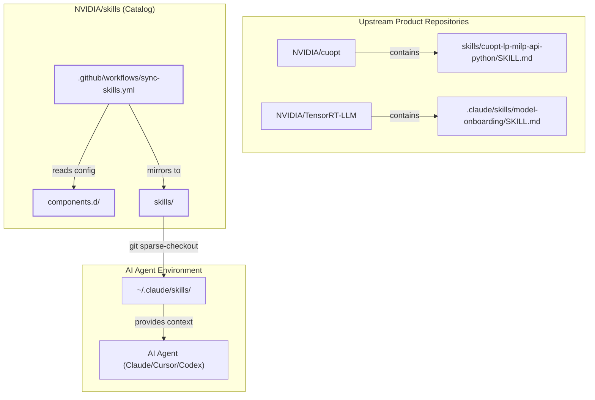
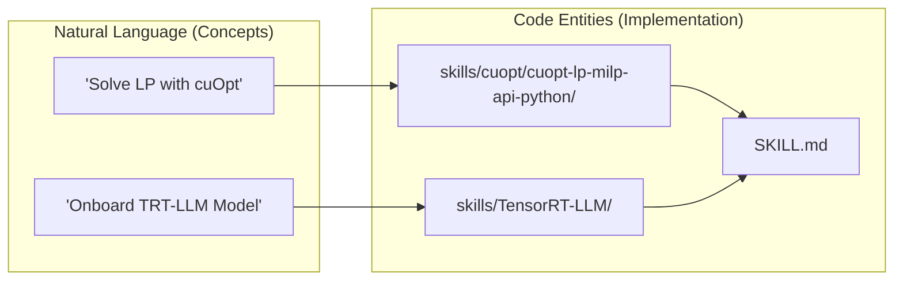

<!-- source: DeepWiki mcp.deepwiki.com · repo NVIDIA/skills · page 1 Overview · fetched 2026-10-30 -->

# Overview

Relevant source files

The following files were used as context for generating this wiki page:

- [CHANGELOG.md](CHANGELOG.md)
- [README.md](README.md)

The **NVIDIA Agent Skills** catalog is a centralized repository of official, NVIDIA-verified portable instruction sets designed for AI agents. These skills teach agents how to correctly utilize NVIDIA CUDA-X libraries, AI Blueprints, and platform tools, such as solving optimization problems with `cuOpt` or onboarding models into `TensorRT-LLM` [README.md:6-16]().

The catalog functions as a mirror; skills are maintained within their respective upstream product repositories and synchronized daily to this repository via an automated pipeline [README.md:16-18](). By adhering to the open [Agent Skills specification](https://agentskills.io/specification), these skills are compatible with any AI agent or framework that supports the standard, including Claude Code, Codex, and Cursor [README.md:16-16](), [README.md:37-42]().

## How It Works

The repository uses a **progressive disclosure model** to manage complexity. Each skill is contained within its own directory under `skills/` and includes a `SKILL.md` file that defines its capabilities and metadata [README.md:24-31]().

### System Architecture: From Catalog to Agent
The following diagram illustrates how the automation pipeline (Code Entity Space) bridges the gap between upstream product development and the final AI agent consumption (Natural Language Space).

**Skill Synchronization and Consumption Flow**

Sources: [README.md:16-18](), [README.md:28-31](), [README.md:37-42](), [CHANGELOG.md:23-26]()

## Progressive Disclosure & Specification

Every skill follows a structured format to ensure agents can parse and execute instructions reliably. 

*   **`SKILL.md`**: The entry point for the agent, containing frontmatter (metadata) and the instruction set [README.md:16-16]().
*   **Automation**: The `.github/workflows/sync-skills.yml` workflow aggregates skills from various NVIDIA products based on definitions in the `components.d/` directory.
*   **Verification**: Every skill is "NVIDIA-Verified," meaning it has passed internal reviews for technical accuracy and security [README.md:6-8]().

For a deep dive into the authoring format and validation rules, see **[Skill Authoring Specification](#4)**.

## Navigation

This wiki is organized to support three primary personas: end-users, product contributors, and maintainers.

### For End-Users & AI Agents
Learn how to install skills into your local agent environment using `git sparse-checkout` and where to place them for specific agents like Claude Code or Cursor.
*   **See: [Getting Started & Installation](#1.1)**

### For NVIDIA Product Teams
A guide for teams looking to onboard their product's skills into the official catalog. This covers the `components.d/` YAML schema and the mandatory IP/Security review process.
*   **See: [Contributing & Onboarding New Products](#1.2)**

### For Maintainers & Developers
Technical details on the automation pipeline, including how the README is regenerated and how the sync workflow handles change detection.
*   **See: [Catalog Architecture & Automation Pipeline](#2)**

### Governance and Security
Information on the dual Apache 2.0 / CC-BY 4.0 licensing, PSIRT vulnerability reporting, and the Contributor Covenant.
*   **See: [Governance, Security & Licensing](#1.3)**

## Code Entity Mapping

The following table associates high-level concepts with their specific implementation paths in the codebase.

| Concept | Code Entity / Path | Role |
| :--- | :--- | :--- |
| **Skill Mirror** | `skills/` | The destination for all synchronized skills [README.md:24-24](). |
| **Sync Engine** | `.github/workflows/sync-skills.yml` | The GitHub Action that pulls skills from upstream [README.md:16-18](). |
| **Product Registry** | `components.d/` | YAML configurations defining source repos and target directories. |
| **README Generator** | `.github/scripts/regenerate-readme.sh` | Updates the "Available Skills" table in the main README [README.md:48-48](). |
| **Legal Framework** | `LICENSE` | Defines the Apache 2.0 + CC-BY 4.0 dual license [README.md:10-10](). |

**Code-to-System Association**

Sources: [README.md:28-31](), [README.md:52-52](), [README.md:61-61]()

---

