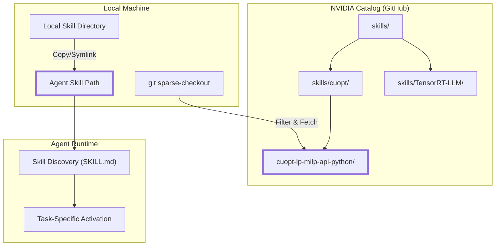
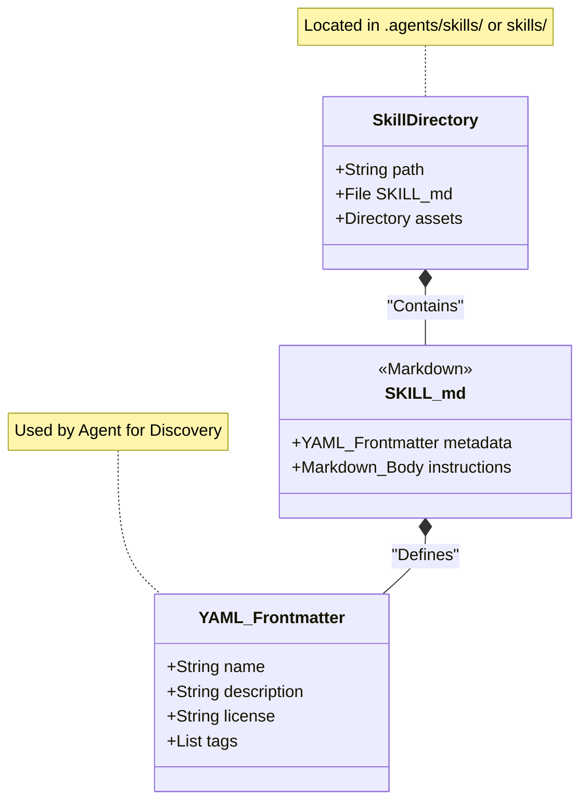

<!-- source: DeepWiki mcp.deepwiki.com · repo NVIDIA/skills · page 1.1 Getting Started & Installation · fetched 2026-10-30 -->

# Getting Started & Installation

<details>
<summary>Relevant source files</summary>

The following files were used as context for generating this wiki page:

- [.github/PULL_REQUEST_TEMPLATE.md](.github/PULL_REQUEST_TEMPLATE.md)
- [CONTRIBUTING.md](CONTRIBUTING.md)
- [README.md](README.md)

</details>


This page details how end-users and AI agents consume skills from the NVIDIA Agent Skills catalog. It covers the technical implementation of the sparse-checkout installation method, agent-specific configuration paths, and the `SKILL.md` format that enables agent discovery.

## Installation Overview

The NVIDIA Agent Skills repository functions as a centralized catalog of verified instruction sets. Instead of cloning the entire repository, which contains skills for numerous NVIDIA products, users and agents are encouraged to use **Git Sparse-Checkout**. This allows for the retrieval of specific skills or product collections while maintaining a minimal local footprint [README.md:24-31]().

### Data Flow: Skill Consumption

The following diagram illustrates how a skill moves from the NVIDIA catalog into an agent's active memory.

**Skill Acquisition and Activation Flow**


Sources: [README.md:24-33](), [CONTRIBUTING.md:12-19]()

## Sparse-Checkout Installation

To install a specific skill, use the following command pattern. This example demonstrates installing the `cuopt-lp-milp-api-python` skill [README.md:26-31]().

```bash
# 1. Clone the repository metadata without downloading blobs
git clone --depth 1 --filter=blob:none --sparse https://github.com/NVIDIA/skills.git
cd skills

# 2. Configure sparse-checkout for a specific skill directory
git sparse-checkout set skills/cuopt/cuopt-lp-milp-api-python

# 3. Deploy to the agent's expected skill path (e.g., Claude Code)
cp -r skills/cuopt/cuopt-lp-milp-api-python ~/.claude/skills/
```
Sources: [README.md:26-31]()

## Agent-Specific Paths

Different AI agents and IDE extensions look for skills in specific directories. To enable a skill, the directory containing the `SKILL.md` file must be placed in one of the following locations:

| Agent / Framework | Installation Path | Scope |
| :--- | :--- | :--- |
| **Claude Code** | `~/.claude/skills/` | Global (User-wide) |
| **Codex** | `.codex/skills/` | Project-specific |
| **Cursor** | `.cursor/skills/` | Project-specific |
| **Standard Agents** | `.agents/skills/` | Project-specific (Preferred) |

### Recommended Default Path
For new product integrations or general agent compatibility, the **`.agents/skills/`** path is the recommended default. It is agent-agnostic and aligns with the [agentskills.io](https://agentskills.io/specification) specification [CONTRIBUTING.md:14-17]().

Sources: [README.md:37-42](), [CONTRIBUTING.md:12-19]()

## The SKILL.md Format

The `SKILL.md` file is the core entity that bridges natural language instructions with executable agent behavior. It uses a structured frontmatter (YAML) to define metadata that agents use for discovery and validation.

### Frontmatter Schema

Every skill in the `skills/` directory must contain a `SKILL.md` file with compliant frontmatter [README.md:16-18]().

| Field | Requirement | Description |
| :--- | :--- | :--- |
| `name` | Required | The human-readable name of the skill. |
| `description` | Required | A concise summary used by the agent to decide when to trigger the skill. |
| `license` | Required | Must be Apache-2.0, CC-BY-4.0, or Dual [CONTRIBUTING.md:23-27](). |
| `metadata` | Optional | Key-value pairs for versioning or product categorization. |

### Technical Entity Mapping

The following diagram maps the conceptual "Skill" to the concrete file system entities and the metadata fields defined in the `SKILL.md` specification.

**Entity Mapping: Natural Language to Code**


Sources: [README.md:14-16](), [CONTRIBUTING.md:12-19](), [.github/PULL_REQUEST_TEMPLATE.md:25-25]()

## Verification and Safety

All skills in the catalog undergo a verification process before being mirrored. This includes:
1.  **IP Review**: Ensuring the skill is cleared for open-source release [CONTRIBUTING.md:21-29]().
2.  **DCO Sign-off**: Every commit must be signed (`git commit -s`) to certify the Developer Certificate of Origin [CONTRIBUTING.md:31-47]().
3.  **Path Standardization**: Skills are validated to ensure they reside in standard paths like `.agents/skills/` or `skills/` to prevent agent discovery failures [CONTRIBUTING.md:14-19]().

Sources: [CONTRIBUTING.md:21-47](), [.github/PULL_REQUEST_TEMPLATE.md:9-31]()

---

