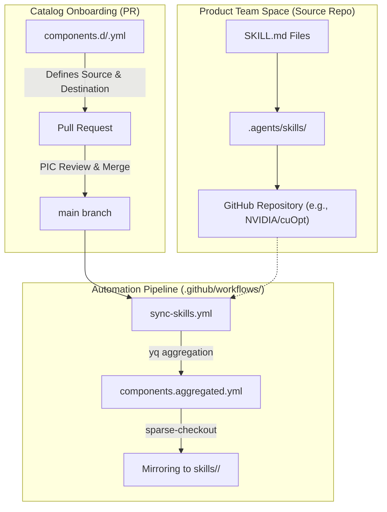
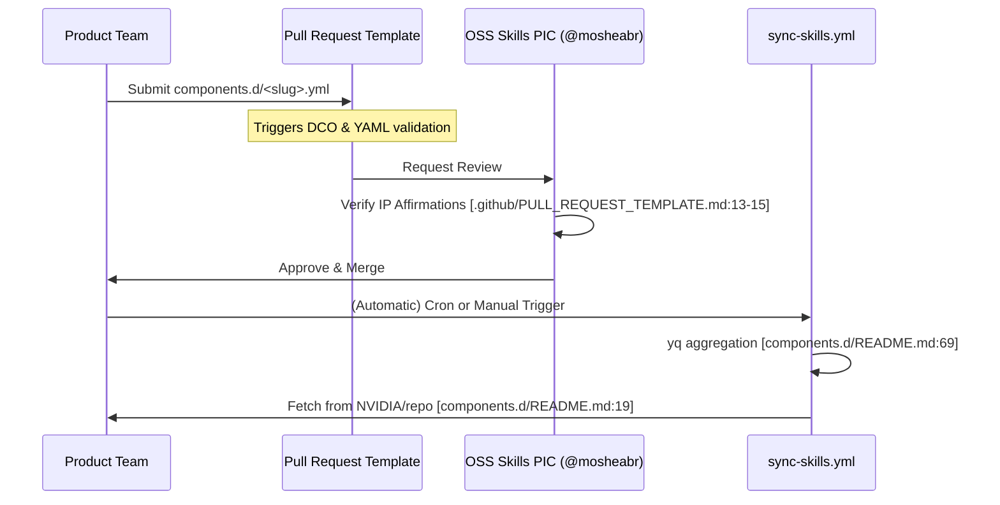

<!-- source: DeepWiki mcp.deepwiki.com · repo NVIDIA/skills · page 1.2 Contributing & Onboarding New Products · fetched 2026-10-30 -->

# Contributing & Onboarding New Products

<details>
<summary>Relevant source files</summary>

The following files were used as context for generating this wiki page:

- [.github/CODEOWNERS](.github/CODEOWNERS)
- [.github/PULL_REQUEST_TEMPLATE.md](.github/PULL_REQUEST_TEMPLATE.md)
- [.gitignore](.gitignore)
- [CONTRIBUTING.md](CONTRIBUTING.md)
- [components.d/README.md](components.d/README.md)

</details>


This guide provides a step-by-step technical walkthrough for NVIDIA product teams to onboard their agent skills into the central catalog. The repository operates on a **federated maintenance model**: while the catalog is central, the source of truth for skills remains within the respective product repositories.

## Onboarding Workflow Overview

The onboarding process is designed to be asynchronous and conflict-free. Teams submit a YAML configuration file to the `components.d/` directory, which the automation pipeline uses to mirror skills into the `skills/` directory of this repository.

### Process Flow: From Product Repo to Catalog

The following diagram illustrates the data flow from a source repository into the centralized catalog.

**Diagram: Skill Onboarding Data Flow**

Sources: [CONTRIBUTING.md:6-8](), [components.d/README.md:6-12](), [components.d/README.md:64-73]()

---

## 1. Defining the Component Configuration

To register a product, you must create a YAML file in `components.d/`. The filename must be a slug (lowercase, spaces replaced by dashes) matching your product name [components.d/README.md:10-10]().

### YAML Schema (`components.d/<slug>.yml`)

| Field | Type | Description |
| :--- | :--- | :--- |
| `name` | string | Display name in the README (e.g., `TensorRT-LLM`) [components.d/README.md:18-18](). |
| `repo` | string | Source GitHub repository in `owner/repo` format [components.d/README.md:19-19](). |
| `description` | string | One-line summary for the Available Skills table [components.d/README.md:20-20](). |
| `skills` | list | List of source-to-catalog mappings [components.d/README.md:21-21](). |
| `skills[].path` | string | Path in the **source** repo containing `SKILL.md` files [components.d/README.md:27-27](). |
| `skills[].catalog_dir`| string | Unique directory name under `skills/` in this repo [components.d/README.md:28-28](). |
| `ref` | string | (Optional) Branch to sync from. Defaults to `main` [components.d/README.md:34-34](). |

### Example: Multi-Skill Component
If a product has skills distributed across multiple sub-packages, you can define multiple entries under the `skills` key.

```yaml
# components.d/nemo-evaluator.yml
name: NeMo Evaluator
repo: NVIDIA-NeMo/Evaluator
description: LLM evaluation and benchmarking skills.
skills:
  - path: packages/nemo-evaluator-launcher/.claude/skills/
    catalog_dir: NeMo-Evaluator-Launcher
  - path: packages/nemo-evaluator/.claude/skills/
    catalog_dir: NeMo-Evaluator
```
Sources: [components.d/README.md:53-62]()

---

## 2. Skill Authoring Requirements

Before onboarding, ensure your skills follow the recommended directory structure and licensing requirements.

### Canonical Paths
Teams are encouraged to use agent-agnostic paths in their source repositories to ensure broad compatibility with tools like Claude Code, Cursor, and Windsurf:
*   **`.agents/skills/`**: Recommended default (aligns with [agentskills.io](https://agentskills.io) spec) [CONTRIBUTING.md:16-16]().
*   **`skills/`**: Acceptable for root-level artifacts [CONTRIBUTING.md:17-17]().

### IP Review & Licensing
NVIDIA contributors must confirm the following for every onboarding PR:
1.  **IP Clearance**: Skills have passed the internal six-question IP review check [CONTRIBUTING.md:23-25]().
2.  **Permissive License**: Skills must be under Apache 2.0, CC-BY 4.0, or a dual-license of both [CONTRIBUTING.md:26-26]().
3.  **No New Dependencies**: No third-party components or licenses are introduced that aren't already in the source repo [CONTRIBUTING.md:27-27]().

Sources: [CONTRIBUTING.md:12-27](), [.github/PULL_REQUEST_TEMPLATE.md:11-15]()

---

## 3. Submission & Review Process

The catalog uses a Pull Request (PR) template to enforce compliance.

### DCO Sign-off
All commits must be signed off to certify the Developer Certificate of Origin (DCO). Use the `-s` flag:
```bash
git commit -s -m "Add new product skills"
```
If you forget, you must rebase and force-push: `git rebase --signoff origin/main && git push --force-with-lease` [CONTRIBUTING.md:31-45]().

### PR Checklist for Authors
When opening a PR, you must check the following in the template:
*   [ ] Source repo is public and under an NVIDIA-owned GitHub org [.github/PULL_REQUEST_TEMPLATE.md:16-16]().
*   [ ] `catalog_dir` is unique and does not collide with existing products [.github/PULL_REQUEST_TEMPLATE.md:24-24]().
*   [ ] `SKILL.md` frontmatter is spec-compliant [.github/PULL_REQUEST_TEMPLATE.md:25-25]().

### OSS Skills PIC Review
The PR will be reviewed by the **OSS Skills Persons in Charge (PIC)**, currently defined in `.github/CODEOWNERS` as `@mosheabr` and `@sayalinvidia` [.github/CODEOWNERS:5-5](). They verify the author affirmations and ensure the YAML configuration is valid before merging [.github/PULL_REQUEST_TEMPLATE.md:21-27]().

**Diagram: Review and Integration Logic**

Sources: [.github/CODEOWNERS:5-5](), [.github/PULL_REQUEST_TEMPLATE.md:4-31](), [components.d/README.md:64-73]()

---

## 4. Post-Onboarding Automation

Once the PR is merged, the `sync-skills.yml` workflow handles the rest:
1.  **Aggregation**: It uses `yq` to merge all individual files in `components.d/*.yml` into a single runtime configuration [components.d/README.md:69-69]().
2.  **Mirroring**: It clones the source repositories and mirrors the specified `path` to the local `skills/<catalog_dir>` [components.d/README.md:28-28]().
3.  **README Update**: The `Available Skills` table in the root `README.md` is automatically regenerated to include the new product and its description [components.d/README.md:12-12]().

Sources: [components.d/README.md:4-12](), [components.d/README.md:64-73]()

---

