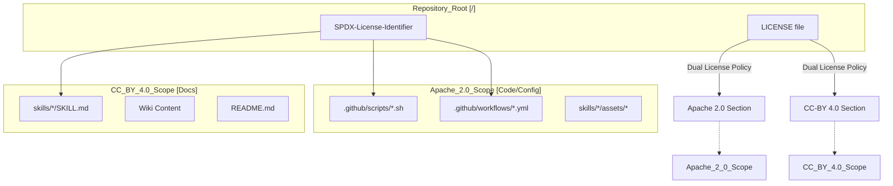
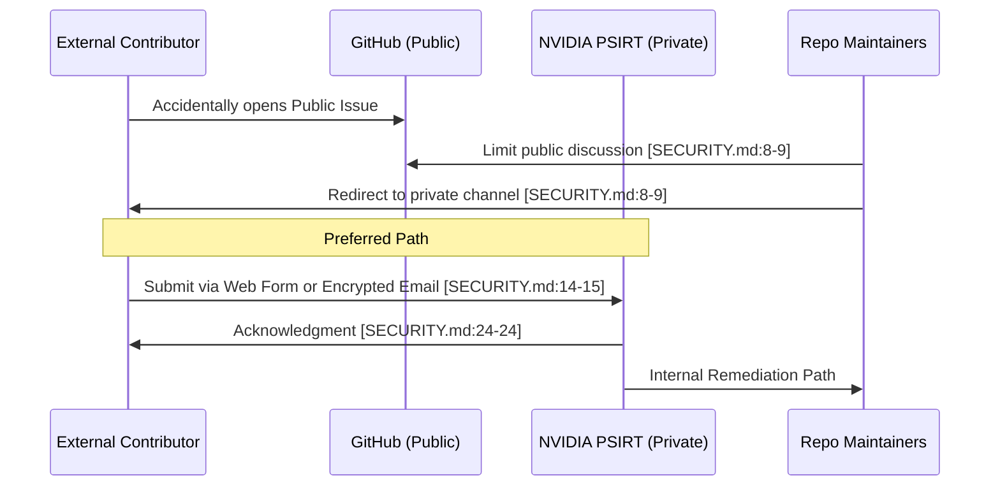

<!-- source: DeepWiki mcp.deepwiki.com · repo NVIDIA/skills · page 1.3 Governance, Security & Licensing · fetched 2026-10-30 -->

# Governance, Security & Licensing

Relevant source files

The following files were used as context for generating this wiki page:

- [.github/CODEOWNERS](.github/CODEOWNERS)
- [.gitignore](.gitignore)
- [CODE_OF_CONDUCT.md](CODE_OF_CONDUCT.md)
- [LICENSE](LICENSE)
- [SECURITY.md](SECURITY.md)

This page outlines the legal, security, and community frameworks governing the NVIDIA Agent Skills repository. It details the dual-licensing model, the protocols for reporting security vulnerabilities through NVIDIA PSIRT, and the behavioral standards expected from all contributors.

## Licensing Framework

The repository employs a dual-licensing strategy to accommodate both functional code and descriptive documentation. This is declared via the SPDX identifier `Apache-2.0 AND CC-BY-4.0` [LICENSE:1-1]() [.github/CODEOWNERS:1-1]().

### Dual-License Allocation

| Content Type | License | Application |
| :--- | :--- | :--- |
| **Code & Configuration** | **Apache License 2.0** | Applies to automation scripts (e.g., `.github/scripts/`), CI/CD workflows, and any executable assets within skill directories [LICENSE:5-6](). |
| **Documentation** | **Creative Commons Attribution 4.0 (CC BY 4.0)** | Applies to `SKILL.md` files, wiki pages, and general repository documentation [LICENSE:7-7](). |

Users may use repository contents under the terms of either license, or both, as applicable to the specific content type [LICENSE:9-10]().

### License Implementation Logic

The following diagram illustrates how the license is applied across different file entities within the repository structure.

**License Assignment Flow**

**Sources:** [LICENSE:1-11](), [.github/CODEOWNERS:1-2](), [SECURITY.md:1-2]()

---

## Security Policy & PSIRT

NVIDIA maintains a centralized security response framework. Security vulnerabilities must **not** be reported via public GitHub issues or Pull Requests [SECURITY.md:8-9]().

### Vulnerability Reporting Channels

If a potential security issue is identified, it must be directed to the NVIDIA Product Security Incident Response Team (PSIRT) [SECURITY.md:24-24]().

*   **Web Submission:** [Security Vulnerability Submission Form](https://www.nvidia.com/object/submit-security-vulnerability.html) [SECURITY.md:14-14]()
*   **Email:** `psirt@nvidia.com` [SECURITY.md:15-15]()
*   **Encryption:** NVIDIA provides a public PGP key for secure communication [SECURITY.md:16-16]()

### Coordinated Disclosure Process

NVIDIA follows a coordinated vulnerability disclosure policy. While there is no active bug bounty program, external reporters are acknowledged once an issue is addressed [SECURITY.md:24-24]().

**Data Flow: Security Reporting**

**Sources:** [SECURITY.md:4-29]()

---

## Governance & Code of Conduct

The project is governed by NVIDIA maintainers and adheres to the **Contributor Covenant (version 2.1)** [CODE_OF_CONDUCT.md:31-33]().

### Repository Ownership

Default ownership and final approval authority for the repository are assigned to the primary maintainers [ .github/CODEOWNERS:4-5]().

| Role | Responsibility |
| :--- | :--- |
| **Maintainers** | Reviewing PRs, investigating Code of Conduct reports, and managing PSIRT redirections [CODE_OF_CONDUCT.md:27-30](). |
| **Contributors** | Adhering to inclusive language standards and respectful engagement [CODE_OF_CONDUCT.md:12-19](). |

### Standards of Behavior

The repository enforces strict standards to ensure a professional environment:
*   **Positive Behavior:** Inclusive language, empathy, and constructive criticism [CODE_OF_CONDUCT.md:14-18]().
*   **Unacceptable Behavior:** Trolling, personal attacks, public/private harassment, and doxxing [CODE_OF_CONDUCT.md:22-25]().

### Enforcement Mechanism

Instances of unacceptable behavior can be reported by opening an issue or contacting the maintainers directly [CODE_OF_CONDUCT.md:27-29](). Maintainers have the authority to investigate and take appropriate action based on the circumstances [CODE_OF_CONDUCT.md:29-30]().

**Sources:** [CODE_OF_CONDUCT.md:1-34](), [.github/CODEOWNERS:1-6]()

---

## Sensitive Information Management

The repository uses a `.gitignore` configuration to prevent the accidental leakage of credentials, environment variables, and local development artifacts [ .gitignore:15-25]().

The following file patterns are explicitly blocked from the repository:
*   **Secrets:** `.env`, `.env.*`, `*.pem`, `*.key`, and `credentials.json` [ .gitignore:16-20]().
*   **Local Configs:** `*.local`, `*.local.*` [ .gitignore:23-24]().

**Sources:** [.gitignore:1-25]()

---

