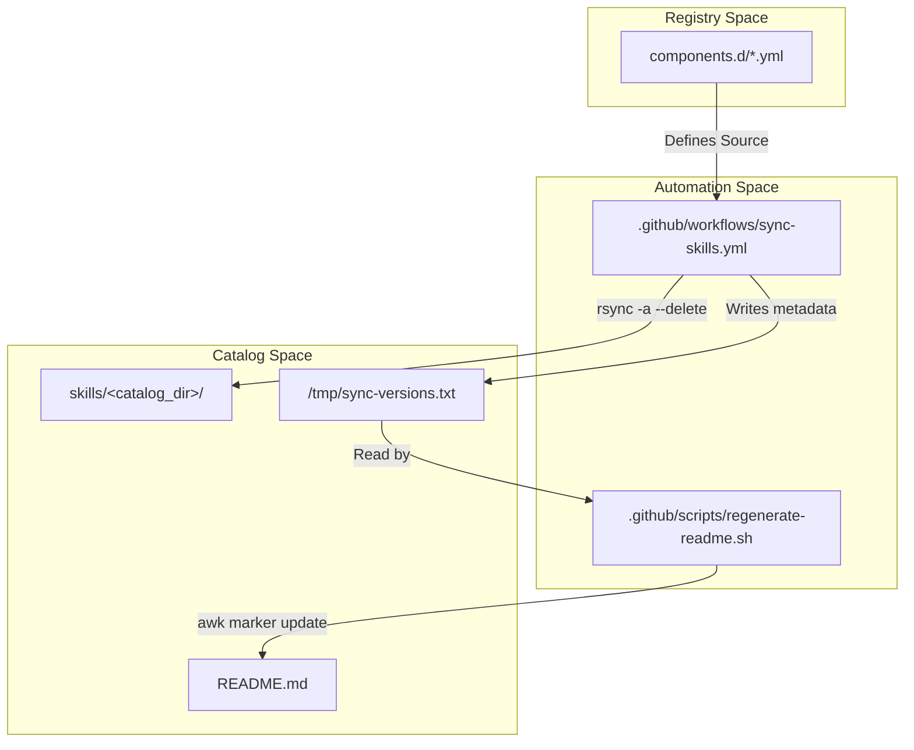
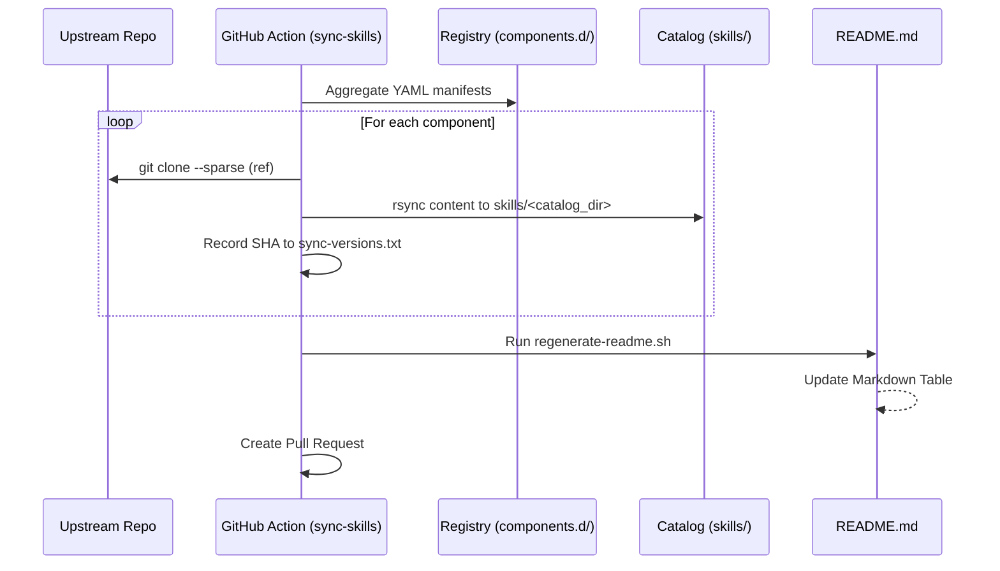

<!-- source: DeepWiki mcp.deepwiki.com · repo NVIDIA/skills · page 2 Catalog Architecture & Automation Pipeline · fetched 2026-10-30 -->

# Catalog Architecture & Automation Pipeline

Relevant source files

The following files were used as context for generating this wiki page:

- [.github/workflows/sync-skills.yml](.github/workflows/sync-skills.yml)
- [README.md](README.md)

The NVIDIA Agent Skills repository serves as a centralized, official catalog for AI agent skills across the NVIDIA ecosystem. Rather than requiring product teams to manually submit code changes to this repository, the architecture relies on an **automated synchronization pipeline**. This ensures that skills remain co-located with their primary source code in upstream product repositories while being easily discoverable and installable from a single source of truth.

### High-Level Architecture

The catalog architecture bridges the gap between decentralized product development and a centralized consumption point. It consists of three primary layers:

1.  **Source Layer (Product Repos):** Upstream repositories (e.g., `NVIDIA/cuopt`, `NVIDIA/TensorRT-LLM`) maintain their own skills in specific subdirectories (e.g., `.claude/skills` or `skills/`).
2.  **Registry Layer (`components.d/`):** A collection of YAML manifests in this repository that define where each product's skills live and where they should be mirrored in the catalog.
3.  **Automation Layer (GitHub Actions):** Workflows that aggregate these manifests, pull the latest content via sparse-checkout, and update the catalog and documentation.

### Code-to-System Mapping

The following diagram illustrates how logical system components map to specific code entities and files within the repository.

**System Entity Mapping**

**Sources:** [.github/workflows/sync-skills.yml:5-10](), [.github/workflows/sync-skills.yml:106-106](), [.github/scripts/regenerate-readme.sh:1-10]()

---

## 2.1 Sync-Skills Workflow

The `sync-skills` workflow is the heartbeat of the catalog. It is a GitHub Action that runs twice daily or on-demand to mirror content from across the NVIDIA organization.

*   **Trigger Mechanism:** Operates on a cron schedule (`0 6,18 * * *`) and `workflow_dispatch` for manual runs [[.github/workflows/sync-skills.yml:14-18]()].
*   **Aggregation:** It uses `yq` to merge all individual product files in `components.d/*.yml` into a single temporary configuration [[.github/workflows/sync-skills.yml:55-56]()].
*   **Sparse Mirroring:** For each component, it performs a `git clone --sparse` to minimize bandwidth, then uses `rsync -a --delete` to ensure the `skills/` directory in this repo exactly matches the upstream source [[.github/workflows/sync-skills.yml:73-75](), [.github/workflows/sync-skills.yml:106-106]()].
*   **Change Detection:** If changes are detected, it automatically generates a Pull Request with a summary of updated components [[.github/workflows/sync-skills.yml:162-179]()].

For a deep dive into the cloning logic and failure reporting, see **[Sync-Skills Workflow](#2.1)**.

---

## 2.2 README Regeneration Script

To ensure the [README.md](README.md) accurately reflects the hundreds of skills in the catalog, the repository uses an automated regeneration script. This prevents the documentation from drifting out of sync with the actual files.

*   **Version Resolution:** The script reads from `sync-versions.txt` (generated during the sync) to resolve the exact short-SHA and commit date of the upstream source [[.github/workflows/sync-skills.yml:86-86](), [.github/scripts/regenerate-readme.sh:12-15]()].
*   **Table Generation:** It iterates through the `components.d/` registry to count skills and build the "Available Skills" Markdown table [[.github/scripts/regenerate-readme.sh:40-60]()].
*   **In-place Update:** It uses `awk` with specific marker pairs (`<!-- skills-table-start -->` and `<!-- skills-table-end -->`) to overwrite the table in the root README without affecting other sections [[README.md:48-48](), [.github/scripts/regenerate-readme.sh:120-130]()].

For details on the Markdown generation logic, see **[README Regeneration Script](#2.2)**.

---

## 2.3 Components Registry (components.d/)

The `components.d/` directory acts as the decentralized registry for the catalog. Each NVIDIA product team manages their own entry as a standalone YAML file.

*   **Decentralized Onboarding:** By using individual files, multiple teams can submit onboarding PRs simultaneously without causing merge conflicts in a shared configuration file [[.github/workflows/sync-skills.yml:51-54]()].
*   **Schema Requirements:** Each file must define a `repo`, a `name`, and a list of `skills` mapping a source `path` to a `catalog_dir` [[.github/workflows/sync-skills.yml:65-67](), [.github/workflows/sync-skills.yml:100-101]()].
*   **Uniqueness Constraint:** The `catalog_dir` must be unique across the entire repository to prevent products from overwriting each other's skills.

For the full YAML schema and registration guidelines, see **[Components Registry (components.d/)](#2.3)**.

**Catalog Update Pipeline Flow**

**Sources:** [.github/workflows/sync-skills.yml:55-130](), [.github/scripts/regenerate-readme.sh:1-20]()

---

