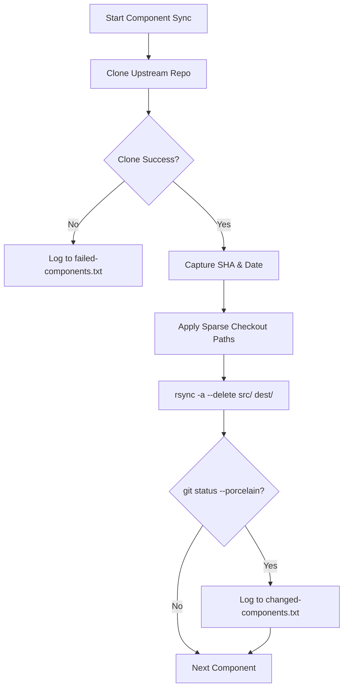

<!-- source: DeepWiki mcp.deepwiki.com · repo NVIDIA/skills · page 2.1 Sync-Skills Workflow · fetched 2026-10-30 -->

# Sync-Skills Workflow

<details>
<summary>Relevant source files</summary>

The following files were used as context for generating this wiki page:

- [.github/workflows/dco.yml](.github/workflows/dco.yml)
- [.github/workflows/sync-skills.yml](.github/workflows/sync-skills.yml)
- [.github/workflows/verify-authors.yml](.github/workflows/verify-authors.yml)

</details>


The `sync-skills` workflow is the central automation engine of the NVIDIA Skills catalog. It is responsible for mirroring skill content from disparate upstream product repositories into the centralized `nvidia/skills` repository. This process ensures that the catalog remains a "single source of truth" for AI agents while allowing product teams to maintain their skills within their own development lifecycles.

## Workflow Overview

The workflow operates on a hub-and-spoke model. It aggregates configuration from `components.d/`, iterates through registered products, and performs surgical updates to the `skills/` directory.

### Triggers
The workflow is configured to run automatically and can be invoked manually for testing or immediate updates:
*   **Scheduled (Cron):** Runs twice daily at 06:00 UTC and 18:00 UTC `[.github/workflows/sync-skills.yml:15-17]()`.
*   **Manual (workflow_dispatch):** Allows maintainers to trigger a sync via the GitHub Actions UI `[.github/workflows/sync-skills.yml:18-18]()`.

### High-Level Data Flow

The following diagram illustrates the transition from the YAML configuration files in the "Natural Language Space" (where products are defined) to the execution logic in the "Code Entity Space".

**Sync Logic and Entity Mapping**

```mermaid
graph TD
    subgraph "Configuration Space"
        C1["components.d/*.yml"] -->|yq ea| AGG["/tmp/components.aggregated.yml"]
    end

    subgraph "Execution Space (.github/workflows/sync-skills.yml)"
        AGG -->|Loop i| LOOP["Component Iterator"]
        LOOP -->|yq .repo| CLONE["git clone --sparse"]
        LOOP -->|yq .skills[j].path| SPARSE["git sparse-checkout set"]
        LOOP -->|yq .skills[j].catalog_dir| SYNC["rsync -a --delete"]
    end

    subgraph "Target Space"
        SYNC -->|Mirror| DEST["skills/{catalog_dir}/"]
        DEST -->|Detect Change| PR["Create Pull Request"]
    end
    
    style AGG stroke-dasharray: 5 5
```
**Sources:** `[.github/workflows/sync-skills.yml:51-57]()`, `[.github/workflows/sync-skills.yml:64-67]()`, `[.github/workflows/sync-skills.yml:91-95]()`, `[.github/workflows/sync-skills.yml:105-106]()`

---

## Implementation Details

### 1. Configuration Aggregation
To simplify the iteration logic and allow concurrent onboarding PRs without merge conflicts, the workflow does not read a single global registry. Instead, it uses `yq` to aggregate all individual files in `components.d/*.yml` into a temporary array `[.github/workflows/sync-skills.yml:51-56]()`. This allows the subsequent bash loop to index components by position `[.github/workflows/sync-skills.yml:64-64]()`.

### 2. Secure Authentication
The workflow uses a GitHub Personal Access Token (PAT) named `SKILLS_SYNC_PAT` `[.github/workflows/sync-skills.yml:9-10]()`. To prevent the token from leaking into logs via clone URLs or error messages, the workflow configures a local git credential helper `[.github/workflows/sync-skills.yml:60-60]()`.

### 3. Sparse-Checkout Cloning
To minimize bandwidth and disk usage (crucial for large product monorepos), the workflow utilizes a multi-step shallow sparse-checkout:
1.  **Initial Clone:** Clones with `--depth 1`, `--filter=blob:none`, and `--sparse` `[.github/workflows/sync-skills.yml:73-75]()`.
2.  **Path Resolution:** Iterates through the `skills` array for the component to collect all required upstream paths `[.github/workflows/sync-skills.yml:89-94]()`.
3.  **Checkout Refinement:** Executes `git sparse-checkout set` to pull only the specific directories containing `SKILL.md` files and assets `[.github/workflows/sync-skills.yml:95-95]()`.

### 4. Mirroring and Change Detection
The actual synchronization is performed using `rsync` with the `--delete` flag `[.github/workflows/sync-skills.yml:106-106]()`. This ensures that if a skill is removed from the upstream product repo, it is also removed from the catalog.

The workflow distinguishes between a "successful sync" and an "actual change":
*   **Successful Sync:** Recorded in `/tmp/rsynced-components.txt` if the source directory exists and is not empty `[.github/workflows/sync-skills.yml:119-120]()`.
*   **Content Change:** Detected via `git status --porcelain`. If the local `skills/` directory shows modifications after `rsync`, the component is added to `/tmp/changed-components.txt` `[.github/workflows/sync-skills.yml:123-127]()`.

**Mirroring Logic Flow**


**Sources:** `[.github/workflows/sync-skills.yml:73-86]()`, `[.github/workflows/sync-skills.yml:106-127]()`

---

## Post-Processing and PR Creation

### README Regeneration
Once all components are processed, the workflow calls `.github/scripts/regenerate-readme.sh` `[.github/workflows/sync-skills.yml:142-142]()`. This script uses the metadata captured during the sync (stored in `/tmp/sync-versions.txt`) to update the "Version" column in the main README tables, providing traceability back to the upstream commit SHAs `[.github/workflows/sync-skills.yml:81-86]()`.

### Automated Pull Request
If changes are detected, the workflow creates a Pull Request using `peter-evans/create-pull-request` `[.github/workflows/sync-skills.yml:180-205]()`. 
*   **Branch Name:** `automated/sync-skills` `[.github/workflows/sync-skills.yml:187-187]()`.
*   **Exemptions:** This branch is explicitly exempted from **DCO (Developer Certificate of Origin)** checks `[.github/workflows/dco.yml:40-43]()` and **Author Verification** checks `[.github/workflows/verify-authors.yml:45-48]()`, as it is a bot-managed mirror.

### Error Handling and Reporting
The workflow includes a safety check to fail the job if *nothing* was synced, which usually indicates a network or credential failure `[.github/workflows/sync-skills.yml:134-139]()`. 

If specific components fail (e.g., a directory was renamed upstream), the workflow:
1.  Logs the failure to `/tmp/failed-components.txt` `[.github/workflows/sync-skills.yml:77-77]()`.
2.  Summarizes these failures in the resulting PR body `[.github/workflows/sync-skills.yml:170-174]()`.
3.  Creates a GitHub Issue if the sync job itself fails, ensuring visibility for maintainers `[.github/workflows/sync-skills.yml:211-224]()`.

| Feature | Implementation |
| :--- | :--- |
| **Tooling** | `yq`, `rsync`, `git sparse-checkout` |
| **Temporary Files** | `/tmp/components.aggregated.yml`, `/tmp/sync-versions.txt` |
| **Concurrency** | Grouped by `sync-skills` with `cancel-in-progress: true` `[.github/workflows/sync-skills.yml:25-27]()` |
| **Traceability** | Upstream SHA, short SHA, and commit date captured per component `[.github/workflows/sync-skills.yml:81-84]()` |

**Sources:** `[.github/workflows/sync-skills.yml:25-27]()`, `[.github/workflows/sync-skills.yml:81-84]()`, `[.github/workflows/sync-skills.yml:142-142]()`, `[.github/workflows/sync-skills.yml:180-205]()`, `[.github/workflows/sync-skills.yml:211-224]()`

---

