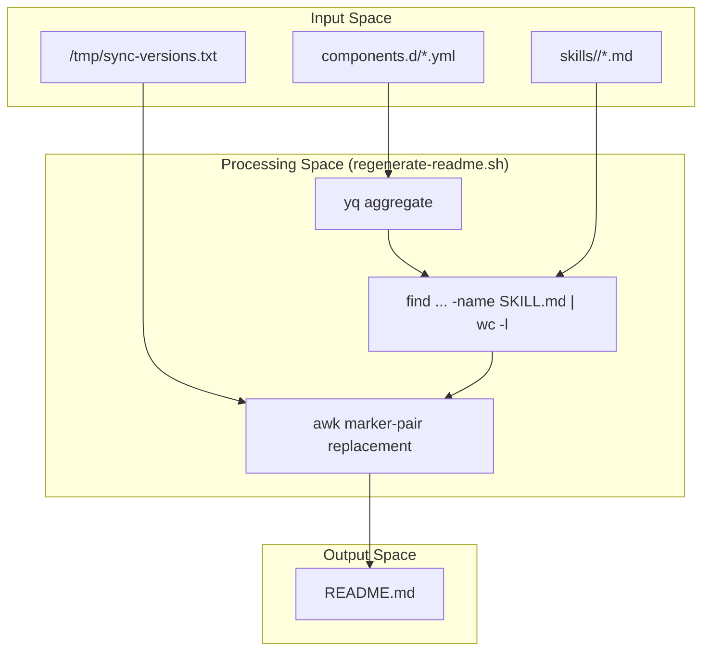
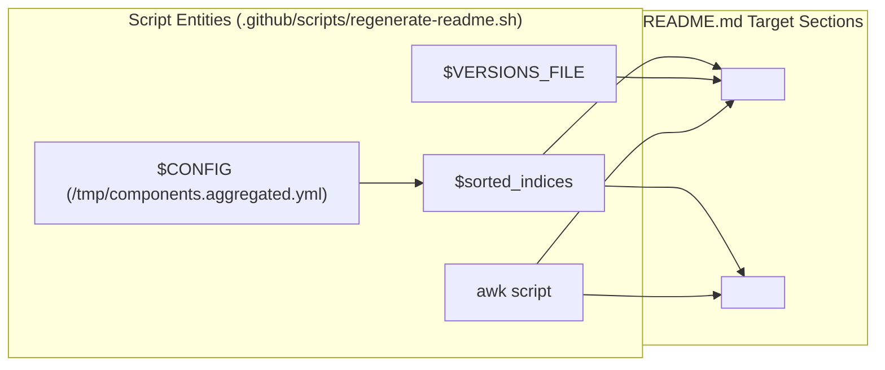

<!-- source: DeepWiki mcp.deepwiki.com · repo NVIDIA/skills · page 2.2 README Regeneration Script · fetched 2026-10-30 -->

# README Regeneration Script

Relevant source files

The following files were used as context for generating this wiki page:

- [.github/scripts/regenerate-readme.sh](.github/scripts/regenerate-readme.sh)

The `regenerate-readme.sh` script is a bash-based automation utility responsible for maintaining the `README.md` file of the NVIDIA Agent Skills catalog. It ensures that the summary tables—specifically the "Available Skills" and "Getting Help & Contributing" sections—accurately reflect the current state of the repository's YAML configurations and synchronized skill content.

This script is typically executed as part of the `.github/workflows/sync-skills.yml` workflow to update the catalog's landing page after new skills are synchronized from upstream repositories.

### Logic Flow and Data Transformation

The script operates by aggregating individual component definitions, calculating skill metrics, resolving version metadata, and performing an in-place update of the `README.md` using `awk` marker pairs.

#### 1. YAML Aggregation and Sorting
The script begins by consolidating all individual YAML files located in `components.d/` into a single temporary aggregate file [`.github/scripts/regenerate-readme.sh:25-28`](). This allows for global indexing and sorting across all registered products.

#### 2. Skill Counting
For each component, the script traverses the local `skills/` directory corresponding to the `catalog_dir` defined in the YAML. It recursively searches for `SKILL.md` files to generate an accurate count of available skills per product [`.github/scripts/regenerate-readme.sh:45-51`]().

#### 3. Version Resolution
The script attempts to resolve version information from a metadata file (defaulting to `/tmp/sync-versions.txt`). This file, populated by the sync workflow, contains the upstream short SHA, full SHA, and committer date [`.github/scripts/regenerate-readme.sh:9-12`](). If the file is present, the script formats a Markdown link to the specific upstream commit [`.github/scripts/regenerate-readme.sh:54-60`]().

#### 4. Table Generation and Injection
The script generates two distinct Markdown tables:
*   **Available Skills Table**: Lists Product name, description, skill count, catalog path, source link, and version [`.github/scripts/regenerate-readme.sh:32-65`]().
*   **Getting Help & Contributing Table**: Lists Product name and links to Issues, Discussions, Contributing guidelines, and Security policies [`.github/scripts/regenerate-readme.sh:67-95`]().

Finally, it uses `awk` to inject these tables into the `README.md` file between specific HTML comment markers [`.github/scripts/regenerate-readme.sh:97-127`]().

**README Regeneration Data Flow**

**Sources:**
* [`.github/scripts/regenerate-readme.sh:1-131`]()

### Key Functions and Operations

The script relies on standard Unix utilities and `yq` for structured data manipulation.

| Operation | Implementation Detail | Code Reference |
|:---|:---|:---|
| **Aggregation** | Uses `yq ea` to merge all component YAMLs into a single `.components` list. | [`.github/scripts/regenerate-readme.sh:27-28`]() |
| **Sorting** | Sorts components alphabetically by name (case-insensitive) to ensure stable README ordering. | [`.github/scripts/regenerate-readme.sh:30`]() |
| **Skill Discovery** | Uses `find` and `wc -l` to count `SKILL.md` files within the `skills/` directory tree. | [`.github/scripts/regenerate-readme.sh:48`]() |
| **Link Construction** | Dynamically builds GitHub URLs for source code, issues, and security policies based on YAML `repo` and `ref` fields. | [`.github/scripts/regenerate-readme.sh:62-63`]() |
| **In-place Update** | Employs an `awk` state machine to identify `<!-- start -->` and `<!-- end -->` markers. | [`.github/scripts/regenerate-readme.sh:98-125`]() |

**Code Entity to Document Section Mapping**

**Sources:**
* [`.github/scripts/regenerate-readme.sh:23-30`]()
* [`.github/scripts/regenerate-readme.sh:98-125`]()

### Marker Pair System

The script uses a strict marker pair system to identify where to inject content. This allows the rest of the `README.md` (headers, introduction, installation instructions) to be edited manually without being overwritten by the automation.

| Start Marker | End Marker | Target Content |
|:---|:---|:---|
| `<!-- skills-table-start -->` | `<!-- skills-table-end -->` | Product catalog summary, skill counts, and versions. |
| `<!-- help-table-start -->` | `<!-- help-table-end -->` | Support links (Issues, Discussions, Contributing). |

The `awk` logic [`.github/scripts/regenerate-readme.sh:98-125`]() works by:
1.  Printing lines from the original file until a "start" marker is found.
2.  Printing the marker itself.
3.  Reading and printing the entire content of the newly generated table file.
4.  Setting a skip flag (`in_skills` or `in_help`) to ignore lines from the original file until the "end" marker is reached.
5.  Printing the "end" marker and resuming normal output.

**Sources:**
* [`.github/scripts/regenerate-readme.sh:15-17`]()
* [`.github/scripts/regenerate-readme.sh:98-125`]()

---

