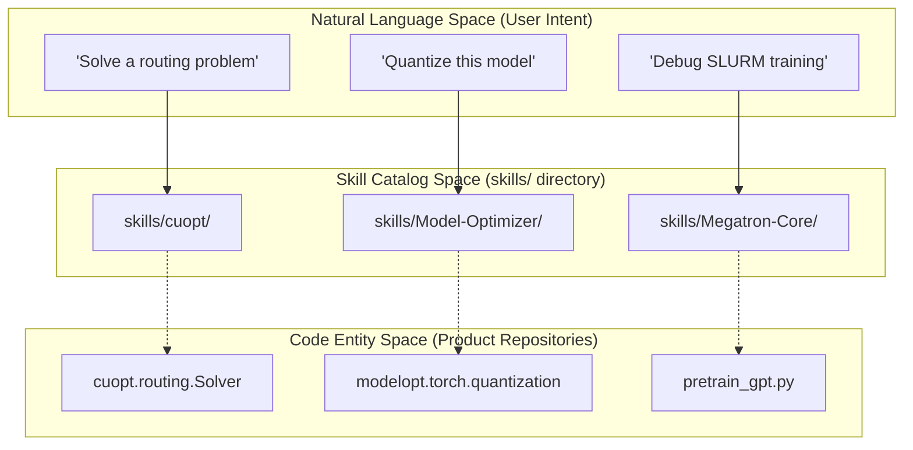
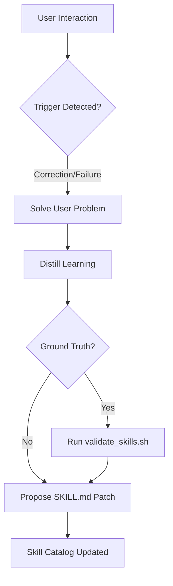

<!-- source: DeepWiki mcp.deepwiki.com · repo NVIDIA/skills · page 3 Skill Catalog: Product Skills Reference · fetched 2026-10-30 -->

# Skill Catalog: Product Skills Reference

Relevant source files

The following files were used as context for generating this wiki page:

- [README.md](README.md)
- [skills/Megatron-Core/run-on-slurm/SKILL.md](skills/Megatron-Core/run-on-slurm/SKILL.md)
- [skills/cuopt/skill-evolution/SKILL.md](skills/cuopt/skill-evolution/SKILL.md)

This page provides a high-level overview of the NVIDIA product skill collections hosted in the `skills/` directory. Each collection is a set of verified, portable instructions—following the [SKILL.md specification](https://agentskills.io/specification)—designed to teach AI agents how to use NVIDIA libraries and platforms correctly.

The catalog is a mirrored repository; skills are maintained in their respective product repositories and synchronized daily to this central location. [README.md:16-18]().

## Skill Catalog Overview

The following diagram illustrates how product-specific code entities and workflows are mapped into the skill catalog structure, bridging the gap between natural language requests and actionable code.

### Natural Language to Code Entity Mapping

**Sources:** [README.md:14-16](), [skills/Megatron-Core/run-on-slurm/SKILL.md:54-55]()

---

## Product Skill Collections

### 3.1. Megatron-Core Skills
Focuses on large-scale distributed LLM training. Includes skills for build management, SLURM execution, CI/CD, and hardware-specific onboarding for GB200 systems.
*   **Key Entities:** `pretrain_gpt.py`, `torch.distributed.run`.
*   **For details, see [Megatron-Core Skills](#3.1).**

### 3.2. Megatron-Bridge Skills
Provides the integration layer between NeMo and Megatron-Core. Skills cover model conversion, resiliency, and performance optimizations like Mixture of Experts (MoE) and FSDP.
*   **For details, see [Megatron-Bridge Skills](#3.2).**

### 3.3. TensorRT-LLM Skills
Covers the full lifecycle of LLM inference optimization, from writing custom kernels using CuTe or Triton to performance profiling with Nsight Systems.
*   **Key Entities:** `Nsight Systems`, `CUDA Graphs`, `Triton`.
*   **For details, see [TensorRT-LLM Skills](#3.3).**

### 3.4. cuOpt Skills
Detailed guidance for the NVIDIA cuOpt optimization solver. Includes Python/C API usage, routing engine configuration, and the "Skill Evolution" framework for self-improving agents.
*   **Key Entities:** `cuopt.routing.Solver`, `LinearExpression`.
*   **For details, see [cuOpt Skills](#3.4).**

### 3.5. NemoClaw Skills
Skills for managing NVIDIA's secure AI agent sandbox. Covers the four-layer security model, including `OpenShell` gateway enforcement and `Landlock LSM` isolation.
*   **For details, see [NemoClaw Skills](#3.5).**

### 3.6. TileGym Skills
Focuses on GPU kernel development. Teaches agents to use the `cuTile` Python DSL for kernel creation and subsequent conversion to Triton or Julia.
*   **For details, see [TileGym Skills](#3.6).**

### 3.7. Model Optimizer Skills
Covers post-training quantization (PTQ), sparsity, and distillation using `ModelOpt`. Includes workflows for MLflow monitoring and deployment.
*   **For details, see [Model Optimizer Skills](#3.7).**

### 3.8. NeMo Evaluator & NeMo Gym Skills
Skills for launching LLM evaluations and managing RL training environments. Includes the NeMo Evaluator Launcher (NEL) and reward profiling.
*   **For details, see [NeMo Evaluator & NeMo Gym Skills](#3.8).**

### 3.9. AI Blueprint & Application Skills
High-level application skills for NVIDIA Blueprints, including RAG, Video Search & Summarization (VSS), and Nemotron Voice Agent deployment.
*   **For details, see [AI Blueprint & Application Skills](#3.9).**

---

## Skill Architecture & Evolution

Skills are not static; they are designed to evolve based on user interactions and failure patterns. The `skill-evolution` framework (pioneered in cuOpt) allows agents to detect generalizable learnings and propose updates to the `SKILL.md` files. [skills/cuopt/skill-evolution/SKILL.md:4-9]().

### Skill Evolution Workflow

**Sources:** [skills/cuopt/skill-evolution/SKILL.md:11-32](), [skills/cuopt/skill-evolution/SKILL.md:87-89]()

### The SKILL.md Specification
Every skill in the catalog must adhere to the standard format, featuring a YAML frontmatter for agent discovery and a Markdown body for instruction.
*   **Required Fields:** `name`, `description`, `when_to_use`. [skills/Megatron-Core/run-on-slurm/SKILL.md:1-5]()
*   **Validation:** Skills are verified via `validate_skills.sh` and asset tests in `ci/test_skills_assets.sh`. [skills/cuopt/skill-evolution/SKILL.md:61-63]()

**Sources:**
*   [README.md:46-65]()
*   [skills/cuopt/skill-evolution/SKILL.md:1-86]()
*   [skills/Megatron-Core/run-on-slurm/SKILL.md:1-5]()

---

