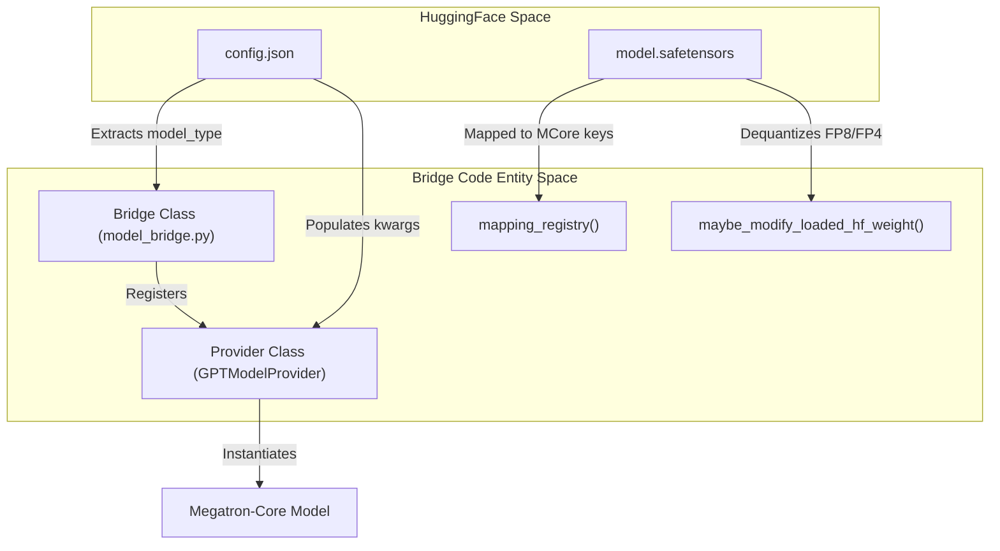
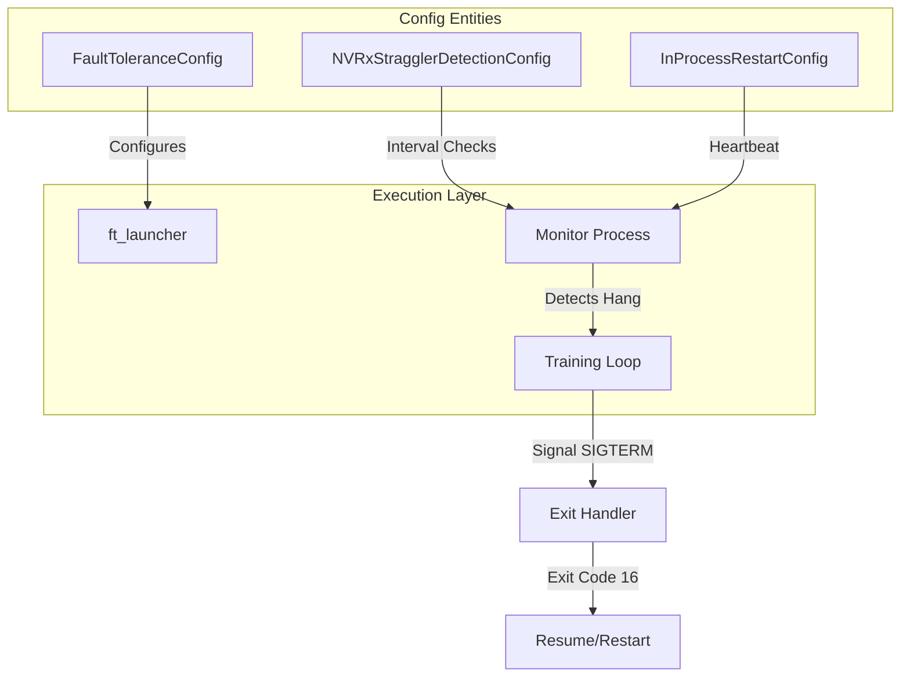

<!-- source: DeepWiki mcp.deepwiki.com · repo NVIDIA/skills · page 3.2 Megatron-Bridge Skills · fetched 2026-10-30 -->

# Megatron-Bridge Skills

Relevant source files

The following files were used as context for generating this wiki page:

- [skills/Megatron-Bridge/adding-model-support/SKILL.md](skills/Megatron-Bridge/adding-model-support/SKILL.md)
- [skills/Megatron-Bridge/mlm-bridge-training/SKILL.md](skills/Megatron-Bridge/mlm-bridge-training/SKILL.md)
- [skills/Megatron-Bridge/resiliency/SKILL.md](skills/Megatron-Bridge/resiliency/SKILL.md)

Megatron-Bridge serves as the integration layer between NeMo and Megatron-Core, enabling high-performance LLM and VLM training with advanced features like resiliency, model-specific optimizations, and seamless configuration translation.

## 1. Model Support & Onboarding

Adding support for new model families involves a multi-phase process of configuration discovery, weight mapping, and provider registration.

### 1.1 Discovery and Analysis
The process begins by analyzing the HuggingFace `config.json` to extract architectural parameters such as `model_type`, `hidden_size`, and `num_attention_heads` [skills/Megatron-Bridge/adding-model-support/SKILL.md:17-27](). A critical distinction is made between LLMs and VLMs based on the presence of `text_config` and `vision_config` [skills/Megatron-Bridge/adding-model-support/SKILL.md:30-44]().

### 1.2 Weight Dequantization
Megatron-Bridge does not automatically dequantize weights during import. If a model uses FP8 or FP4, it must be dequantized before conversion either via a standalone script or by overriding `maybe_modify_loaded_hf_weight()` in the bridge class [skills/Megatron-Bridge/adding-model-support/SKILL.md:45-76]().

### 1.3 Implementation Patterns
- **LLMs**: Typically require only a bridge file registering the model and implementing `provider_bridge()` and `mapping_registry()` [skills/Megatron-Bridge/adding-model-support/SKILL.md:127-132]().
- **VLMs**: Often require a custom `Provider` subclass and a model class that combines a vision encoder with a language decoder [skills/Megatron-Bridge/adding-model-support/SKILL.md:134-140]().

### Model Onboarding Entity Map
The following diagram maps the conceptual model onboarding steps to the specific code entities in the Megatron-Bridge directory structure.

"Model Onboarding Entity Map"

Sources: [skills/Megatron-Bridge/adding-model-support/SKILL.md:17-140]()

---

## 2. Training & Correlation

Megatron-Bridge allows users to run training using recipes that translate NeMo-style configurations into Megatron-Core parameters.

### 2.1 Correlation Testing
To ensure parity with Megatron-LM (MLM), users perform correlation runs using the `vanilla_gpt_pretrain_config`. This matches the bare defaults of `pretrain_gpt.py` [skills/Megatron-Bridge/mlm-bridge-training/SKILL.md:13-18]().

### 2.2 Execution
Training is launched via `scripts/training/run_recipe.py` using `uv run` to manage the environment [skills/Megatron-Bridge/mlm-bridge-training/SKILL.md:40-50]().

| Feature | Megatron-LM Argument | Bridge Configuration Override |
|---|---|---|
| Layers | `--num-layers` | `model.num_layers` |
| Parallelism | `--tensor-model-parallel-size` | `model.tensor_model_parallel_size` |
| Sequence Length | `--seq-length` | `dataset.sequence_length` |
| Precision | `--bf16` | (Included in recipe) |

Sources: [skills/Megatron-Bridge/mlm-bridge-training/SKILL.md:20-91]()

---

## 3. Resiliency & Fault Tolerance

The bridge provides a robust resiliency layer to handle hangs, hardware failures, and preemptions in large-scale Slurm environments.

### 3.1 Fault Tolerance (Slurm)
Fault tolerance can be enabled via the `FaultTolerancePlugin` in NeMo Run or by direct configuration of `FaultToleranceConfig` [skills/Megatron-Bridge/resiliency/SKILL.md:16-54](). It manages heartbeat timeouts and job restarts [skills/Megatron-Bridge/resiliency/SKILL.md:36-41]().

### 3.2 Straggler Detection
Using `NVRxStragglerDetectionConfig`, the system can detect GPUs performing below a relative or individual threshold (default 0.7) and optionally terminate training [skills/Megatron-Bridge/resiliency/SKILL.md:83-107]().

### 3.3 In-Process Restart (Experimental)
This feature allows for restarting training within the same process to recover from GIL-released hangs without a full job teardown [skills/Megatron-Bridge/resiliency/SKILL.md:164-184]().

### Resiliency Logic Flow
This diagram illustrates the interaction between configuration objects and the training loop's resiliency state machine.

"Resiliency State Machine Flow"

Sources: [skills/Megatron-Bridge/resiliency/SKILL.md:43-191]()

---

## 4. Performance Optimization

Megatron-Bridge integrates several Megatron-Core optimizations to maximize throughput and hardware utilization.

- **Parallelism Strategies**: Supports Tensor Parallelism (TP), Pipeline Parallelism (PP), and Expert Parallelism (EP) for Mixture-of-Experts (MoE) models [skills/Megatron-Bridge/mlm-bridge-training/SKILL.md:60-91]().
- **MoE Optimization**: Large MoE models require specific handling of activation recomputation and multi-node EP, as TP does not reduce per-GPU expert memory [skills/Megatron-Bridge/mlm-bridge-training/SKILL.md:158-160]().
- **Sequence Packing**: Optimized data loading and training via `dataset.sequence_length` overrides [skills/Megatron-Bridge/mlm-bridge-training/SKILL.md:156-156]().

Sources: [skills/Megatron-Bridge/mlm-bridge-training/SKILL.md:156-160]()

---

## 5. CI/CD and Submodule Management

The bridge maintains a tight coupling with the Megatron-LM repository through a submodule.

### 5.1 Switching MCore Versions
The script `./scripts/switch_mcore.sh` is used to toggle between `main` and `dev` versions of the Megatron-Core submodule for testing new features [skills/Megatron-Bridge/mlm-bridge-training/SKILL.md:114-130]().

### 5.2 Environment Sync
When the submodule pointer changes, users must run `git submodule update --init 3rdparty/Megatron-LM` and `uv sync` to ensure the environment matches the new lockfile [skills/Megatron-Bridge/mlm-bridge-training/SKILL.md:132-139]().

Sources: [skills/Megatron-Bridge/mlm-bridge-training/SKILL.md:106-140]()

---

