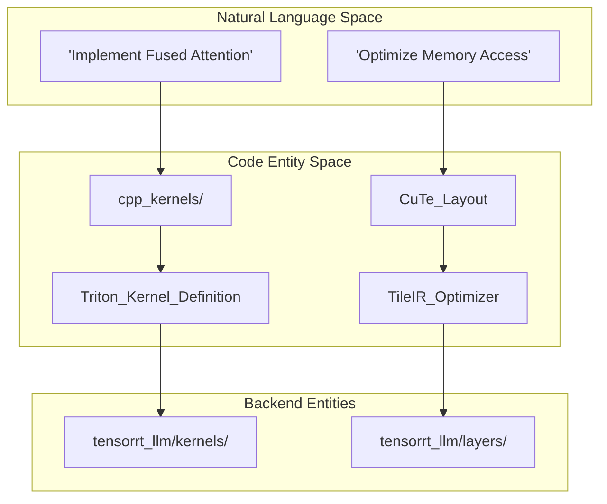
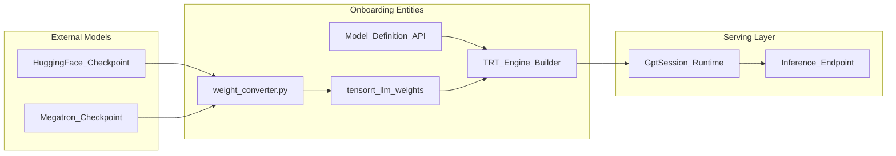

<!-- source: DeepWiki mcp.deepwiki.com · repo NVIDIA/skills · page 3.3 TensorRT-LLM Skills · fetched 2026-10-30 -->

# TensorRT-LLM Skills

Relevant source files

The following files were used as context for generating this wiki page:

- [components.d/tensorrt-llm.yml](components.d/tensorrt-llm.yml)

The TensorRT-LLM skills provide a comprehensive framework for optimizing Large Language Model (LLM) inference. These skills enable agents and developers to perform deep kernel engineering using domain-specific languages (DSLs), conduct rigorous performance profiling using the NVIDIA Nsight suite, onboard new model architectures, and diagnose complex Continuous Integration (CI) failures within the TensorRT-LLM ecosystem.

## Kernel Engineering & Optimization

TensorRT-LLM utilizes several high-performance backends for kernel development. These skills cover the implementation and optimization of fused operators, attention mechanisms, and custom layers.

### CuTe DSL and TileIR
The library leverages the **CuTe** (CUDA Template) C++ library and **TileIR** for structured tiling and data movement. These tools allow for fine-grained control over thread-block layouts and memory hierarchies.

*   **Implementation**: Defining layouts and copy atoms to maximize memory bandwidth.
*   **Data Flow**: Orchestrating movement between Global Memory (GMEM), Shared Memory (SMEM), and Register File (RF).

### Triton and Custom Kernels
For rapid prototyping and high-level kernel writing, the skills include support for **OpenAI Triton**. This involves writing Python-based kernels that are compiled into optimized PTX.

*   **Key Functions**: Implementing fused activation functions and normalization layers.
*   **Optimization**: Tuning block sizes and stages to avoid register pressure and bank conflicts.

### Natural Language to Kernel Implementation
This diagram illustrates the transition from high-level operator requirements to specific code entities in the kernel development workflow.

**Diagram: Kernel Implementation Path**

**Sources:** [components.d/tensorrt-llm.yml:1-7]()

---

## Performance Analysis & Profiling

Performance analysis skills focus on identifying bottlenecks in the inference pipeline, ranging from host-side overhead to device-side execution stalls.

### Nsight Systems & Nsight Compute
These skills facilitate the use of NVIDIA profiling tools to analyze kernel execution.
*   **Nsight Systems**: Used for visualizing the timeline of CUDA stream activity, identifying gaps in GPU utilization, and analyzing host-to-device communication.
*   **Nsight Compute**: Used for deep-dive analysis of individual kernels, providing metrics on occupancy, instruction throughput, and memory utilization.

### Host Profiling & CUDA Graphs
To minimize CPU-side overhead, especially in low-latency scenarios, the skills cover:
*   **Host Profiling**: Identifying latency in the TensorRT runtime and C++ orchestration layers.
*   **CUDA Graphs**: Capturing sequences of kernel launches to reduce the overhead of the driver and hardware command processor.

**Table: Profiling Tools and Targets**

| Tool | Target | Metric/Goal |
| :--- | :--- | :--- |
| **Nsight Systems** | Global Timeline | Reduce CPU/GPU idle gaps |
| **Nsight Compute** | Individual Kernel | Maximize SM Throughput |
| **Host Profiler** | C++ Runtime | Minimize `enqueueV3` latency |
| **CUDA Graphs** | Repeated Sequences | Eliminate launch overhead |

**Sources:** [components.d/tensorrt-llm.yml:1-7]()

---

## Model Onboarding & Serving

Onboarding a new model architecture into TensorRT-LLM involves defining the network graph, mapping weights, and configuring the serving environment.

### Model Definition & Weight Mapping
The process starts with defining the model structure using the TensorRT-LLM Python API, which mirrors the architecture of models from HuggingFace or Megatron.
*   **Model Class**: Inheriting from `tensorrt_llm.models.PretrainedModel`.
*   **Weight Conversion**: Mapping PyTorch/SafeTensors checkpoints to the TensorRT-LLM format.

### Serving Configuration
Configuring the inference server (e.g., Triton Inference Server with the TensorRT-LLM backend) involves:
*   **Model Config**: Setting parameters like `max_batch_size`, `max_input_len`, and `paged_kv_cache`.
*   **Runtime Execution**: Tuning the `GptSession` or `Executor` API for optimal throughput.

**Diagram: Model Onboarding Data Flow**

**Sources:** [components.d/tensorrt-llm.yml:1-7]()

---

## CI Diagnostics & Maintenance

Maintaining a high-velocity codebase like TensorRT-LLM requires skills for diagnosing failures in the automated testing pipeline.

### CI Failure Retrieval
Skills include navigating CI logs to identify the root cause of failures, whether they are functional regressions, performance regressions, or environment issues.
*   **Log Analysis**: Parsing logs from GitHub Actions or internal NVIDIA Jenkins pipelines.
*   **Reproduction**: Using the `examples/` and `tests/` directories to create minimal reproducible examples (MREs) for reported bugs.

### Codebase Exploration
Navigating the extensive C++ and Python codebase to locate specific logic:
*   **`cpp/`**: Core C++ runtime and kernel implementations.
*   **`tensorrt_llm/`**: Python API for model building and orchestration.
*   **`examples/`**: Reference implementations for various model families (Llama, GPT, Mistral).

**Sources:** [components.d/tensorrt-llm.yml:1-7]()

---

