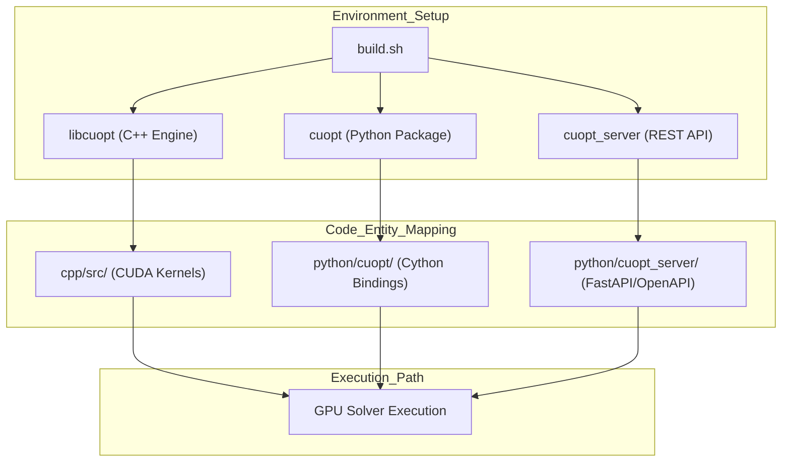
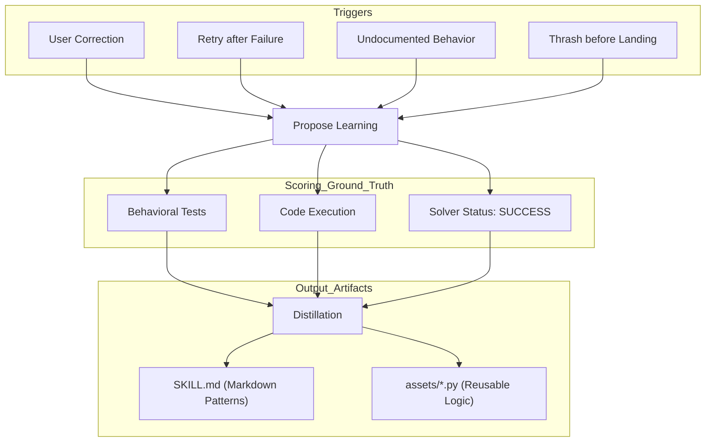

<!-- source: DeepWiki mcp.deepwiki.com · repo NVIDIA/skills · page 3.4 cuOpt Skills · fetched 2026-10-30 -->

# cuOpt Skills

Relevant source files

The following files were used as context for generating this wiki page:

- [components.d/cuopt.yml](components.d/cuopt.yml)
- [skills/Megatron-Core/run-on-slurm/SKILL.md](skills/Megatron-Core/run-on-slurm/SKILL.md)
- [skills/cuopt/cuopt-developer/SKILL.md](skills/cuopt/cuopt-developer/SKILL.md)
- [skills/cuopt/skill-evolution/SKILL.md](skills/cuopt/skill-evolution/SKILL.md)

The NVIDIA cuOpt skills provide a comprehensive interface for GPU-accelerated optimization, covering vehicle routing, linear programming (LP), mixed-integer linear programming (MILP), and quadratic programming (QP). This catalog includes skills for installation, server deployment, developer workflows, and an autonomous skill-evolution framework for continuous improvement.

## 1. Overview and Installation

cuOpt supports multiple entry points including Python APIs, C APIs, and a RESTful server interface. Installation and environment setup depend on whether the user is an end-user or a developer modifying the solver internals.

### Data Flow: Installation to Execution
The following diagram illustrates how the system transitions from installation to a running solver instance.

**System Initialization Flow**

Sources: [skills/cuopt/cuopt-developer/SKILL.md:92-108](), [skills/cuopt/cuopt-developer/SKILL.md:150-165]()

### Developer Mode
Developers contributing to the codebase must manage dependencies and build components selectively to optimize resource usage.
*   **Parallel Builds:** The `PARALLEL_LEVEL` environment variable should be tuned to available RAM (4-8 GB per job) to avoid OOM during CUDA compilation [skills/cuopt/cuopt-developer/SKILL.md:143-148]().
*   **Component Building:** Specific components like the C++ library or the server can be built independently using `./build.sh [component]` [skills/cuopt/cuopt-developer/SKILL.md:158-165]().
*   **Testing:** C++ tests use `ctest`, while Python and Server tests use `pytest` [skills/cuopt/cuopt-developer/SKILL.md:167-178](). Note that datasets must be downloaded separately as they are not checked into the repository [skills/cuopt/cuopt-developer/SKILL.md:182-188]().

## 2. Numerical Optimization (LP/MILP/QP)

cuOpt provides high-performance solvers for linear and quadratic programming. These are accessible via the C API for low-level integration and Python for modeling.

### API Support Matrix
| API Type | LP | MILP | QP | Routing |
|----------|:--:|:----:|:--:|:-------:|
| C API    | ✓  | ✓    | ✓  | ✗       |
| Python   | ✓  | ✓    | ✓  | ✓       |
| Server   | ✓  | ✓    | ✗  | ✓       |

Sources: [skills/cuopt/cuopt-developer/SKILL.md:112-118]()

### Modeling Best Practices
When formulating problems for the cuOpt solver, several performance and stability rules apply:
*   **Objective Scaling:** For large objectives, use `LinearExpression` to avoid hitting Python's recursion limit, which typically occurs at ~1000 terms when using chained `+` operators [skills/cuopt/skill-evolution/SKILL.md:79-82]().
*   **Variable Selection:** Ensure correct variable types (CONTINUOUS vs INTEGER) are selected during formulation to prevent solver errors or sub-optimal results [skills/cuopt/skill-evolution/SKILL.md:19-20]().

## 3. Developer Workflows & Architecture

The cuOpt repository is structured to separate the core CUDA engine from the high-level Python wrappers and deployment services.

### Repository Structure
*   `cpp/`: Core C++ engine containing public headers (`include/cuopt/`) and CUDA kernel implementations (`src/`) [skills/cuopt/cuopt-developer/SKILL.md:96-99]().
*   `python/cuopt/`: Python bindings and the primary Routing API [skills/cuopt/cuopt-developer/SKILL.md:101]().
*   `python/libcuopt/`: The Cython-based wrapper for the C library [skills/cuopt/cuopt-developer/SKILL.md:104]().
*   `python/cuopt_server/`: Implementation of the REST API [skills/cuopt/cuopt-developer/SKILL.md:102]().

### Contribution Rules
Developers must follow strict hygiene to maintain codebase quality:
1.  **DCO Signoff:** All commits must be signed (`git commit -s`) to comply with the Developer Certificate of Origin [skills/cuopt/cuopt-developer/SKILL.md:214-217]().
2.  **Pre-commit Hooks:** Run `pre-commit install` to enable automated style and linting checks [skills/cuopt/cuopt-developer/SKILL.md:200-205]().
3.  **GPU Hygiene:** Operations must be stream-ordered and use RMM (RAPIDS Memory Manager) allocators instead of raw `new`/`delete` [skills/cuopt/cuopt-developer/SKILL.md:135-138]().

## 4. Skill Evolution Framework

The cuOpt catalog implements an autonomous "Skill Evolution" workflow. This system detects when the agent encounters undocumented behavior, user corrections, or "thrashing" (multiple failed attempts before success) and proposes updates to the skill library [skills/cuopt/skill-evolution/SKILL.md:11-20]().

### Evolution Logic
The evolution process follows a structured path from problem-solving to artifact distillation.

**Skill Improvement Loop**

Sources: [skills/cuopt/skill-evolution/SKILL.md:11-20](), [skills/cuopt/skill-evolution/SKILL.md:39-47](), [skills/cuopt/skill-evolution/SKILL.md:53-64]()

### Distillation Rules
*   **Markdown:** Used for "gotchas," patterns, and short examples. Preferred for general guidance [skills/cuopt/skill-evolution/SKILL.md:55-58]().
*   **Code Assets:** Used for reusable logic (e.g., constraint-builders) exceeding 15 lines or when the same helper is written across multiple independent interactions [skills/cuopt/skill-evolution/SKILL.md:60-73]().

Sources: [skills/cuopt/skill-evolution/SKILL.md:1-85](), [skills/cuopt/cuopt-developer/SKILL.md:1-217](), [components.d/cuopt.yml:1-7]()

---

