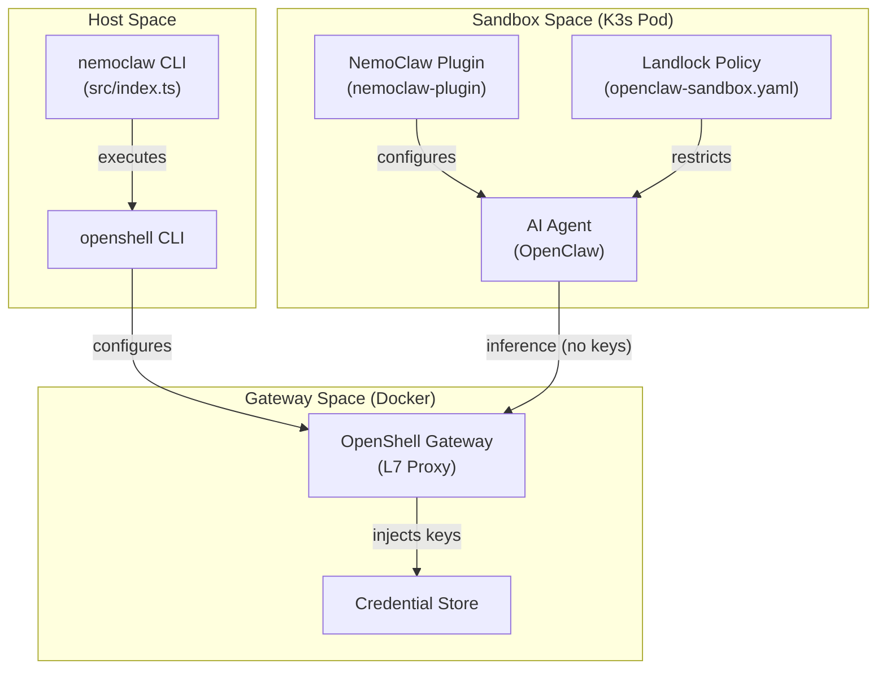
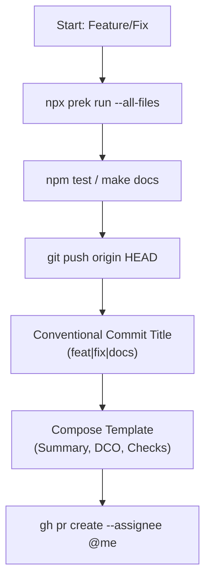

<!-- source: DeepWiki mcp.deepwiki.com · repo NVIDIA/skills · page 3.5 NemoClaw Skills · fetched 2026-10-30 -->

# NemoClaw Skills

Relevant source files

The following files were used as context for generating this wiki page:

- [skills/NemoClaw/nemoclaw-contributor-create-pr/SKILL.md](skills/NemoClaw/nemoclaw-contributor-create-pr/SKILL.md)
- [skills/NemoClaw/nemoclaw-contributor-update-docs/SKILL.md](skills/NemoClaw/nemoclaw-contributor-update-docs/SKILL.md)
- [skills/NemoClaw/nemoclaw-user-configure-security/references/best-practices.md](skills/NemoClaw/nemoclaw-user-configure-security/references/best-practices.md)
- [skills/NemoClaw/nemoclaw-user-configure-security/references/credential-storage.md](skills/NemoClaw/nemoclaw-user-configure-security/references/credential-storage.md)
- [skills/NemoClaw/nemoclaw-user-deploy-remote/references/sandbox-hardening.md](skills/NemoClaw/nemoclaw-user-deploy-remote/references/sandbox-hardening.md)
- [skills/NemoClaw/nemoclaw-user-get-started/SKILL.md](skills/NemoClaw/nemoclaw-user-get-started/SKILL.md)
- [skills/NemoClaw/nemoclaw-user-manage-policy/SKILL.md](skills/NemoClaw/nemoclaw-user-manage-policy/SKILL.md)
- [skills/NemoClaw/nemoclaw-user-reference/references/architecture.md](skills/NemoClaw/nemoclaw-user-reference/references/architecture.md)
- [skills/NemoClaw/nemoclaw-user-reference/references/commands.md](skills/NemoClaw/nemoclaw-user-reference/references/commands.md)
- [skills/NemoClaw/nemoclaw-user-reference/references/network-policies.md](skills/NemoClaw/nemoclaw-user-reference/references/network-policies.md)
- [skills/NemoClaw/nemoclaw-user-reference/references/troubleshooting.md](skills/NemoClaw/nemoclaw-user-reference/references/troubleshooting.md)

NemoClaw is NVIDIA's secure AI agent sandbox, providing an opinionated reference stack built on **NVIDIA OpenShell**. It enables the deployment of AI agents (like OpenClaw or NemoHermes) within a hardened environment featuring deny-by-default networking, filesystem immutability, and isolated inference credential management [skills/NemoClaw/nemoclaw-user-reference/references/architecture.md:5-10]().

This page provides a high-level overview of the skills available for NemoClaw users, maintainers, and contributors.

## System Architecture

NemoClaw orchestrates OpenShell resources using a Python-based blueprint and integrates with agents via a TypeScript plugin [skills/NemoClaw/nemoclaw-user-reference/references/architecture.md:5-6](). The architecture follows a layered approach where the host CLI orchestrates a Docker container, which in turn runs an embedded k3s cluster for the sandbox pod [skills/NemoClaw/nemoclaw-user-reference/references/architecture.md:122-132]().

### Component Interaction Diagram
This diagram bridges the high-level system components to the underlying code entities and CLI tools.

Sources: [skills/NemoClaw/nemoclaw-user-reference/references/architecture.md:11-66](), [skills/NemoClaw/nemoclaw-user-reference/references/architecture.md:76-120]()

## User Skills

User skills focus on the lifecycle of a sandbox, from initial installation to advanced security configuration.

### Getting Started & Deployment
Users can install NemoClaw using a one-line installer script which triggers the `nemoclaw onboard` wizard [skills/NemoClaw/nemoclaw-user-get-started/SKILL.md:23-24]().
*   **Onboarding:** The `nemoclaw onboard` command handles preflight checks, provider selection, and sandbox creation [skills/NemoClaw/nemoclaw-user-reference/references/commands.md:41-45]().
*   **Remote Deployment:** The `nemoclaw deploy` command allows provisioning sandboxes on remote instances (e.g., Brev.dev) [skills/NemoClaw/nemoclaw-user-configure-security/references/credential-storage.md:42-45]().

### Security & Inference Configuration
NemoClaw employs a "deny-by-default" posture across four layers: Network, Filesystem, Process, and Inference [skills/NemoClaw/nemoclaw-user-configure-security/references/best-practices.md:5-7]().
*   **Network Policies:** Users can customize egress rules using presets (e.g., `github`, `brave`, `npm`) or manual YAML edits in `nemoclaw-blueprint/policies/openclaw-sandbox.yaml` [skills/NemoClaw/nemoclaw-user-manage-policy/SKILL.md:34-40]().
*   **Credential Management:** Credentials are never stored on the host disk in plaintext; they are registered directly with the OpenShell gateway [skills/NemoClaw/nemoclaw-user-configure-security/references/credential-storage.md:5-9]().
*   **Inference Options:** Supports NVIDIA Endpoints, OpenAI, Anthropic, Google Gemini, and local Ollama [skills/NemoClaw/nemoclaw-user-get-started/SKILL.md:46-58]().

For a deep dive into the underlying enforcement mechanisms, see [NemoClaw Security Architecture](#3.5.1).

## Maintainer Skills

Maintainer skills involve the rigorous governance of the NemoClaw repository, ensuring code quality and security through automated workflows.

*   **Triage & Review:** Maintainers use specialized loops (Morning/Day/Evening) to sweep issues and review PRs.
*   **PR Comparator:** A tool used to compare the behavior of the sandbox before and after changes.
*   **Release Management:** Cutting tags and normalizing PR titles to follow Conventional Commits [skills/NemoClaw/nemoclaw-contributor-create-pr/SKILL.md:72-86]().

For detailed workflow descriptions, see [NemoClaw Maintainer Workflows](#3.5.2).

## Contributor Skills

Contributors assist in expanding NemoClaw's capabilities and keeping documentation synchronized with code changes.

### Documentation Workflows
The `nemoclaw-contributor-update-docs` skill automates the identification of user-facing changes by scanning git commits [skills/NemoClaw/nemoclaw-contributor-update-docs/SKILL.md:6-8]().
*   **Commit Mapping:** Commits in `nemoclaw/src/commands/` typically map to `docs/reference/commands.md`, while changes in `nemoclaw-blueprint/` affect `docs/about/architecture.md` [skills/NemoClaw/nemoclaw-contributor-update-docs/SKILL.md:68-80]().
*   **Skip Lists:** Documentation generation respects `docs/.docs-skip` to avoid documenting experimental features or prohibited terms [skills/NemoClaw/nemoclaw-contributor-update-docs/SKILL.md:22-33]().

### Pull Request Standards
Contributors must follow a strict PR template that includes a Summary, Related Issue, Type of Change, and a mandatory **DCO Sign-Off** [skills/NemoClaw/nemoclaw-contributor-create-pr/SKILL.md:110-144]().

### PR Creation Process Diagram
This diagram maps the contributor workflow to the CLI tools and repository structure.

Sources: [skills/NemoClaw/nemoclaw-contributor-create-pr/SKILL.md:16-169]()

## Reference Tables

### Core CLI Commands
| Command | Purpose |
| :--- | :--- |
| `nemoclaw onboard` | Interactive setup of gateway and sandbox [skills/NemoClaw/nemoclaw-user-reference/references/commands.md:41]() |
| `nemoclaw status` | Check sandbox and inference health [skills/NemoClaw/nemoclaw-user-reference/references/commands.md:16]() |
| `nemoclaw credentials list` | List registered providers in OpenShell [skills/NemoClaw/nemoclaw-user-configure-security/references/credential-storage.md:25]() |
| `openshell term` | Open the TUI for real-time network request approval [skills/NemoClaw/nemoclaw-user-manage-policy/SKILL.md:151]() |

### Security Enforcement Layers
| Layer | Enforcement Point | Configurable File |
| :--- | :--- | :--- |
| **Network** | OpenShell Gateway | `policies/openclaw-sandbox.yaml` [skills/NemoClaw/nemoclaw-user-configure-security/references/best-practices.md:84-87]() |
| **Filesystem** | Landlock LSM | `nemoclaw-blueprint/policies/openclaw-sandbox.yaml` [skills/NemoClaw/nemoclaw-user-reference/references/network-policies.md:11-23]() |
| **Process** | Container Runtime | `Dockerfile` (ulimits, cap-drop) [skills/NemoClaw/nemoclaw-user-deploy-remote/references/sandbox-hardening.md:25-42]() |
| **Inference** | OpenShell L7 Proxy | `blueprint.yaml` [skills/NemoClaw/nemoclaw-contributor-update-docs/SKILL.md:76]() |

---

