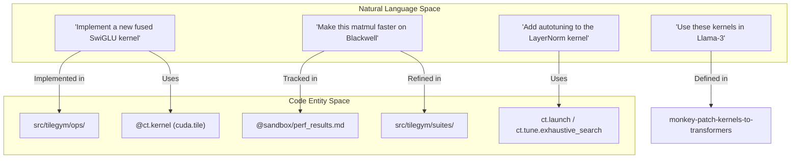
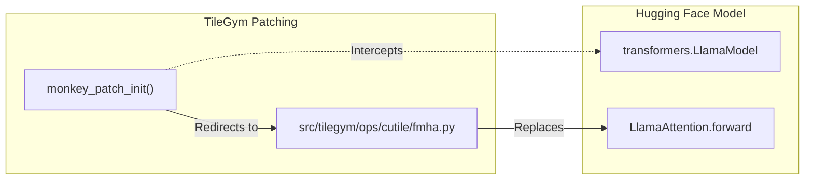

<!-- source: DeepWiki mcp.deepwiki.com · repo NVIDIA/skills · page 3.6 TileGym Skills · fetched 2026-10-30 -->

# TileGym Skills

Relevant source files

The following files were used as context for generating this wiki page:

- [components.d/tilegym.yml](components.d/tilegym.yml)
- [skills/TileGym/cutile-autotuning/SKILL.md](skills/TileGym/cutile-autotuning/SKILL.md)
- [skills/TileGym/cutile-python/orchestration/overview.md](skills/TileGym/cutile-python/orchestration/overview.md)
- [skills/TileGym/improve-cutile-kernel-perf/SKILL.md](skills/TileGym/improve-cutile-kernel-perf/SKILL.md)
- [skills/TileGym/monkey-patch-kernels-to-transformers/SKILL.md](skills/TileGym/monkey-patch-kernels-to-transformers/SKILL.md)

TileGym is NVIDIA's GPU kernel development gym, focused on tile-based programming, cross-framework conversion, and performance optimization. The skills in this section enable agents to develop high-performance kernels using the cuTile Python DSL, optimize them for specific hardware architectures (Ampere, Hopper, Blackwell), and integrate them into large-scale models like Hugging Face Transformers.

## Overview

TileGym provides a structured environment for the end-to-end lifecycle of a GPU kernel:
1.  **Programming**: Writing kernels in a Pythonic DSL (cuTile) that maps to low-level CUDA features like TMA (Tensor Memory Accelerator) and persistent scheduling.
2.  **Optimization**: Iteratively refining kernels through bottleneck analysis and IR (Intermediate Representation) inspection.
3.  **Autotuning**: Designing search spaces for tile sizes and occupancy to maximize hardware utilization.
4.  **Integration**: Patching these kernels into existing deep learning frameworks to replace standard PyTorch or Triton implementations.

### System Architecture: Natural Language to Code Entities

The following diagram illustrates how high-level development tasks map to specific code entities and directories within the TileGym repository.

**Diagram: TileGym Task-to-Code Mapping**

Sources: [skills/TileGym/cutile-autotuning/SKILL.md:37-38](), [skills/TileGym/improve-cutile-kernel-perf/SKILL.md:34-36](), [skills/TileGym/improve-cutile-kernel-perf/SKILL.md:95-102](), [skills/TileGym/monkey-patch-kernels-to-transformers/SKILL.md:22-23]()

---

## 3.6.1 cuTile Python Programming
The core of TileGym is the cuTile Python DSL, which allows developers to write tile-based kernels without leaving Python. This skill covers the orchestration of multiple agents (Analyzer, Kernel, and Composer) to handle complex tasks like implementing entire Transformer blocks.

*   **Deep Agent Orchestration**: For complex requests (3+ operations or inter-kernel dependencies), a multi-agent workflow is used to decompose problems into individual kernel specs [skills/TileGym/cutile-python/orchestration/overview.md:15-25]().
*   **Op Tracing**: Integration with `torch-learner` allows agents to trace existing PyTorch operations (like `nn.LSTM`) to uncover their internal math and memory layouts before re-implementing them in cuTile [skills/TileGym/cutile-python/orchestration/overview.md:67-75]().
*   **Performance Optimization**: Systematic iteration using a "Playbook" of recipes, including TMA usage, persistent scheduling, and latency hints [skills/TileGym/improve-cutile-kernel-perf/SKILL.md:47-52]().

For details, see [cuTile Python Programming](#3.6.1).

Sources: [skills/TileGym/cutile-python/orchestration/overview.md:5-14](), [skills/TileGym/improve-cutile-kernel-perf/SKILL.md:27-30]()

---

## 3.6.2 cuTile Kernel Conversion & Autotuning
Once a kernel is functional, it must be tuned for performance across different GPU architectures and, in some cases, converted to other formats like Triton or Julia.

*   **Autotuning Patterns**: Implements a "tune-once/cache/launch" pattern using `cuda.tile.tune.exhaustive_search`. This ensures that the search overhead only occurs on the first call for a specific tensor shape [skills/TileGym/cutile-autotuning/SKILL.md:31-46]().
*   **Search Space Design**: Focuses on small, precise search spaces (typically ≤ 30 configs) to manage the heavy compilation time of cuTile kernels [skills/TileGym/cutile-autotuning/SKILL.md:96-99]().
*   **Architecture Specifics**: Provides different tuning templates for compute-bound kernels (GEMM/FMHA) versus memory-bound kernels (Elementwise/Reduction) [skills/TileGym/cutile-autotuning/SKILL.md:105-119]().

For details, see [cuTile Kernel Conversion & Autotuning](#3.6.2).

Sources: [skills/TileGym/cutile-autotuning/SKILL.md:1-5](), [skills/TileGym/cutile-autotuning/SKILL.md:11-19]()

---

## Kernel Integration & Monkey-Patching
TileGym kernels are validated end-to-end by injecting them into Hugging Face `transformers` models. This is achieved through a non-intrusive monkey-patching approach that replaces standard submodules at model instantiation [skills/TileGym/monkey-patch-kernels-to-transformers/SKILL.md:22-23]().

**Workflow for Model Integration:**
1.  **Environment Setup**: Prepare the target Transformer model and benchmark harness [skills/TileGym/monkey-patch-kernels-to-transformers/SKILL.md:26]().
2.  **Kernel Integration**: Map existing TileGym kernels to the model's modules [skills/TileGym/monkey-patch-kernels-to-transformers/SKILL.md:27]().
3.  **Auto-Kernelization**: For uncovered code paths, agents autonomously generate new cuTile kernels to improve end-to-end throughput [skills/TileGym/monkey-patch-kernels-to-transformers/SKILL.md:28-30]().

**Diagram: Integration Workflow**

Sources: [skills/TileGym/monkey-patch-kernels-to-transformers/SKILL.md:1-5](), [skills/TileGym/monkey-patch-kernels-to-transformers/SKILL.md:22-31]()

---

