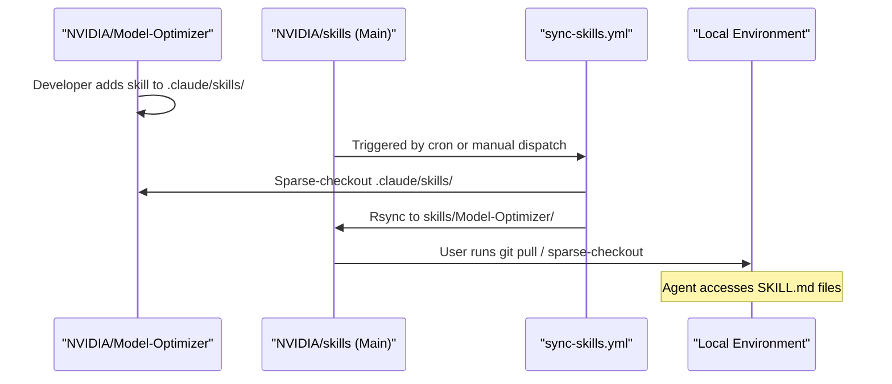

<!-- source: DeepWiki mcp.deepwiki.com · repo NVIDIA/skills · page 3.7 Model Optimizer Skills · fetched 2026-10-30 -->

# Model Optimizer Skills

<details>
<summary>Relevant source files</summary>

The following files were used as context for generating this wiki page:

- [components.d/model-optimizer.yml](components.d/model-optimizer.yml)

</details>


The **Model Optimizer (ModelOpt)** skills provide a comprehensive interface for performing model compression and optimization tasks, specifically targeting post-training quantization (PTQ), sparsity, and distillation to enable efficient inference on NVIDIA hardware. These skills encapsulate the workflows required to optimize deep learning models, evaluate their performance/accuracy trade-offs, and prepare them for deployment.

## Overview

Model-Optimizer skills are integrated into the catalog to assist agents in navigating the complexities of model compression. The skills are sourced from the `NVIDIA/Model-Optimizer` repository and are organized to support the full lifecycle of model optimization, from initial quantization to release management.

### Component Registration
The Model-Optimizer component is registered in the skills catalog via its configuration file, which defines the source repository and the location of the skill definitions.

| Attribute | Value |
| :--- | :--- |
| **Name** | `Model-Optimizer` |
| **Repository** | `NVIDIA/Model-Optimizer` |
| **Skill Path** | `.claude/skills/` |
| **Catalog Directory** | `Model-Optimizer` |

Sources: `[components.d/model-optimizer.yml:1-6]()`

## Skill Domains and Workflows

The Model-Optimizer skills are categorized into several functional domains, each addressing a specific stage of the optimization pipeline.

### 1. Post-Training Quantization (PTQ)
These skills automate the process of converting model weights and activations from high-precision (e.g., FP32/BF16) to lower precision (e.g., INT8, FP8, or INT4). 
- **Implementation**: Utilizes `ModelOpt` quantization APIs to calibrate models using representative datasets.
- **Data Flow**: High-precision model + Calibration Data $\rightarrow$ `ModelOpt.quantize()` $\rightarrow$ Quantized Checkpoint.

### 2. Deployment and Export
Once optimized, models must be exported to formats compatible with NVIDIA inference engines like TensorRT or TensorRT-LLM.
- **Key Functions**: Skills handle the conversion logic to ensure that quantization scales and metadata are correctly preserved during the export process.

### 3. Evaluation and Monitoring
Optimization often involves a trade-off between model size/speed and accuracy.
- **MLflow Integration**: Skills provide access to MLflow for logging optimization experiments, tracking metrics like perplexity or mAP, and comparing different quantization configurations.
- **Monitoring**: Real-time tracking of the optimization process to detect convergence issues or significant accuracy drops.

### 4. Debugging and Troubleshooting
Complex optimization tasks, such as finding the optimal quantization scale for a specific layer, require specialized debugging skills.
- **Workflow**: Identifying "outlier" weights or activations that cause quantization errors and applying selective precision (keeping sensitive layers at higher precision).

### 5. Release and Maintenance
For maintainers of the Model-Optimizer library, specific skills manage the software lifecycle.
- **Cherry-pick Workflows**: Automated scripts and procedures for backporting fixes or features from the main branch to release branches.

## System Architecture

The following diagram illustrates the relationship between the Model-Optimizer skills and the underlying codebase entities.

### Natural Language to Code Entity Mapping: Optimization Pipeline

```mermaid
graph TD
    subgraph "Natural Language Space"
        "User Request" -- "Optimize Model" --> "PTQ Skill"
        "User Request" -- "Track Progress" --> "MLflow Skill"
        "User Request" -- "Fix Bug" --> "Debug Skill"
    end

    subgraph "Code Entity Space (Model-Optimizer)"
        "PTQ Skill" --> "modelopt.torch.quantization"
        "PTQ Skill" --> "modelopt.onnx.quantization"
        "MLflow Skill" --> "modelopt.monitoring.mlflow_logger"
        "Debug Skill" --> "modelopt.diagnostics.inspector"
    end

    subgraph "Catalog Integration"
        "components.d/model-optimizer.yml" -- "defines" --> "Model-Optimizer Component"
        "Model-Optimizer Component" -- "points to" --> ".claude/skills/"
    end
```

Sources: `[components.d/model-optimizer.yml:1-9]()`

## Integration with Skills Catalog

The Model-Optimizer skills follow the standard catalog structure, allowing them to be consumed by AI agents (like Claude or Cursor) to perform complex NVIDIA-specific engineering tasks.

### Skill Discovery Data Flow

The following diagram shows how Model-Optimizer skills move from the source repository into the local environment of a developer or agent.



Sources: `[components.d/model-optimizer.yml:1-6]()`

## Technical Reference Table

| Skill Category | Key Responsibilities | Primary Code Interaction |
| :--- | :--- | :--- |
| **Quantization** | PTQ, FP8/INT8 scaling, Calibration | `modelopt.torch.quantization` |
| **Sparsity** | Structured/Unstructured pruning | `modelopt.torch.sparsity` |
| **Distillation** | Teacher-student training loops | `modelopt.torch.distill` |
| **Deployment** | Exporting to TensorRT/ONNX | `modelopt.deploy` |
| **DevOps** | Release cherry-picks, CI monitoring | `.github/workflows/` |

Sources: `[components.d/model-optimizer.yml:1-3]()`

---

