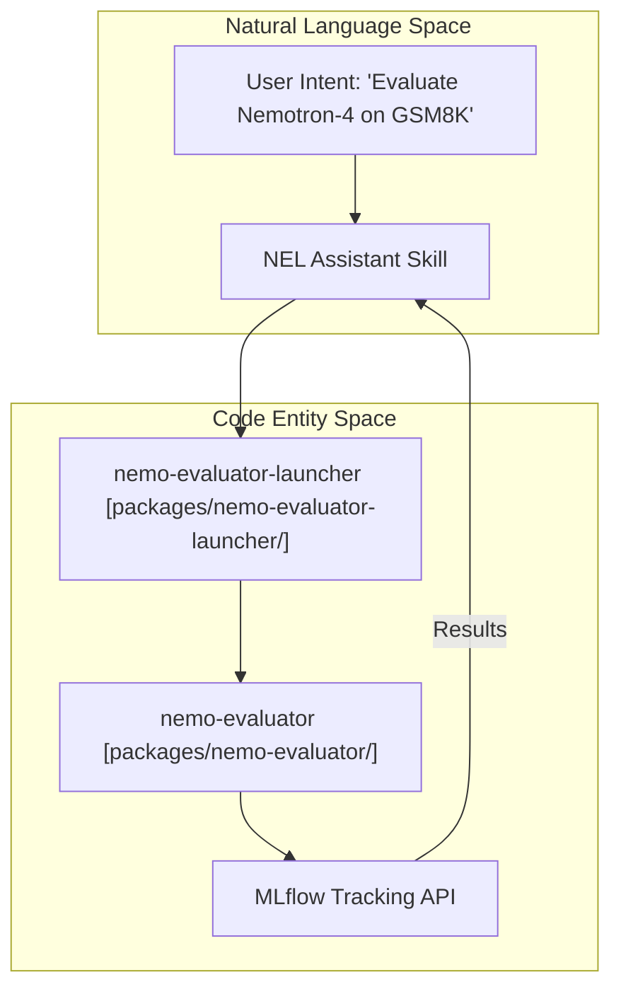
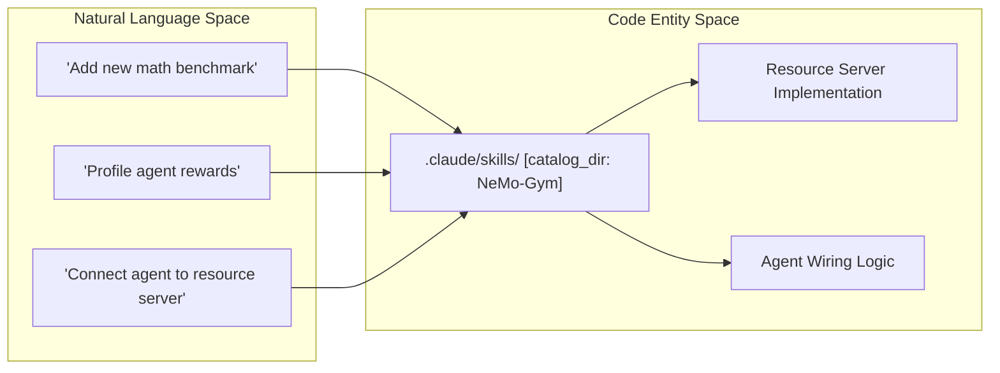

<!-- source: DeepWiki mcp.deepwiki.com · repo NVIDIA/skills · page 3.8 NeMo Evaluator & NeMo Gym Skills · fetched 2026-10-30 -->

# NeMo Evaluator & NeMo Gym Skills

Relevant source files

The following files were used as context for generating this wiki page:

- [components.d/nemo-evaluator.yml](components.d/nemo-evaluator.yml)
- [components.d/nemo-gym.yml](components.d/nemo-gym.yml)

This page details the skills and technical architecture for **NeMo Evaluator** and **NeMo Gym**. NeMo Evaluator provides a comprehensive framework for launching LLM evaluations, managing results via MLflow, and integrating custom benchmarks. NeMo Gym provides Reinforcement Learning (RL) training environments, focusing on benchmark integration, resource management, and agent-reward profiling.

## NeMo Evaluator Skills

NeMo Evaluator is structured into two primary skill sets: the **NeMo Evaluator Launcher** and the core **NeMo Evaluator** package. These skills enable agents to automate the evaluation lifecycle of Large Language Models.

### NeMo Evaluator Launcher
The Launcher skills focus on the orchestration of evaluation jobs. This includes the NeMo Evaluator Launcher (NEL) assistant, which streamlines the process of submitting evaluation tasks to various backends.

*   **Launch Evaluations:** Automating the submission of LLM benchmarks across different infrastructures.
*   **MLflow Integration:** Accessing and querying evaluation results stored in MLflow for performance tracking.
*   **NEL Assistant:** High-level abstractions for interacting with the evaluation launcher CLI and configuration files.

### Core NeMo Evaluator
The core skills focus on the extensibility of the evaluation framework itself.

*   **Bring-Your-Own Benchmarks (BYOB):** Technical workflows for adding custom datasets and evaluation metrics into the NeMo Evaluator ecosystem.
*   **Result Analysis:** Skills for parsing and interpreting raw evaluation outputs.

### Data Flow: Evaluation Lifecycle

The following diagram illustrates the interaction between the Launcher, the Core Evaluator, and external tracking services like MLflow.

**NeMo Evaluator System Flow**

**Sources:** [components.d/nemo-evaluator.yml:1-8]()

---

## NeMo Gym Skills

NeMo Gym skills are designed for developers working on Reinforcement Learning from Human Feedback (RLHF) and other RL training paradigms. The skills facilitate the setup of complex training environments and the profiling of agent behavior.

### Environment Management
*   **Resource Servers:** Managing the lifecycle of servers that host models or datasets during RL training loops.
*   **Agent Wiring:** Configuring the communication interface between the RL agent and the environment/gym.

### Benchmarking and Profiling
*   **Adding Benchmarks:** Standardized procedures for integrating new RL benchmarks into the gym.
*   **Reward Profiling:** Tools and techniques for analyzing reward distributions and agent trajectories to debug training stability.

### Architecture: Gym Integration

This diagram maps the high-level gym concepts to the implementation paths within the repository.

**NeMo Gym Implementation Mapping**

**Sources:** [components.d/nemo-gym.yml:1-7]()

---

## Component Registration

The following table summarizes the repository locations and catalog mappings for these skills within the NVIDIA Agent Skills framework.

| Component | Upstream Repository | Catalog Directory | Skill Path in Source |
| :--- | :--- | :--- | :--- |
| **NeMo Evaluator Launcher** | `NVIDIA-NeMo/Evaluator` | `NeMo-Evaluator-Launcher` | `packages/nemo-evaluator-launcher/.claude/skills/` |
| **NeMo Evaluator Core** | `NVIDIA-NeMo/Evaluator` | `NeMo-Evaluator` | `packages/nemo-evaluator/.claude/skills/` |
| **NeMo Gym** | `NVIDIA-NeMo/Gym` | `NeMo-Gym` | `.claude/skills/` |

**Sources:** [components.d/nemo-evaluator.yml:1-8](), [components.d/nemo-gym.yml:1-7]()

---

