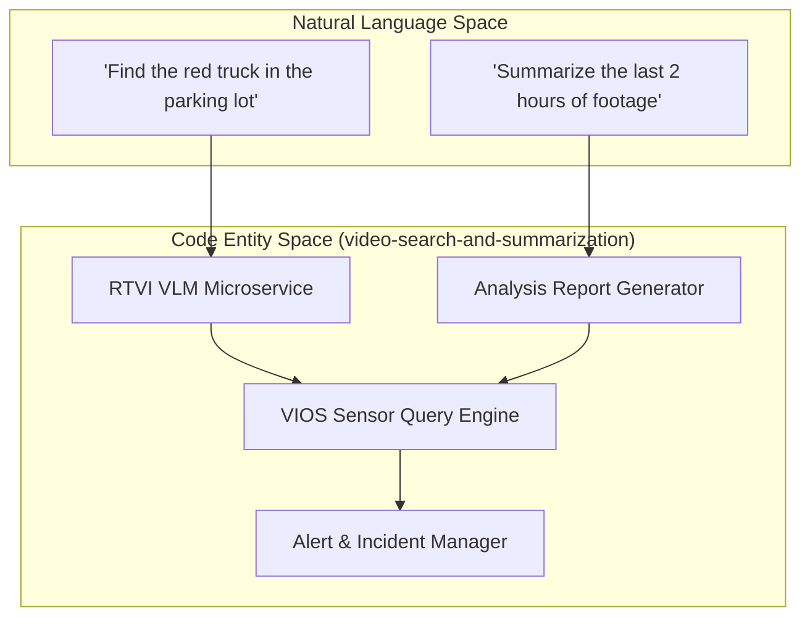
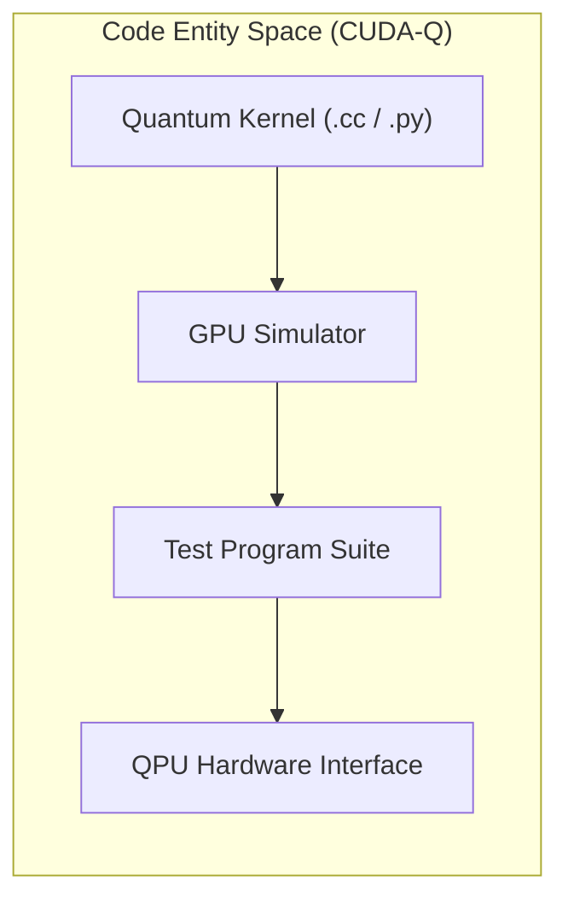

<!-- source: DeepWiki mcp.deepwiki.com · repo NVIDIA/skills · page 3.9 AI Blueprint & Application Skills · fetched 2026-10-30 -->

# AI Blueprint & Application Skills

Relevant source files

The following files were used as context for generating this wiki page:

- [components.d/cuda-q.yml](components.d/cuda-q.yml)
- [components.d/nemotron-voice-agent.yml](components.d/nemotron-voice-agent.yml)
- [components.d/rag-blueprint.yml](components.d/rag-blueprint.yml)
- [components.d/video-search-and-summarization.yml](components.d/video-search-and-summarization.yml)

The AI Blueprint and Application skills provide a comprehensive set of operational and development workflows for NVIDIA's reference AI applications. These skills enable agents and developers to deploy, manage, and optimize complex pipelines including Retrieval-Augmented Generation (RAG), multimodal video analytics, real-time voice agents, and quantum-classical computing.

## Retrieval-Augmented Generation (RAG) Blueprint

The RAG Blueprint skills focus on the lifecycle management of a production-grade RAG pipeline. These skills abstract the complexities of orchestrating multiple microservices, including vector databases, embedding models, and LLM inference servers.

### Deployment and Configuration
The RAG skills support two primary deployment modalities:
1.  **Docker Compose**: Used for local development and workstation-class deployments.
2.  **Helm Charts**: Used for scalable production deployments on Kubernetes.

The configuration skills allow for the dynamic adjustment of the retrieval pipeline, including switching between different NVIDIA NIM (NVIDIA Inference Microservices) endpoints for embeddings and text generation.

### Operations and Troubleshooting
The skills provide specific routines for:
*   **Health Checks**: Verifying the connectivity between the API gateway, the vector database, and the inference services.
*   **Troubleshooting**: Analyzing container logs and service status to identify bottlenecks or failures in the retrieval chain.
*   **Shutdown**: Graceful decommissioning of the RAG stack to ensure data persistence in the vector store.

**Sources:**
*   [components.d/rag-blueprint.yml:1-7]()

---

## Video Search and Summarization (VSS)

The VSS Blueprint provides skills for managing large-scale video analytics and intelligence. It integrates Video Integration and Orchestration Services (VIOS) with Vision-Language Models (VLM).

### System Architecture & Data Flow
The VSS application operates by ingesting video streams, processing them through analytics sensors, and providing a natural language interface for querying the visual data.

| Component | Code/Entity Reference | Role |
| :--- | :--- | :--- |
| **VIOS Sensors** | `VIOS API` | Queries raw sensor data and metadata from video streams. |
| **VLM Microservice** | `RTVI VLM` | Real-time Video Intelligence microservice for visual reasoning. |
| **Analysis Reports** | `Summary Generator` | Synthesizes video metadata into human-readable reports. |
| **Alert Management** | `Incident Manager` | Configures and monitors real-time triggers for specific visual events. |

### VSS Operational Flow
The following diagram illustrates how the VSS skills interact with the underlying microservices:

**VSS Blueprint Interaction Logic**

**Sources:**
*   [components.d/video-search-and-summarization.yml:1-7]()

---

## Nemotron Voice Agent

The Nemotron Voice Agent skills enable the deployment of low-latency, speech-to-speech conversational AI. These skills are optimized for different hardware profiles, ranging from edge devices to cloud infrastructure.

### Deployment Targets
The skills provide specialized configuration paths for three main targets:
*   **Workstation**: Optimized for NVIDIA RTX GPUs using local NIM deployments.
*   **Jetson Thor**: Tailored for edge robotics and embedded use cases, focusing on power efficiency and hardware acceleration.
*   **Cloud NIM**: Scalable deployment using cloud-hosted NVIDIA Inference Microservices.

The skills manage the orchestration of the speech-to-text (STT), LLM (Nemotron), and text-to-speech (TTS) pipeline to ensure "real-time" performance metrics are met.

**Sources:**
*   [components.d/nemotron-voice-agent.yml:1-7]()

---

## CUDA-Q (Quantum Computing)

The CUDA-Q skills facilitate the onboarding and development process for hybrid quantum-classical computing. This collection bridges the gap between standard GPU programming and quantum processing units (QPUs).

### Onboarding and Simulation
The skills guide the user through:
*   **Installation**: Setting up the CUDA-Q environment and dependencies.
*   **GPU Simulation**: Leveraging NVIDIA GPUs to simulate quantum circuits before deploying to physical hardware.
*   **QPU Integration**: Managing the hand-off between classical pre-processing on GPUs and quantum execution on QPUs.

### Quantum Application Development
The skills include templates and validation routines for "Test Programs," ensuring that quantum kernels are correctly defined and that the classical-quantum interface is functioning as expected.

**CUDA-Q Development Workflow**

**Sources:**
*   [components.d/cuda-q.yml:1-9]()

---

