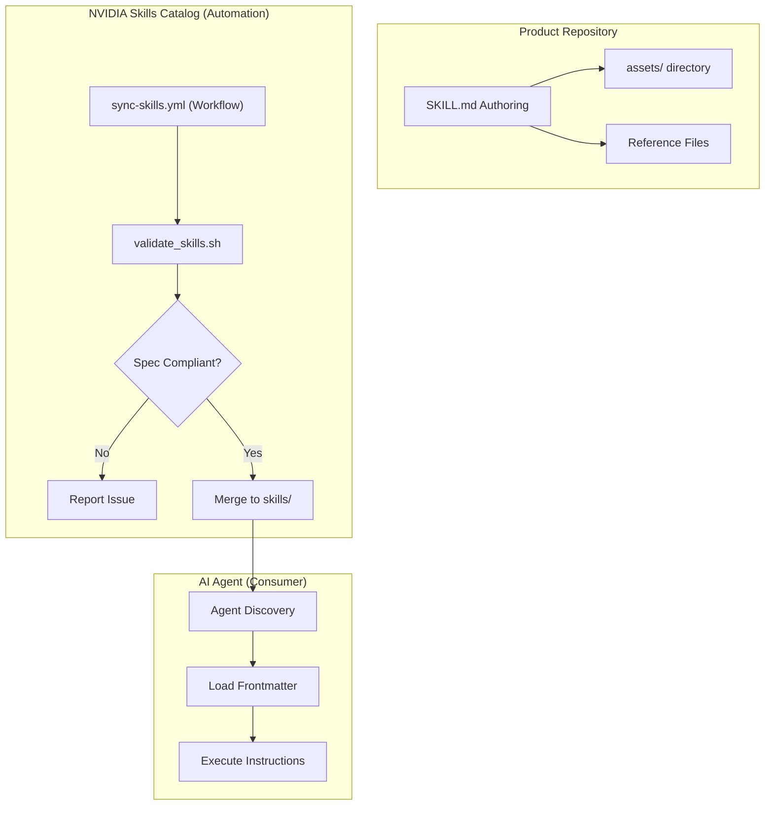
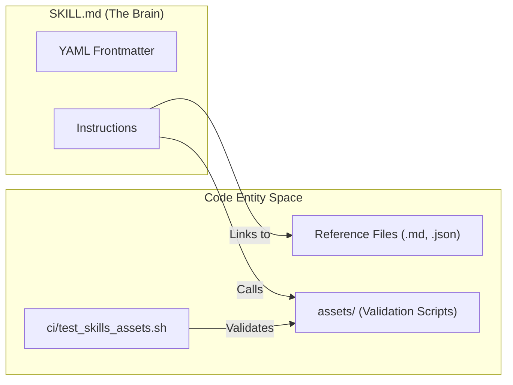

<!-- source: DeepWiki mcp.deepwiki.com · repo NVIDIA/skills · page 4.1 SKILL.md Format & Frontmatter · fetched 2026-10-30 -->

# SKILL.md Format & Frontmatter

<details>
<summary>Relevant source files</summary>

The following files were used as context for generating this wiki page:

- [.github/PULL_REQUEST_TEMPLATE.md](.github/PULL_REQUEST_TEMPLATE.md)
- [CONTRIBUTING.md](CONTRIBUTING.md)
- [README.md](README.md)

</details>


The `SKILL.md` file is the foundational unit of the NVIDIA Agent Skills catalog. It serves as a portable instruction set that defines how an AI agent should perform a specific task using NVIDIA libraries and platforms. This page specifies the required structure, metadata fields, and design patterns for these files, ensuring compatibility with the [agentskills.io](https://agentskills.io) specification.

## Purpose and Scope

Every skill in the `skills/` directory must contain a `SKILL.md` file at its root [README.md:24-31](). This file provides the "brain" for the agent, combining machine-readable metadata (frontmatter) with human-readable (and agent-consumable) instructions (body). The format is designed for **progressive disclosure**, where the agent only loads detailed reference material or code assets when specifically required by the task at hand.

## SKILL.md Structure Overview

A compliant `SKILL.md` consists of two distinct sections separated by a triple-dash (`---`) delimiter:
1.  **YAML Frontmatter**: Metadata used by agents for discovery, capability matching, and security boundary enforcement.
2.  **Instructional Body**: The core logic, examples, and "Size Escape Hatch" links for the agent to follow.

### Data Flow: From Source to Catalog

Skills are authored in product repositories and synchronized to the central catalog. The `SKILL.md` frontmatter is validated during this synchronization process.

**Skill Ingestion & Validation Flow**

Sources: [README.md:16-18](), [.github/PULL_REQUEST_TEMPLATE.md:21-27]()

## Frontmatter Specification

The frontmatter must be valid YAML. It defines the identity and constraints of the skill.

| Field | Type | Requirement | Description |
| :--- | :--- | :--- | :--- |
| `name` | String | **Required** | A concise, unique name for the skill (e.g., `cuopt-routing-api`). |
| `description` | String | **Required** | A one-sentence summary of what the skill enables the agent to do. |
| `license` | String | **Required** | Must be `Apache-2.0`, `CC-BY-4.0`, or `Apache-2.0 AND CC-BY-4.0` [CONTRIBUTING.md:21-27](). |
| `metadata` | Map | **Required** | Arbitrary key-value pairs for categorization (e.g., `version`, `tags`). |
| `argument-hint` | String | Optional | Guidance for the agent on what parameters it needs to extract from user intent. |
| `allowed-tools` | List | Optional | A whitelist of CLI tools or APIs the agent is permitted to use for this skill. |
| `user_invocable` | Boolean | Optional | If `false`, the agent should only use this as a sub-routine for other skills. |

### Implementation Detail: Validation
The catalog uses `validate_skills.sh` (referenced in authoring specs) to ensure that the `SKILL.md` frontmatter contains the mandatory fields before a PR is merged [4.3 Skill Validation & CI]().

Sources: [.github/PULL_REQUEST_TEMPLATE.md:24-25](), [CONTRIBUTING.md:21-27]()

## Body Structure & Progressive Disclosure

The body of the `SKILL.md` should not contain massive code blocks or exhaustive API references. Instead, it follows a **Progressive Disclosure** model.

### 1. High-Level Instructions
The top of the body should provide the "Happy Path" for the agent. Use concise Markdown headers and lists.

### 2. The Size Escape Hatch (Reference Files)
To prevent the agent's context window from being overwhelmed, large datasets, complex code examples, or detailed API schemas should be moved to separate files (e.g., `REFERENCE.md` or `SCHEMA.json`) within the skill directory. The `SKILL.md` should simply point the agent to these files:

> "If you need the full API schema for the cuOpt solver, read `reference/api_spec.json`."

### 3. Assets Directory
Executable scripts, test harnesses, and environment validation tools must be placed in an `assets/` subdirectory [4.3 Skill Validation & CI]().

**Skill Directory Entity Mapping**

Sources: [README.md:24-31](), [.github/PULL_REQUEST_TEMPLATE.md:17-18]()

## Example SKILL.md

```markdown
---
name: "cuopt-lp-solver"
description: "Solve Linear Programming (LP) problems using the NVIDIA cuOpt Python API."
license: "Apache-2.0"
metadata:
  product: "cuOpt"
  version: "24.03"
argument-hint: "Look for objective functions and constraints in the user's prompt."
---

# cuOpt LP Solver Skill

Use this skill when a user asks to optimize a linear objective function subject to linear constraints.

## Instructions
1. Check if `cuopt` is installed by running `python -c "import cuopt"`.
2. If not installed, refer the user to the installation guide in `REFERENCE.md`.
3. Define the problem using the `cuopt.lp` module.
4. Call the solver and format the output as a table.

## Reference
- For complex MILP patterns, see `reference/milp_examples.md`.
- To validate the environment, execute `assets/check_gpu.py`.
```

## Usage in Agents

When an agent like **Claude Code** or **Cursor** loads a skill, it parses the `SKILL.md` file [README.md:37-43]().
- **Discovery**: The agent scans the configured skills directory (e.g., `~/.claude/skills/`) for `SKILL.md` files.
- **Activation**: The `description` and `argument-hint` fields are used to determine if the skill matches the user's current request.
- **Execution**: The agent follows the Markdown instructions in the body, using the `allowed-tools` (if specified) to interact with the system.

Sources: [README.md:24-31](), [README.md:37-43](), [CONTRIBUTING.md:12-20]()

---

