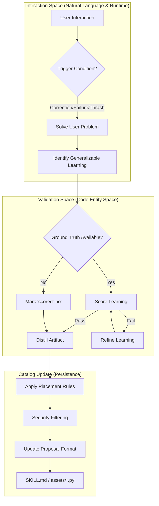
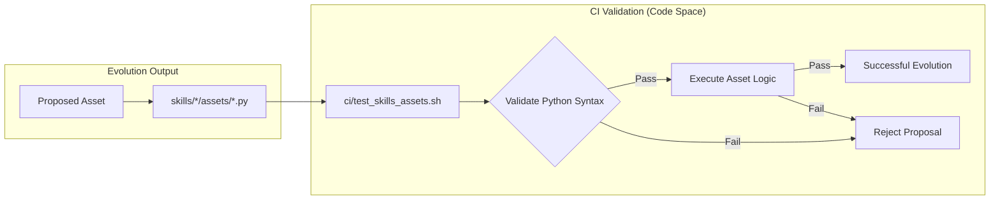

<!-- source: DeepWiki mcp.deepwiki.com · repo NVIDIA/skills · page 4.2 Skill Evolution & Self-Improvement · fetched 2026-10-30 -->

# Skill Evolution & Self-Improvement

<details>
<summary>Relevant source files</summary>

The following files were used as context for generating this wiki page:

- [skills/Megatron-Core/run-on-slurm/SKILL.md](skills/Megatron-Core/run-on-slurm/SKILL.md)
- [skills/cuopt/skill-evolution/SKILL.md](skills/cuopt/skill-evolution/SKILL.md)

</details>


The Skill Evolution framework is a self-correcting loop designed to capture generalizable knowledge from agent interactions. When an agent solves a non-trivial problem or encounters an error, it identifies the underlying pattern, validates it against ground truth, and proposes an update to the skill catalog. This ensures that the catalog remains a "living" repository that improves with every user interaction.

## Framework Overview

The evolution process is triggered by specific interaction signals, such as user corrections or execution failures. Once triggered, the agent must solve the immediate problem, distill the lesson into a reusable format (Markdown or Code), and submit a structured proposal.

### Evolution Data Flow

The following diagram illustrates how a runtime failure or correction transitions from the "Natural Language Space" of a user conversation into the "Code Entity Space" of the skill catalog.

**Skill Evolution Lifecycle**

Sources: [skills/cuopt/skill-evolution/SKILL.md:7-35]()

---

## Trigger Conditions

An agent must evaluate entering the evolution workflow when any of the following events occur. These signals indicate that the existing skills provided insufficient guidance.

| Trigger | Description |
| :--- | :--- |
| **User Correction** | The user provides a direct fix (e.g., "Use Y instead of Z"). [skills/cuopt/skill-evolution/SKILL.md:15-15]() |
| **Retry after Failure** | Code or formulation failed (exception, solver error) and required a change in approach. [skills/cuopt/skill-evolution/SKILL.md:16-16]() |
| **Undocumented Behavior** | Discovery of an API behavior or constraint not mentioned in the skill. [skills/cuopt/skill-evolution/SKILL.md:17-17]() |
| **Workaround** | Implementation of a "gotcha" bypass that isn't documented. [skills/cuopt/skill-evolution/SKILL.md:18-18]() |
| **Thrash before Landing** | Arriving at the correct answer only after writing/deleting dead code or exploring multiple failed paths. [skills/cuopt/skill-evolution/SKILL.md:20-20]() |

Sources: [skills/cuopt/skill-evolution/SKILL.md:11-25]()

---

## Scoring & Ground Truth

Evolution requires validation to prevent "hallucinated" improvements. If ground truth is available, the agent must score the learning before proposing an update.

**Scoring Mechanisms**
| Ground Truth | Implementation |
| :--- | :--- |
| **Behavioral Tests** | `must_include` / `must_not_include` string patterns in generated code. [skills/cuopt/skill-evolution/SKILL.md:43-43]() |
| **Code Execution** | Verifying `solution.py` runs without error via `ci/test_skills_assets.sh`. [skills/cuopt/skill-evolution/SKILL.md:44-44]() |
| **Solver Status** | Checking for `Optimal` or `SUCCESS` statuses from engines like cuOpt. [skills/cuopt/skill-evolution/SKILL.md:45-45]() |
| **Constraint Satisfaction** | Programmatic verification that the formulation meets all logic requirements. [skills/cuopt/skill-evolution/SKILL.md:46-46]() |

Sources: [skills/cuopt/skill-evolution/SKILL.md:37-50]()

---

## Distillation & Placement Rules

Learnings are distilled into either Markdown patches for `SKILL.md` or Python code assets.

### Placement Logic
*   **Markdown:** Default choice for "gotchas," patterns, and short examples. [skills/cuopt/skill-evolution/SKILL.md:55-58]()
*   **Code Assets:** Used when the logic exceeds ~15 lines, encodes a non-trivial algorithm, or has been independently rewritten in 2+ interactions. [skills/cuopt/skill-evolution/SKILL.md:67-73]()
*   **Targeting:** Updates must be placed in the **single most relevant skill**. If a learning applies to multiple skills, it is placed in the most fundamental one (e.g., a solver-wide constraint goes in the core solver skill, not a specific use-case skill). [skills/cuopt/skill-evolution/SKILL.md:87-89]()

### Security Filtering
Before a proposal is finalized, it must pass a security filter to ensure no sensitive data is leaked:
1.  **Anonymization:** Strip all user-specific paths, IP addresses, and objective values. [skills/cuopt/skill-evolution/SKILL.md:81-81]()
2.  **Generic Patterns:** Convert the specific fix (e.g., "Fixing the 5000-variable factory problem") into a general rule (e.g., "Any LP with a large objective"). [skills/cuopt/skill-evolution/SKILL.md:81-81]()

Sources: [skills/cuopt/skill-evolution/SKILL.md:51-85]()

---

## Update Proposal Format

Every skill evolution must be presented as a structured proposal. This format allows human maintainers or automated CI to quickly verify the change.

**Proposal Structure**
```markdown
### Skill Evolution Proposal

**Trigger:** [Describe the specific failure or correction that initiated this]
**Learning:** [Concise description of the generalizable pattern]
**Scored:** [Yes/No - include result of ground truth check]

**Proposed Update:**
- **File:** [Path to SKILL.md or assets/file.py]
- **Action:** [Add/Update/Delete]
- **Content:**
  ```[diff or code block]
  ...
  ```
```
Sources: [skills/cuopt/skill-evolution/SKILL.md:31-33]()

---

## Technical Implementation: Asset Testing

The `ci/test_skills_assets.sh` script is the primary gatekeeper for code-based skill evolution. It ensures that any new `assets/*.py` files extracted during the evolution process are functionally correct.

**Asset Validation Pipeline**

Sources: [skills/cuopt/skill-evolution/SKILL.md:62-62](), [skills/cuopt/skill-evolution/SKILL.md:44-44]()

---

