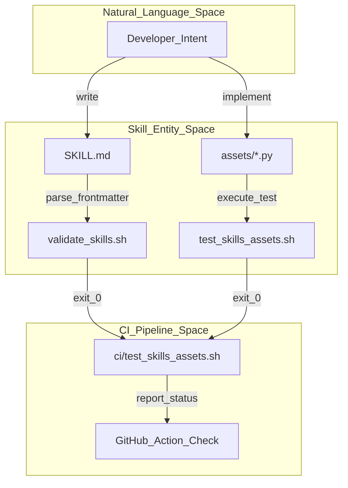

<!-- source: DeepWiki mcp.deepwiki.com · repo NVIDIA/skills · page 4.3 Skill Validation & CI · fetched 2026-10-30 -->

# Skill Validation & CI

Relevant source files

The following files were used as context for generating this wiki page:

- [skills/Megatron-Core/cicd/SKILL.md](skills/Megatron-Core/cicd/SKILL.md)
- [skills/Megatron-Core/run-on-slurm/SKILL.md](skills/Megatron-Core/run-on-slurm/SKILL.md)
- [skills/cuopt/skill-evolution/SKILL.md](skills/cuopt/skill-evolution/SKILL.md)

The NVIDIA Agent Skills catalog employs a multi-layered validation strategy to ensure that all skills—ranging from high-level documentation to executable code assets—remain functionally correct and structurally compliant. Validation is divided between local pre-submission scripts and automated GitHub Action pipelines that verify both the `SKILL.md` frontmatter and the execution of Python assets.

## Validation Architecture

The validation system ensures that skills adhere to the [agentskills.io](https://agentskills.io) specification while maintaining the integrity of the NVIDIA-specific catalog structure.

### Validation Flow

The following diagram illustrates the data flow from a skill contribution to its final validation in the CI pipeline.

**Skill Validation Data Flow**

Sources: [skills/cuopt/skill-evolution/SKILL.md:53-65](), [skills/Megatron-Core/cicd/SKILL.md:154-162]()

## Structural Compliance (`validate_skills.sh`)

All skills must follow the `SKILL.md` format, which includes a YAML frontmatter block containing metadata such as `name`, `description`, and `version`.

### Key Requirements
*   **Frontmatter Presence**: Every skill directory must contain a `SKILL.md` file with valid YAML frontmatter [skills/cuopt/skill-evolution/SKILL.md:1-5]().
*   **Naming Constraints**: Skill names must be unique across the catalog to prevent collisions during agent discovery.
*   **Schema Validation**: Fields like `when_to_use` or `argument-hint` must follow the prescribed list or string formats [skills/Megatron-Core/run-on-slurm/SKILL.md:1-5]().

## Code Asset Testing (`test_skills_assets.sh`)

Skills often include executable assets in an `assets/` directory. These are typically reusable helper functions or reference solutions that are too complex to embed directly in Markdown [skills/cuopt/skill-evolution/SKILL.md:67-73]().

### Asset Organization
Assets are organized within the product-specific skill directories:
*   **Location**: `skills/<Product>/<Skill-Name>/assets/`
*   **Requirement**: Must be runnable by the `ci/test_skills_assets.sh` script [skills/cuopt/skill-evolution/SKILL.md:60-64]().
*   **Documentation**: Each asset must include a docstring explaining its purpose and the rationale for its extraction from a specific interaction [skills/cuopt/skill-evolution/SKILL.md:63-64]().

### Execution Logic
The `test_skills_assets.sh` script iterates through all registered skills and executes any Python files found in `assets/`. This ensures that:
1.  The code is syntactically correct.
2.  Dependencies are properly declared (typically via `uv` or `pip`).
3.  The logic produces the expected output or satisfies solver constraints (e.g., cuOpt `Optimal` status) [skills/cuopt/skill-evolution/SKILL.md:37-49]().

## CI Pipeline (`ci/test_skills_assets.sh`)

The automated CI pipeline acts as the final gatekeeper for the repository. It mirrors the local validation scripts but runs within a controlled environment (often a containerized runner).

### Pipeline Components
The pipeline is structured to handle various failure modes and provide granular feedback to contributors.

**CI Failure Investigation Mapping**
| Failure Type | Code Entity / Script | Investigation Action |
| :--- | :--- | :--- |
| **Linting** | `tools/autoformat.sh` | Run locally to see required diff [skills/Megatron-Core/cicd/SKILL.md:156-156](). |
| **Structure** | `validate_skills.sh` | Check `SKILL.md` frontmatter for YAML syntax errors. |
| **Execution** | `test_skills_assets.sh` | Inspect `stderr.log` for Python tracebacks [skills/Megatron-Core/cicd/SKILL.md:150-151](). |
| **Integration** | `cicd-integration-tests-*` | Review rank-specific logs for distributed training failures [skills/Megatron-Core/cicd/SKILL.md:159-159](). |

Sources: [skills/Megatron-Core/cicd/SKILL.md:154-162](), [skills/cuopt/skill-evolution/SKILL.md:37-49]()

### Log Management
Because CI logs for complex skills (like Megatron-Core training) can exceed 10,000 lines, the CI infrastructure uploads logs as artifacts.
*   **Artifact Naming**: `logs-<test_case>-<run_id>-<uuid>` [skills/Megatron-Core/cicd/SKILL.md:134-135]().
*   **Diagnosis**: Developers are encouraged to use `grep` to locate the first non-NCCL Python traceback, as subsequent failures are often downstream symptoms [skills/Megatron-Core/run-on-slurm/SKILL.md:98-100]().

## Skill Evolution & Scoring

A unique aspect of the validation process is the **Skill Evolution** workflow, where new learnings are scored against ground truth before being promoted to the catalog.

### Scoring Criteria
When a skill is updated or a new asset is added, it is evaluated against available ground truth:

| Ground Truth | Verification Method |
| :--- | :--- |
| **Behavioral tests** | `must_include` / `must_not_include` patterns [skills/cuopt/skill-evolution/SKILL.md:43-43](). |
| **Code execution** | Asset runs without error in `ci/test_skills_assets.sh` [skills/cuopt/skill-evolution/SKILL.md:44-44](). |
| **Solver status** | cuOpt returns `SUCCESS` or `Optimal` [skills/cuopt/skill-evolution/SKILL.md:45-45](). |
| **Known answer** | Output matches expected value within tolerance [skills/cuopt/skill-evolution/SKILL.md:47-47](). |

Sources: [skills/cuopt/skill-evolution/SKILL.md:37-49](), [skills/Megatron-Core/run-on-slurm/SKILL.md:102-108]()

---

