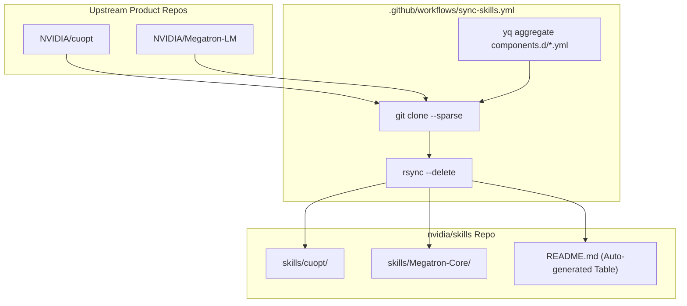
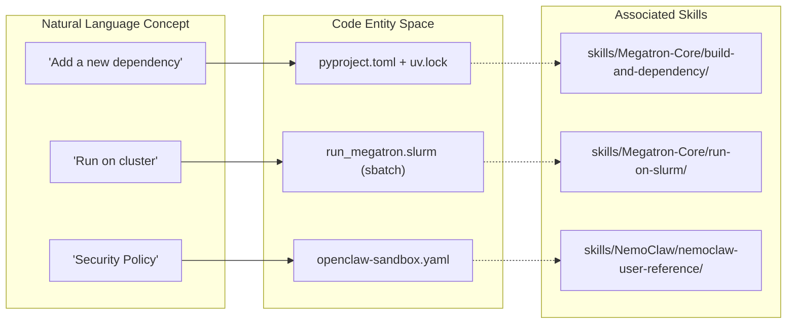

<!-- source: DeepWiki mcp.deepwiki.com · repo NVIDIA/skills · page 5 Glossary · fetched 2026-10-30 -->

# Glossary

Relevant source files

The following files were used as context for generating this wiki page:

- [.github/PULL_REQUEST_TEMPLATE.md](.github/PULL_REQUEST_TEMPLATE.md)
- [.github/workflows/sync-skills.yml](.github/workflows/sync-skills.yml)
- [CODE_OF_CONDUCT.md](CODE_OF_CONDUCT.md)
- [CONTRIBUTING.md](CONTRIBUTING.md)
- [LICENSE](LICENSE)
- [README.md](README.md)
- [SECURITY.md](SECURITY.md)
- [skills/Megatron-Core/build-and-dependency/SKILL.md](skills/Megatron-Core/build-and-dependency/SKILL.md)
- [skills/Megatron-Core/onboard-gb200-1node-tests/SKILL.md](skills/Megatron-Core/onboard-gb200-1node-tests/SKILL.md)
- [skills/Megatron-Core/respond-to-issue/SKILL.md](skills/Megatron-Core/respond-to-issue/SKILL.md)
- [skills/Megatron-Core/run-on-slurm/SKILL.md](skills/Megatron-Core/run-on-slurm/SKILL.md)
- [skills/NemoClaw/nemoclaw-user-configure-security/references/best-practices.md](skills/NemoClaw/nemoclaw-user-configure-security/references/best-practices.md)
- [skills/NemoClaw/nemoclaw-user-reference/references/network-policies.md](skills/NemoClaw/nemoclaw-user-reference/references/network-policies.md)
- [skills/TileGym/cutile-autotuning/SKILL.md](skills/TileGym/cutile-autotuning/SKILL.md)
- [skills/TileGym/cutile-python/orchestration/overview.md](skills/TileGym/cutile-python/orchestration/overview.md)
- [skills/cuopt/skill-evolution/SKILL.md](skills/cuopt/skill-evolution/SKILL.md)

This page provides definitions for codebase-specific terms, architectural concepts, and domain jargon used throughout the NVIDIA Agent Skills catalog. It serves as a technical reference for onboarding engineers to understand the implementation details and data flow of the skill synchronization and execution framework.

## Core Catalog Concepts

### Agent Skill
A portable instruction set, following the [agentskills.io](https://agentskills.io) specification, that teaches AI agents how to use specific NVIDIA libraries or platforms [README.md:14-16](). Each skill is encapsulated in a directory containing a `SKILL.md` file and optional assets [README.md:24-31]().

### SKILL.md
The entry point and metadata definition for a skill. It uses YAML frontmatter to define the skill's name, description, and activation triggers (`when_to_use`) [skills/Megatron-Core/run-on-slurm/SKILL.md:1-5]().
*   **Frontmatter**: Contains fields like `name`, `description`, `when_to_use`, and `user_invocable` [skills/Megatron-Core/respond-to-issue/SKILL.md:1-7]().
*   **Body**: Contains the actual instructions, typically in Markdown format [skills/Megatron-Core/run-on-slurm/SKILL.md:7-115]().

### Component Registry (`components.d/`)
A directory containing YAML files that define which product repositories should be synced into the catalog. Each file corresponds to a single product or component [README.md:65-67]().
*   **Schema**: Includes the source `repo`, the target `ref` (branch), and a list of `skills` mapping source paths to `catalog_dir` destinations [.github/workflows/sync-skills.yml:64-102]().

### Sync-Skills Workflow
An automated GitHub Action (`.github/workflows/sync-skills.yml`) that runs twice daily to mirror skills from upstream product repositories into this catalog [.github/workflows/sync-skills.yml:12-17]().

**Sync Data Flow**

*Sources: [.github/workflows/sync-skills.yml:41-142](), [README.md:46-62]()*

---

## Technical Domain Terms

### Progressive Disclosure
A documentation pattern where complex details are hidden or placed in secondary files (references) to avoid overwhelming the agent during initial skill activation. This is often implemented by placing large code blocks or deep-dives in a `references/` subdirectory [skills/NemoClaw/nemoclaw-user-reference/references/network-policies.md:1-3]().

### Skill Evolution
A framework, pioneered by the `cuopt` team, for agents to self-improve skills based on user corrections, solver failures, or undocumented behaviors [skills/cuopt/skill-evolution/SKILL.md:11-20]().
*   **Ground Truth**: Data used to score a proposed skill update, such as `Optimal` solver status or successful code execution [skills/cuopt/skill-evolution/SKILL.md:37-49]().
*   **Distillation**: The process of extracting a general pattern from a specific fix and turning it into a Markdown patch or a reusable code asset [skills/cuopt/skill-evolution/SKILL.md:51-64]().

### Sparse Checkout
A Git feature used by the sync pipeline and recommended for end-users to download only specific skill directories rather than the entire multi-gigabyte catalog [README.md:26-31](), [.github/workflows/sync-skills.yml:71-95]().

---

## Product-Specific Jargon

### Megatron-Core (MCore)
*   **Parallelism Modes**: Strategies for distributing LLM training: `TP` (Tensor Parallel), `PP` (Pipeline Parallel), `DP` (Data Parallel), `CP` (Context Parallel), and `EP` (Expert Parallel) [skills/Megatron-Core/onboard-gb200-1node-tests/SKILL.md:45-56]().
*   **GB200**: NVIDIA Blackwell-based hardware. MC-specific skills handle onboarding functional tests for this architecture [skills/Megatron-Core/onboard-gb200-1node-tests/SKILL.md:10-13]().
*   **uv**: The Python package manager used for Megatron-Core dependency locking and environment synchronization [skills/Megatron-Core/build-and-dependency/SKILL.md:135-142]().

### NemoClaw Security
*   **OpenShell**: The secure gateway that intercepts and enforces network policies for NemoClaw sandboxes [skills/NemoClaw/nemoclaw-user-reference/references/network-policies.md:5-7]().
*   **Landlock LSM**: A Linux Security Module used to enforce filesystem immutability and restricted access within the sandbox [skills/NemoClaw/nemoclaw-user-reference/references/network-policies.md:23-25]().
*   **Binary-Scoped Rules**: Network policies that restrict egress not just by host, but by the specific binary (identified by SHA256 hash) attempting the connection [skills/NemoClaw/nemoclaw-user-configure-security/references/best-practices.md:124-130]().

**Natural Language to Code Entity Mapping**

*Sources: [skills/Megatron-Core/build-and-dependency/SKILL.md:171-186](), [skills/Megatron-Core/run-on-slurm/SKILL.md:15-57](), [skills/NemoClaw/nemoclaw-user-reference/references/network-policies.md:9-12]()*

---

## Governance & Infrastructure

### DCO (Developer Certificate of Origin)
A legal requirement for all contributions. Commits must be signed off using `git commit -s` to certify the contributor has the right to submit the code under the project's license [CONTRIBUTING.md:31-40]().

### PSIRT (Product Security Incident Response Team)
The NVIDIA team responsible for handling security vulnerability reports. Vulnerabilities should be reported via `psirt@nvidia.com` rather than public GitHub issues [SECURITY.md:10-15]().

### OSS Skills PIC
The "Person In Charge" (reviewer) from the Open Source Skills team who validates onboarding PRs against the `SKILL.md` specification and IP requirements [.github/PULL_REQUEST_TEMPLATE.md:21-27]().

| Term | Definition | Code Pointer |
| :--- | :--- | :--- |
| `catalog_dir` | The unique directory name under `skills/` where a component is mirrored. | [.github/workflows/sync-skills.yml:101]() |
| `user_invocable` | A frontmatter flag indicating the skill can be started directly by a user command. | [skills/Megatron-Core/respond-to-issue/SKILL.md:5]() |
| `yq` | A portable command-line YAML processor used to aggregate component configs. | [.github/workflows/sync-skills.yml:38-56]() |
| `rsync --delete` | Used during sync to ensure the catalog perfectly mirrors the upstream source, removing deleted files. | [.github/workflows/sync-skills.yml:106]() |

*Sources: [README.md:1-62](), [.github/workflows/sync-skills.yml:1-130](), [CONTRIBUTING.md:1-48](), [SECURITY.md:1-29](), [.github/PULL_REQUEST_TEMPLATE.md:1-36]()*