# Page: Overview

# Overview

<details>
<summary>Relevant source files</summary>

The following files were used as context for generating this wiki page:

- [CHANGELOG.md](CHANGELOG.md)
- [README.md](README.md)

</details>


The **NVIDIA Agent Skills** catalog is a centralized repository of official, NVIDIA-verified portable instruction sets designed for AI agents. These skills teach agents how to correctly utilize NVIDIA CUDA-X libraries, AI Blueprints, and platform tools, such as solving optimization problems with `cuOpt` or onboarding models into `TensorRT-LLM` [README.md:6-16]().

The catalog functions as a mirror; skills are maintained within their respective upstream product repositories and synchronized daily to this repository via an automated pipeline [README.md:16-18](). By adhering to the open [Agent Skills specification](https://agentskills.io/specification), these skills are compatible with any AI agent or framework that supports the standard, including Claude Code, Codex, and Cursor [README.md:16-16](), [README.md:37-42]().

## How It Works

The repository uses a **progressive disclosure model** to manage complexity. Each skill is contained within its own directory under `skills/` and includes a `SKILL.md` file that defines its capabilities and metadata [README.md:24-31]().

### System Architecture: From Catalog to Agent
The following diagram illustrates how the automation pipeline (Code Entity Space) bridges the gap between upstream product development and the final AI agent consumption (Natural Language Space).

**Skill Synchronization and Consumption Flow**
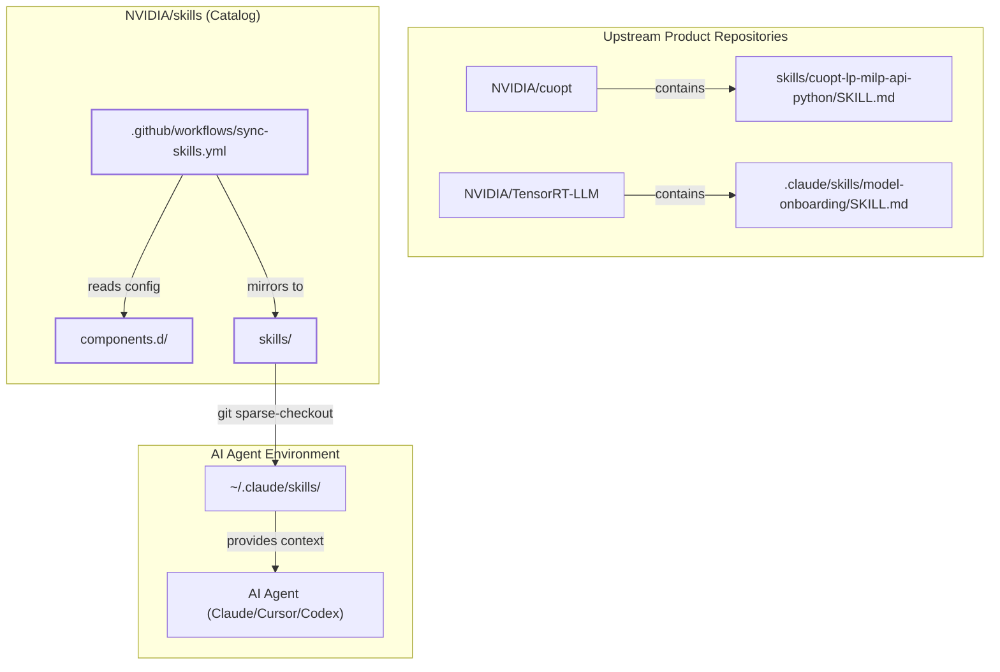
Sources: [README.md:16-18](), [README.md:28-31](), [README.md:37-42](), [CHANGELOG.md:23-26]()

## Progressive Disclosure & Specification

Every skill follows a structured format to ensure agents can parse and execute instructions reliably. 

*   **`SKILL.md`**: The entry point for the agent, containing frontmatter (metadata) and the instruction set [README.md:16-16]().
*   **Automation**: The `.github/workflows/sync-skills.yml` workflow aggregates skills from various NVIDIA products based on definitions in the `components.d/` directory.
*   **Verification**: Every skill is "NVIDIA-Verified," meaning it has passed internal reviews for technical accuracy and security [README.md:6-8]().

For a deep dive into the authoring format and validation rules, see **[Skill Authoring Specification](#4)**.

## Navigation

This wiki is organized to support three primary personas: end-users, product contributors, and maintainers.

### For End-Users & AI Agents
Learn how to install skills into your local agent environment using `git sparse-checkout` and where to place them for specific agents like Claude Code or Cursor.
*   **See: [Getting Started & Installation](#1.1)**

### For NVIDIA Product Teams
A guide for teams looking to onboard their product's skills into the official catalog. This covers the `components.d/` YAML schema and the mandatory IP/Security review process.
*   **See: [Contributing & Onboarding New Products](#1.2)**

### For Maintainers & Developers
Technical details on the automation pipeline, including how the README is regenerated and how the sync workflow handles change detection.
*   **See: [Catalog Architecture & Automation Pipeline](#2)**

### Governance and Security
Information on the dual Apache 2.0 / CC-BY 4.0 licensing, PSIRT vulnerability reporting, and the Contributor Covenant.
*   **See: [Governance, Security & Licensing](#1.3)**

## Code Entity Mapping

The following table associates high-level concepts with their specific implementation paths in the codebase.

| Concept | Code Entity / Path | Role |
| :--- | :--- | :--- |
| **Skill Mirror** | `skills/` | The destination for all synchronized skills [README.md:24-24](). |
| **Sync Engine** | `.github/workflows/sync-skills.yml` | The GitHub Action that pulls skills from upstream [README.md:16-18](). |
| **Product Registry** | `components.d/` | YAML configurations defining source repos and target directories. |
| **README Generator** | `.github/scripts/regenerate-readme.sh` | Updates the "Available Skills" table in the main README [README.md:48-48](). |
| **Legal Framework** | `LICENSE` | Defines the Apache 2.0 + CC-BY 4.0 dual license [README.md:10-10](). |

**Code-to-System Association**
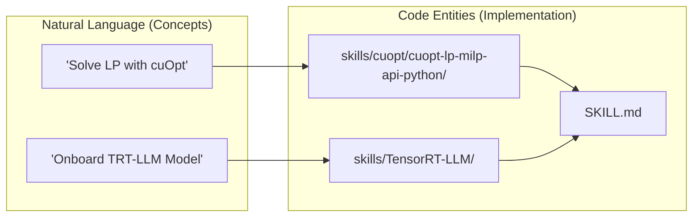
Sources: [README.md:28-31](), [README.md:52-52](), [README.md:61-61]()

---

# Page: Getting Started & Installation

# Getting Started & Installation

<details>
<summary>Relevant source files</summary>

The following files were used as context for generating this wiki page:

- [.github/PULL_REQUEST_TEMPLATE.md](.github/PULL_REQUEST_TEMPLATE.md)
- [CONTRIBUTING.md](CONTRIBUTING.md)
- [README.md](README.md)

</details>


This page details how end-users and AI agents consume skills from the NVIDIA Agent Skills catalog. It covers the technical implementation of the sparse-checkout installation method, agent-specific configuration paths, and the `SKILL.md` format that enables agent discovery.

## Installation Overview

The NVIDIA Agent Skills repository functions as a centralized catalog of verified instruction sets. Instead of cloning the entire repository, which contains skills for numerous NVIDIA products, users and agents are encouraged to use **Git Sparse-Checkout**. This allows for the retrieval of specific skills or product collections while maintaining a minimal local footprint [README.md:24-31]().

### Data Flow: Skill Consumption

The following diagram illustrates how a skill moves from the NVIDIA catalog into an agent's active memory.

**Skill Acquisition and Activation Flow**

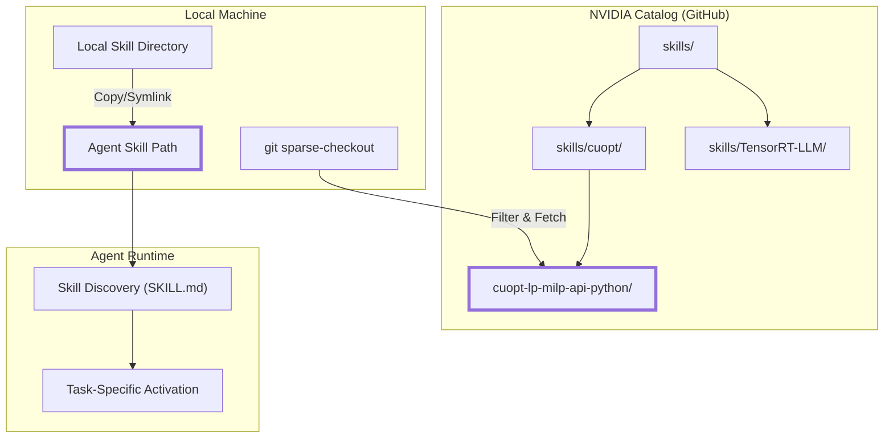
Sources: [README.md:24-33](), [CONTRIBUTING.md:12-19]()

## Sparse-Checkout Installation

To install a specific skill, use the following command pattern. This example demonstrates installing the `cuopt-lp-milp-api-python` skill [README.md:26-31]().

```bash
# 1. Clone the repository metadata without downloading blobs
git clone --depth 1 --filter=blob:none --sparse https://github.com/NVIDIA/skills.git
cd skills

# 2. Configure sparse-checkout for a specific skill directory
git sparse-checkout set skills/cuopt/cuopt-lp-milp-api-python

# 3. Deploy to the agent's expected skill path (e.g., Claude Code)
cp -r skills/cuopt/cuopt-lp-milp-api-python ~/.claude/skills/
```
Sources: [README.md:26-31]()

## Agent-Specific Paths

Different AI agents and IDE extensions look for skills in specific directories. To enable a skill, the directory containing the `SKILL.md` file must be placed in one of the following locations:

| Agent / Framework | Installation Path | Scope |
| :--- | :--- | :--- |
| **Claude Code** | `~/.claude/skills/` | Global (User-wide) |
| **Codex** | `.codex/skills/` | Project-specific |
| **Cursor** | `.cursor/skills/` | Project-specific |
| **Standard Agents** | `.agents/skills/` | Project-specific (Preferred) |

### Recommended Default Path
For new product integrations or general agent compatibility, the **`.agents/skills/`** path is the recommended default. It is agent-agnostic and aligns with the [agentskills.io](https://agentskills.io/specification) specification [CONTRIBUTING.md:14-17]().

Sources: [README.md:37-42](), [CONTRIBUTING.md:12-19]()

## The SKILL.md Format

The `SKILL.md` file is the core entity that bridges natural language instructions with executable agent behavior. It uses a structured frontmatter (YAML) to define metadata that agents use for discovery and validation.

### Frontmatter Schema

Every skill in the `skills/` directory must contain a `SKILL.md` file with compliant frontmatter [README.md:16-18]().

| Field | Requirement | Description |
| :--- | :--- | :--- |
| `name` | Required | The human-readable name of the skill. |
| `description` | Required | A concise summary used by the agent to decide when to trigger the skill. |
| `license` | Required | Must be Apache-2.0, CC-BY-4.0, or Dual [CONTRIBUTING.md:23-27](). |
| `metadata` | Optional | Key-value pairs for versioning or product categorization. |

### Technical Entity Mapping

The following diagram maps the conceptual "Skill" to the concrete file system entities and the metadata fields defined in the `SKILL.md` specification.

**Entity Mapping: Natural Language to Code**

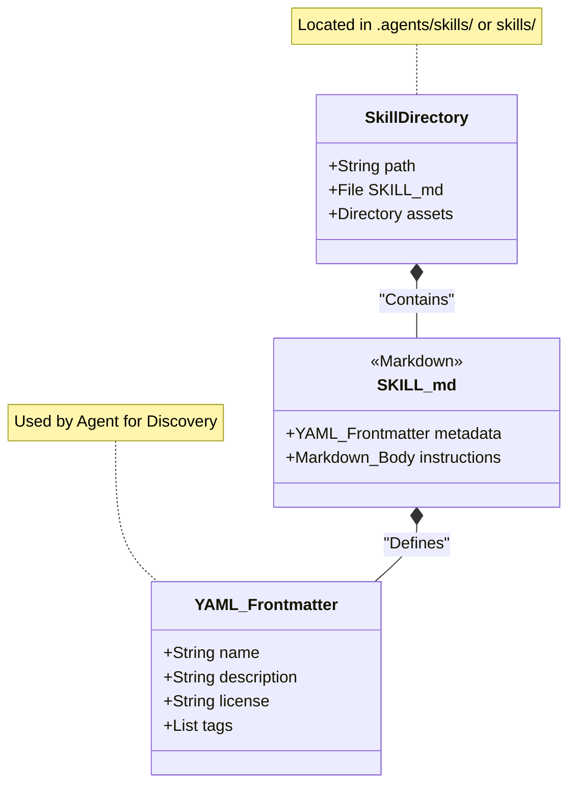
Sources: [README.md:14-16](), [CONTRIBUTING.md:12-19](), [.github/PULL_REQUEST_TEMPLATE.md:25-25]()

## Verification and Safety

All skills in the catalog undergo a verification process before being mirrored. This includes:
1.  **IP Review**: Ensuring the skill is cleared for open-source release [CONTRIBUTING.md:21-29]().
2.  **DCO Sign-off**: Every commit must be signed (`git commit -s`) to certify the Developer Certificate of Origin [CONTRIBUTING.md:31-47]().
3.  **Path Standardization**: Skills are validated to ensure they reside in standard paths like `.agents/skills/` or `skills/` to prevent agent discovery failures [CONTRIBUTING.md:14-19]().

Sources: [CONTRIBUTING.md:21-47](), [.github/PULL_REQUEST_TEMPLATE.md:9-31]()

---

# Page: Contributing & Onboarding New Products

# Contributing & Onboarding New Products

<details>
<summary>Relevant source files</summary>

The following files were used as context for generating this wiki page:

- [.github/CODEOWNERS](.github/CODEOWNERS)
- [.github/PULL_REQUEST_TEMPLATE.md](.github/PULL_REQUEST_TEMPLATE.md)
- [.gitignore](.gitignore)
- [CONTRIBUTING.md](CONTRIBUTING.md)
- [components.d/README.md](components.d/README.md)

</details>


This guide provides a step-by-step technical walkthrough for NVIDIA product teams to onboard their agent skills into the central catalog. The repository operates on a **federated maintenance model**: while the catalog is central, the source of truth for skills remains within the respective product repositories.

## Onboarding Workflow Overview

The onboarding process is designed to be asynchronous and conflict-free. Teams submit a YAML configuration file to the `components.d/` directory, which the automation pipeline uses to mirror skills into the `skills/` directory of this repository.

### Process Flow: From Product Repo to Catalog

The following diagram illustrates the data flow from a source repository into the centralized catalog.

**Diagram: Skill Onboarding Data Flow**
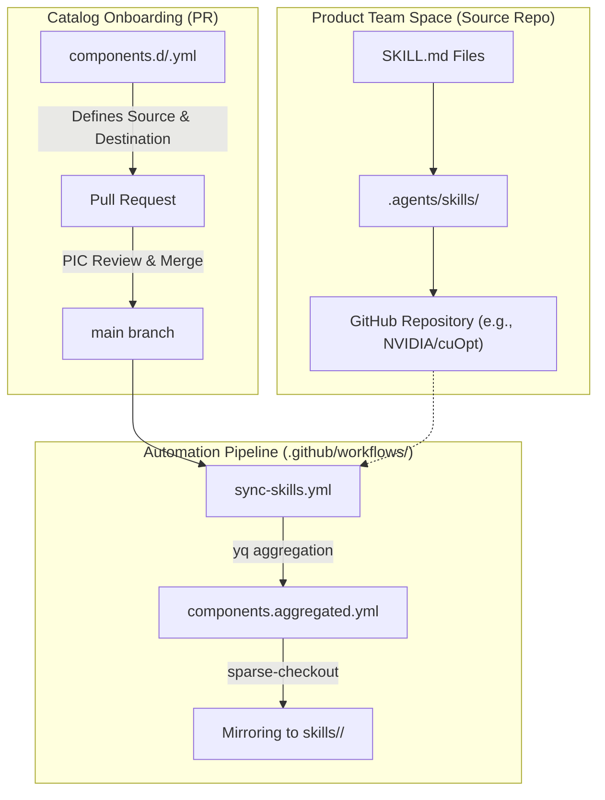
Sources: [CONTRIBUTING.md:6-8](), [components.d/README.md:6-12](), [components.d/README.md:64-73]()

---

## 1. Defining the Component Configuration

To register a product, you must create a YAML file in `components.d/`. The filename must be a slug (lowercase, spaces replaced by dashes) matching your product name [components.d/README.md:10-10]().

### YAML Schema (`components.d/<slug>.yml`)

| Field | Type | Description |
| :--- | :--- | :--- |
| `name` | string | Display name in the README (e.g., `TensorRT-LLM`) [components.d/README.md:18-18](). |
| `repo` | string | Source GitHub repository in `owner/repo` format [components.d/README.md:19-19](). |
| `description` | string | One-line summary for the Available Skills table [components.d/README.md:20-20](). |
| `skills` | list | List of source-to-catalog mappings [components.d/README.md:21-21](). |
| `skills[].path` | string | Path in the **source** repo containing `SKILL.md` files [components.d/README.md:27-27](). |
| `skills[].catalog_dir`| string | Unique directory name under `skills/` in this repo [components.d/README.md:28-28](). |
| `ref` | string | (Optional) Branch to sync from. Defaults to `main` [components.d/README.md:34-34](). |

### Example: Multi-Skill Component
If a product has skills distributed across multiple sub-packages, you can define multiple entries under the `skills` key.

```yaml
# components.d/nemo-evaluator.yml
name: NeMo Evaluator
repo: NVIDIA-NeMo/Evaluator
description: LLM evaluation and benchmarking skills.
skills:
  - path: packages/nemo-evaluator-launcher/.claude/skills/
    catalog_dir: NeMo-Evaluator-Launcher
  - path: packages/nemo-evaluator/.claude/skills/
    catalog_dir: NeMo-Evaluator
```
Sources: [components.d/README.md:53-62]()

---

## 2. Skill Authoring Requirements

Before onboarding, ensure your skills follow the recommended directory structure and licensing requirements.

### Canonical Paths
Teams are encouraged to use agent-agnostic paths in their source repositories to ensure broad compatibility with tools like Claude Code, Cursor, and Windsurf:
*   **`.agents/skills/`**: Recommended default (aligns with [agentskills.io](https://agentskills.io) spec) [CONTRIBUTING.md:16-16]().
*   **`skills/`**: Acceptable for root-level artifacts [CONTRIBUTING.md:17-17]().

### IP Review & Licensing
NVIDIA contributors must confirm the following for every onboarding PR:
1.  **IP Clearance**: Skills have passed the internal six-question IP review check [CONTRIBUTING.md:23-25]().
2.  **Permissive License**: Skills must be under Apache 2.0, CC-BY 4.0, or a dual-license of both [CONTRIBUTING.md:26-26]().
3.  **No New Dependencies**: No third-party components or licenses are introduced that aren't already in the source repo [CONTRIBUTING.md:27-27]().

Sources: [CONTRIBUTING.md:12-27](), [.github/PULL_REQUEST_TEMPLATE.md:11-15]()

---

## 3. Submission & Review Process

The catalog uses a Pull Request (PR) template to enforce compliance.

### DCO Sign-off
All commits must be signed off to certify the Developer Certificate of Origin (DCO). Use the `-s` flag:
```bash
git commit -s -m "Add new product skills"
```
If you forget, you must rebase and force-push: `git rebase --signoff origin/main && git push --force-with-lease` [CONTRIBUTING.md:31-45]().

### PR Checklist for Authors
When opening a PR, you must check the following in the template:
*   [ ] Source repo is public and under an NVIDIA-owned GitHub org [.github/PULL_REQUEST_TEMPLATE.md:16-16]().
*   [ ] `catalog_dir` is unique and does not collide with existing products [.github/PULL_REQUEST_TEMPLATE.md:24-24]().
*   [ ] `SKILL.md` frontmatter is spec-compliant [.github/PULL_REQUEST_TEMPLATE.md:25-25]().

### OSS Skills PIC Review
The PR will be reviewed by the **OSS Skills Persons in Charge (PIC)**, currently defined in `.github/CODEOWNERS` as `@mosheabr` and `@sayalinvidia` [.github/CODEOWNERS:5-5](). They verify the author affirmations and ensure the YAML configuration is valid before merging [.github/PULL_REQUEST_TEMPLATE.md:21-27]().

**Diagram: Review and Integration Logic**
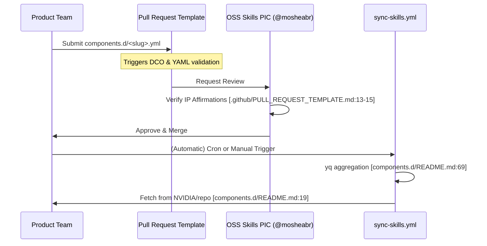
Sources: [.github/CODEOWNERS:5-5](), [.github/PULL_REQUEST_TEMPLATE.md:4-31](), [components.d/README.md:64-73]()

---

## 4. Post-Onboarding Automation

Once the PR is merged, the `sync-skills.yml` workflow handles the rest:
1.  **Aggregation**: It uses `yq` to merge all individual files in `components.d/*.yml` into a single runtime configuration [components.d/README.md:69-69]().
2.  **Mirroring**: It clones the source repositories and mirrors the specified `path` to the local `skills/<catalog_dir>` [components.d/README.md:28-28]().
3.  **README Update**: The `Available Skills` table in the root `README.md` is automatically regenerated to include the new product and its description [components.d/README.md:12-12]().

Sources: [components.d/README.md:4-12](), [components.d/README.md:64-73]()

---

# Page: Governance, Security & Licensing

# Governance, Security & Licensing

<details>
<summary>Relevant source files</summary>

The following files were used as context for generating this wiki page:

- [.github/CODEOWNERS](.github/CODEOWNERS)
- [.gitignore](.gitignore)
- [CODE_OF_CONDUCT.md](CODE_OF_CONDUCT.md)
- [LICENSE](LICENSE)
- [SECURITY.md](SECURITY.md)

</details>


This page outlines the legal, security, and community frameworks governing the NVIDIA Agent Skills repository. It details the dual-licensing model, the protocols for reporting security vulnerabilities through NVIDIA PSIRT, and the behavioral standards expected from all contributors.

## Licensing Framework

The repository employs a dual-licensing strategy to accommodate both functional code and descriptive documentation. This is declared via the SPDX identifier `Apache-2.0 AND CC-BY-4.0` [LICENSE:1-1]() [.github/CODEOWNERS:1-1]().

### Dual-License Allocation

| Content Type | License | Application |
| :--- | :--- | :--- |
| **Code & Configuration** | **Apache License 2.0** | Applies to automation scripts (e.g., `.github/scripts/`), CI/CD workflows, and any executable assets within skill directories [LICENSE:5-6](). |
| **Documentation** | **Creative Commons Attribution 4.0 (CC BY 4.0)** | Applies to `SKILL.md` files, wiki pages, and general repository documentation [LICENSE:7-7](). |

Users may use repository contents under the terms of either license, or both, as applicable to the specific content type [LICENSE:9-10]().

### License Implementation Logic

The following diagram illustrates how the license is applied across different file entities within the repository structure.

**License Assignment Flow**
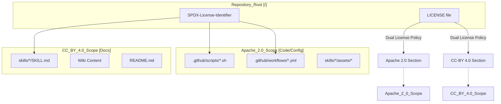
**Sources:** [LICENSE:1-11](), [.github/CODEOWNERS:1-2](), [SECURITY.md:1-2]()

---

## Security Policy & PSIRT

NVIDIA maintains a centralized security response framework. Security vulnerabilities must **not** be reported via public GitHub issues or Pull Requests [SECURITY.md:8-9]().

### Vulnerability Reporting Channels

If a potential security issue is identified, it must be directed to the NVIDIA Product Security Incident Response Team (PSIRT) [SECURITY.md:24-24]().

*   **Web Submission:** [Security Vulnerability Submission Form](https://www.nvidia.com/object/submit-security-vulnerability.html) [SECURITY.md:14-14]()
*   **Email:** `psirt@nvidia.com` [SECURITY.md:15-15]()
*   **Encryption:** NVIDIA provides a public PGP key for secure communication [SECURITY.md:16-16]()

### Coordinated Disclosure Process

NVIDIA follows a coordinated vulnerability disclosure policy. While there is no active bug bounty program, external reporters are acknowledged once an issue is addressed [SECURITY.md:24-24]().

**Data Flow: Security Reporting**
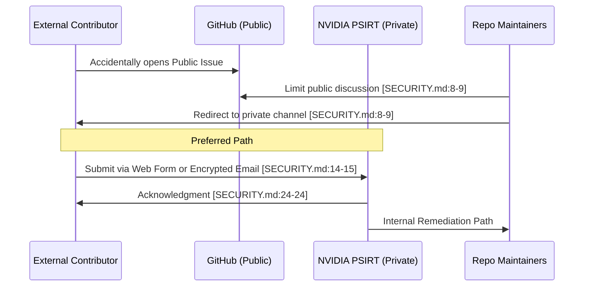
**Sources:** [SECURITY.md:4-29]()

---

## Governance & Code of Conduct

The project is governed by NVIDIA maintainers and adheres to the **Contributor Covenant (version 2.1)** [CODE_OF_CONDUCT.md:31-33]().

### Repository Ownership

Default ownership and final approval authority for the repository are assigned to the primary maintainers [ .github/CODEOWNERS:4-5]().

| Role | Responsibility |
| :--- | :--- |
| **Maintainers** | Reviewing PRs, investigating Code of Conduct reports, and managing PSIRT redirections [CODE_OF_CONDUCT.md:27-30](). |
| **Contributors** | Adhering to inclusive language standards and respectful engagement [CODE_OF_CONDUCT.md:12-19](). |

### Standards of Behavior

The repository enforces strict standards to ensure a professional environment:
*   **Positive Behavior:** Inclusive language, empathy, and constructive criticism [CODE_OF_CONDUCT.md:14-18]().
*   **Unacceptable Behavior:** Trolling, personal attacks, public/private harassment, and doxxing [CODE_OF_CONDUCT.md:22-25]().

### Enforcement Mechanism

Instances of unacceptable behavior can be reported by opening an issue or contacting the maintainers directly [CODE_OF_CONDUCT.md:27-29](). Maintainers have the authority to investigate and take appropriate action based on the circumstances [CODE_OF_CONDUCT.md:29-30]().

**Sources:** [CODE_OF_CONDUCT.md:1-34](), [.github/CODEOWNERS:1-6]()

---

## Sensitive Information Management

The repository uses a `.gitignore` configuration to prevent the accidental leakage of credentials, environment variables, and local development artifacts [ .gitignore:15-25]().

The following file patterns are explicitly blocked from the repository:
*   **Secrets:** `.env`, `.env.*`, `*.pem`, `*.key`, and `credentials.json` [ .gitignore:16-20]().
*   **Local Configs:** `*.local`, `*.local.*` [ .gitignore:23-24]().

**Sources:** [.gitignore:1-25]()

---

# Page: Catalog Architecture & Automation Pipeline

# Catalog Architecture & Automation Pipeline

<details>
<summary>Relevant source files</summary>

The following files were used as context for generating this wiki page:

- [.github/workflows/sync-skills.yml](.github/workflows/sync-skills.yml)
- [README.md](README.md)

</details>


The NVIDIA Agent Skills repository serves as a centralized, official catalog for AI agent skills across the NVIDIA ecosystem. Rather than requiring product teams to manually submit code changes to this repository, the architecture relies on an **automated synchronization pipeline**. This ensures that skills remain co-located with their primary source code in upstream product repositories while being easily discoverable and installable from a single source of truth.

### High-Level Architecture

The catalog architecture bridges the gap between decentralized product development and a centralized consumption point. It consists of three primary layers:

1.  **Source Layer (Product Repos):** Upstream repositories (e.g., `NVIDIA/cuopt`, `NVIDIA/TensorRT-LLM`) maintain their own skills in specific subdirectories (e.g., `.claude/skills` or `skills/`).
2.  **Registry Layer (`components.d/`):** A collection of YAML manifests in this repository that define where each product's skills live and where they should be mirrored in the catalog.
3.  **Automation Layer (GitHub Actions):** Workflows that aggregate these manifests, pull the latest content via sparse-checkout, and update the catalog and documentation.

### Code-to-System Mapping

The following diagram illustrates how logical system components map to specific code entities and files within the repository.

**System Entity Mapping**
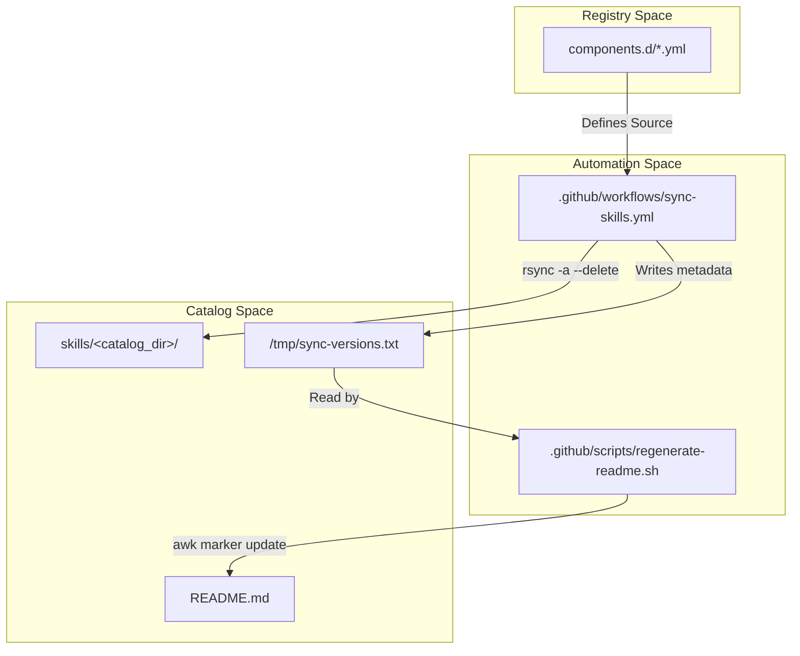
**Sources:** [.github/workflows/sync-skills.yml:5-10](), [.github/workflows/sync-skills.yml:106-106](), [.github/scripts/regenerate-readme.sh:1-10]()

---

## 2.1 Sync-Skills Workflow

The `sync-skills` workflow is the heartbeat of the catalog. It is a GitHub Action that runs twice daily or on-demand to mirror content from across the NVIDIA organization.

*   **Trigger Mechanism:** Operates on a cron schedule (`0 6,18 * * *`) and `workflow_dispatch` for manual runs [[.github/workflows/sync-skills.yml:14-18]()].
*   **Aggregation:** It uses `yq` to merge all individual product files in `components.d/*.yml` into a single temporary configuration [[.github/workflows/sync-skills.yml:55-56]()].
*   **Sparse Mirroring:** For each component, it performs a `git clone --sparse` to minimize bandwidth, then uses `rsync -a --delete` to ensure the `skills/` directory in this repo exactly matches the upstream source [[.github/workflows/sync-skills.yml:73-75](), [.github/workflows/sync-skills.yml:106-106]()].
*   **Change Detection:** If changes are detected, it automatically generates a Pull Request with a summary of updated components [[.github/workflows/sync-skills.yml:162-179]()].

For a deep dive into the cloning logic and failure reporting, see **[Sync-Skills Workflow](#2.1)**.

---

## 2.2 README Regeneration Script

To ensure the [README.md](README.md) accurately reflects the hundreds of skills in the catalog, the repository uses an automated regeneration script. This prevents the documentation from drifting out of sync with the actual files.

*   **Version Resolution:** The script reads from `sync-versions.txt` (generated during the sync) to resolve the exact short-SHA and commit date of the upstream source [[.github/workflows/sync-skills.yml:86-86](), [.github/scripts/regenerate-readme.sh:12-15]()].
*   **Table Generation:** It iterates through the `components.d/` registry to count skills and build the "Available Skills" Markdown table [[.github/scripts/regenerate-readme.sh:40-60]()].
*   **In-place Update:** It uses `awk` with specific marker pairs (`<!-- skills-table-start -->` and `<!-- skills-table-end -->`) to overwrite the table in the root README without affecting other sections [[README.md:48-48](), [.github/scripts/regenerate-readme.sh:120-130]()].

For details on the Markdown generation logic, see **[README Regeneration Script](#2.2)**.

---

## 2.3 Components Registry (components.d/)

The `components.d/` directory acts as the decentralized registry for the catalog. Each NVIDIA product team manages their own entry as a standalone YAML file.

*   **Decentralized Onboarding:** By using individual files, multiple teams can submit onboarding PRs simultaneously without causing merge conflicts in a shared configuration file [[.github/workflows/sync-skills.yml:51-54]()].
*   **Schema Requirements:** Each file must define a `repo`, a `name`, and a list of `skills` mapping a source `path` to a `catalog_dir` [[.github/workflows/sync-skills.yml:65-67](), [.github/workflows/sync-skills.yml:100-101]()].
*   **Uniqueness Constraint:** The `catalog_dir` must be unique across the entire repository to prevent products from overwriting each other's skills.

For the full YAML schema and registration guidelines, see **[Components Registry (components.d/)](#2.3)**.

**Catalog Update Pipeline Flow**
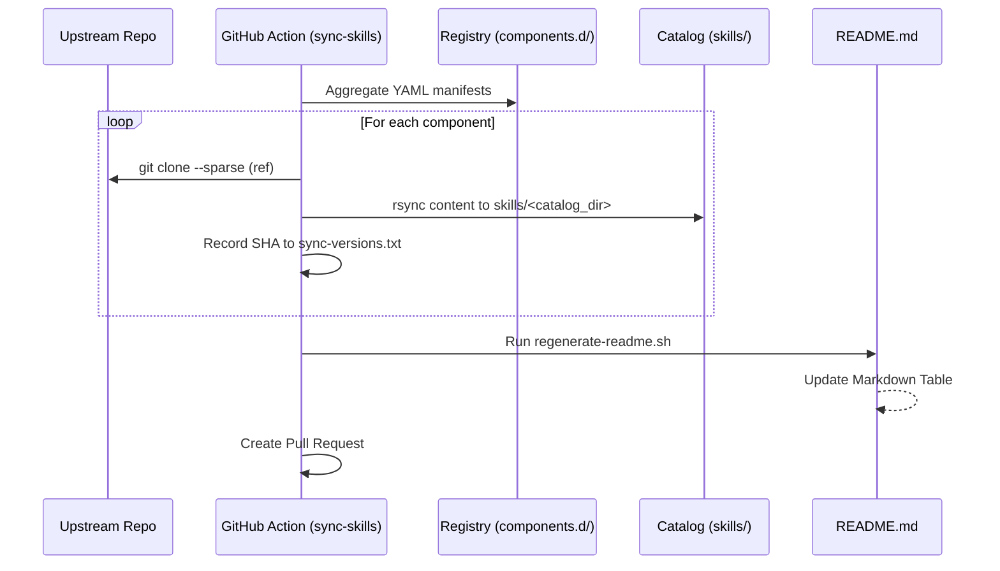
**Sources:** [.github/workflows/sync-skills.yml:55-130](), [.github/scripts/regenerate-readme.sh:1-20]()

---

# Page: Sync-Skills Workflow

# Sync-Skills Workflow

<details>
<summary>Relevant source files</summary>

The following files were used as context for generating this wiki page:

- [.github/workflows/dco.yml](.github/workflows/dco.yml)
- [.github/workflows/sync-skills.yml](.github/workflows/sync-skills.yml)
- [.github/workflows/verify-authors.yml](.github/workflows/verify-authors.yml)

</details>


The `sync-skills` workflow is the central automation engine of the NVIDIA Skills catalog. It is responsible for mirroring skill content from disparate upstream product repositories into the centralized `nvidia/skills` repository. This process ensures that the catalog remains a "single source of truth" for AI agents while allowing product teams to maintain their skills within their own development lifecycles.

## Workflow Overview

The workflow operates on a hub-and-spoke model. It aggregates configuration from `components.d/`, iterates through registered products, and performs surgical updates to the `skills/` directory.

### Triggers
The workflow is configured to run automatically and can be invoked manually for testing or immediate updates:
*   **Scheduled (Cron):** Runs twice daily at 06:00 UTC and 18:00 UTC `[.github/workflows/sync-skills.yml:15-17]()`.
*   **Manual (workflow_dispatch):** Allows maintainers to trigger a sync via the GitHub Actions UI `[.github/workflows/sync-skills.yml:18-18]()`.

### High-Level Data Flow

The following diagram illustrates the transition from the YAML configuration files in the "Natural Language Space" (where products are defined) to the execution logic in the "Code Entity Space".

**Sync Logic and Entity Mapping**

```mermaid
graph TD
    subgraph "Configuration Space"
        C1["components.d/*.yml"] -->|yq ea| AGG["/tmp/components.aggregated.yml"]
    end

    subgraph "Execution Space (.github/workflows/sync-skills.yml)"
        AGG -->|Loop i| LOOP["Component Iterator"]
        LOOP -->|yq .repo| CLONE["git clone --sparse"]
        LOOP -->|yq .skills[j].path| SPARSE["git sparse-checkout set"]
        LOOP -->|yq .skills[j].catalog_dir| SYNC["rsync -a --delete"]
    end

    subgraph "Target Space"
        SYNC -->|Mirror| DEST["skills/{catalog_dir}/"]
        DEST -->|Detect Change| PR["Create Pull Request"]
    end
    
    style AGG stroke-dasharray: 5 5
```
**Sources:** `[.github/workflows/sync-skills.yml:51-57]()`, `[.github/workflows/sync-skills.yml:64-67]()`, `[.github/workflows/sync-skills.yml:91-95]()`, `[.github/workflows/sync-skills.yml:105-106]()`

---

## Implementation Details

### 1. Configuration Aggregation
To simplify the iteration logic and allow concurrent onboarding PRs without merge conflicts, the workflow does not read a single global registry. Instead, it uses `yq` to aggregate all individual files in `components.d/*.yml` into a temporary array `[.github/workflows/sync-skills.yml:51-56]()`. This allows the subsequent bash loop to index components by position `[.github/workflows/sync-skills.yml:64-64]()`.

### 2. Secure Authentication
The workflow uses a GitHub Personal Access Token (PAT) named `SKILLS_SYNC_PAT` `[.github/workflows/sync-skills.yml:9-10]()`. To prevent the token from leaking into logs via clone URLs or error messages, the workflow configures a local git credential helper `[.github/workflows/sync-skills.yml:60-60]()`.

### 3. Sparse-Checkout Cloning
To minimize bandwidth and disk usage (crucial for large product monorepos), the workflow utilizes a multi-step shallow sparse-checkout:
1.  **Initial Clone:** Clones with `--depth 1`, `--filter=blob:none`, and `--sparse` `[.github/workflows/sync-skills.yml:73-75]()`.
2.  **Path Resolution:** Iterates through the `skills` array for the component to collect all required upstream paths `[.github/workflows/sync-skills.yml:89-94]()`.
3.  **Checkout Refinement:** Executes `git sparse-checkout set` to pull only the specific directories containing `SKILL.md` files and assets `[.github/workflows/sync-skills.yml:95-95]()`.

### 4. Mirroring and Change Detection
The actual synchronization is performed using `rsync` with the `--delete` flag `[.github/workflows/sync-skills.yml:106-106]()`. This ensures that if a skill is removed from the upstream product repo, it is also removed from the catalog.

The workflow distinguishes between a "successful sync" and an "actual change":
*   **Successful Sync:** Recorded in `/tmp/rsynced-components.txt` if the source directory exists and is not empty `[.github/workflows/sync-skills.yml:119-120]()`.
*   **Content Change:** Detected via `git status --porcelain`. If the local `skills/` directory shows modifications after `rsync`, the component is added to `/tmp/changed-components.txt` `[.github/workflows/sync-skills.yml:123-127]()`.

**Mirroring Logic Flow**

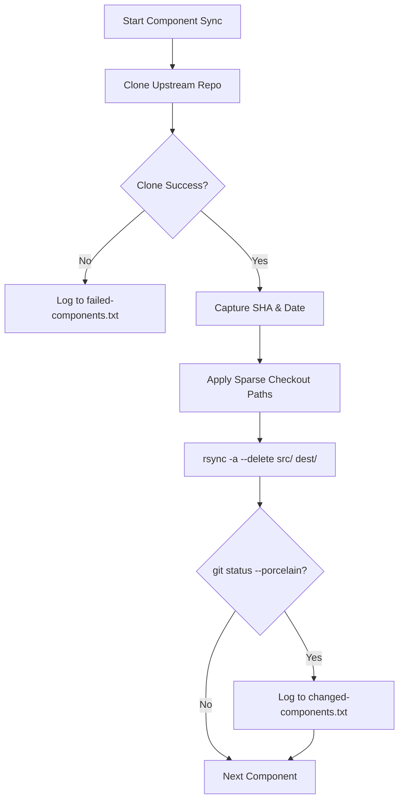
**Sources:** `[.github/workflows/sync-skills.yml:73-86]()`, `[.github/workflows/sync-skills.yml:106-127]()`

---

## Post-Processing and PR Creation

### README Regeneration
Once all components are processed, the workflow calls `.github/scripts/regenerate-readme.sh` `[.github/workflows/sync-skills.yml:142-142]()`. This script uses the metadata captured during the sync (stored in `/tmp/sync-versions.txt`) to update the "Version" column in the main README tables, providing traceability back to the upstream commit SHAs `[.github/workflows/sync-skills.yml:81-86]()`.

### Automated Pull Request
If changes are detected, the workflow creates a Pull Request using `peter-evans/create-pull-request` `[.github/workflows/sync-skills.yml:180-205]()`. 
*   **Branch Name:** `automated/sync-skills` `[.github/workflows/sync-skills.yml:187-187]()`.
*   **Exemptions:** This branch is explicitly exempted from **DCO (Developer Certificate of Origin)** checks `[.github/workflows/dco.yml:40-43]()` and **Author Verification** checks `[.github/workflows/verify-authors.yml:45-48]()`, as it is a bot-managed mirror.

### Error Handling and Reporting
The workflow includes a safety check to fail the job if *nothing* was synced, which usually indicates a network or credential failure `[.github/workflows/sync-skills.yml:134-139]()`. 

If specific components fail (e.g., a directory was renamed upstream), the workflow:
1.  Logs the failure to `/tmp/failed-components.txt` `[.github/workflows/sync-skills.yml:77-77]()`.
2.  Summarizes these failures in the resulting PR body `[.github/workflows/sync-skills.yml:170-174]()`.
3.  Creates a GitHub Issue if the sync job itself fails, ensuring visibility for maintainers `[.github/workflows/sync-skills.yml:211-224]()`.

| Feature | Implementation |
| :--- | :--- |
| **Tooling** | `yq`, `rsync`, `git sparse-checkout` |
| **Temporary Files** | `/tmp/components.aggregated.yml`, `/tmp/sync-versions.txt` |
| **Concurrency** | Grouped by `sync-skills` with `cancel-in-progress: true` `[.github/workflows/sync-skills.yml:25-27]()` |
| **Traceability** | Upstream SHA, short SHA, and commit date captured per component `[.github/workflows/sync-skills.yml:81-84]()` |

**Sources:** `[.github/workflows/sync-skills.yml:25-27]()`, `[.github/workflows/sync-skills.yml:81-84]()`, `[.github/workflows/sync-skills.yml:142-142]()`, `[.github/workflows/sync-skills.yml:180-205]()`, `[.github/workflows/sync-skills.yml:211-224]()`

---

# Page: README Regeneration Script

# README Regeneration Script

<details>
<summary>Relevant source files</summary>

The following files were used as context for generating this wiki page:

- [.github/scripts/regenerate-readme.sh](.github/scripts/regenerate-readme.sh)

</details>


The `regenerate-readme.sh` script is a bash-based automation utility responsible for maintaining the `README.md` file of the NVIDIA Agent Skills catalog. It ensures that the summary tables—specifically the "Available Skills" and "Getting Help & Contributing" sections—accurately reflect the current state of the repository's YAML configurations and synchronized skill content.

This script is typically executed as part of the `.github/workflows/sync-skills.yml` workflow to update the catalog's landing page after new skills are synchronized from upstream repositories.

### Logic Flow and Data Transformation

The script operates by aggregating individual component definitions, calculating skill metrics, resolving version metadata, and performing an in-place update of the `README.md` using `awk` marker pairs.

#### 1. YAML Aggregation and Sorting
The script begins by consolidating all individual YAML files located in `components.d/` into a single temporary aggregate file [`.github/scripts/regenerate-readme.sh:25-28`](). This allows for global indexing and sorting across all registered products.

#### 2. Skill Counting
For each component, the script traverses the local `skills/` directory corresponding to the `catalog_dir` defined in the YAML. It recursively searches for `SKILL.md` files to generate an accurate count of available skills per product [`.github/scripts/regenerate-readme.sh:45-51`]().

#### 3. Version Resolution
The script attempts to resolve version information from a metadata file (defaulting to `/tmp/sync-versions.txt`). This file, populated by the sync workflow, contains the upstream short SHA, full SHA, and committer date [`.github/scripts/regenerate-readme.sh:9-12`](). If the file is present, the script formats a Markdown link to the specific upstream commit [`.github/scripts/regenerate-readme.sh:54-60`]().

#### 4. Table Generation and Injection
The script generates two distinct Markdown tables:
*   **Available Skills Table**: Lists Product name, description, skill count, catalog path, source link, and version [`.github/scripts/regenerate-readme.sh:32-65`]().
*   **Getting Help & Contributing Table**: Lists Product name and links to Issues, Discussions, Contributing guidelines, and Security policies [`.github/scripts/regenerate-readme.sh:67-95`]().

Finally, it uses `awk` to inject these tables into the `README.md` file between specific HTML comment markers [`.github/scripts/regenerate-readme.sh:97-127`]().

**README Regeneration Data Flow**

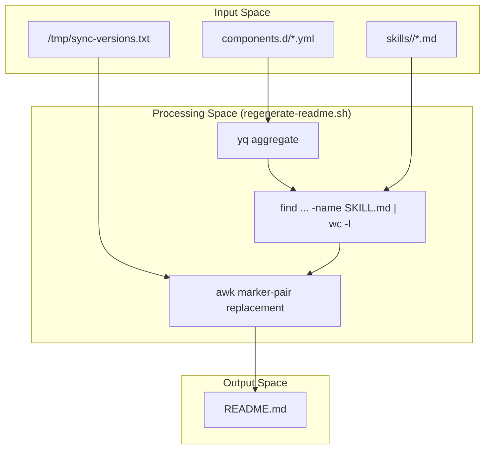

**Sources:**
* [`.github/scripts/regenerate-readme.sh:1-131`]()

### Key Functions and Operations

The script relies on standard Unix utilities and `yq` for structured data manipulation.

| Operation | Implementation Detail | Code Reference |
|:---|:---|:---|
| **Aggregation** | Uses `yq ea` to merge all component YAMLs into a single `.components` list. | [`.github/scripts/regenerate-readme.sh:27-28`]() |
| **Sorting** | Sorts components alphabetically by name (case-insensitive) to ensure stable README ordering. | [`.github/scripts/regenerate-readme.sh:30`]() |
| **Skill Discovery** | Uses `find` and `wc -l` to count `SKILL.md` files within the `skills/` directory tree. | [`.github/scripts/regenerate-readme.sh:48`]() |
| **Link Construction** | Dynamically builds GitHub URLs for source code, issues, and security policies based on YAML `repo` and `ref` fields. | [`.github/scripts/regenerate-readme.sh:62-63`]() |
| **In-place Update** | Employs an `awk` state machine to identify `<!-- start -->` and `<!-- end -->` markers. | [`.github/scripts/regenerate-readme.sh:98-125`]() |

**Code Entity to Document Section Mapping**

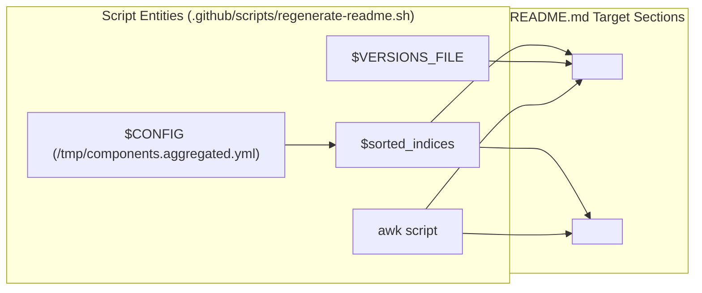

**Sources:**
* [`.github/scripts/regenerate-readme.sh:23-30`]()
* [`.github/scripts/regenerate-readme.sh:98-125`]()

### Marker Pair System

The script uses a strict marker pair system to identify where to inject content. This allows the rest of the `README.md` (headers, introduction, installation instructions) to be edited manually without being overwritten by the automation.

| Start Marker | End Marker | Target Content |
|:---|:---|:---|
| `<!-- skills-table-start -->` | `<!-- skills-table-end -->` | Product catalog summary, skill counts, and versions. |
| `<!-- help-table-start -->` | `<!-- help-table-end -->` | Support links (Issues, Discussions, Contributing). |

The `awk` logic [`.github/scripts/regenerate-readme.sh:98-125`]() works by:
1.  Printing lines from the original file until a "start" marker is found.
2.  Printing the marker itself.
3.  Reading and printing the entire content of the newly generated table file.
4.  Setting a skip flag (`in_skills` or `in_help`) to ignore lines from the original file until the "end" marker is reached.
5.  Printing the "end" marker and resuming normal output.

**Sources:**
* [`.github/scripts/regenerate-readme.sh:15-17`]()
* [`.github/scripts/regenerate-readme.sh:98-125`]()

---

# Page: Components Registry (components.d/)

# Components Registry (components.d/)

<details>
<summary>Relevant source files</summary>

The following files were used as context for generating this wiki page:

- [components.d/README.md](components.d/README.md)
- [components.d/cuda-q.yml](components.d/cuda-q.yml)
- [components.d/cuopt.yml](components.d/cuopt.yml)
- [components.d/megatron-bridge.yml](components.d/megatron-bridge.yml)
- [components.d/megatron-core.yml](components.d/megatron-core.yml)
- [components.d/model-optimizer.yml](components.d/model-optimizer.yml)
- [components.d/nemo-evaluator.yml](components.d/nemo-evaluator.yml)
- [components.d/nemo-gym.yml](components.d/nemo-gym.yml)
- [components.d/nemoclaw.yml](components.d/nemoclaw.yml)
- [components.d/nemotron-voice-agent.yml](components.d/nemotron-voice-agent.yml)
- [components.d/rag-blueprint.yml](components.d/rag-blueprint.yml)
- [components.d/tensorrt-llm.yml](components.d/tensorrt-llm.yml)
- [components.d/tilegym.yml](components.d/tilegym.yml)
- [components.d/video-search-and-summarization.yml](components.d/video-search-and-summarization.yml)

</details>


The `components.d/` directory serves as the source of truth for all NVIDIA products integrated into the Skills catalog. It utilizes a decentralized configuration model where each product or component is defined in its own YAML file. This architecture prevents merge conflicts during simultaneous onboarding and allows the automation pipeline to scale across multiple NVIDIA engineering teams [components.d/README.md:4-6]().

## Configuration Schema

Each YAML file in `components.d/` must follow a specific schema to be successfully parsed by the `sync-skills.yml` workflow and the `regenerate-readme.sh` script.

### Required Fields
The following fields are mandatory for every component [components.d/README.md:14-29]():

| Field | Type | Description |
| :--- | :--- | :--- |
| `name` | `string` | The display name used in the README tables (e.g., `Megatron-Core`). |
| `repo` | `string` | The source GitHub repository in `owner/repo` format. |
| `description` | `string` | A concise one-line summary of the component's capabilities. |
| `skills` | `list` | A list of source/destination mappings for skill files. |

Each entry in the `skills` list requires:
*   `path`: The directory in the **upstream** repository where the `SKILL.md` files are located.
*   `catalog_dir`: The unique directory name under `skills/` in **this** repository where the skills will be mirrored.

### Optional Fields
These fields allow for fine-grained control over the synchronization and documentation generation [components.d/README.md:30-37]():

| Field | Default | Description |
| :--- | :--- | :--- |
| `ref` | `main` | The git branch or tag to sync from in the source repository. |
| `links.contributing` | `CONTRIBUTING.md` | Path to the contributing guide in the source repo. |
| `links.discussions` | `true` | Boolean to enable/disable the Discussions link in the README. |
| `links.security` | `true` | Boolean to enable/disable the Security link in the README. |

**Sources:** [components.d/README.md:14-37](), [components.d/megatron-core.yml:1-9]()

---

## Data Flow: From YAML to Catalog

The registry acts as the input for the aggregation logic. The system bridges the "Natural Language Space" (Product Names/Descriptions) to the "Code Entity Space" (Repository Paths/Local Directories) through a multi-step workflow.

### Component Aggregation Logic
The `sync-skills.yml` workflow uses `yq` to aggregate all individual files into a single temporary manifest [components.d/README.md:64-70]():

**Aggregation and Sync Process**
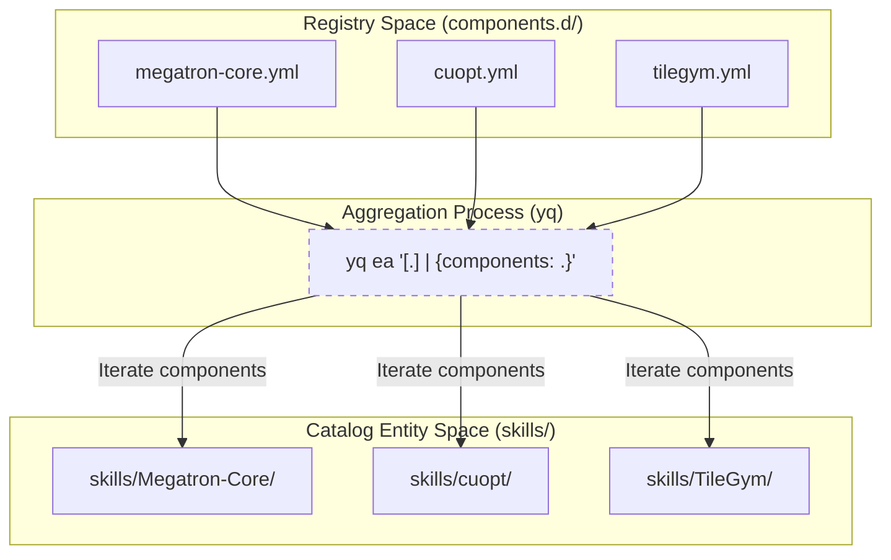
**Sources:** [components.d/README.md:64-73](), [components.d/megatron-core.yml:1-6](), [components.d/cuopt.yml:1-6](), [components.d/tilegym.yml:1-6]()

---

## Multi-Skill Components

Some NVIDIA products distribute skills across multiple sub-packages within their repository. The registry supports this by allowing multiple entries in the `skills` list. Each entry must have a unique `catalog_dir` to prevent file collisions during the rsync process [components.d/README.md:51-62]().

**Example: NeMo Evaluator Configuration**
```yaml
name: NeMo Evaluator
repo: NVIDIA-NeMo/Evaluator
description: LLM evaluation — launch evaluations, access MLflow results...
skills:
  - path: packages/nemo-evaluator-launcher/.claude/skills/
    catalog_dir: NeMo-Evaluator-Launcher
  - path: packages/nemo-evaluator/.claude/skills/
    catalog_dir: NeMo-Evaluator
```
**Sources:** [components.d/nemo-evaluator.yml:1-9](), [components.d/README.md:53-62]()

---

## Registered NVIDIA Products

The following table details the primary components currently registered in the `components.d/` registry and their corresponding source-to-catalog mappings.

| Product Name | Source Repo | Catalog Directory |
| :--- | :--- | :--- |
| **Megatron-Core** | `NVIDIA/Megatron-LM` | `Megatron-Core` [components.d/megatron-core.yml:1-6]() |
| **Megatron-Bridge** | `NVIDIA-NeMo/Megatron-Bridge` | `Megatron-Bridge` [components.d/megatron-bridge.yml:1-6]() |
| **cuOpt** | `NVIDIA/cuopt` | `cuopt` [components.d/cuopt.yml:1-6]() |
| **TileGym** | `NVIDIA/TileGym` | `TileGym` [components.d/tilegym.yml:1-6]() |
| **NemoClaw** | `NVIDIA/NemoClaw` | `NemoClaw` [components.d/nemoclaw.yml:1-6]() |
| **CUDA-Q** | `NVIDIA/cuda-quantum` | `CUDA-Q` [components.d/cuda-q.yml:1-6]() |
| **Model-Optimizer** | `NVIDIA/Model-Optimizer` | `Model-Optimizer` [components.d/model-optimizer.yml:1-6]() |
| **NeMo Gym** | `NVIDIA-NeMo/Gym` | `NeMo-Gym` [components.d/nemo-gym.yml:1-6]() |
| **VSS Blueprint** | `NVIDIA-AI-Blueprints/video-search-and-summarization` | `video-search-and-summarization` [components.d/video-search-and-summarization.yml:1-6]() |
| **Nemotron Voice Agent** | `NVIDIA-AI-Blueprints/nemotron-voice-agent` | `nemotron-voice-agent` [components.d/nemotron-voice-agent.yml:1-6]() |

### Implementation Constraints
1.  **Uniqueness:** The `catalog_dir` must be unique across all files in `components.d/`. This is the directory name created under the root `skills/` folder [components.d/README.md:28]().
2.  **Naming Convention:** Component files should be named using a lowercased slug with dashes (e.g., `nemotron-voice-agent.yml`) [components.d/README.md:10]().
3.  **Path Resolution:** The `path` field is relative to the root of the `repo` defined in the same file [components.d/README.md:27]().

**Sources:** [components.d/README.md:1-73](), [components.d/cuda-q.yml:1-9](), [components.d/nemo-evaluator.yml:1-9](), [components.d/video-search-and-summarization.yml:1-7]()

---

# Page: Skill Catalog: Product Skills Reference

# Skill Catalog: Product Skills Reference

<details>
<summary>Relevant source files</summary>

The following files were used as context for generating this wiki page:

- [README.md](README.md)
- [skills/Megatron-Core/run-on-slurm/SKILL.md](skills/Megatron-Core/run-on-slurm/SKILL.md)
- [skills/cuopt/skill-evolution/SKILL.md](skills/cuopt/skill-evolution/SKILL.md)

</details>


This page provides a high-level overview of the NVIDIA product skill collections hosted in the `skills/` directory. Each collection is a set of verified, portable instructions—following the [SKILL.md specification](https://agentskills.io/specification)—designed to teach AI agents how to use NVIDIA libraries and platforms correctly.

The catalog is a mirrored repository; skills are maintained in their respective product repositories and synchronized daily to this central location. [README.md:16-18]().

## Skill Catalog Overview

The following diagram illustrates how product-specific code entities and workflows are mapped into the skill catalog structure, bridging the gap between natural language requests and actionable code.

### Natural Language to Code Entity Mapping
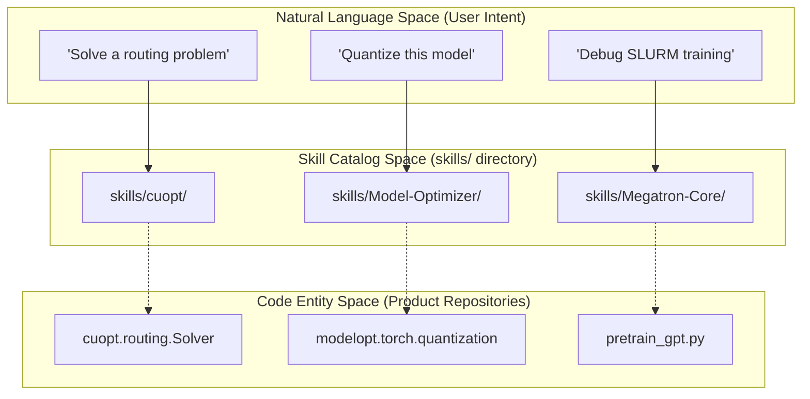
**Sources:** [README.md:14-16](), [skills/Megatron-Core/run-on-slurm/SKILL.md:54-55]()

---

## Product Skill Collections

### 3.1. Megatron-Core Skills
Focuses on large-scale distributed LLM training. Includes skills for build management, SLURM execution, CI/CD, and hardware-specific onboarding for GB200 systems.
*   **Key Entities:** `pretrain_gpt.py`, `torch.distributed.run`.
*   **For details, see [Megatron-Core Skills](#3.1).**

### 3.2. Megatron-Bridge Skills
Provides the integration layer between NeMo and Megatron-Core. Skills cover model conversion, resiliency, and performance optimizations like Mixture of Experts (MoE) and FSDP.
*   **For details, see [Megatron-Bridge Skills](#3.2).**

### 3.3. TensorRT-LLM Skills
Covers the full lifecycle of LLM inference optimization, from writing custom kernels using CuTe or Triton to performance profiling with Nsight Systems.
*   **Key Entities:** `Nsight Systems`, `CUDA Graphs`, `Triton`.
*   **For details, see [TensorRT-LLM Skills](#3.3).**

### 3.4. cuOpt Skills
Detailed guidance for the NVIDIA cuOpt optimization solver. Includes Python/C API usage, routing engine configuration, and the "Skill Evolution" framework for self-improving agents.
*   **Key Entities:** `cuopt.routing.Solver`, `LinearExpression`.
*   **For details, see [cuOpt Skills](#3.4).**

### 3.5. NemoClaw Skills
Skills for managing NVIDIA's secure AI agent sandbox. Covers the four-layer security model, including `OpenShell` gateway enforcement and `Landlock LSM` isolation.
*   **For details, see [NemoClaw Skills](#3.5).**

### 3.6. TileGym Skills
Focuses on GPU kernel development. Teaches agents to use the `cuTile` Python DSL for kernel creation and subsequent conversion to Triton or Julia.
*   **For details, see [TileGym Skills](#3.6).**

### 3.7. Model Optimizer Skills
Covers post-training quantization (PTQ), sparsity, and distillation using `ModelOpt`. Includes workflows for MLflow monitoring and deployment.
*   **For details, see [Model Optimizer Skills](#3.7).**

### 3.8. NeMo Evaluator & NeMo Gym Skills
Skills for launching LLM evaluations and managing RL training environments. Includes the NeMo Evaluator Launcher (NEL) and reward profiling.
*   **For details, see [NeMo Evaluator & NeMo Gym Skills](#3.8).**

### 3.9. AI Blueprint & Application Skills
High-level application skills for NVIDIA Blueprints, including RAG, Video Search & Summarization (VSS), and Nemotron Voice Agent deployment.
*   **For details, see [AI Blueprint & Application Skills](#3.9).**

---

## Skill Architecture & Evolution

Skills are not static; they are designed to evolve based on user interactions and failure patterns. The `skill-evolution` framework (pioneered in cuOpt) allows agents to detect generalizable learnings and propose updates to the `SKILL.md` files. [skills/cuopt/skill-evolution/SKILL.md:4-9]().

### Skill Evolution Workflow
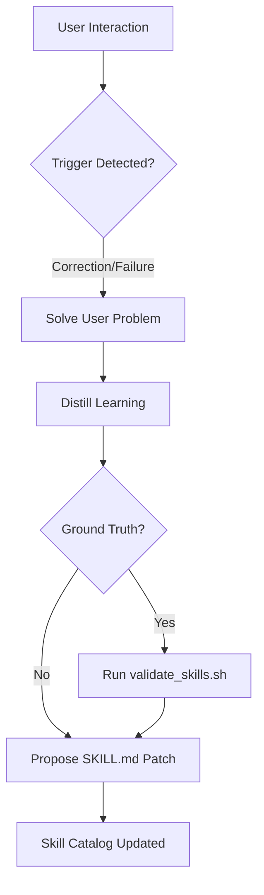
**Sources:** [skills/cuopt/skill-evolution/SKILL.md:11-32](), [skills/cuopt/skill-evolution/SKILL.md:87-89]()

### The SKILL.md Specification
Every skill in the catalog must adhere to the standard format, featuring a YAML frontmatter for agent discovery and a Markdown body for instruction.
*   **Required Fields:** `name`, `description`, `when_to_use`. [skills/Megatron-Core/run-on-slurm/SKILL.md:1-5]()
*   **Validation:** Skills are verified via `validate_skills.sh` and asset tests in `ci/test_skills_assets.sh`. [skills/cuopt/skill-evolution/SKILL.md:61-63]()

**Sources:**
*   [README.md:46-65]()
*   [skills/cuopt/skill-evolution/SKILL.md:1-86]()
*   [skills/Megatron-Core/run-on-slurm/SKILL.md:1-5]()

---

# Page: Megatron-Core Skills

# Megatron-Core Skills

<details>
<summary>Relevant source files</summary>

The following files were used as context for generating this wiki page:

- [skills/Megatron-Core/build-and-dependency/SKILL.md](skills/Megatron-Core/build-and-dependency/SKILL.md)
- [skills/Megatron-Core/cicd/SKILL.md](skills/Megatron-Core/cicd/SKILL.md)
- [skills/Megatron-Core/create-issue/SKILL.md](skills/Megatron-Core/create-issue/SKILL.md)
- [skills/Megatron-Core/linting-and-formatting/SKILL.md](skills/Megatron-Core/linting-and-formatting/SKILL.md)
- [skills/Megatron-Core/nightly-sync/SKILL.md](skills/Megatron-Core/nightly-sync/SKILL.md)
- [skills/Megatron-Core/onboard-gb200-1node-tests/SKILL.md](skills/Megatron-Core/onboard-gb200-1node-tests/SKILL.md)
- [skills/Megatron-Core/respond-to-issue/SKILL.md](skills/Megatron-Core/respond-to-issue/SKILL.md)
- [skills/Megatron-Core/run-on-slurm/SKILL.md](skills/Megatron-Core/run-on-slurm/SKILL.md)
- [skills/Megatron-Core/split-pr/SKILL.md](skills/Megatron-Core/split-pr/SKILL.md)
- [skills/Megatron-Core/testing/SKILL.md](skills/Megatron-Core/testing/SKILL.md)
- [skills/cuopt/skill-evolution/SKILL.md](skills/cuopt/skill-evolution/SKILL.md)

</details>


The Megatron-Core (MCore) skill set provides comprehensive technical guidance for the lifecycle of the Megatron-LM training framework. This includes environment setup via containers, dependency management with `uv`, distributed execution on SLURM clusters, CI/CD pipeline navigation, and automated issue triage. These skills are designed to ensure consistency between local development and the high-performance computing (HPC) environments where Megatron-LM is deployed.

## Environment & Dependency Management

Megatron-Core utilizes a container-first development model to ensure that complex native extensions (such as TransformerEngine or DeepEP) and specific CUDA/NCCL versions are consistent across all environments.

### Build and Dependency Workflow
The framework uses `uv` for Python package management. All `uv` operations, including dependency resolution and locking, must be performed inside the designated CI container to ensure compatibility with the pre-installed system libraries [skills/Megatron-Core/build-and-dependency/SKILL.md:9-11]().

| Image Variant | Purpose | Key Markers |
| :--- | :--- | :--- |
| `dev` | Default for CI and most PRs; includes bleeding-edge extras like ModelOpt [skills/Megatron-Core/build-and-dependency/SKILL.md:37-37](). | `@pytest.mark.flaky_in_dev` [skills/Megatron-Core/build-and-dependency/SKILL.md:43-43]() |
| `lts` | Stability testing; excludes experimental extras [skills/Megatron-Core/build-and-dependency/SKILL.md:38-38](). | `@pytest.mark.flaky` [skills/Megatron-Core/build-and-dependency/SKILL.md:44-44]() |

### Code Formatting and Linting
The project enforces strict style rules using a suite of tools including `ruff`, `black`, `isort`, `pylint`, and `mypy` [skills/Megatron-Core/linting-and-formatting/SKILL.md:23-23](). Developers should run `tools/autoformat.sh` before opening a PR [skills/Megatron-Core/linting-and-formatting/SKILL.md:12-13]().

**Sources:** [skills/Megatron-Core/build-and-dependency/SKILL.md:1-207](), [skills/Megatron-Core/linting-and-formatting/SKILL.md:1-58]()

## Distributed Execution on SLURM

Launching Megatron-LM on a cluster requires specific environment configurations to handle multi-node communication and hardware-specific optimizations.

### SLURM Execution Logic
Training jobs are typically submitted via `sbatch` using a script that configures `torch.distributed.run` [skills/Megatron-Core/run-on-slurm/SKILL.md:48-57](). A critical configuration parameter is `CUDA_DEVICE_MAX_CONNECTIONS`, which prevents deadlocks in specific parallelism modes [skills/Megatron-Core/run-on-slurm/SKILL.md:73-75]().

**SLURM Configuration Entities**
The following diagram maps SLURM environment variables to the distributed training logic.

"SLURM to Distributed Mapping"
```mermaid
graph TD
    subgraph "SLURM_Environment"
        ["SLURM_JOB_NODELIST"] --> ["MASTER_ADDR"]
        ["SLURM_NNODES"] --> ["NNODES"]
        ["SLURM_NODEID"] --> ["NODE_RANK"]
    end

    subgraph "Execution_Command"
        ["uv_run_python"] -- "-m" --> ["torch.distributed.run"]
        ["torch.distributed.run"] -- "--nnodes" --> ["NNODES"]
        ["torch.distributed.run"] -- "--node-rank" --> ["NODE_RANK"]
        ["torch.distributed.run"] -- "--master-addr" --> ["MASTER_ADDR"]
    end

    ["CUDA_DEVICE_MAX_CONNECTIONS"] -- "Value=1" --> ["TP_or_CP_Pre_Blackwell"]
    ["CUDA_DEVICE_MAX_CONNECTIONS"] -- "Value=32" --> ["overlap_moe_expert_parallel_comm"]
```
**Sources:** [skills/Megatron-Core/run-on-slurm/SKILL.md:1-115]()

## Testing Framework

The MCore test system is divided into unit tests and functional (integration) tests, managed via `pytest` and `nemo-run`.

### Test Hierarchy
*   **Unit Tests:** Located in `tests/unit_tests/`. These require 8 GPUs and are dispatched via `torch.distributed.run` [skills/Megatron-Core/testing/SKILL.md:15-15]().
*   **Functional Tests:** Located in `tests/functional_tests/`. These involve end-to-end training runs and compare results against "golden values" [skills/Megatron-Core/testing/SKILL.md:16-20]().

### Recipe Management
Tests are defined in YAML recipes (e.g., in `tests/test_utils/recipes/h100/`) which use a `products` block to expand test cases across different environments and platforms [skills/Megatron-Core/testing/SKILL.md:52-57]().

**Sources:** [skills/Megatron-Core/testing/SKILL.md:1-194]()

## CI/CD and Issue Management

MCore uses a complex GitHub Actions pipeline (`.github/workflows/cicd-main.yml`) that integrates with internal NVIDIA GitLab CI for hardware-intensive tests [skills/Megatron-Core/cicd/SKILL.md:13-15]().

### CI Triage and Response
Automated skills assist maintainers in triaging failures and responding to community issues:
1.  **Failure Triage:** The `create-issue` skill parses GitHub Action logs, identifies the root cause (e.g., Python traceback or NCCL timeout), and files a bug report assigned to the last author of the failing test [skills/Megatron-Core/create-issue/SKILL.md:9-12]().
2.  **Issue Response:** The `respond-to-issue` skill researches the codebase and git history to draft technically grounded replies to external contributors [skills/Megatron-Core/respond-to-issue/SKILL.md:9-11]().
3.  **PR Splitting:** To reduce the review bottleneck, the `split-pr` skill analyzes `CODEOWNERS` to break large PRs into smaller units targeting specific reviewer groups [skills/Megatron-Core/split-pr/SKILL.md:9-15]().

### CI Control Labels
The pipeline behavior is controlled by PR labels [skills/Megatron-Core/cicd/SKILL.md:36-38]():

| Label | Effect |
| :--- | :--- |
| `Run tests` | Lightweight suite (4 steps, no golden-value check) [skills/Megatron-Core/cicd/SKILL.md:45-45](). |
| `Run functional tests` | Full suite (100 steps + golden-value comparison) [skills/Megatron-Core/cicd/SKILL.md:46-46](). |
| `container::lts` | Switches the base image to the LTS variant [skills/Megatron-Core/cicd/SKILL.md:53-53](). |

**Sources:** [skills/Megatron-Core/cicd/SKILL.md:1-171](), [skills/Megatron-Core/create-issue/SKILL.md:1-188](), [skills/Megatron-Core/respond-to-issue/SKILL.md:1-66](), [skills/Megatron-Core/split-pr/SKILL.md:1-64]()

## Specialized Workflows

### Nightly Main-to-Dev Sync
A specialized bot manages the nightly merge of the `main` branch into `dev`. This workflow includes sophisticated conflict resolution to handle "squash-merge chains" where Git's default merge logic might incorrectly discard newer changes in the `dev` branch [skills/Megatron-Core/nightly-sync/SKILL.md:31-36]().

### GB200 Test Onboarding
For new Blackwell (GB200) hardware, the `onboard-gb200-1node-tests` skill provides a systematic way to convert 2-node functional tests into 1-node variants by adapting parallelism parameters like Tensor Parallel (TP) and Pipeline Parallel (PP) to fit within 4 GPUs [skills/Megatron-Core/onboard-gb200-1node-tests/SKILL.md:9-13]().

"Onboarding Data Flow"
```mermaid
graph LR
    subgraph "Source_Recipes"
        ["gpt.yaml"] -- "8_GPUs" --> ["mr_scoped_tests"]
        ["moe.yaml"] -- "8_GPUs" --> ["mr_scoped_tests"]
    end

    subgraph "Adaptation_Logic"
        ["mr_scoped_tests"] -- "Read" --> ["model_config.yaml"]
        ["model_config.yaml"] -- "TP_x_PP_gt_4" --> ["Reduce_PP"]
        ["model_config.yaml"] -- "EP_gt_4" --> ["Reduce_EP"]
    end

    subgraph "Target_Recipes"
        ["Reduce_PP"] --> ["gpt-1node.yaml"]
        ["Reduce_EP"] --> ["moe-1node.yaml"]
        ["gpt-1node.yaml"] -- "4_GPUs" --> ["mr-github_scope"]
    end
```
**Sources:** [skills/Megatron-Core/nightly-sync/SKILL.md:1-155](), [skills/Megatron-Core/onboard-gb200-1node-tests/SKILL.md:1-150]()

---

# Page: Megatron-Bridge Skills

# Megatron-Bridge Skills

<details>
<summary>Relevant source files</summary>

The following files were used as context for generating this wiki page:

- [skills/Megatron-Bridge/adding-model-support/SKILL.md](skills/Megatron-Bridge/adding-model-support/SKILL.md)
- [skills/Megatron-Bridge/mlm-bridge-training/SKILL.md](skills/Megatron-Bridge/mlm-bridge-training/SKILL.md)
- [skills/Megatron-Bridge/resiliency/SKILL.md](skills/Megatron-Bridge/resiliency/SKILL.md)

</details>


Megatron-Bridge serves as the integration layer between NeMo and Megatron-Core, enabling high-performance LLM and VLM training with advanced features like resiliency, model-specific optimizations, and seamless configuration translation.

## 1. Model Support & Onboarding

Adding support for new model families involves a multi-phase process of configuration discovery, weight mapping, and provider registration.

### 1.1 Discovery and Analysis
The process begins by analyzing the HuggingFace `config.json` to extract architectural parameters such as `model_type`, `hidden_size`, and `num_attention_heads` [skills/Megatron-Bridge/adding-model-support/SKILL.md:17-27](). A critical distinction is made between LLMs and VLMs based on the presence of `text_config` and `vision_config` [skills/Megatron-Bridge/adding-model-support/SKILL.md:30-44]().

### 1.2 Weight Dequantization
Megatron-Bridge does not automatically dequantize weights during import. If a model uses FP8 or FP4, it must be dequantized before conversion either via a standalone script or by overriding `maybe_modify_loaded_hf_weight()` in the bridge class [skills/Megatron-Bridge/adding-model-support/SKILL.md:45-76]().

### 1.3 Implementation Patterns
- **LLMs**: Typically require only a bridge file registering the model and implementing `provider_bridge()` and `mapping_registry()` [skills/Megatron-Bridge/adding-model-support/SKILL.md:127-132]().
- **VLMs**: Often require a custom `Provider` subclass and a model class that combines a vision encoder with a language decoder [skills/Megatron-Bridge/adding-model-support/SKILL.md:134-140]().

### Model Onboarding Entity Map
The following diagram maps the conceptual model onboarding steps to the specific code entities in the Megatron-Bridge directory structure.

"Model Onboarding Entity Map"
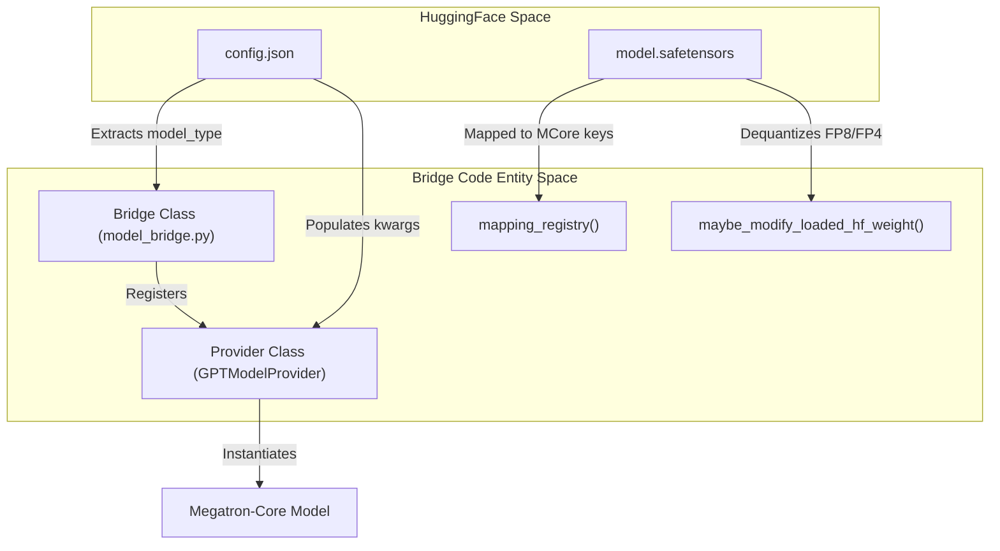
Sources: [skills/Megatron-Bridge/adding-model-support/SKILL.md:17-140]()

---

## 2. Training & Correlation

Megatron-Bridge allows users to run training using recipes that translate NeMo-style configurations into Megatron-Core parameters.

### 2.1 Correlation Testing
To ensure parity with Megatron-LM (MLM), users perform correlation runs using the `vanilla_gpt_pretrain_config`. This matches the bare defaults of `pretrain_gpt.py` [skills/Megatron-Bridge/mlm-bridge-training/SKILL.md:13-18]().

### 2.2 Execution
Training is launched via `scripts/training/run_recipe.py` using `uv run` to manage the environment [skills/Megatron-Bridge/mlm-bridge-training/SKILL.md:40-50]().

| Feature | Megatron-LM Argument | Bridge Configuration Override |
|---|---|---|
| Layers | `--num-layers` | `model.num_layers` |
| Parallelism | `--tensor-model-parallel-size` | `model.tensor_model_parallel_size` |
| Sequence Length | `--seq-length` | `dataset.sequence_length` |
| Precision | `--bf16` | (Included in recipe) |

Sources: [skills/Megatron-Bridge/mlm-bridge-training/SKILL.md:20-91]()

---

## 3. Resiliency & Fault Tolerance

The bridge provides a robust resiliency layer to handle hangs, hardware failures, and preemptions in large-scale Slurm environments.

### 3.1 Fault Tolerance (Slurm)
Fault tolerance can be enabled via the `FaultTolerancePlugin` in NeMo Run or by direct configuration of `FaultToleranceConfig` [skills/Megatron-Bridge/resiliency/SKILL.md:16-54](). It manages heartbeat timeouts and job restarts [skills/Megatron-Bridge/resiliency/SKILL.md:36-41]().

### 3.2 Straggler Detection
Using `NVRxStragglerDetectionConfig`, the system can detect GPUs performing below a relative or individual threshold (default 0.7) and optionally terminate training [skills/Megatron-Bridge/resiliency/SKILL.md:83-107]().

### 3.3 In-Process Restart (Experimental)
This feature allows for restarting training within the same process to recover from GIL-released hangs without a full job teardown [skills/Megatron-Bridge/resiliency/SKILL.md:164-184]().

### Resiliency Logic Flow
This diagram illustrates the interaction between configuration objects and the training loop's resiliency state machine.

"Resiliency State Machine Flow"
```mermaid
graph TD
    subgraph "Config Entities"
        FTC["FaultToleranceConfig"]
        NVRX["NVRxStragglerDetectionConfig"]
        IPR["InProcessRestartConfig"]
    end

    subgraph "Execution Layer"
        FTL["ft_launcher"]
        TR["Training Loop"]
        MON["Monitor Process"]
    end

    FTC -- "Configures" --> FTL
    NVRX -- "Interval Checks" --> MON
    IPR -- "Heartbeat" --> MON
    
    MON -- "Detects Hang" --> TR
    TR -- "Signal SIGTERM" --> EXIT["Exit Handler"]
    EXIT -- "Exit Code 16" --> RESUME["Resume/Restart"]
```
Sources: [skills/Megatron-Bridge/resiliency/SKILL.md:43-191]()

---

## 4. Performance Optimization

Megatron-Bridge integrates several Megatron-Core optimizations to maximize throughput and hardware utilization.

- **Parallelism Strategies**: Supports Tensor Parallelism (TP), Pipeline Parallelism (PP), and Expert Parallelism (EP) for Mixture-of-Experts (MoE) models [skills/Megatron-Bridge/mlm-bridge-training/SKILL.md:60-91]().
- **MoE Optimization**: Large MoE models require specific handling of activation recomputation and multi-node EP, as TP does not reduce per-GPU expert memory [skills/Megatron-Bridge/mlm-bridge-training/SKILL.md:158-160]().
- **Sequence Packing**: Optimized data loading and training via `dataset.sequence_length` overrides [skills/Megatron-Bridge/mlm-bridge-training/SKILL.md:156-156]().

Sources: [skills/Megatron-Bridge/mlm-bridge-training/SKILL.md:156-160]()

---

## 5. CI/CD and Submodule Management

The bridge maintains a tight coupling with the Megatron-LM repository through a submodule.

### 5.1 Switching MCore Versions
The script `./scripts/switch_mcore.sh` is used to toggle between `main` and `dev` versions of the Megatron-Core submodule for testing new features [skills/Megatron-Bridge/mlm-bridge-training/SKILL.md:114-130]().

### 5.2 Environment Sync
When the submodule pointer changes, users must run `git submodule update --init 3rdparty/Megatron-LM` and `uv sync` to ensure the environment matches the new lockfile [skills/Megatron-Bridge/mlm-bridge-training/SKILL.md:132-139]().

Sources: [skills/Megatron-Bridge/mlm-bridge-training/SKILL.md:106-140]()

---

# Page: TensorRT-LLM Skills

# TensorRT-LLM Skills

<details>
<summary>Relevant source files</summary>

The following files were used as context for generating this wiki page:

- [components.d/tensorrt-llm.yml](components.d/tensorrt-llm.yml)

</details>


The TensorRT-LLM skills provide a comprehensive framework for optimizing Large Language Model (LLM) inference. These skills enable agents and developers to perform deep kernel engineering using domain-specific languages (DSLs), conduct rigorous performance profiling using the NVIDIA Nsight suite, onboard new model architectures, and diagnose complex Continuous Integration (CI) failures within the TensorRT-LLM ecosystem.

## Kernel Engineering & Optimization

TensorRT-LLM utilizes several high-performance backends for kernel development. These skills cover the implementation and optimization of fused operators, attention mechanisms, and custom layers.

### CuTe DSL and TileIR
The library leverages the **CuTe** (CUDA Template) C++ library and **TileIR** for structured tiling and data movement. These tools allow for fine-grained control over thread-block layouts and memory hierarchies.

*   **Implementation**: Defining layouts and copy atoms to maximize memory bandwidth.
*   **Data Flow**: Orchestrating movement between Global Memory (GMEM), Shared Memory (SMEM), and Register File (RF).

### Triton and Custom Kernels
For rapid prototyping and high-level kernel writing, the skills include support for **OpenAI Triton**. This involves writing Python-based kernels that are compiled into optimized PTX.

*   **Key Functions**: Implementing fused activation functions and normalization layers.
*   **Optimization**: Tuning block sizes and stages to avoid register pressure and bank conflicts.

### Natural Language to Kernel Implementation
This diagram illustrates the transition from high-level operator requirements to specific code entities in the kernel development workflow.

**Diagram: Kernel Implementation Path**
```mermaid
graph TD
    subgraph "Natural Language Space"
        A["'Implement Fused Attention'"]
        B["'Optimize Memory Access'"]
    end

    subgraph "Code Entity Space"
        A --> C["cpp_kernels/"]
        B --> D["CuTe_Layout"]
        C --> E["Triton_Kernel_Definition"]
        D --> F["TileIR_Optimizer"]
    end

    subgraph "Backend Entities"
        E --> G["tensorrt_llm/kernels/"]
        F --> H["tensorrt_llm/layers/"]
    end
```
**Sources:** [components.d/tensorrt-llm.yml:1-7]()

---

## Performance Analysis & Profiling

Performance analysis skills focus on identifying bottlenecks in the inference pipeline, ranging from host-side overhead to device-side execution stalls.

### Nsight Systems & Nsight Compute
These skills facilitate the use of NVIDIA profiling tools to analyze kernel execution.
*   **Nsight Systems**: Used for visualizing the timeline of CUDA stream activity, identifying gaps in GPU utilization, and analyzing host-to-device communication.
*   **Nsight Compute**: Used for deep-dive analysis of individual kernels, providing metrics on occupancy, instruction throughput, and memory utilization.

### Host Profiling & CUDA Graphs
To minimize CPU-side overhead, especially in low-latency scenarios, the skills cover:
*   **Host Profiling**: Identifying latency in the TensorRT runtime and C++ orchestration layers.
*   **CUDA Graphs**: Capturing sequences of kernel launches to reduce the overhead of the driver and hardware command processor.

**Table: Profiling Tools and Targets**

| Tool | Target | Metric/Goal |
| :--- | :--- | :--- |
| **Nsight Systems** | Global Timeline | Reduce CPU/GPU idle gaps |
| **Nsight Compute** | Individual Kernel | Maximize SM Throughput |
| **Host Profiler** | C++ Runtime | Minimize `enqueueV3` latency |
| **CUDA Graphs** | Repeated Sequences | Eliminate launch overhead |

**Sources:** [components.d/tensorrt-llm.yml:1-7]()

---

## Model Onboarding & Serving

Onboarding a new model architecture into TensorRT-LLM involves defining the network graph, mapping weights, and configuring the serving environment.

### Model Definition & Weight Mapping
The process starts with defining the model structure using the TensorRT-LLM Python API, which mirrors the architecture of models from HuggingFace or Megatron.
*   **Model Class**: Inheriting from `tensorrt_llm.models.PretrainedModel`.
*   **Weight Conversion**: Mapping PyTorch/SafeTensors checkpoints to the TensorRT-LLM format.

### Serving Configuration
Configuring the inference server (e.g., Triton Inference Server with the TensorRT-LLM backend) involves:
*   **Model Config**: Setting parameters like `max_batch_size`, `max_input_len`, and `paged_kv_cache`.
*   **Runtime Execution**: Tuning the `GptSession` or `Executor` API for optimal throughput.

**Diagram: Model Onboarding Data Flow**
```mermaid
graph LR
    subgraph "External Models"
        HF["HuggingFace_Checkpoint"]
        MC["Megatron_Checkpoint"]
    end

    subgraph "Onboarding Entities"
        HF --> Conv["weight_converter.py"]
        MC --> Conv
        Conv --> TRT_W["tensorrt_llm_weights"]
        Def["Model_Definition_API"] --> TRT_E["TRT_Engine_Builder"]
        TRT_W --> TRT_E
    end

    subgraph "Serving Layer"
        TRT_E --> Srv["GptSession_Runtime"]
        Srv --> API["Inference_Endpoint"]
    end
```
**Sources:** [components.d/tensorrt-llm.yml:1-7]()

---

## CI Diagnostics & Maintenance

Maintaining a high-velocity codebase like TensorRT-LLM requires skills for diagnosing failures in the automated testing pipeline.

### CI Failure Retrieval
Skills include navigating CI logs to identify the root cause of failures, whether they are functional regressions, performance regressions, or environment issues.
*   **Log Analysis**: Parsing logs from GitHub Actions or internal NVIDIA Jenkins pipelines.
*   **Reproduction**: Using the `examples/` and `tests/` directories to create minimal reproducible examples (MREs) for reported bugs.

### Codebase Exploration
Navigating the extensive C++ and Python codebase to locate specific logic:
*   **`cpp/`**: Core C++ runtime and kernel implementations.
*   **`tensorrt_llm/`**: Python API for model building and orchestration.
*   **`examples/`**: Reference implementations for various model families (Llama, GPT, Mistral).

**Sources:** [components.d/tensorrt-llm.yml:1-7]()

---

# Page: cuOpt Skills

# cuOpt Skills

<details>
<summary>Relevant source files</summary>

The following files were used as context for generating this wiki page:

- [components.d/cuopt.yml](components.d/cuopt.yml)
- [skills/Megatron-Core/run-on-slurm/SKILL.md](skills/Megatron-Core/run-on-slurm/SKILL.md)
- [skills/cuopt/cuopt-developer/SKILL.md](skills/cuopt/cuopt-developer/SKILL.md)
- [skills/cuopt/skill-evolution/SKILL.md](skills/cuopt/skill-evolution/SKILL.md)

</details>


The NVIDIA cuOpt skills provide a comprehensive interface for GPU-accelerated optimization, covering vehicle routing, linear programming (LP), mixed-integer linear programming (MILP), and quadratic programming (QP). This catalog includes skills for installation, server deployment, developer workflows, and an autonomous skill-evolution framework for continuous improvement.

## 1. Overview and Installation

cuOpt supports multiple entry points including Python APIs, C APIs, and a RESTful server interface. Installation and environment setup depend on whether the user is an end-user or a developer modifying the solver internals.

### Data Flow: Installation to Execution
The following diagram illustrates how the system transitions from installation to a running solver instance.

**System Initialization Flow**
```mermaid
graph TD
    subgraph "Environment_Setup"
        A["build.sh"] --> B["libcuopt (C++ Engine)"]
        A --> C["cuopt (Python Package)"]
        A --> D["cuopt_server (REST API)"]
    end

    subgraph "Code_Entity_Mapping"
        B --> E["cpp/src/ (CUDA Kernels)"]
        C --> F["python/cuopt/ (Cython Bindings)"]
        D --> G["python/cuopt_server/ (FastAPI/OpenAPI)"]
    end

    subgraph "Execution_Path"
        E --> H["GPU Solver Execution"]
        F --> H
        G --> H
    end
```
Sources: [skills/cuopt/cuopt-developer/SKILL.md:92-108](), [skills/cuopt/cuopt-developer/SKILL.md:150-165]()

### Developer Mode
Developers contributing to the codebase must manage dependencies and build components selectively to optimize resource usage.
*   **Parallel Builds:** The `PARALLEL_LEVEL` environment variable should be tuned to available RAM (4-8 GB per job) to avoid OOM during CUDA compilation [skills/cuopt/cuopt-developer/SKILL.md:143-148]().
*   **Component Building:** Specific components like the C++ library or the server can be built independently using `./build.sh [component]` [skills/cuopt/cuopt-developer/SKILL.md:158-165]().
*   **Testing:** C++ tests use `ctest`, while Python and Server tests use `pytest` [skills/cuopt/cuopt-developer/SKILL.md:167-178](). Note that datasets must be downloaded separately as they are not checked into the repository [skills/cuopt/cuopt-developer/SKILL.md:182-188]().

## 2. Numerical Optimization (LP/MILP/QP)

cuOpt provides high-performance solvers for linear and quadratic programming. These are accessible via the C API for low-level integration and Python for modeling.

### API Support Matrix
| API Type | LP | MILP | QP | Routing |
|----------|:--:|:----:|:--:|:-------:|
| C API    | ✓  | ✓    | ✓  | ✗       |
| Python   | ✓  | ✓    | ✓  | ✓       |
| Server   | ✓  | ✓    | ✗  | ✓       |

Sources: [skills/cuopt/cuopt-developer/SKILL.md:112-118]()

### Modeling Best Practices
When formulating problems for the cuOpt solver, several performance and stability rules apply:
*   **Objective Scaling:** For large objectives, use `LinearExpression` to avoid hitting Python's recursion limit, which typically occurs at ~1000 terms when using chained `+` operators [skills/cuopt/skill-evolution/SKILL.md:79-82]().
*   **Variable Selection:** Ensure correct variable types (CONTINUOUS vs INTEGER) are selected during formulation to prevent solver errors or sub-optimal results [skills/cuopt/skill-evolution/SKILL.md:19-20]().

## 3. Developer Workflows & Architecture

The cuOpt repository is structured to separate the core CUDA engine from the high-level Python wrappers and deployment services.

### Repository Structure
*   `cpp/`: Core C++ engine containing public headers (`include/cuopt/`) and CUDA kernel implementations (`src/`) [skills/cuopt/cuopt-developer/SKILL.md:96-99]().
*   `python/cuopt/`: Python bindings and the primary Routing API [skills/cuopt/cuopt-developer/SKILL.md:101]().
*   `python/libcuopt/`: The Cython-based wrapper for the C library [skills/cuopt/cuopt-developer/SKILL.md:104]().
*   `python/cuopt_server/`: Implementation of the REST API [skills/cuopt/cuopt-developer/SKILL.md:102]().

### Contribution Rules
Developers must follow strict hygiene to maintain codebase quality:
1.  **DCO Signoff:** All commits must be signed (`git commit -s`) to comply with the Developer Certificate of Origin [skills/cuopt/cuopt-developer/SKILL.md:214-217]().
2.  **Pre-commit Hooks:** Run `pre-commit install` to enable automated style and linting checks [skills/cuopt/cuopt-developer/SKILL.md:200-205]().
3.  **GPU Hygiene:** Operations must be stream-ordered and use RMM (RAPIDS Memory Manager) allocators instead of raw `new`/`delete` [skills/cuopt/cuopt-developer/SKILL.md:135-138]().

## 4. Skill Evolution Framework

The cuOpt catalog implements an autonomous "Skill Evolution" workflow. This system detects when the agent encounters undocumented behavior, user corrections, or "thrashing" (multiple failed attempts before success) and proposes updates to the skill library [skills/cuopt/skill-evolution/SKILL.md:11-20]().

### Evolution Logic
The evolution process follows a structured path from problem-solving to artifact distillation.

**Skill Improvement Loop**
```mermaid
graph TD
    subgraph "Triggers"
        T1["User Correction"]
        T2["Retry after Failure"]
        T3["Undocumented Behavior"]
        T4["Thrash before Landing"]
    end

    subgraph "Scoring_Ground_Truth"
        S1["Behavioral Tests"]
        S2["Code Execution"]
        S3["Solver Status: SUCCESS"]
    end

    T1 & T2 & T3 & T4 --> P["Propose Learning"]
    P --> S1 & S2 & S3
    S1 & S2 & S3 --> D["Distillation"]

    subgraph "Output_Artifacts"
        D --> M["SKILL.md (Markdown Patterns)"]
        D --> C["assets/*.py (Reusable Logic)"]
    end
```
Sources: [skills/cuopt/skill-evolution/SKILL.md:11-20](), [skills/cuopt/skill-evolution/SKILL.md:39-47](), [skills/cuopt/skill-evolution/SKILL.md:53-64]()

### Distillation Rules
*   **Markdown:** Used for "gotchas," patterns, and short examples. Preferred for general guidance [skills/cuopt/skill-evolution/SKILL.md:55-58]().
*   **Code Assets:** Used for reusable logic (e.g., constraint-builders) exceeding 15 lines or when the same helper is written across multiple independent interactions [skills/cuopt/skill-evolution/SKILL.md:60-73]().

Sources: [skills/cuopt/skill-evolution/SKILL.md:1-85](), [skills/cuopt/cuopt-developer/SKILL.md:1-217](), [components.d/cuopt.yml:1-7]()

---

# Page: NemoClaw Skills

# NemoClaw Skills

<details>
<summary>Relevant source files</summary>

The following files were used as context for generating this wiki page:

- [skills/NemoClaw/nemoclaw-contributor-create-pr/SKILL.md](skills/NemoClaw/nemoclaw-contributor-create-pr/SKILL.md)
- [skills/NemoClaw/nemoclaw-contributor-update-docs/SKILL.md](skills/NemoClaw/nemoclaw-contributor-update-docs/SKILL.md)
- [skills/NemoClaw/nemoclaw-user-configure-security/references/best-practices.md](skills/NemoClaw/nemoclaw-user-configure-security/references/best-practices.md)
- [skills/NemoClaw/nemoclaw-user-configure-security/references/credential-storage.md](skills/NemoClaw/nemoclaw-user-configure-security/references/credential-storage.md)
- [skills/NemoClaw/nemoclaw-user-deploy-remote/references/sandbox-hardening.md](skills/NemoClaw/nemoclaw-user-deploy-remote/references/sandbox-hardening.md)
- [skills/NemoClaw/nemoclaw-user-get-started/SKILL.md](skills/NemoClaw/nemoclaw-user-get-started/SKILL.md)
- [skills/NemoClaw/nemoclaw-user-manage-policy/SKILL.md](skills/NemoClaw/nemoclaw-user-manage-policy/SKILL.md)
- [skills/NemoClaw/nemoclaw-user-reference/references/architecture.md](skills/NemoClaw/nemoclaw-user-reference/references/architecture.md)
- [skills/NemoClaw/nemoclaw-user-reference/references/commands.md](skills/NemoClaw/nemoclaw-user-reference/references/commands.md)
- [skills/NemoClaw/nemoclaw-user-reference/references/network-policies.md](skills/NemoClaw/nemoclaw-user-reference/references/network-policies.md)
- [skills/NemoClaw/nemoclaw-user-reference/references/troubleshooting.md](skills/NemoClaw/nemoclaw-user-reference/references/troubleshooting.md)

</details>


NemoClaw is NVIDIA's secure AI agent sandbox, providing an opinionated reference stack built on **NVIDIA OpenShell**. It enables the deployment of AI agents (like OpenClaw or NemoHermes) within a hardened environment featuring deny-by-default networking, filesystem immutability, and isolated inference credential management [skills/NemoClaw/nemoclaw-user-reference/references/architecture.md:5-10]().

This page provides a high-level overview of the skills available for NemoClaw users, maintainers, and contributors.

## System Architecture

NemoClaw orchestrates OpenShell resources using a Python-based blueprint and integrates with agents via a TypeScript plugin [skills/NemoClaw/nemoclaw-user-reference/references/architecture.md:5-6](). The architecture follows a layered approach where the host CLI orchestrates a Docker container, which in turn runs an embedded k3s cluster for the sandbox pod [skills/NemoClaw/nemoclaw-user-reference/references/architecture.md:122-132]().

### Component Interaction Diagram
This diagram bridges the high-level system components to the underlying code entities and CLI tools.

```mermaid
graph TB
    subgraph "Host Space"
        NC_CLI["nemoclaw CLI<br/>(src/index.ts)"]
        OS_CLI["openshell CLI"]
    end

    subgraph "Gateway Space (Docker)"
        GW["OpenShell Gateway<br/>(L7 Proxy)"]
        STORE["Credential Store"]
    end

    subgraph "Sandbox Space (K3s Pod)"
        AGENT["AI Agent<br/>(OpenClaw)"]
        PLUGIN["NemoClaw Plugin<br/>(nemoclaw-plugin)"]
        POLICY["Landlock Policy<br/>(openclaw-sandbox.yaml)"]
    end

    NC_CLI -- "executes" --> OS_CLI
    OS_CLI -- "configures" --> GW
    AGENT -- "inference (no keys)" --> GW
    GW -- "injects keys" --> STORE
    PLUGIN -- "configures" --> AGENT
    POLICY -- "restricts" --> AGENT
```
Sources: [skills/NemoClaw/nemoclaw-user-reference/references/architecture.md:11-66](), [skills/NemoClaw/nemoclaw-user-reference/references/architecture.md:76-120]()

## User Skills

User skills focus on the lifecycle of a sandbox, from initial installation to advanced security configuration.

### Getting Started & Deployment
Users can install NemoClaw using a one-line installer script which triggers the `nemoclaw onboard` wizard [skills/NemoClaw/nemoclaw-user-get-started/SKILL.md:23-24]().
*   **Onboarding:** The `nemoclaw onboard` command handles preflight checks, provider selection, and sandbox creation [skills/NemoClaw/nemoclaw-user-reference/references/commands.md:41-45]().
*   **Remote Deployment:** The `nemoclaw deploy` command allows provisioning sandboxes on remote instances (e.g., Brev.dev) [skills/NemoClaw/nemoclaw-user-configure-security/references/credential-storage.md:42-45]().

### Security & Inference Configuration
NemoClaw employs a "deny-by-default" posture across four layers: Network, Filesystem, Process, and Inference [skills/NemoClaw/nemoclaw-user-configure-security/references/best-practices.md:5-7]().
*   **Network Policies:** Users can customize egress rules using presets (e.g., `github`, `brave`, `npm`) or manual YAML edits in `nemoclaw-blueprint/policies/openclaw-sandbox.yaml` [skills/NemoClaw/nemoclaw-user-manage-policy/SKILL.md:34-40]().
*   **Credential Management:** Credentials are never stored on the host disk in plaintext; they are registered directly with the OpenShell gateway [skills/NemoClaw/nemoclaw-user-configure-security/references/credential-storage.md:5-9]().
*   **Inference Options:** Supports NVIDIA Endpoints, OpenAI, Anthropic, Google Gemini, and local Ollama [skills/NemoClaw/nemoclaw-user-get-started/SKILL.md:46-58]().

For a deep dive into the underlying enforcement mechanisms, see [NemoClaw Security Architecture](#3.5.1).

## Maintainer Skills

Maintainer skills involve the rigorous governance of the NemoClaw repository, ensuring code quality and security through automated workflows.

*   **Triage & Review:** Maintainers use specialized loops (Morning/Day/Evening) to sweep issues and review PRs.
*   **PR Comparator:** A tool used to compare the behavior of the sandbox before and after changes.
*   **Release Management:** Cutting tags and normalizing PR titles to follow Conventional Commits [skills/NemoClaw/nemoclaw-contributor-create-pr/SKILL.md:72-86]().

For detailed workflow descriptions, see [NemoClaw Maintainer Workflows](#3.5.2).

## Contributor Skills

Contributors assist in expanding NemoClaw's capabilities and keeping documentation synchronized with code changes.

### Documentation Workflows
The `nemoclaw-contributor-update-docs` skill automates the identification of user-facing changes by scanning git commits [skills/NemoClaw/nemoclaw-contributor-update-docs/SKILL.md:6-8]().
*   **Commit Mapping:** Commits in `nemoclaw/src/commands/` typically map to `docs/reference/commands.md`, while changes in `nemoclaw-blueprint/` affect `docs/about/architecture.md` [skills/NemoClaw/nemoclaw-contributor-update-docs/SKILL.md:68-80]().
*   **Skip Lists:** Documentation generation respects `docs/.docs-skip` to avoid documenting experimental features or prohibited terms [skills/NemoClaw/nemoclaw-contributor-update-docs/SKILL.md:22-33]().

### Pull Request Standards
Contributors must follow a strict PR template that includes a Summary, Related Issue, Type of Change, and a mandatory **DCO Sign-Off** [skills/NemoClaw/nemoclaw-contributor-create-pr/SKILL.md:110-144]().

### PR Creation Process Diagram
This diagram maps the contributor workflow to the CLI tools and repository structure.

```mermaid
flowchart TD
    START["Start: Feature/Fix"] --> PREK["npx prek run --all-files"]
    PREK --> TEST["npm test / make docs"]
    TEST --> PUSH["git push origin HEAD"]
    PUSH --> TITLE["Conventional Commit Title<br/>(feat|fix|docs)"]
    TITLE --> BODY["Compose Template<br/>(Summary, DCO, Checks)"]
    BODY --> GH_PR["gh pr create --assignee @me"]
```
Sources: [skills/NemoClaw/nemoclaw-contributor-create-pr/SKILL.md:16-169]()

## Reference Tables

### Core CLI Commands
| Command | Purpose |
| :--- | :--- |
| `nemoclaw onboard` | Interactive setup of gateway and sandbox [skills/NemoClaw/nemoclaw-user-reference/references/commands.md:41]() |
| `nemoclaw status` | Check sandbox and inference health [skills/NemoClaw/nemoclaw-user-reference/references/commands.md:16]() |
| `nemoclaw credentials list` | List registered providers in OpenShell [skills/NemoClaw/nemoclaw-user-configure-security/references/credential-storage.md:25]() |
| `openshell term` | Open the TUI for real-time network request approval [skills/NemoClaw/nemoclaw-user-manage-policy/SKILL.md:151]() |

### Security Enforcement Layers
| Layer | Enforcement Point | Configurable File |
| :--- | :--- | :--- |
| **Network** | OpenShell Gateway | `policies/openclaw-sandbox.yaml` [skills/NemoClaw/nemoclaw-user-configure-security/references/best-practices.md:84-87]() |
| **Filesystem** | Landlock LSM | `nemoclaw-blueprint/policies/openclaw-sandbox.yaml` [skills/NemoClaw/nemoclaw-user-reference/references/network-policies.md:11-23]() |
| **Process** | Container Runtime | `Dockerfile` (ulimits, cap-drop) [skills/NemoClaw/nemoclaw-user-deploy-remote/references/sandbox-hardening.md:25-42]() |
| **Inference** | OpenShell L7 Proxy | `blueprint.yaml` [skills/NemoClaw/nemoclaw-contributor-update-docs/SKILL.md:76]() |

---

# Page: NemoClaw Security Architecture

# NemoClaw Security Architecture

<details>
<summary>Relevant source files</summary>

The following files were used as context for generating this wiki page:

- [skills/NemoClaw/nemoclaw-user-configure-security/references/best-practices.md](skills/NemoClaw/nemoclaw-user-configure-security/references/best-practices.md)
- [skills/NemoClaw/nemoclaw-user-configure-security/references/credential-storage.md](skills/NemoClaw/nemoclaw-user-configure-security/references/credential-storage.md)
- [skills/NemoClaw/nemoclaw-user-deploy-remote/references/sandbox-hardening.md](skills/NemoClaw/nemoclaw-user-deploy-remote/references/sandbox-hardening.md)
- [skills/NemoClaw/nemoclaw-user-get-started/SKILL.md](skills/NemoClaw/nemoclaw-user-get-started/SKILL.md)
- [skills/NemoClaw/nemoclaw-user-reference/references/architecture.md](skills/NemoClaw/nemoclaw-user-reference/references/architecture.md)
- [skills/NemoClaw/nemoclaw-user-reference/references/network-policies.md](skills/NemoClaw/nemoclaw-user-reference/references/network-policies.md)

</details>


NemoClaw implements a four-layer, deny-by-default security model designed to sandbox untrusted AI agent workloads. This architecture ensures that even if an agent is compromised via prompt injection or malicious code execution, the impact is contained through strict network enforcement, filesystem immutability, process isolation, and credential abstraction.

## Security Model Overview

The security posture is established during the `nemoclaw onboard` process and enforced by the OpenShell gateway and the container runtime [skills/NemoClaw/nemoclaw-user-configure-security/references/best-practices.md:18-24]().

### The Four Layers of Defense

| Layer | Enforcement Point | Scope | Runtime Modifiable |
| :--- | :--- | :--- | :--- |
| **Network** | OpenShell Gateway | L4/L7 egress filtering, binary-scoped rules, and SSL termination. | Yes (via `openshell policy`) |
| **Filesystem** | Landlock LSM | Path-level read/write restrictions and system immutability. | No (requires restart) |
| **Process** | Container Runtime | Capability dropping, resource limits (`ulimit`), and privilege escalation prevention. | No (requires restart) |
| **Inference** | OpenShell Gateway | Credential isolation via placeholder substitution. | Yes (via `openshell provider`) |

**Sources:** [skills/NemoClaw/nemoclaw-user-configure-security/references/best-practices.md:75-104]()

## Network Enforcement (OpenShell Gateway)

NemoClaw utilizes the OpenShell gateway as a transparent L7 proxy that intercepts all sandbox egress [skills/NemoClaw/nemoclaw-user-reference/references/architecture.md:124-131]().

### Binary-Scoped Rules
Unlike traditional firewalls that filter by IP/Port, NemoClaw filters by the identity of the requesting binary. OpenShell identifies the calling binary by reading `/proc/<pid>/exe`, walking the process tree, and verifying a SHA256 hash of the executable [skills/NemoClaw/nemoclaw-user-configure-security/references/best-practices.md:126-129]().

### Policy Tiers and Presets
The network policy is defined in `nemoclaw-blueprint/policies/openclaw-sandbox.yaml` [skills/NemoClaw/nemoclaw-user-reference/references/network-policies.md:9-11](). Users select from three tiers during onboarding:
*   **Restricted:** Base sandbox only (Inference + Core tools).
*   **Balanced:** Adds dev tooling (npm, pypi, brew) and web search (Brave).
*   **Open:** Adds messaging (Slack, Discord) and productivity (Jira, Outlook).

**Sources:** [skills/NemoClaw/nemoclaw-user-reference/references/network-policies.md:81-85]()

### Operator Approval Flow
When an agent attempts to reach an unlisted endpoint, the request is blocked and queued for real-time operator approval via the TUI command `openshell term` [skills/NemoClaw/nemoclaw-user-reference/references/network-policies.md:105-113]().

## Filesystem Immutability (Landlock LSM)

NemoClaw uses Landlock Linux Security Module (LSM) to enforce fine-grained filesystem access controls within the sandbox [skills/NemoClaw/nemoclaw-user-deploy-remote/references/sandbox-hardening.md:91-94]().

### Sandbox Path Access
| Path | Access Level | Purpose |
| :--- | :--- | :--- |
| `/sandbox` | Read-Write | Agent home directory and workspace. |
| `/tmp` | Read-Write | Temporary files and logs. |
| `/usr`, `/lib`, `/etc` | Read-Only | Prevents tampering with system binaries or TLS trust stores. |

**Sources:** [skills/NemoClaw/nemoclaw-user-reference/references/network-policies.md:15-20](), [skills/NemoClaw/nemoclaw-user-deploy-remote/references/sandbox-hardening.md:72-82]()

## Process Isolation & Hardening

The sandbox image is hardened by removing unnecessary tools and restricting process-level privileges [skills/NemoClaw/nemoclaw-user-deploy-remote/references/sandbox-hardening.md:3-6]().

### Hardening Measures
1.  **Tool Purging:** Build toolchains (`gcc`, `make`) and network probes (`netcat`) are removed from the runtime image [skills/NemoClaw/nemoclaw-user-deploy-remote/references/sandbox-hardening.md:8-12]().
2.  **Resource Limits:** The entrypoint script `nemoclaw-start.sh` sets `ulimit -u 512` to prevent fork-bomb attacks [skills/NemoClaw/nemoclaw-user-deploy-remote/references/sandbox-hardening.md:23-27]().
3.  **Capability Drops:** All Linux capabilities are dropped (`--cap-drop=ALL`), and `no-new-privileges` is set to prevent `setuid` escalation [skills/NemoClaw/nemoclaw-user-deploy-remote/references/sandbox-hardening.md:34-42](), [skills/NemoClaw/nemoclaw-user-deploy-remote/references/sandbox-hardening.md:58-59]().

**Sources:** [skills/NemoClaw/nemoclaw-user-deploy-remote/references/sandbox-hardening.md:1-69]()

## Inference Credential Isolation

NemoClaw ensures that raw API keys (e.g., `NVIDIA_API_KEY`, `OPENAI_API_KEY`) never enter the sandbox environment [skills/NemoClaw/nemoclaw-user-reference/references/architecture.md:133-134]().

### The Substitution Mechanism
1.  **Registration:** Credentials are provided to the host-side `nemoclaw` CLI and registered with the OpenShell gateway using `openshell provider create` [skills/NemoClaw/nemoclaw-user-configure-security/references/credential-storage.md:8-9]().
2.  **Placeholders:** The agent inside the sandbox is configured with placeholder strings instead of real keys.
3.  **L7 Injection:** When the agent makes an inference request, the OpenShell L7 proxy intercepts the traffic and injects the real credential into the `Authorization` header at the network boundary [skills/NemoClaw/nemoclaw-user-reference/references/architecture.md:128-131]().

**Sources:** [skills/NemoClaw/nemoclaw-user-configure-security/references/credential-storage.md:1-32](), [skills/NemoClaw/nemoclaw-user-reference/references/architecture.md:122-135]()

## System Architecture Diagrams

### Logic to Code Entity Mapping: Security Initialization
This diagram maps the natural language "Onboarding" flow to the specific code entities and files that establish the security posture.

```mermaid
graph TD
    subgraph "Host Space"
        START["'nemoclaw onboard'"] -- "calls" --> ONB_LIB["src/lib/onboard.ts"]
        ONB_LIB -- "invokes" --> OS_CLI["openshell CLI"]
    end

    subgraph "Policy Definition"
        OS_CLI -- "loads" --> BASE_YAML["nemoclaw-blueprint/policies/openclaw-sandbox.yaml"]
        OS_CLI -- "loads" --> TIER_YAML["nemoclaw-blueprint/policies/tiers.yaml"]
    end

    subgraph "Enforcement Entities"
        OS_CLI -- "configures" --> GW_PROC["OpenShell Gateway Container"]
        GW_PROC -- "applies" --> L7_PROXY["OpenShell L7 Proxy"]
        GW_PROC -- "spawns" --> SB_POD["Sandbox Pod"]
        SB_POD -- "runs" --> START_SH["nemoclaw-start.sh"]
    end

    START_SH -- "sets" --> ULIMIT["ulimit -u 512"]
    START_SH -- "activates" --> LANDLOCK["Landlock LSM Policy"]

    style START fill:none,stroke-width:2px
    style START_SH stroke-dasharray: 5 5
```
**Sources:** [skills/NemoClaw/nemoclaw-user-reference/references/network-policies.md:9-11](), [skills/NemoClaw/nemoclaw-user-reference/references/network-policies.md:90-91](), [skills/NemoClaw/nemoclaw-user-reference/references/architecture.md:124-131](), [skills/NemoClaw/nemoclaw-user-deploy-remote/references/sandbox-hardening.md:23-27]()

### Data Flow: Credential Isolation
This diagram illustrates how credentials move from the user to the gateway, bypassing the sandbox entirely.

```mermaid
sequenceDiagram
    participant User as "👤 Operator"
    participant NCLI as "nemoclaw CLI (Host)"
    participant GW as "OpenShell Gateway (Proxy)"
    participant SB as "Sandbox (Agent Process)"
    participant Provider as "AI Provider (e.g. NVIDIA)"

    User->>NCLI: "export NVIDIA_API_KEY=nvapi-..."
    NCLI->>GW: "openshell provider create --key $NVIDIA_API_KEY"
    Note over GW: "Credential stored in Gateway Store"
    NCLI->>SB: "Launch with placeholder: 'NIM_KEY_PLACEHOLDER'"
    
    SB->>GW: "POST /v1/chat/completions (Auth: Bearer NIM_KEY_PLACEHOLDER)"
    Note over GW: "L7 Proxy detects placeholder"
    GW->>GW: "Substitute real nvapi-... key"
    GW->>Provider: "POST /v1/chat/completions (Auth: Bearer nvapi-...)"
    Provider-->>GW: "200 OK (Response)"
    GW-->>SB: "Forward Response"
```
**Sources:** [skills/NemoClaw/nemoclaw-user-configure-security/references/credential-storage.md:8-9](), [skills/NemoClaw/nemoclaw-user-reference/references/architecture.md:131-134]()

---

# Page: NemoClaw Maintainer Workflows

# NemoClaw Maintainer Workflows

<details>
<summary>Relevant source files</summary>

The following files were used as context for generating this wiki page:

- [skills/NemoClaw/nemoclaw-contributor-create-pr/SKILL.md](skills/NemoClaw/nemoclaw-contributor-create-pr/SKILL.md)
- [skills/NemoClaw/nemoclaw-contributor-update-docs/SKILL.md](skills/NemoClaw/nemoclaw-contributor-update-docs/SKILL.md)
- [skills/NemoClaw/nemoclaw-user-manage-policy/SKILL.md](skills/NemoClaw/nemoclaw-user-manage-policy/SKILL.md)

</details>


This page describes the automated and semi-automated workflows used by NemoClaw maintainers to manage the repository lifecycle. These workflows cover daily maintenance loops, pull request (PR) triage, documentation synchronization, and release management.

## Overview of Maintainer Loops

Maintainers operate on three primary temporal loops—Morning, Daytime, and Evening—to ensure repository health, security, and velocity. These loops are supported by specialized skills that automate the extraction of context from Git history and GitHub metadata.

### Temporal Maintenance Cycles

| Loop | Primary Focus | Key Activities |
| :--- | :--- | :--- |
| **Morning** | Context Retrieval | Triage new issues, review overnight PR activity, check CI status of the `main` branch. |
| **Daytime** | Active Review | Perform security code reviews, run PR comparators, and normalize PR titles for Conventional Commits. |
| **Evening** | Release Prep | Scan commits for doc drift, refresh user skills, and prepare release tag proposals. |

Sources: [skills/NemoClaw/nemoclaw-contributor-update-docs/SKILL.md:3-21](), [skills/NemoClaw/nemoclaw-contributor-create-pr/SKILL.md:68-87]()

---

## PR Triage and Review Workflow

The maintainer workflow for PRs ensures that every contribution meets the structural and security requirements of the NemoClaw project.

### PR Creation and Validation
Contributors use the `nemoclaw-contributor-create-pr` skill to ensure PRs follow the mandatory template [skills/NemoClaw/nemoclaw-contributor-create-pr/SKILL.md:112-144](). Maintainers verify that:
1.  **DCO Sign-off** is present in the PR body [skills/NemoClaw/nemoclaw-contributor-create-pr/SKILL.md:101-108]().
2.  **Conventional Commits** formatting is applied to the title (e.g., `feat(cli): ...` or `fix(blueprint): ...`) [skills/NemoClaw/nemoclaw-contributor-create-pr/SKILL.md:72-82]().
3.  **Pre-PR Checks** (`npx prek run` and `npm test`) have been reported as passing [skills/NemoClaw/nemoclaw-contributor-create-pr/SKILL.md:38-59]().

### Security Code Review
Maintainers specifically look for changes affecting the sandbox security model. Key areas of focus include:
*   **Policy Changes**: Any modifications to `nemoclaw-blueprint/policies/openclaw-sandbox.yaml` or new files in `nemoclaw-blueprint/policies/presets/` [skills/NemoClaw/nemoclaw-user-manage-policy:30-36]().
*   **Egress Rules**: Ensuring custom hosts do not bypass the review process [skills/NemoClaw/nemoclaw-user-manage-policy:11-13]().
*   **Binary Scoping**: Verifying that `binaries` field in network policies correctly restricts which executables can access specific endpoints [skills/NemoClaw/nemoclaw-user-manage-policy:57-59]().

### PR Triage Data Flow
The following diagram illustrates the transition from a contributor's local environment to the maintainer's review space.

**PR Triage Logic**
```mermaid
graph TD
    subgraph "Contributor Space"
        A["git commit -s"] -- "DCO Sign-off" --> B["git push origin"]
        B --> C["nemoclaw-contributor-create-pr"]
    end

    subgraph "Maintainer Review Space"
        C -- "gh pr create --body" --> D["PR Template Verification"]
        D -- "Check Title" --> E{"Conventional Commits?"}
        E -- "Yes" --> F["Security Review: policies/"]
        E -- "No" --> G["nemoclaw-maintainer-title-normalize"]
        G --> F
        F -- "Check endpoints/binaries" --> H["Approval / Merge"]
    end
```
Sources: [skills/NemoClaw/nemoclaw-contributor-create-pr/SKILL.md:157-169](), [skills/NemoClaw/nemoclaw-user-manage-policy/SKILL.md:52-62]()

---

## Documentation and Skill Synchronization

A critical maintainer responsibility is preventing "doc drift"—where the documentation lags behind code changes. This is handled via the `nemoclaw-contributor-update-docs` skill.

### The Doc-Skip Mechanism
Maintainers maintain a `docs/.docs-skip` file to control which features are exposed to the documentation and AI agent skills.
*   **skip-features**: Substrings matched against commit messages to exclude experimental code [skills/NemoClaw/nemoclaw-contributor-update-docs/SKILL.md:32-32]().
*   **skip-terms**: A hard gate of prohibited terms that must never appear in generated documentation [skills/NemoClaw/nemoclaw-contributor-update-docs/SKILL.md:33-33]().

### Doc Update Logic
Maintainers scan the commit range (e.g., `git log v0.1.0..HEAD`) and map code changes to specific documentation pages [skills/NemoClaw/nemoclaw-contributor-update-docs/SKILL.md:41-61]().

| Code Change Area | Target Doc Page |
| :--- | :--- |
| `nemoclaw/src/commands/` | `docs/reference/commands.md` |
| `nemoclaw-blueprint/policies/` | `docs/reference/network-policies.md` |
| `nemoclaw-blueprint/blueprint.yaml` | `docs/reference/inference-profiles.md` |

Sources: [skills/NemoClaw/nemoclaw-contributor-update-docs/SKILL.md:66-80]()

### Skill Entity Mapping
This diagram maps the maintainer's conceptual "Release Prep" to the specific code entities and files involved.

**Release Documentation Flow**
```mermaid
graph LR
    subgraph "Input Signals"
        C1["git log --name-only"]
        C2["docs/.docs-skip"]
    end

    subgraph "Processing: update-docs skill"
        P1["Filter: skip-features"]
        P2["Map: src/commands -> commands.md"]
        P3["Sanitize: skip-terms"]
    end

    subgraph "Output Entities"
        O1["docs/reference/*.md"]
        O2["skills/NemoClaw/*/SKILL.md"]
    end

    C1 --> P1
    C2 --> P1
    P1 --> P2
    P2 --> P3
    P3 --> O1
    O1 -- "Refresh" --> O2
```
Sources: [skills/NemoClaw/nemoclaw-contributor-update-docs/SKILL.md:22-37](), [skills/NemoClaw/nemoclaw-contributor-update-docs/SKILL.md:105-124]()

---

## Network Policy Maintenance

Maintainers manage the "Golden" sandbox policy. Changes are made either statically or dynamically.

### Static Policy Updates
Maintainers update the baseline by editing `nemoclaw-blueprint/policies/openclaw-sandbox.yaml` [skills/NemoClaw/nemoclaw-user-manage-policy:34-36](). This file defines the default security posture for all new sandboxes.

### Dynamic Policy Verification
During triage or troubleshooting, maintainers use `openshell` to inspect live policies:
1.  **Snapshot**: `openshell policy get --full <name>` [skills/NemoClaw/nemoclaw-user-manage-policy:131-131]().
2.  **Comparison**: Check against the `openclaw-sandbox.yaml` baseline to identify drift or unauthorized egress [skills/NemoClaw/nemoclaw-user-manage-policy:85-89]().
3.  **TUI Approval**: Using `openshell term` to interactively approve or deny blocked requests during development [skills/NemoClaw/nemoclaw-user-manage-policy:148-152]().

Sources: [skills/NemoClaw/nemoclaw-user-manage-policy/SKILL.md:22-28](), [skills/NemoClaw/nemoclaw-user-manage-policy/SKILL.md:115-124]()

---

# Page: TileGym Skills

# TileGym Skills

<details>
<summary>Relevant source files</summary>

The following files were used as context for generating this wiki page:

- [components.d/tilegym.yml](components.d/tilegym.yml)
- [skills/TileGym/cutile-autotuning/SKILL.md](skills/TileGym/cutile-autotuning/SKILL.md)
- [skills/TileGym/cutile-python/orchestration/overview.md](skills/TileGym/cutile-python/orchestration/overview.md)
- [skills/TileGym/improve-cutile-kernel-perf/SKILL.md](skills/TileGym/improve-cutile-kernel-perf/SKILL.md)
- [skills/TileGym/monkey-patch-kernels-to-transformers/SKILL.md](skills/TileGym/monkey-patch-kernels-to-transformers/SKILL.md)

</details>


TileGym is NVIDIA's GPU kernel development gym, focused on tile-based programming, cross-framework conversion, and performance optimization. The skills in this section enable agents to develop high-performance kernels using the cuTile Python DSL, optimize them for specific hardware architectures (Ampere, Hopper, Blackwell), and integrate them into large-scale models like Hugging Face Transformers.

## Overview

TileGym provides a structured environment for the end-to-end lifecycle of a GPU kernel:
1.  **Programming**: Writing kernels in a Pythonic DSL (cuTile) that maps to low-level CUDA features like TMA (Tensor Memory Accelerator) and persistent scheduling.
2.  **Optimization**: Iteratively refining kernels through bottleneck analysis and IR (Intermediate Representation) inspection.
3.  **Autotuning**: Designing search spaces for tile sizes and occupancy to maximize hardware utilization.
4.  **Integration**: Patching these kernels into existing deep learning frameworks to replace standard PyTorch or Triton implementations.

### System Architecture: Natural Language to Code Entities

The following diagram illustrates how high-level development tasks map to specific code entities and directories within the TileGym repository.

**Diagram: TileGym Task-to-Code Mapping**
```mermaid
graph TD
    subgraph "Natural Language Space"
        Task_New["'Implement a new fused SwiGLU kernel'"]
        Task_Opt["'Make this matmul faster on Blackwell'"]
        Task_Tune["'Add autotuning to the LayerNorm kernel'"]
        Task_Patch["'Use these kernels in Llama-3'"]
    end

    subgraph "Code Entity Space"
        CT_Kernel["@ct.kernel (cuda.tile)"]
        CT_Launch["ct.launch / ct.tune.exhaustive_search"]
        Perf_Results["@sandbox/perf_results.md"]
        Suites["src/tilegym/suites/"]
        Ops["src/tilegym/ops/"]
    end

    Task_New -->|Implemented in| Ops
    Task_New -->|Uses| CT_Kernel
    Task_Opt -->|Tracked in| Perf_Results
    Task_Opt -->|Refined in| Suites
    Task_Tune -->|Uses| CT_Launch
    Task_Patch -->|Defined in| SKILL_Patch["monkey-patch-kernels-to-transformers"]
```
Sources: [skills/TileGym/cutile-autotuning/SKILL.md:37-38](), [skills/TileGym/improve-cutile-kernel-perf/SKILL.md:34-36](), [skills/TileGym/improve-cutile-kernel-perf/SKILL.md:95-102](), [skills/TileGym/monkey-patch-kernels-to-transformers/SKILL.md:22-23]()

---

## 3.6.1 cuTile Python Programming
The core of TileGym is the cuTile Python DSL, which allows developers to write tile-based kernels without leaving Python. This skill covers the orchestration of multiple agents (Analyzer, Kernel, and Composer) to handle complex tasks like implementing entire Transformer blocks.

*   **Deep Agent Orchestration**: For complex requests (3+ operations or inter-kernel dependencies), a multi-agent workflow is used to decompose problems into individual kernel specs [skills/TileGym/cutile-python/orchestration/overview.md:15-25]().
*   **Op Tracing**: Integration with `torch-learner` allows agents to trace existing PyTorch operations (like `nn.LSTM`) to uncover their internal math and memory layouts before re-implementing them in cuTile [skills/TileGym/cutile-python/orchestration/overview.md:67-75]().
*   **Performance Optimization**: Systematic iteration using a "Playbook" of recipes, including TMA usage, persistent scheduling, and latency hints [skills/TileGym/improve-cutile-kernel-perf/SKILL.md:47-52]().

For details, see [cuTile Python Programming](#3.6.1).

Sources: [skills/TileGym/cutile-python/orchestration/overview.md:5-14](), [skills/TileGym/improve-cutile-kernel-perf/SKILL.md:27-30]()

---

## 3.6.2 cuTile Kernel Conversion & Autotuning
Once a kernel is functional, it must be tuned for performance across different GPU architectures and, in some cases, converted to other formats like Triton or Julia.

*   **Autotuning Patterns**: Implements a "tune-once/cache/launch" pattern using `cuda.tile.tune.exhaustive_search`. This ensures that the search overhead only occurs on the first call for a specific tensor shape [skills/TileGym/cutile-autotuning/SKILL.md:31-46]().
*   **Search Space Design**: Focuses on small, precise search spaces (typically ≤ 30 configs) to manage the heavy compilation time of cuTile kernels [skills/TileGym/cutile-autotuning/SKILL.md:96-99]().
*   **Architecture Specifics**: Provides different tuning templates for compute-bound kernels (GEMM/FMHA) versus memory-bound kernels (Elementwise/Reduction) [skills/TileGym/cutile-autotuning/SKILL.md:105-119]().

For details, see [cuTile Kernel Conversion & Autotuning](#3.6.2).

Sources: [skills/TileGym/cutile-autotuning/SKILL.md:1-5](), [skills/TileGym/cutile-autotuning/SKILL.md:11-19]()

---

## Kernel Integration & Monkey-Patching
TileGym kernels are validated end-to-end by injecting them into Hugging Face `transformers` models. This is achieved through a non-intrusive monkey-patching approach that replaces standard submodules at model instantiation [skills/TileGym/monkey-patch-kernels-to-transformers/SKILL.md:22-23]().

**Workflow for Model Integration:**
1.  **Environment Setup**: Prepare the target Transformer model and benchmark harness [skills/TileGym/monkey-patch-kernels-to-transformers/SKILL.md:26]().
2.  **Kernel Integration**: Map existing TileGym kernels to the model's modules [skills/TileGym/monkey-patch-kernels-to-transformers/SKILL.md:27]().
3.  **Auto-Kernelization**: For uncovered code paths, agents autonomously generate new cuTile kernels to improve end-to-end throughput [skills/TileGym/monkey-patch-kernels-to-transformers/SKILL.md:28-30]().

**Diagram: Integration Workflow**
```mermaid
graph LR
    subgraph "Hugging Face Model"
        HF_Mod["transformers.LlamaModel"]
        HF_Attn["LlamaAttention.forward"]
    end

    subgraph "TileGym Patching"
        Patch_Init["monkey_patch_init()"]
        TG_Kernel["src/tilegym/ops/cutile/fmha.py"]
    end

    Patch_Init -.->|Intercepts| HF_Mod
    Patch_Init -->|Redirects to| TG_Kernel
    TG_Kernel -->|Replaces| HF_Attn
```
Sources: [skills/TileGym/monkey-patch-kernels-to-transformers/SKILL.md:1-5](), [skills/TileGym/monkey-patch-kernels-to-transformers/SKILL.md:22-31]()

---

# Page: cuTile Python Programming

# cuTile Python Programming

<details>
<summary>Relevant source files</summary>

The following files were used as context for generating this wiki page:

- [skills/TileGym/cutile-python/examples/convolution/README.md](skills/TileGym/cutile-python/examples/convolution/README.md)
- [skills/TileGym/cutile-python/examples/matmul/README.md](skills/TileGym/cutile-python/examples/matmul/README.md)
- [skills/TileGym/cutile-python/examples/normalization/README.md](skills/TileGym/cutile-python/examples/normalization/README.md)
- [skills/TileGym/cutile-python/guidelines/01_implementation_lessons.md](skills/TileGym/cutile-python/guidelines/01_implementation_lessons.md)
- [skills/TileGym/cutile-python/guidelines/02_code_generation_rules.md](skills/TileGym/cutile-python/guidelines/02_code_generation_rules.md)
- [skills/TileGym/cutile-python/guidelines/03_concepts.md](skills/TileGym/cutile-python/guidelines/03_concepts.md)
- [skills/TileGym/cutile-python/orchestration/analyzer_agent.md](skills/TileGym/cutile-python/orchestration/analyzer_agent.md)
- [skills/TileGym/cutile-python/orchestration/composer_agent.md](skills/TileGym/cutile-python/orchestration/composer_agent.md)
- [skills/TileGym/cutile-python/orchestration/kernel_agent.md](skills/TileGym/cutile-python/orchestration/kernel_agent.md)
- [skills/TileGym/cutile-python/orchestration/workflow.md](skills/TileGym/cutile-python/orchestration/workflow.md)
- [skills/TileGym/cutile-python/torch-learner/tracing_workflow.md](skills/TileGym/cutile-python/torch-learner/tracing_workflow.md)

</details>


This page provides a detailed technical reference for the cuTile Python Domain-Specific Language (DSL), a tile-based programming model for developing high-performance GPU kernels. It covers implementation rules, the multi-agent orchestration framework for kernel generation, and integration patterns with PyTorch.

## Overview and Purpose

cuTile is designed to bridge the gap between high-level Python productivity and low-level CUDA performance. It uses a "tile-based" abstraction where operations are performed on multi-dimensional registers (tiles) rather than individual elements [skills/TileGym/cutile-python/guidelines/01_implementation_lessons.md:3-6](). The programming model enforces specific constraints, such as power-of-2 tile dimensions, to ensure efficient hardware mapping [skills/TileGym/cutile-python/guidelines/03_concepts.md:3-9]().

### Core Programming Concepts

| Concept | Rule | Reference |
| :--- | :--- | :--- |
| **Indexing** | Use tile indices (block IDs), not element indices. | [01_implementation_lessons.md:3-11]() |
| **Tile Shapes** | Each dimension must be a power of 2 ($2^n$). | [03_concepts.md:3-6]() |
| **Data Movement** | `ct.load` (Global $\to$ Reg) and `ct.store` (Reg $\to$ Global). | [03_concepts.md:36-49]() |
| **Accumulators** | Use `ct.float32` for accumulation, then cast to output type. | [01_implementation_lessons.md:13-20]() |
| **Grid Limits** | Maximum total grid size is 65535. | [01_implementation_lessons.md:85-89]() |

Sources: [skills/TileGym/cutile-python/guidelines/01_implementation_lessons.md:3-89](), [skills/TileGym/cutile-python/guidelines/03_concepts.md:3-49]()

---

## Multi-Agent Orchestration Workflow

Complex kernel development is handled through a pipeline of specialized agents. This "Deep Agent" approach decomposes a high-level request into verifiable sub-tasks [skills/TileGym/cutile-python/orchestration/workflow.md:1-5]().

### The Orchestration Pipeline

The workflow transitions from natural language requirements to specific code entities across three main agent roles.

**Natural Language to Code Entity Mapping**
```mermaid
graph TD
    User["User Request (Natural Language)"] --> Analyzer["Analyzer Agent (Task Decomposition)"]
    
    subgraph "Code Entity Space"
        Analyzer --> Spec["KERNEL SPEC (JSON/Dict)"]
        Spec --> KernelAgent["Kernel Agent (Code Generation)"]
        KernelAgent --> KernelFunc["@ct.kernel function"]
        KernelAgent --> LaunchFunc["launch_...() wrapper"]
        
        KernelFunc --> Composer["Composer Agent (Integration)"]
        LaunchFunc --> Composer
        Composer --> FinalFile["composed_function() in .py file"]
    end
    
    FinalFile --> MainAgent["Main Agent (Execute/Debug)"]
    MainAgent --> TorchLearner["torch-learner (Op Tracing)"]
    TorchLearner -.-> Analyzer
```
Sources: [skills/TileGym/cutile-python/orchestration/workflow.md:16-35](), [skills/TileGym/cutile-python/orchestration/analyzer_agent.md:3-14](), [skills/TileGym/cutile-python/orchestration/kernel_agent.md:3-15](), [skills/TileGym/cutile-python/orchestration/composer_agent.md:3-17]()

### Agent Roles and Responsibilities

1.  **Analyzer Agent**: Identifies operations in a PyTorch module, determines fusion opportunities (e.g., fusing Linear + Bias + ReLU), and maps data dependencies [skills/TileGym/cutile-python/orchestration/analyzer_agent.md:5-13](). It uses `torch-learner` traces to understand backend-specific math [skills/TileGym/cutile-python/orchestration/analyzer_agent.md:32-33]().
2.  **Kernel Agent**: Focuses on a single `KERNEL SPEC`. It designs tile sizes, calculates grid dimensions, and generates the `@ct.kernel` code [skills/TileGym/cutile-python/orchestration/kernel_agent.md:5-15]().
3.  **Composer Agent**: Assembles multiple kernels into a topological execution order. It writes "glue code" for intermediate tensor allocations and includes a `pytorch_reference` for validation [skills/TileGym/cutile-python/orchestration/composer_agent.md:5-17]().

---

## Implementation Rules and Lessons

### Code Generation Rules (DSL Primitives)
cuTile requires implementing complex functions from primitives. Many standard math functions do not exist directly in the `ct` namespace [skills/TileGym/cutile-python/guidelines/02_code_generation_rules.md:3-5]().

| Target Function | cuTile Implementation Pattern |
| :--- | :--- |
| `ct.sigmoid(x)` | `1.0 / (1.0 + ct.exp(-x))` |
| `ct.silu(x)` | `x * (1.0 / (1.0 + ct.exp(-x)))` |
| `ct.sign(x)` | `ct.where(x > 0, 1, 0) + ct.where(x < 0, -1, 0)` |
| `ct.softmax` | Combine `ct.max`, `ct.exp`, and `ct.sum` |
| `ct.transpose` | Load normally, then use `ct.transpose(tile)` (not `order='F'`) |

Sources: [skills/TileGym/cutile-python/guidelines/02_code_generation_rules.md:3-20](), [skills/TileGym/cutile-python/guidelines/01_implementation_lessons.md:91-102]()

### Critical Lessons
*   **Boolean Arithmetic**: Boolean tile arithmetic is unsupported. Cast results to `ct.int32` before multiplying or use `ct.where` [skills/TileGym/cutile-python/guidelines/01_implementation_lessons.md:104-116]().
*   **OOB Handling**: cuTile handles out-of-bounds (OOB) indices by returning safe defaults (zeros), but explicit `padding_value` is required for `ct.load` and `ct.gather` to avoid garbage memory in arithmetic [skills/TileGym/cutile-python/guidelines/01_implementation_lessons.md:129-141]().
*   **Reshaping for Matmul**: cuTile natively supports 2D and 3D matmul. Higher-dimensional tensors (e.g., 4D) must be reshaped to 3D (Batch*M, K, N) before calling `ct.matmul` [skills/TileGym/cutile-python/guidelines/01_implementation_lessons.md:37-54]().

---

## Data Flow: PyTorch to cuTile Integration

The integration involves capturing PyTorch state and mapping it to cuTile kernel arguments.

**PyTorch-to-cuTile Data Flow**
```mermaid
graph LR
    subgraph "PyTorch Space"
        PT_Weight["model.conv.weight.data"]
        PT_Bias["model.conv.bias.data"]
        PT_Input["input_tensor"]
    end

    subgraph "cuTile Kernel Execution"
        CT_Load["ct.load(A, index, shape)"]
        CT_MMA["ct.mma(tx, ty, acc)"]
        CT_Store["ct.store(C, index, tile)"]
    end

    PT_Weight --> CT_Load
    PT_Input --> CT_Load
    CT_Load --> CT_MMA
    CT_MMA --> CT_Store
    CT_Store --> Final["torch.Tensor (Output)"]
```
Sources: [skills/TileGym/cutile-python/examples/convolution/README.md:15-30](), [skills/TileGym/cutile-python/guidelines/01_implementation_lessons.md:59-78]()

### Working with Tensors
1.  **Extract Parameters**: Use `.data` to access raw tensors from PyTorch layers [skills/TileGym/cutile-python/examples/convolution/README.md:21-24]().
2.  **Grid Configuration**: Set grid dimensions based on the output tensor shape, using `ct.cdiv` for ceiling division [skills/TileGym/cutile-python/examples/convolution/README.md:36-38]().
3.  **Precision**: Standard practice is loading `float16` inputs and using `float32` for the `ct.mma` accumulator [skills/TileGym/cutile-python/guidelines/02_code_generation_rules.md:124-126]().

---

## Worked Examples Reference

The codebase provides optimized patterns for common operations.

### Convolution
*   **Tiling**: Avoid (1, 1) tile sizes for 2D/3D spatial dimensions as they are inefficient [skills/TileGym/cutile-python/examples/convolution/README.md:13]().
*   **Variants**: Examples cover 2D/3D regular and transpose convolutions, including grouped and dilated variants [skills/TileGym/cutile-python/examples/convolution/README.md:42-45]().

### Matrix Multiplication
*   **Split-K GEMM**: Implementation for cases where the reduction dimension (K) is large, splitting work across multiple thread blocks [skills/TileGym/cutile-python/examples/matmul/README.md:7]().
*   **GEMV**: Specialized matrix-vector multiplication [skills/TileGym/cutile-python/examples/matmul/README.md:5]().

### Normalization
*   **Group Norm**: Example provided for group normalization with bias [skills/TileGym/cutile-python/examples/normalization/README.md:5]().
*   **Layer/RMS Norm**: Reference implementations are located in `src/tilegym/ops/cutile/` [skills/TileGym/cutile-python/examples/normalization/README.md:7]().

Sources: [skills/TileGym/cutile-python/examples/convolution/README.md:1-45](), [skills/TileGym/cutile-python/examples/matmul/README.md:1-10](), [skills/TileGym/cutile-python/examples/normalization/README.md:1-7]()

---

# Page: cuTile Kernel Conversion & Autotuning

# cuTile Kernel Conversion & Autotuning

<details>
<summary>Relevant source files</summary>

The following files were used as context for generating this wiki page:

- [skills/TileGym/converting-cutile-to-julia/references/api-mapping.md](skills/TileGym/converting-cutile-to-julia/references/api-mapping.md)
- [skills/TileGym/converting-cutile-to-julia/references/critical-rules.md](skills/TileGym/converting-cutile-to-julia/references/critical-rules.md)
- [skills/TileGym/converting-cutile-to-triton/references/api-mapping.md](skills/TileGym/converting-cutile-to-triton/references/api-mapping.md)
- [skills/TileGym/converting-cutile-to-triton/references/performance-gotchas.md](skills/TileGym/converting-cutile-to-triton/references/performance-gotchas.md)
- [skills/TileGym/converting-cutile-to-triton/translations/workflow.md](skills/TileGym/converting-cutile-to-triton/translations/workflow.md)
- [skills/TileGym/cutile-autotuning/SKILL.md](skills/TileGym/cutile-autotuning/SKILL.md)
- [skills/TileGym/cutile-autotuning/references/hardware-constraints.md](skills/TileGym/cutile-autotuning/references/hardware-constraints.md)
- [skills/TileGym/cutile-autotuning/references/parameter-space-design.md](skills/TileGym/cutile-autotuning/references/parameter-space-design.md)
- [skills/TileGym/cutile-autotuning/references/search-strategies.md](skills/TileGym/cutile-autotuning/references/search-strategies.md)

</details>


This page provides technical guidance for converting cuTile kernels between Python, Triton, and Julia, as well as implementing robust autotuning strategies within the TileGym framework. It covers API mappings, performance optimization patterns, and hardware-specific constraints for NVIDIA architectures from Ampere (sm80) to Blackwell (sm120).

## 1. cuTile to Triton Conversion

Converting cuTile kernels to Triton requires mapping the high-level tile abstractions of cuTile to Triton's pointer-based or Tensor Memory Accelerator (TMA) based paradigms.

### 1.1 API Mapping & Workflow
The conversion process follows a strict validation loop to ensure correctness and performance parity.

| cuTile | Triton | Notes |
|--------|--------|-------|
| `import cuda.tile as ct` | `import triton.language as tl` | [skills/TileGym/converting-cutile-to-triton/references/api-mapping.md:37-37]() |
| `@ct.kernel` | `@triton.jit` | [skills/TileGym/converting-cutile-to-triton/references/api-mapping.md:38-38]() |
| `ct.bid(axis)` | `tl.program_id(axis)` | [skills/TileGym/converting-cutile-to-triton/references/api-mapping.md:47-47]() |
| `ct.matmul(a, b)` | `tl.dot(a, b)` | [skills/TileGym/converting-cutile-to-triton/references/api-mapping.md:107-107]() |
| `ct.astype(x, dtype)` | `x.to(dtype)` | [skills/TileGym/converting-cutile-to-triton/references/api-mapping.md:136-136]() |

### 1.2 The TMA Optimization Pattern
A critical performance gotcha in Triton conversion is the use of raw pointer offsets for 2D+ tiles. While cuTile handles TMA internally, Triton requires explicit descriptors for optimal performance on sm90+.

**TMA Descriptor Pattern:**
For any load with a 2D+ block shape (e.g., GEMM tiles), use `tl.make_tensor_descriptor` instead of `tl.load(ptr + offs)`. Failure to do so can result in a **5-20x (500%-2000%) performance regression** [skills/TileGym/converting-cutile-to-triton/references/performance-gotchas.md:7-7]().

### 1.3 Conversion Workflow (C2T)
The mandatory workflow for converting kernels is managed via a `todowrite` task list [skills/TileGym/converting-cutile-to-triton/translations/workflow.md:12-19]():

1.  **c2t-1**: Analyze test coverage.
2.  **c2t-2**: Apply API mapping.
3.  **c2t-3**: Test correctness (`pytest -k triton`).
4.  **c2t-4**: **MANDATORY** TMA optimization and alignment hints (`tl.assume`).
5.  **c2t-5**: Performance comparison vs cuTile.

**Sources:**
- [skills/TileGym/converting-cutile-to-triton/references/api-mapping.md:37-136]()
- [skills/TileGym/converting-cutile-to-triton/references/performance-gotchas.md:1-20]()
- [skills/TileGym/converting-cutile-to-triton/translations/workflow.md:7-41]()

---

## 2. cuTile to Julia Conversion

Converting to `cuTile.jl` involves moving from Python's dynamic environment to Julia's typed, 1-indexed system.

### 2.1 Critical Rules for Julia
1.  **1-based Indexing**: `ct.bid`, `ct.num_tiles`, and `permutedims` axes must be shifted by +1 [skills/TileGym/converting-cutile-to-julia/references/critical-rules.md:3-3]().
2.  **Explicit Broadcasting**: Julia requires the dot syntax (`.+`, `.*`) for shape-mismatched tiles, whereas Python cuTile auto-broadcasts [skills/TileGym/converting-cutile-to-julia/references/critical-rules.md:7-7]().
3.  **Kernel Return**: Julia kernels must explicitly end with `return nothing` [skills/TileGym/converting-cutile-to-julia/references/critical-rules.md:13-13]().
4.  **Parameter Wrapping**: Constants are defined as `param::Int` in the signature but must be wrapped as `ct.Constant(val)` at the `ct.launch` call site [skills/TileGym/converting-cutile-to-julia/references/critical-rules.md:11-11]().

### 2.2 API Mapping Table

| Python | Julia | Notes |
|--------|-------|-------|
| `ct.bid(0)` | `ct.bid(1)` | 1-indexed [skills/TileGym/converting-cutile-to-julia/references/api-mapping.md:36-36]() |
| `ct.load(arr, index=(i,j), shape=(m,n))` | `ct.load(arr; index=(i,j), shape=(m,n))` | Keyword arguments [skills/TileGym/converting-cutile-to-julia/references/api-mapping.md:46-46]() |
| `tile.astype(ct.float32)` | `convert(ct.Tile{Float32}, tile)` | Type system mapping [skills/TileGym/converting-cutile-to-julia/references/api-mapping.md:81-81]() |
| `ct.sum(tile, axis=0)` | `sum(tile; dims=1)` | Axis +1; keeps dims [skills/TileGym/converting-cutile-to-julia/references/api-mapping.md:152-152]() |

**Sources:**
- [skills/TileGym/converting-cutile-to-julia/references/api-mapping.md:1-168]()
- [skills/TileGym/converting-cutile-to-julia/references/critical-rules.md:1-61]()

---

## 3. Autotuning Implementation

The `exhaustive_search` API is used to find optimal parameters for cuTile kernels. Because cuTile JIT compilation is heavy (~0.5-1s per config), the search space is strictly limited to $\le 30$ configs [skills/TileGym/cutile-autotuning/SKILL.md:98-98]().

### 3.1 The Tune-Once/Cache/Launch Pattern
To eliminate runtime overhead, autotuning results are cached at the module level.

**Autotune Data Flow:**
The diagram below illustrates how `exhaustive_search` interacts with the cache and the GPU.

**Title: cuTile Autotune Execution Flow**
```mermaid
graph TD
    A["my_op(input)"] --> B{"cache_key in _autotune_cache?"}
    B -- "No" --> C["exhaustive_search(configs)"]
    C --> D["Compile & Benchmark Trials"]
    D --> E["Identify best_cfg"]
    E --> F["tuned_kernel = kernel.replace_hints(...)"]
    F --> G["Store (best_cfg, tuned_kernel) in Cache"]
    G --> H["ct.launch(tuned_kernel)"]
    B -- "Yes" --> I["Retrieve (cfg, tuned_kernel)"]
    I --> H
```
*Sources: [skills/TileGym/cutile-autotuning/SKILL.md:35-72](), [skills/TileGym/cutile-autotuning/references/search-strategies.md:12-38]()*

### 3.2 Parameter Space Design
The search dimensions depend on the kernel classification:

| Kernel Type | Dimensions to Tune |
|-------------|-------------------|
| **Memory-bound** (Elementwise, Norms) | `occupancy` only [1, 2, 4, 8] [skills/TileGym/cutile-autotuning/references/parameter-space-design.md:19-23]() |
| **Compute-bound** (Matmul, GEMM) | `TILE_M`, `TILE_N`, `TILE_K`, `num_ctas`, `occupancy` [skills/TileGym/cutile-autotuning/references/parameter-space-design.md:39-41]() |
| **FP8 Matmul** | `BLOCK_SIZE_M`, `occupancy`, `swap_ab` [skills/TileGym/cutile-autotuning/references/parameter-space-design.md:76-76]() |

### 3.3 Hardware Constraints
Architectural differences dictate the valid search space for `num_ctas` and tile sizes.

| Architecture | CGA (num_ctas > 1) | Max Tile Size | Notes |
|--------------|--------------------|---------------|-------|
| **sm100 (B200)** | Supported (1, 2, 4) | 512x512 | Large SHMEM [skills/TileGym/cutile-autotuning/references/hardware-constraints.md:20-26]() |
| **sm120 (5090)** | No benefit (use 1) | 256x256 | Smaller SHMEM [skills/TileGym/cutile-autotuning/references/hardware-constraints.md:46-54]() |
| **sm90 (H100)** | Supported (1, 2, 4) | 128x128 | First CGA support [skills/TileGym/cutile-autotuning/references/hardware-constraints.md:73-80]() |
| **sm80 (A100)** | Not supported | 128x128 | No TMA hardware [skills/TileGym/cutile-autotuning/references/hardware-constraints.md:89-97]() |

**Code Entity Mapping:**
The following diagram maps autotuning concepts to specific code entities in the `cuda.tile` package.

**Title: cuTile Autotuning Code Entities**
```mermaid
classDiagram
    class exhaustive_search {
        <<function>>
        +configs: List
        +grid_fn: Callable
        +args_fn: Callable
        +hints_fn: Callable
    }
    class TuningResult {
        <<class>>
        +best: SimpleNamespace
    }
    class ct_kernel {
        <<decorator>>
        +replace_hints(occupancy, num_ctas)
    }
    class ct_launch {
        <<function>>
        +stream
        +grid
        +kernel
        +args
    }
    exhaustive_search ..> TuningResult : returns
    TuningResult --> ct_kernel : configures
    ct_kernel --> ct_launch : executes
```
*Sources: [skills/TileGym/cutile-autotuning/SKILL.md:57-67](), [skills/TileGym/cutile-autotuning/references/search-strategies.md:20-37]()*

**Sources:**
- [skills/TileGym/cutile-autotuning/SKILL.md:1-120]()
- [skills/TileGym/cutile-autotuning/references/hardware-constraints.md:1-128]()
- [skills/TileGym/cutile-autotuning/references/parameter-space-design.md:1-115]()
- [skills/TileGym/cutile-autotuning/references/search-strategies.md:1-139]()

---

# Page: Model Optimizer Skills

# Model Optimizer Skills

<details>
<summary>Relevant source files</summary>

The following files were used as context for generating this wiki page:

- [components.d/model-optimizer.yml](components.d/model-optimizer.yml)

</details>


The **Model Optimizer (ModelOpt)** skills provide a comprehensive interface for performing model compression and optimization tasks, specifically targeting post-training quantization (PTQ), sparsity, and distillation to enable efficient inference on NVIDIA hardware. These skills encapsulate the workflows required to optimize deep learning models, evaluate their performance/accuracy trade-offs, and prepare them for deployment.

## Overview

Model-Optimizer skills are integrated into the catalog to assist agents in navigating the complexities of model compression. The skills are sourced from the `NVIDIA/Model-Optimizer` repository and are organized to support the full lifecycle of model optimization, from initial quantization to release management.

### Component Registration
The Model-Optimizer component is registered in the skills catalog via its configuration file, which defines the source repository and the location of the skill definitions.

| Attribute | Value |
| :--- | :--- |
| **Name** | `Model-Optimizer` |
| **Repository** | `NVIDIA/Model-Optimizer` |
| **Skill Path** | `.claude/skills/` |
| **Catalog Directory** | `Model-Optimizer` |

Sources: `[components.d/model-optimizer.yml:1-6]()`

## Skill Domains and Workflows

The Model-Optimizer skills are categorized into several functional domains, each addressing a specific stage of the optimization pipeline.

### 1. Post-Training Quantization (PTQ)
These skills automate the process of converting model weights and activations from high-precision (e.g., FP32/BF16) to lower precision (e.g., INT8, FP8, or INT4). 
- **Implementation**: Utilizes `ModelOpt` quantization APIs to calibrate models using representative datasets.
- **Data Flow**: High-precision model + Calibration Data $\rightarrow$ `ModelOpt.quantize()` $\rightarrow$ Quantized Checkpoint.

### 2. Deployment and Export
Once optimized, models must be exported to formats compatible with NVIDIA inference engines like TensorRT or TensorRT-LLM.
- **Key Functions**: Skills handle the conversion logic to ensure that quantization scales and metadata are correctly preserved during the export process.

### 3. Evaluation and Monitoring
Optimization often involves a trade-off between model size/speed and accuracy.
- **MLflow Integration**: Skills provide access to MLflow for logging optimization experiments, tracking metrics like perplexity or mAP, and comparing different quantization configurations.
- **Monitoring**: Real-time tracking of the optimization process to detect convergence issues or significant accuracy drops.

### 4. Debugging and Troubleshooting
Complex optimization tasks, such as finding the optimal quantization scale for a specific layer, require specialized debugging skills.
- **Workflow**: Identifying "outlier" weights or activations that cause quantization errors and applying selective precision (keeping sensitive layers at higher precision).

### 5. Release and Maintenance
For maintainers of the Model-Optimizer library, specific skills manage the software lifecycle.
- **Cherry-pick Workflows**: Automated scripts and procedures for backporting fixes or features from the main branch to release branches.

## System Architecture

The following diagram illustrates the relationship between the Model-Optimizer skills and the underlying codebase entities.

### Natural Language to Code Entity Mapping: Optimization Pipeline

```mermaid
graph TD
    subgraph "Natural Language Space"
        "User Request" -- "Optimize Model" --> "PTQ Skill"
        "User Request" -- "Track Progress" --> "MLflow Skill"
        "User Request" -- "Fix Bug" --> "Debug Skill"
    end

    subgraph "Code Entity Space (Model-Optimizer)"
        "PTQ Skill" --> "modelopt.torch.quantization"
        "PTQ Skill" --> "modelopt.onnx.quantization"
        "MLflow Skill" --> "modelopt.monitoring.mlflow_logger"
        "Debug Skill" --> "modelopt.diagnostics.inspector"
    end

    subgraph "Catalog Integration"
        "components.d/model-optimizer.yml" -- "defines" --> "Model-Optimizer Component"
        "Model-Optimizer Component" -- "points to" --> ".claude/skills/"
    end
```

Sources: `[components.d/model-optimizer.yml:1-9]()`

## Integration with Skills Catalog

The Model-Optimizer skills follow the standard catalog structure, allowing them to be consumed by AI agents (like Claude or Cursor) to perform complex NVIDIA-specific engineering tasks.

### Skill Discovery Data Flow

The following diagram shows how Model-Optimizer skills move from the source repository into the local environment of a developer or agent.

```mermaid
sequenceDiagram
    participant Repo as "NVIDIA/Model-Optimizer"
    participant Catalog as "NVIDIA/skills (Main)"
    participant Sync as "sync-skills.yml"
    participant Local as "Local Environment"

    Repo->>Repo: Developer adds skill to .claude/skills/
    Catalog->>Sync: Triggered by cron or manual dispatch
    Sync->>Repo: Sparse-checkout .claude/skills/
    Sync->>Catalog: Rsync to skills/Model-Optimizer/
    Catalog->>Local: User runs git pull / sparse-checkout
    Note over Local: Agent accesses SKILL.md files
```

Sources: `[components.d/model-optimizer.yml:1-6]()`

## Technical Reference Table

| Skill Category | Key Responsibilities | Primary Code Interaction |
| :--- | :--- | :--- |
| **Quantization** | PTQ, FP8/INT8 scaling, Calibration | `modelopt.torch.quantization` |
| **Sparsity** | Structured/Unstructured pruning | `modelopt.torch.sparsity` |
| **Distillation** | Teacher-student training loops | `modelopt.torch.distill` |
| **Deployment** | Exporting to TensorRT/ONNX | `modelopt.deploy` |
| **DevOps** | Release cherry-picks, CI monitoring | `.github/workflows/` |

Sources: `[components.d/model-optimizer.yml:1-3]()`

---

# Page: NeMo Evaluator & NeMo Gym Skills

# NeMo Evaluator & NeMo Gym Skills

<details>
<summary>Relevant source files</summary>

The following files were used as context for generating this wiki page:

- [components.d/nemo-evaluator.yml](components.d/nemo-evaluator.yml)
- [components.d/nemo-gym.yml](components.d/nemo-gym.yml)

</details>


This page details the skills and technical architecture for **NeMo Evaluator** and **NeMo Gym**. NeMo Evaluator provides a comprehensive framework for launching LLM evaluations, managing results via MLflow, and integrating custom benchmarks. NeMo Gym provides Reinforcement Learning (RL) training environments, focusing on benchmark integration, resource management, and agent-reward profiling.

## NeMo Evaluator Skills

NeMo Evaluator is structured into two primary skill sets: the **NeMo Evaluator Launcher** and the core **NeMo Evaluator** package. These skills enable agents to automate the evaluation lifecycle of Large Language Models.

### NeMo Evaluator Launcher
The Launcher skills focus on the orchestration of evaluation jobs. This includes the NeMo Evaluator Launcher (NEL) assistant, which streamlines the process of submitting evaluation tasks to various backends.

*   **Launch Evaluations:** Automating the submission of LLM benchmarks across different infrastructures.
*   **MLflow Integration:** Accessing and querying evaluation results stored in MLflow for performance tracking.
*   **NEL Assistant:** High-level abstractions for interacting with the evaluation launcher CLI and configuration files.

### Core NeMo Evaluator
The core skills focus on the extensibility of the evaluation framework itself.

*   **Bring-Your-Own Benchmarks (BYOB):** Technical workflows for adding custom datasets and evaluation metrics into the NeMo Evaluator ecosystem.
*   **Result Analysis:** Skills for parsing and interpreting raw evaluation outputs.

### Data Flow: Evaluation Lifecycle

The following diagram illustrates the interaction between the Launcher, the Core Evaluator, and external tracking services like MLflow.

**NeMo Evaluator System Flow**
```mermaid
graph TD
    subgraph "Natural Language Space"
        User["User Intent: 'Evaluate Nemotron-4 on GSM8K'"]
        NEL_Assistant["NEL Assistant Skill"]
    end

    subgraph "Code Entity Space"
        Launcher["nemo-evaluator-launcher [packages/nemo-evaluator-launcher/]"]
        Core_Eval["nemo-evaluator [packages/nemo-evaluator/]"]
        MLflow_Client["MLflow Tracking API"]
    end

    User --> NEL_Assistant
    NEL_Assistant --> Launcher
    Launcher --> Core_Eval
    Core_Eval --> MLflow_Client
    MLflow_Client -->|Results| NEL_Assistant
```
**Sources:** [components.d/nemo-evaluator.yml:1-8]()

---

## NeMo Gym Skills

NeMo Gym skills are designed for developers working on Reinforcement Learning from Human Feedback (RLHF) and other RL training paradigms. The skills facilitate the setup of complex training environments and the profiling of agent behavior.

### Environment Management
*   **Resource Servers:** Managing the lifecycle of servers that host models or datasets during RL training loops.
*   **Agent Wiring:** Configuring the communication interface between the RL agent and the environment/gym.

### Benchmarking and Profiling
*   **Adding Benchmarks:** Standardized procedures for integrating new RL benchmarks into the gym.
*   **Reward Profiling:** Tools and techniques for analyzing reward distributions and agent trajectories to debug training stability.

### Architecture: Gym Integration

This diagram maps the high-level gym concepts to the implementation paths within the repository.

**NeMo Gym Implementation Mapping**
```mermaid
graph LR
    subgraph "Natural Language Space"
        Add_Bench["'Add new math benchmark'"]
        Prof_Rew["'Profile agent rewards'"]
        Wire_Agent["'Connect agent to resource server'"]
    end

    subgraph "Code Entity Space"
        Gym_Skills[".claude/skills/ [catalog_dir: NeMo-Gym]"]
        Res_Server["Resource Server Implementation"]
        Agent_Interface["Agent Wiring Logic"]
    end

    Add_Bench --> Gym_Skills
    Prof_Rew --> Gym_Skills
    Wire_Agent --> Gym_Skills
    Gym_Skills --> Res_Server
    Gym_Skills --> Agent_Interface
```
**Sources:** [components.d/nemo-gym.yml:1-7]()

---

## Component Registration

The following table summarizes the repository locations and catalog mappings for these skills within the NVIDIA Agent Skills framework.

| Component | Upstream Repository | Catalog Directory | Skill Path in Source |
| :--- | :--- | :--- | :--- |
| **NeMo Evaluator Launcher** | `NVIDIA-NeMo/Evaluator` | `NeMo-Evaluator-Launcher` | `packages/nemo-evaluator-launcher/.claude/skills/` |
| **NeMo Evaluator Core** | `NVIDIA-NeMo/Evaluator` | `NeMo-Evaluator` | `packages/nemo-evaluator/.claude/skills/` |
| **NeMo Gym** | `NVIDIA-NeMo/Gym` | `NeMo-Gym` | `.claude/skills/` |

**Sources:** [components.d/nemo-evaluator.yml:1-8](), [components.d/nemo-gym.yml:1-7]()

---

# Page: AI Blueprint & Application Skills

# AI Blueprint & Application Skills

<details>
<summary>Relevant source files</summary>

The following files were used as context for generating this wiki page:

- [components.d/cuda-q.yml](components.d/cuda-q.yml)
- [components.d/nemotron-voice-agent.yml](components.d/nemotron-voice-agent.yml)
- [components.d/rag-blueprint.yml](components.d/rag-blueprint.yml)
- [components.d/video-search-and-summarization.yml](components.d/video-search-and-summarization.yml)

</details>


The AI Blueprint and Application skills provide a comprehensive set of operational and development workflows for NVIDIA's reference AI applications. These skills enable agents and developers to deploy, manage, and optimize complex pipelines including Retrieval-Augmented Generation (RAG), multimodal video analytics, real-time voice agents, and quantum-classical computing.

## Retrieval-Augmented Generation (RAG) Blueprint

The RAG Blueprint skills focus on the lifecycle management of a production-grade RAG pipeline. These skills abstract the complexities of orchestrating multiple microservices, including vector databases, embedding models, and LLM inference servers.

### Deployment and Configuration
The RAG skills support two primary deployment modalities:
1.  **Docker Compose**: Used for local development and workstation-class deployments.
2.  **Helm Charts**: Used for scalable production deployments on Kubernetes.

The configuration skills allow for the dynamic adjustment of the retrieval pipeline, including switching between different NVIDIA NIM (NVIDIA Inference Microservices) endpoints for embeddings and text generation.

### Operations and Troubleshooting
The skills provide specific routines for:
*   **Health Checks**: Verifying the connectivity between the API gateway, the vector database, and the inference services.
*   **Troubleshooting**: Analyzing container logs and service status to identify bottlenecks or failures in the retrieval chain.
*   **Shutdown**: Graceful decommissioning of the RAG stack to ensure data persistence in the vector store.

**Sources:**
*   [components.d/rag-blueprint.yml:1-7]()

---

## Video Search and Summarization (VSS)

The VSS Blueprint provides skills for managing large-scale video analytics and intelligence. It integrates Video Integration and Orchestration Services (VIOS) with Vision-Language Models (VLM).

### System Architecture & Data Flow
The VSS application operates by ingesting video streams, processing them through analytics sensors, and providing a natural language interface for querying the visual data.

| Component | Code/Entity Reference | Role |
| :--- | :--- | :--- |
| **VIOS Sensors** | `VIOS API` | Queries raw sensor data and metadata from video streams. |
| **VLM Microservice** | `RTVI VLM` | Real-time Video Intelligence microservice for visual reasoning. |
| **Analysis Reports** | `Summary Generator` | Synthesizes video metadata into human-readable reports. |
| **Alert Management** | `Incident Manager` | Configures and monitors real-time triggers for specific visual events. |

### VSS Operational Flow
The following diagram illustrates how the VSS skills interact with the underlying microservices:

**VSS Blueprint Interaction Logic**
```mermaid
graph TD
    subgraph "Natural Language Space"
        UserQuery["'Find the red truck in the parking lot'"]
        ReportReq["'Summarize the last 2 hours of footage'"]
    end

    subgraph "Code Entity Space (video-search-and-summarization)"
        VLM["RTVI VLM Microservice"]
        VIOS["VIOS Sensor Query Engine"]
        Alerts["Alert & Incident Manager"]
        Reporter["Analysis Report Generator"]
    end

    UserQuery --> VLM
    VLM --> VIOS
    ReportReq --> Reporter
    Reporter --> VIOS
    VIOS --> Alerts
```

**Sources:**
*   [components.d/video-search-and-summarization.yml:1-7]()

---

## Nemotron Voice Agent

The Nemotron Voice Agent skills enable the deployment of low-latency, speech-to-speech conversational AI. These skills are optimized for different hardware profiles, ranging from edge devices to cloud infrastructure.

### Deployment Targets
The skills provide specialized configuration paths for three main targets:
*   **Workstation**: Optimized for NVIDIA RTX GPUs using local NIM deployments.
*   **Jetson Thor**: Tailored for edge robotics and embedded use cases, focusing on power efficiency and hardware acceleration.
*   **Cloud NIM**: Scalable deployment using cloud-hosted NVIDIA Inference Microservices.

The skills manage the orchestration of the speech-to-text (STT), LLM (Nemotron), and text-to-speech (TTS) pipeline to ensure "real-time" performance metrics are met.

**Sources:**
*   [components.d/nemotron-voice-agent.yml:1-7]()

---

## CUDA-Q (Quantum Computing)

The CUDA-Q skills facilitate the onboarding and development process for hybrid quantum-classical computing. This collection bridges the gap between standard GPU programming and quantum processing units (QPUs).

### Onboarding and Simulation
The skills guide the user through:
*   **Installation**: Setting up the CUDA-Q environment and dependencies.
*   **GPU Simulation**: Leveraging NVIDIA GPUs to simulate quantum circuits before deploying to physical hardware.
*   **QPU Integration**: Managing the hand-off between classical pre-processing on GPUs and quantum execution on QPUs.

### Quantum Application Development
The skills include templates and validation routines for "Test Programs," ensuring that quantum kernels are correctly defined and that the classical-quantum interface is functioning as expected.

**CUDA-Q Development Workflow**
```mermaid
graph LR
    subgraph "Code Entity Space (CUDA-Q)"
        Kernel["Quantum Kernel (.cc / .py)"]
        Sim["GPU Simulator"]
        QPU["QPU Hardware Interface"]
        Verify["Test Program Suite"]
    end

    Kernel --> Sim
    Sim --> Verify
    Verify --> QPU
```

**Sources:**
*   [components.d/cuda-q.yml:1-9]()

---

# Page: Skill Authoring Specification

# Skill Authoring Specification

<details>
<summary>Relevant source files</summary>

The following files were used as context for generating this wiki page:

- [.github/PULL_REQUEST_TEMPLATE.md](.github/PULL_REQUEST_TEMPLATE.md)
- [CONTRIBUTING.md](CONTRIBUTING.md)
- [skills/Megatron-Core/run-on-slurm/SKILL.md](skills/Megatron-Core/run-on-slurm/SKILL.md)
- [skills/cuopt/skill-evolution/SKILL.md](skills/cuopt/skill-evolution/SKILL.md)

</details>


This page provides the technical reference for authoring and maintaining skills within the NVIDIA Agent Skills catalog. It defines the structural requirements for skill files, the metadata schema, and the lifecycle of a skill from initial creation to automated evolution.

## Specification Overview

The NVIDIA Agent Skills framework follows the [agentskills.io](https://agentskills.io/specification) specification, designed for high-density, context-efficient communication between human developers and AI agents. Skills are organized by product and follow a **Progressive Disclosure** model: providing just enough information for an agent to start a task, with "escape hatches" to deeper reference material only when needed.

### Core Components
- **`SKILL.md`**: The entry point for every skill, containing a YAML frontmatter and Markdown body.
- **`assets/`**: A directory for executable code, reference implementations, and validation tests.
- **`validation/`**: Scripts and schemas used to ensure skill compliance during CI.

For details on the specific file structure, see [SKILL.md Format & Frontmatter](#4.1).

---

## Technical Architecture

The following diagram illustrates how natural language requirements in a `SKILL.md` file bridge into the "Code Entity Space" through assets and validation scripts.

### Skill-to-Code Mapping
```mermaid
graph TD
    subgraph "Natural Language Space (SKILL.md)"
        A["frontmatter: name, description"] -- "defines" --> B["Progressive Disclosure Body"]
        B -- "links to" --> C["Reference Files (assets/)"]
    end

    subgraph "Code Entity Space"
        C -- "executed by" --> D["test_skills_assets.sh"]
        E["validate_skills.sh"] -- "inspects" --> A
        F["Skill Evolution Loop"] -- "proposes patches to" --> B
    end

    subgraph "Automation & CI"
        D -- "part of" --> G["ci/test_skills_assets.sh"]
        E -- "blocks" --> H["GitHub PR Check"]
    end
```
**Sources:** [.github/PULL_REQUEST_TEMPLATE.md:21-26](), [skills/cuopt/skill-evolution/SKILL.md:53-64]()

---

## The SKILL.md Format

Every skill is defined by a `SKILL.md` file. This file must contain a YAML frontmatter block that allows agents to parse the skill's purpose and applicability without reading the entire document.

| Field | Requirement | Description |
| :--- | :--- | :--- |
| `name` | Required | Unique identifier for the skill (slug-style). |
| `description` | Required | High-level summary of what the skill accomplishes. |
| `when_to_use` | Optional | Semantic triggers and keywords for agent retrieval. |
| `version` | Optional | Semantic version of the skill content. |

For the full schema and body formatting rules, see [SKILL.md Format & Frontmatter](#4.1).

**Sources:** [skills/Megatron-Core/run-on-slurm/SKILL.md:1-5](), [skills/cuopt/skill-evolution/SKILL.md:1-5]()

---

## Skill Evolution & Feedback Loop

Skills in this catalog are not static; they are designed to improve through a self-correction mechanism called **Skill Evolution**. This framework (initially developed for `cuOpt`) monitors agent interactions for "triggers" like user corrections or code execution failures.

### Evolution Trigger Flow
```mermaid
sequenceDiagram
    participant U as User/Agent Interaction
    participant E as Evolution Trigger
    participant S as Scoring (Ground Truth)
    participant P as Update Proposal

    U->>E: User correction / Retry after failure
    E->>S: Validate fix against assets/
    S->>P: Distill to generic pattern
    P->>U: Propose SKILL.md patch
```

When a trigger fires (e.g., `Thrash before landing`), the agent is tasked with distilling the specific fix into a generalizable pattern and proposing a patch to the relevant `SKILL.md` or adding a new helper to `assets/`.

For details on the evolution triggers and distillation rules, see [Skill Evolution & Self-Improvement](#4.2).

**Sources:** [skills/cuopt/skill-evolution/SKILL.md:11-35](), [skills/cuopt/skill-evolution/SKILL.md:67-73]()

---

## Validation and CI

To maintain the quality of the catalog, all skills undergo automated validation. This ensures that the YAML frontmatter is well-formed and that any code assets provided are functional.

1.  **Structural Validation**: `validate_skills.sh` checks for required frontmatter fields and unique `catalog_dir` constraints.
2.  **Functional Validation**: `test_skills_assets.sh` executes Python scripts and other code entities in the `assets/` directory to ensure they produce the expected output.

For details on the validation pipeline, see [Skill Validation & CI](#4.3).

**Sources:** [.github/PULL_REQUEST_TEMPLATE.md:21-26](), [skills/cuopt/skill-evolution/SKILL.md:60-63]()

---

## Organization & Assets

Skills should be organized within the product's directory in the catalog. 

- **Recommended Path**: `.agents/skills/` or `skills/` at the root of the source repository.
- **Reference Files**: If a code example exceeds ~15 lines, it should be moved from the `SKILL.md` body into a file within the `assets/` subdirectory.

**Sources:** [CONTRIBUTING.md:12-19](), [skills/cuopt/skill-evolution/SKILL.md:67-73]()

---

# Page: SKILL.md Format & Frontmatter

# SKILL.md Format & Frontmatter

<details>
<summary>Relevant source files</summary>

The following files were used as context for generating this wiki page:

- [.github/PULL_REQUEST_TEMPLATE.md](.github/PULL_REQUEST_TEMPLATE.md)
- [CONTRIBUTING.md](CONTRIBUTING.md)
- [README.md](README.md)

</details>


The `SKILL.md` file is the foundational unit of the NVIDIA Agent Skills catalog. It serves as a portable instruction set that defines how an AI agent should perform a specific task using NVIDIA libraries and platforms. This page specifies the required structure, metadata fields, and design patterns for these files, ensuring compatibility with the [agentskills.io](https://agentskills.io) specification.

## Purpose and Scope

Every skill in the `skills/` directory must contain a `SKILL.md` file at its root [README.md:24-31](). This file provides the "brain" for the agent, combining machine-readable metadata (frontmatter) with human-readable (and agent-consumable) instructions (body). The format is designed for **progressive disclosure**, where the agent only loads detailed reference material or code assets when specifically required by the task at hand.

## SKILL.md Structure Overview

A compliant `SKILL.md` consists of two distinct sections separated by a triple-dash (`---`) delimiter:
1.  **YAML Frontmatter**: Metadata used by agents for discovery, capability matching, and security boundary enforcement.
2.  **Instructional Body**: The core logic, examples, and "Size Escape Hatch" links for the agent to follow.

### Data Flow: From Source to Catalog

Skills are authored in product repositories and synchronized to the central catalog. The `SKILL.md` frontmatter is validated during this synchronization process.

**Skill Ingestion & Validation Flow**
```mermaid
graph TD
    subgraph "Product Repository"
        A["SKILL.md Authoring"] --> B["assets/ directory"]
        A --> C["Reference Files"]
    end

    subgraph "NVIDIA Skills Catalog (Automation)"
        D["sync-skills.yml (Workflow)"] --> E["validate_skills.sh"]
        E --> F{"Spec Compliant?"}
        F -- "No" --> G["Report Issue"]
        F -- "Yes" --> H["Merge to skills/"]
    end

    subgraph "AI Agent (Consumer)"
        H --> I["Agent Discovery"]
        I --> J["Load Frontmatter"]
        J --> K["Execute Instructions"]
    end
```
Sources: [README.md:16-18](), [.github/PULL_REQUEST_TEMPLATE.md:21-27]()

## Frontmatter Specification

The frontmatter must be valid YAML. It defines the identity and constraints of the skill.

| Field | Type | Requirement | Description |
| :--- | :--- | :--- | :--- |
| `name` | String | **Required** | A concise, unique name for the skill (e.g., `cuopt-routing-api`). |
| `description` | String | **Required** | A one-sentence summary of what the skill enables the agent to do. |
| `license` | String | **Required** | Must be `Apache-2.0`, `CC-BY-4.0`, or `Apache-2.0 AND CC-BY-4.0` [CONTRIBUTING.md:21-27](). |
| `metadata` | Map | **Required** | Arbitrary key-value pairs for categorization (e.g., `version`, `tags`). |
| `argument-hint` | String | Optional | Guidance for the agent on what parameters it needs to extract from user intent. |
| `allowed-tools` | List | Optional | A whitelist of CLI tools or APIs the agent is permitted to use for this skill. |
| `user_invocable` | Boolean | Optional | If `false`, the agent should only use this as a sub-routine for other skills. |

### Implementation Detail: Validation
The catalog uses `validate_skills.sh` (referenced in authoring specs) to ensure that the `SKILL.md` frontmatter contains the mandatory fields before a PR is merged [4.3 Skill Validation & CI]().

Sources: [.github/PULL_REQUEST_TEMPLATE.md:24-25](), [CONTRIBUTING.md:21-27]()

## Body Structure & Progressive Disclosure

The body of the `SKILL.md` should not contain massive code blocks or exhaustive API references. Instead, it follows a **Progressive Disclosure** model.

### 1. High-Level Instructions
The top of the body should provide the "Happy Path" for the agent. Use concise Markdown headers and lists.

### 2. The Size Escape Hatch (Reference Files)
To prevent the agent's context window from being overwhelmed, large datasets, complex code examples, or detailed API schemas should be moved to separate files (e.g., `REFERENCE.md` or `SCHEMA.json`) within the skill directory. The `SKILL.md` should simply point the agent to these files:

> "If you need the full API schema for the cuOpt solver, read `reference/api_spec.json`."

### 3. Assets Directory
Executable scripts, test harnesses, and environment validation tools must be placed in an `assets/` subdirectory [4.3 Skill Validation & CI]().

**Skill Directory Entity Mapping**
```mermaid
graph LR
    subgraph "SKILL.md (The Brain)"
        FM["YAML Frontmatter"]
        BODY["Instructions"]
    end

    subgraph "Code Entity Space"
        REF["Reference Files (.md, .json)"]
        ASSETS["assets/ (Validation Scripts)"]
        TESTS["ci/test_skills_assets.sh"]
    end

    BODY -- "Links to" --> REF
    BODY -- "Calls" --> ASSETS
    TESTS -- "Validates" --> ASSETS
```
Sources: [README.md:24-31](), [.github/PULL_REQUEST_TEMPLATE.md:17-18]()

## Example SKILL.md

```markdown
---
name: "cuopt-lp-solver"
description: "Solve Linear Programming (LP) problems using the NVIDIA cuOpt Python API."
license: "Apache-2.0"
metadata:
  product: "cuOpt"
  version: "24.03"
argument-hint: "Look for objective functions and constraints in the user's prompt."
---

# cuOpt LP Solver Skill

Use this skill when a user asks to optimize a linear objective function subject to linear constraints.

## Instructions
1. Check if `cuopt` is installed by running `python -c "import cuopt"`.
2. If not installed, refer the user to the installation guide in `REFERENCE.md`.
3. Define the problem using the `cuopt.lp` module.
4. Call the solver and format the output as a table.

## Reference
- For complex MILP patterns, see `reference/milp_examples.md`.
- To validate the environment, execute `assets/check_gpu.py`.
```

## Usage in Agents

When an agent like **Claude Code** or **Cursor** loads a skill, it parses the `SKILL.md` file [README.md:37-43]().
- **Discovery**: The agent scans the configured skills directory (e.g., `~/.claude/skills/`) for `SKILL.md` files.
- **Activation**: The `description` and `argument-hint` fields are used to determine if the skill matches the user's current request.
- **Execution**: The agent follows the Markdown instructions in the body, using the `allowed-tools` (if specified) to interact with the system.

Sources: [README.md:24-31](), [README.md:37-43](), [CONTRIBUTING.md:12-20]()

---

# Page: Skill Evolution & Self-Improvement

# Skill Evolution & Self-Improvement

<details>
<summary>Relevant source files</summary>

The following files were used as context for generating this wiki page:

- [skills/Megatron-Core/run-on-slurm/SKILL.md](skills/Megatron-Core/run-on-slurm/SKILL.md)
- [skills/cuopt/skill-evolution/SKILL.md](skills/cuopt/skill-evolution/SKILL.md)

</details>


The Skill Evolution framework is a self-correcting loop designed to capture generalizable knowledge from agent interactions. When an agent solves a non-trivial problem or encounters an error, it identifies the underlying pattern, validates it against ground truth, and proposes an update to the skill catalog. This ensures that the catalog remains a "living" repository that improves with every user interaction.

## Framework Overview

The evolution process is triggered by specific interaction signals, such as user corrections or execution failures. Once triggered, the agent must solve the immediate problem, distill the lesson into a reusable format (Markdown or Code), and submit a structured proposal.

### Evolution Data Flow

The following diagram illustrates how a runtime failure or correction transitions from the "Natural Language Space" of a user conversation into the "Code Entity Space" of the skill catalog.

**Skill Evolution Lifecycle**
```mermaid
graph TD
    subgraph "Interaction Space (Natural Language & Runtime)"
        A["User Interaction"] --> B{"Trigger Condition?"}
        B -- "Correction/Failure/Thrash" --> C["Solve User Problem"]
        C --> D["Identify Generalizable Learning"]
    end

    subgraph "Validation Space (Code Entity Space)"
        D --> E{"Ground Truth Available?"}
        E -- "Yes" --> F["Score Learning"]
        F -- "Pass" --> G["Distill Artifact"]
        F -- "Fail" --> H["Refine Learning"]
        H --> F
        E -- "No" --> I["Mark 'scored: no'"]
        I --> G
    end

    subgraph "Catalog Update (Persistence)"
        G --> J["Apply Placement Rules"]
        J --> K["Security Filtering"]
        K --> L["Update Proposal Format"]
        L --> M["SKILL.md / assets/*.py"]
    end
```
Sources: [skills/cuopt/skill-evolution/SKILL.md:7-35]()

---

## Trigger Conditions

An agent must evaluate entering the evolution workflow when any of the following events occur. These signals indicate that the existing skills provided insufficient guidance.

| Trigger | Description |
| :--- | :--- |
| **User Correction** | The user provides a direct fix (e.g., "Use Y instead of Z"). [skills/cuopt/skill-evolution/SKILL.md:15-15]() |
| **Retry after Failure** | Code or formulation failed (exception, solver error) and required a change in approach. [skills/cuopt/skill-evolution/SKILL.md:16-16]() |
| **Undocumented Behavior** | Discovery of an API behavior or constraint not mentioned in the skill. [skills/cuopt/skill-evolution/SKILL.md:17-17]() |
| **Workaround** | Implementation of a "gotcha" bypass that isn't documented. [skills/cuopt/skill-evolution/SKILL.md:18-18]() |
| **Thrash before Landing** | Arriving at the correct answer only after writing/deleting dead code or exploring multiple failed paths. [skills/cuopt/skill-evolution/SKILL.md:20-20]() |

Sources: [skills/cuopt/skill-evolution/SKILL.md:11-25]()

---

## Scoring & Ground Truth

Evolution requires validation to prevent "hallucinated" improvements. If ground truth is available, the agent must score the learning before proposing an update.

**Scoring Mechanisms**
| Ground Truth | Implementation |
| :--- | :--- |
| **Behavioral Tests** | `must_include` / `must_not_include` string patterns in generated code. [skills/cuopt/skill-evolution/SKILL.md:43-43]() |
| **Code Execution** | Verifying `solution.py` runs without error via `ci/test_skills_assets.sh`. [skills/cuopt/skill-evolution/SKILL.md:44-44]() |
| **Solver Status** | Checking for `Optimal` or `SUCCESS` statuses from engines like cuOpt. [skills/cuopt/skill-evolution/SKILL.md:45-45]() |
| **Constraint Satisfaction** | Programmatic verification that the formulation meets all logic requirements. [skills/cuopt/skill-evolution/SKILL.md:46-46]() |

Sources: [skills/cuopt/skill-evolution/SKILL.md:37-50]()

---

## Distillation & Placement Rules

Learnings are distilled into either Markdown patches for `SKILL.md` or Python code assets.

### Placement Logic
*   **Markdown:** Default choice for "gotchas," patterns, and short examples. [skills/cuopt/skill-evolution/SKILL.md:55-58]()
*   **Code Assets:** Used when the logic exceeds ~15 lines, encodes a non-trivial algorithm, or has been independently rewritten in 2+ interactions. [skills/cuopt/skill-evolution/SKILL.md:67-73]()
*   **Targeting:** Updates must be placed in the **single most relevant skill**. If a learning applies to multiple skills, it is placed in the most fundamental one (e.g., a solver-wide constraint goes in the core solver skill, not a specific use-case skill). [skills/cuopt/skill-evolution/SKILL.md:87-89]()

### Security Filtering
Before a proposal is finalized, it must pass a security filter to ensure no sensitive data is leaked:
1.  **Anonymization:** Strip all user-specific paths, IP addresses, and objective values. [skills/cuopt/skill-evolution/SKILL.md:81-81]()
2.  **Generic Patterns:** Convert the specific fix (e.g., "Fixing the 5000-variable factory problem") into a general rule (e.g., "Any LP with a large objective"). [skills/cuopt/skill-evolution/SKILL.md:81-81]()

Sources: [skills/cuopt/skill-evolution/SKILL.md:51-85]()

---

## Update Proposal Format

Every skill evolution must be presented as a structured proposal. This format allows human maintainers or automated CI to quickly verify the change.

**Proposal Structure**
```markdown
### Skill Evolution Proposal

**Trigger:** [Describe the specific failure or correction that initiated this]
**Learning:** [Concise description of the generalizable pattern]
**Scored:** [Yes/No - include result of ground truth check]

**Proposed Update:**
- **File:** [Path to SKILL.md or assets/file.py]
- **Action:** [Add/Update/Delete]
- **Content:**
  ```[diff or code block]
  ...
  ```
```
Sources: [skills/cuopt/skill-evolution/SKILL.md:31-33]()

---

## Technical Implementation: Asset Testing

The `ci/test_skills_assets.sh` script is the primary gatekeeper for code-based skill evolution. It ensures that any new `assets/*.py` files extracted during the evolution process are functionally correct.

**Asset Validation Pipeline**
```mermaid
graph LR
    subgraph "Evolution Output"
        P["Proposed Asset"] --> F["skills/*/assets/*.py"]
    end

    subgraph "CI Validation (Code Space)"
        F --> T["ci/test_skills_assets.sh"]
        T --> V{"Validate Python Syntax"}
        V -- "Pass" --> X["Execute Asset Logic"]
        X -- "Pass" --> S["Successful Evolution"]
        V -- "Fail" --> E["Reject Proposal"]
        X -- "Fail" --> E
    end
```
Sources: [skills/cuopt/skill-evolution/SKILL.md:62-62](), [skills/cuopt/skill-evolution/SKILL.md:44-44]()

---

# Page: Skill Validation & CI

# Skill Validation & CI

<details>
<summary>Relevant source files</summary>

The following files were used as context for generating this wiki page:

- [skills/Megatron-Core/cicd/SKILL.md](skills/Megatron-Core/cicd/SKILL.md)
- [skills/Megatron-Core/run-on-slurm/SKILL.md](skills/Megatron-Core/run-on-slurm/SKILL.md)
- [skills/cuopt/skill-evolution/SKILL.md](skills/cuopt/skill-evolution/SKILL.md)

</details>


The NVIDIA Agent Skills catalog employs a multi-layered validation strategy to ensure that all skills—ranging from high-level documentation to executable code assets—remain functionally correct and structurally compliant. Validation is divided between local pre-submission scripts and automated GitHub Action pipelines that verify both the `SKILL.md` frontmatter and the execution of Python assets.

## Validation Architecture

The validation system ensures that skills adhere to the [agentskills.io](https://agentskills.io) specification while maintaining the integrity of the NVIDIA-specific catalog structure.

### Validation Flow

The following diagram illustrates the data flow from a skill contribution to its final validation in the CI pipeline.

**Skill Validation Data Flow**
```mermaid
graph TD
    subgraph "Skill_Entity_Space"
        A["SKILL.md"] -->|parse_frontmatter| B["validate_skills.sh"]
        C["assets/*.py"] -->|execute_test| D["test_skills_assets.sh"]
    end

    subgraph "CI_Pipeline_Space"
        B -->|exit_0| E["ci/test_skills_assets.sh"]
        D -->|exit_0| E
        E -->|report_status| F["GitHub_Action_Check"]
    end

    subgraph "Natural_Language_Space"
        G["Developer_Intent"] -->|write| A
        G -->|implement| C
    end
```
Sources: [skills/cuopt/skill-evolution/SKILL.md:53-65](), [skills/Megatron-Core/cicd/SKILL.md:154-162]()

## Structural Compliance (`validate_skills.sh`)

All skills must follow the `SKILL.md` format, which includes a YAML frontmatter block containing metadata such as `name`, `description`, and `version`.

### Key Requirements
*   **Frontmatter Presence**: Every skill directory must contain a `SKILL.md` file with valid YAML frontmatter [skills/cuopt/skill-evolution/SKILL.md:1-5]().
*   **Naming Constraints**: Skill names must be unique across the catalog to prevent collisions during agent discovery.
*   **Schema Validation**: Fields like `when_to_use` or `argument-hint` must follow the prescribed list or string formats [skills/Megatron-Core/run-on-slurm/SKILL.md:1-5]().

## Code Asset Testing (`test_skills_assets.sh`)

Skills often include executable assets in an `assets/` directory. These are typically reusable helper functions or reference solutions that are too complex to embed directly in Markdown [skills/cuopt/skill-evolution/SKILL.md:67-73]().

### Asset Organization
Assets are organized within the product-specific skill directories:
*   **Location**: `skills/<Product>/<Skill-Name>/assets/`
*   **Requirement**: Must be runnable by the `ci/test_skills_assets.sh` script [skills/cuopt/skill-evolution/SKILL.md:60-64]().
*   **Documentation**: Each asset must include a docstring explaining its purpose and the rationale for its extraction from a specific interaction [skills/cuopt/skill-evolution/SKILL.md:63-64]().

### Execution Logic
The `test_skills_assets.sh` script iterates through all registered skills and executes any Python files found in `assets/`. This ensures that:
1.  The code is syntactically correct.
2.  Dependencies are properly declared (typically via `uv` or `pip`).
3.  The logic produces the expected output or satisfies solver constraints (e.g., cuOpt `Optimal` status) [skills/cuopt/skill-evolution/SKILL.md:37-49]().

## CI Pipeline (`ci/test_skills_assets.sh`)

The automated CI pipeline acts as the final gatekeeper for the repository. It mirrors the local validation scripts but runs within a controlled environment (often a containerized runner).

### Pipeline Components
The pipeline is structured to handle various failure modes and provide granular feedback to contributors.

**CI Failure Investigation Mapping**
| Failure Type | Code Entity / Script | Investigation Action |
| :--- | :--- | :--- |
| **Linting** | `tools/autoformat.sh` | Run locally to see required diff [skills/Megatron-Core/cicd/SKILL.md:156-156](). |
| **Structure** | `validate_skills.sh` | Check `SKILL.md` frontmatter for YAML syntax errors. |
| **Execution** | `test_skills_assets.sh` | Inspect `stderr.log` for Python tracebacks [skills/Megatron-Core/cicd/SKILL.md:150-151](). |
| **Integration** | `cicd-integration-tests-*` | Review rank-specific logs for distributed training failures [skills/Megatron-Core/cicd/SKILL.md:159-159](). |

Sources: [skills/Megatron-Core/cicd/SKILL.md:154-162](), [skills/cuopt/skill-evolution/SKILL.md:37-49]()

### Log Management
Because CI logs for complex skills (like Megatron-Core training) can exceed 10,000 lines, the CI infrastructure uploads logs as artifacts.
*   **Artifact Naming**: `logs-<test_case>-<run_id>-<uuid>` [skills/Megatron-Core/cicd/SKILL.md:134-135]().
*   **Diagnosis**: Developers are encouraged to use `grep` to locate the first non-NCCL Python traceback, as subsequent failures are often downstream symptoms [skills/Megatron-Core/run-on-slurm/SKILL.md:98-100]().

## Skill Evolution & Scoring

A unique aspect of the validation process is the **Skill Evolution** workflow, where new learnings are scored against ground truth before being promoted to the catalog.

### Scoring Criteria
When a skill is updated or a new asset is added, it is evaluated against available ground truth:

| Ground Truth | Verification Method |
| :--- | :--- |
| **Behavioral tests** | `must_include` / `must_not_include` patterns [skills/cuopt/skill-evolution/SKILL.md:43-43](). |
| **Code execution** | Asset runs without error in `ci/test_skills_assets.sh` [skills/cuopt/skill-evolution/SKILL.md:44-44](). |
| **Solver status** | cuOpt returns `SUCCESS` or `Optimal` [skills/cuopt/skill-evolution/SKILL.md:45-45](). |
| **Known answer** | Output matches expected value within tolerance [skills/cuopt/skill-evolution/SKILL.md:47-47](). |

Sources: [skills/cuopt/skill-evolution/SKILL.md:37-49](), [skills/Megatron-Core/run-on-slurm/SKILL.md:102-108]()

---

# Page: Glossary

# Glossary

<details>
<summary>Relevant source files</summary>

The following files were used as context for generating this wiki page:

- [.github/PULL_REQUEST_TEMPLATE.md](.github/PULL_REQUEST_TEMPLATE.md)
- [.github/workflows/sync-skills.yml](.github/workflows/sync-skills.yml)
- [CODE_OF_CONDUCT.md](CODE_OF_CONDUCT.md)
- [CONTRIBUTING.md](CONTRIBUTING.md)
- [LICENSE](LICENSE)
- [README.md](README.md)
- [SECURITY.md](SECURITY.md)
- [skills/Megatron-Core/build-and-dependency/SKILL.md](skills/Megatron-Core/build-and-dependency/SKILL.md)
- [skills/Megatron-Core/onboard-gb200-1node-tests/SKILL.md](skills/Megatron-Core/onboard-gb200-1node-tests/SKILL.md)
- [skills/Megatron-Core/respond-to-issue/SKILL.md](skills/Megatron-Core/respond-to-issue/SKILL.md)
- [skills/Megatron-Core/run-on-slurm/SKILL.md](skills/Megatron-Core/run-on-slurm/SKILL.md)
- [skills/NemoClaw/nemoclaw-user-configure-security/references/best-practices.md](skills/NemoClaw/nemoclaw-user-configure-security/references/best-practices.md)
- [skills/NemoClaw/nemoclaw-user-reference/references/network-policies.md](skills/NemoClaw/nemoclaw-user-reference/references/network-policies.md)
- [skills/TileGym/cutile-autotuning/SKILL.md](skills/TileGym/cutile-autotuning/SKILL.md)
- [skills/TileGym/cutile-python/orchestration/overview.md](skills/TileGym/cutile-python/orchestration/overview.md)
- [skills/cuopt/skill-evolution/SKILL.md](skills/cuopt/skill-evolution/SKILL.md)

</details>


This page provides definitions for codebase-specific terms, architectural concepts, and domain jargon used throughout the NVIDIA Agent Skills catalog. It serves as a technical reference for onboarding engineers to understand the implementation details and data flow of the skill synchronization and execution framework.

## Core Catalog Concepts

### Agent Skill
A portable instruction set, following the [agentskills.io](https://agentskills.io) specification, that teaches AI agents how to use specific NVIDIA libraries or platforms [README.md:14-16](). Each skill is encapsulated in a directory containing a `SKILL.md` file and optional assets [README.md:24-31]().

### SKILL.md
The entry point and metadata definition for a skill. It uses YAML frontmatter to define the skill's name, description, and activation triggers (`when_to_use`) [skills/Megatron-Core/run-on-slurm/SKILL.md:1-5]().
*   **Frontmatter**: Contains fields like `name`, `description`, `when_to_use`, and `user_invocable` [skills/Megatron-Core/respond-to-issue/SKILL.md:1-7]().
*   **Body**: Contains the actual instructions, typically in Markdown format [skills/Megatron-Core/run-on-slurm/SKILL.md:7-115]().

### Component Registry (`components.d/`)
A directory containing YAML files that define which product repositories should be synced into the catalog. Each file corresponds to a single product or component [README.md:65-67]().
*   **Schema**: Includes the source `repo`, the target `ref` (branch), and a list of `skills` mapping source paths to `catalog_dir` destinations [.github/workflows/sync-skills.yml:64-102]().

### Sync-Skills Workflow
An automated GitHub Action (`.github/workflows/sync-skills.yml`) that runs twice daily to mirror skills from upstream product repositories into this catalog [.github/workflows/sync-skills.yml:12-17]().

**Sync Data Flow**
```mermaid
graph TD
    subgraph Upstream ["Upstream Product Repos"]
        R1["NVIDIA/cuopt"]
        R2["NVIDIA/Megatron-LM"]
    end

    subgraph Workflow [".github/workflows/sync-skills.yml"]
        YQ["yq aggregate components.d/*.yml"]
        CLONE["git clone --sparse"]
        RSYNC["rsync --delete"]
    end

    subgraph Catalog ["nvidia/skills Repo"]
        S1["skills/cuopt/"]
        S2["skills/Megatron-Core/"]
        RM["README.md (Auto-generated Table)"]
    end

    R1 --> CLONE
    R2 --> CLONE
    YQ --> CLONE
    CLONE --> RSYNC
    RSYNC --> S1
    RSYNC --> S2
    RSYNC --> RM
```
*Sources: [.github/workflows/sync-skills.yml:41-142](), [README.md:46-62]()*

---

## Technical Domain Terms

### Progressive Disclosure
A documentation pattern where complex details are hidden or placed in secondary files (references) to avoid overwhelming the agent during initial skill activation. This is often implemented by placing large code blocks or deep-dives in a `references/` subdirectory [skills/NemoClaw/nemoclaw-user-reference/references/network-policies.md:1-3]().

### Skill Evolution
A framework, pioneered by the `cuopt` team, for agents to self-improve skills based on user corrections, solver failures, or undocumented behaviors [skills/cuopt/skill-evolution/SKILL.md:11-20]().
*   **Ground Truth**: Data used to score a proposed skill update, such as `Optimal` solver status or successful code execution [skills/cuopt/skill-evolution/SKILL.md:37-49]().
*   **Distillation**: The process of extracting a general pattern from a specific fix and turning it into a Markdown patch or a reusable code asset [skills/cuopt/skill-evolution/SKILL.md:51-64]().

### Sparse Checkout
A Git feature used by the sync pipeline and recommended for end-users to download only specific skill directories rather than the entire multi-gigabyte catalog [README.md:26-31](), [.github/workflows/sync-skills.yml:71-95]().

---

## Product-Specific Jargon

### Megatron-Core (MCore)
*   **Parallelism Modes**: Strategies for distributing LLM training: `TP` (Tensor Parallel), `PP` (Pipeline Parallel), `DP` (Data Parallel), `CP` (Context Parallel), and `EP` (Expert Parallel) [skills/Megatron-Core/onboard-gb200-1node-tests/SKILL.md:45-56]().
*   **GB200**: NVIDIA Blackwell-based hardware. MC-specific skills handle onboarding functional tests for this architecture [skills/Megatron-Core/onboard-gb200-1node-tests/SKILL.md:10-13]().
*   **uv**: The Python package manager used for Megatron-Core dependency locking and environment synchronization [skills/Megatron-Core/build-and-dependency/SKILL.md:135-142]().

### NemoClaw Security
*   **OpenShell**: The secure gateway that intercepts and enforces network policies for NemoClaw sandboxes [skills/NemoClaw/nemoclaw-user-reference/references/network-policies.md:5-7]().
*   **Landlock LSM**: A Linux Security Module used to enforce filesystem immutability and restricted access within the sandbox [skills/NemoClaw/nemoclaw-user-reference/references/network-policies.md:23-25]().
*   **Binary-Scoped Rules**: Network policies that restrict egress not just by host, but by the specific binary (identified by SHA256 hash) attempting the connection [skills/NemoClaw/nemoclaw-user-configure-security/references/best-practices.md:124-130]().

**Natural Language to Code Entity Mapping**
```mermaid
graph LR
    subgraph "Natural Language Concept"
        N1["'Add a new dependency'"]
        N2["'Run on cluster'"]
        N3["'Security Policy'"]
    end

    subgraph "Code Entity Space"
        E1["pyproject.toml + uv.lock"]
        E2["run_megatron.slurm (sbatch)"]
        E3["openclaw-sandbox.yaml"]
    end

    subgraph "Associated Skills"
        S1["skills/Megatron-Core/build-and-dependency/"]
        S2["skills/Megatron-Core/run-on-slurm/"]
        S3["skills/NemoClaw/nemoclaw-user-reference/"]
    end

    N1 --> E1
    E1 -.-> S1
    N2 --> E2
    E2 -.-> S2
    N3 --> E3
    E3 -.-> S3
```
*Sources: [skills/Megatron-Core/build-and-dependency/SKILL.md:171-186](), [skills/Megatron-Core/run-on-slurm/SKILL.md:15-57](), [skills/NemoClaw/nemoclaw-user-reference/references/network-policies.md:9-12]()*

---

## Governance & Infrastructure

### DCO (Developer Certificate of Origin)
A legal requirement for all contributions. Commits must be signed off using `git commit -s` to certify the contributor has the right to submit the code under the project's license [CONTRIBUTING.md:31-40]().

### PSIRT (Product Security Incident Response Team)
The NVIDIA team responsible for handling security vulnerability reports. Vulnerabilities should be reported via `psirt@nvidia.com` rather than public GitHub issues [SECURITY.md:10-15]().

### OSS Skills PIC
The "Person In Charge" (reviewer) from the Open Source Skills team who validates onboarding PRs against the `SKILL.md` specification and IP requirements [.github/PULL_REQUEST_TEMPLATE.md:21-27]().

| Term | Definition | Code Pointer |
| :--- | :--- | :--- |
| `catalog_dir` | The unique directory name under `skills/` where a component is mirrored. | [.github/workflows/sync-skills.yml:101]() |
| `user_invocable` | A frontmatter flag indicating the skill can be started directly by a user command. | [skills/Megatron-Core/respond-to-issue/SKILL.md:5]() |
| `yq` | A portable command-line YAML processor used to aggregate component configs. | [.github/workflows/sync-skills.yml:38-56]() |
| `rsync --delete` | Used during sync to ensure the catalog perfectly mirrors the upstream source, removing deleted files. | [.github/workflows/sync-skills.yml:106]() |

*Sources: [README.md:1-62](), [.github/workflows/sync-skills.yml:1-130](), [CONTRIBUTING.md:1-48](), [SECURITY.md:1-29](), [.github/PULL_REQUEST_TEMPLATE.md:1-36]()*