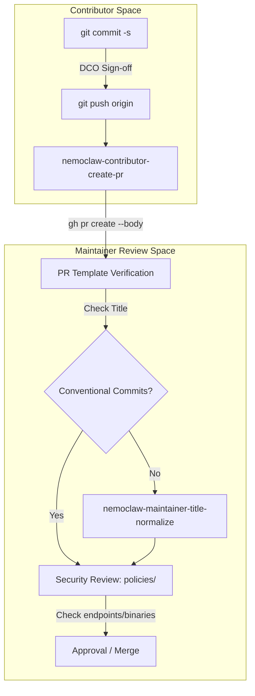
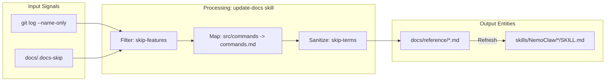

<!-- source: DeepWiki mcp.deepwiki.com · repo NVIDIA/skills · extra page NemoClaw Maintainer Workflows · fetched 2026-10-30 -->

# NemoClaw Maintainer Workflows

Relevant source files

The following files were used as context for generating this wiki page:

- [skills/NemoClaw/nemoclaw-contributor-create-pr/SKILL.md](skills/NemoClaw/nemoclaw-contributor-create-pr/SKILL.md)
- [skills/NemoClaw/nemoclaw-contributor-update-docs/SKILL.md](skills/NemoClaw/nemoclaw-contributor-update-docs/SKILL.md)
- [skills/NemoClaw/nemoclaw-user-manage-policy/SKILL.md](skills/NemoClaw/nemoclaw-user-manage-policy/SKILL.md)

This page describes the automated and semi-automated workflows used by NemoClaw maintainers to manage the repository lifecycle. These workflows cover daily maintenance loops, pull request (PR) triage, documentation synchronization, and release management.

## Overview of Maintainer Loops

Maintainers operate on three primary temporal loops—Morning, Daytime, and Evening—to ensure repository health, security, and velocity. These loops are supported by specialized skills that automate the extraction of context from Git history and GitHub metadata.

### Temporal Maintenance Cycles

| Loop | Primary Focus | Key Activities |
| :--- | :--- | :--- |
| **Morning** | Context Retrieval | Triage new issues, review overnight PR activity, check CI status of the `main` branch. |
| **Daytime** | Active Review | Perform security code reviews, run PR comparators, and normalize PR titles for Conventional Commits. |
| **Evening** | Release Prep | Scan commits for doc drift, refresh user skills, and prepare release tag proposals. |

Sources: [skills/NemoClaw/nemoclaw-contributor-update-docs/SKILL.md:3-21](), [skills/NemoClaw/nemoclaw-contributor-create-pr/SKILL.md:68-87]()

---

## PR Triage and Review Workflow

The maintainer workflow for PRs ensures that every contribution meets the structural and security requirements of the NemoClaw project.

### PR Creation and Validation
Contributors use the `nemoclaw-contributor-create-pr` skill to ensure PRs follow the mandatory template [skills/NemoClaw/nemoclaw-contributor-create-pr/SKILL.md:112-144](). Maintainers verify that:
1.  **DCO Sign-off** is present in the PR body [skills/NemoClaw/nemoclaw-contributor-create-pr/SKILL.md:101-108]().
2.  **Conventional Commits** formatting is applied to the title (e.g., `feat(cli): ...` or `fix(blueprint): ...`) [skills/NemoClaw/nemoclaw-contributor-create-pr/SKILL.md:72-82]().
3.  **Pre-PR Checks** (`npx prek run` and `npm test`) have been reported as passing [skills/NemoClaw/nemoclaw-contributor-create-pr/SKILL.md:38-59]().

### Security Code Review
Maintainers specifically look for changes affecting the sandbox security model. Key areas of focus include:
*   **Policy Changes**: Any modifications to `nemoclaw-blueprint/policies/openclaw-sandbox.yaml` or new files in `nemoclaw-blueprint/policies/presets/` [skills/NemoClaw/nemoclaw-user-manage-policy:30-36]().
*   **Egress Rules**: Ensuring custom hosts do not bypass the review process [skills/NemoClaw/nemoclaw-user-manage-policy:11-13]().
*   **Binary Scoping**: Verifying that `binaries` field in network policies correctly restricts which executables can access specific endpoints [skills/NemoClaw/nemoclaw-user-manage-policy:57-59]().

### PR Triage Data Flow
The following diagram illustrates the transition from a contributor's local environment to the maintainer's review space.

**PR Triage Logic**

Sources: [skills/NemoClaw/nemoclaw-contributor-create-pr/SKILL.md:157-169](), [skills/NemoClaw/nemoclaw-user-manage-policy/SKILL.md:52-62]()

---

## Documentation and Skill Synchronization

A critical maintainer responsibility is preventing "doc drift"—where the documentation lags behind code changes. This is handled via the `nemoclaw-contributor-update-docs` skill.

### The Doc-Skip Mechanism
Maintainers maintain a `docs/.docs-skip` file to control which features are exposed to the documentation and AI agent skills.
*   **skip-features**: Substrings matched against commit messages to exclude experimental code [skills/NemoClaw/nemoclaw-contributor-update-docs/SKILL.md:32-32]().
*   **skip-terms**: A hard gate of prohibited terms that must never appear in generated documentation [skills/NemoClaw/nemoclaw-contributor-update-docs/SKILL.md:33-33]().

### Doc Update Logic
Maintainers scan the commit range (e.g., `git log v0.1.0..HEAD`) and map code changes to specific documentation pages [skills/NemoClaw/nemoclaw-contributor-update-docs/SKILL.md:41-61]().

| Code Change Area | Target Doc Page |
| :--- | :--- |
| `nemoclaw/src/commands/` | `docs/reference/commands.md` |
| `nemoclaw-blueprint/policies/` | `docs/reference/network-policies.md` |
| `nemoclaw-blueprint/blueprint.yaml` | `docs/reference/inference-profiles.md` |

Sources: [skills/NemoClaw/nemoclaw-contributor-update-docs/SKILL.md:66-80]()

### Skill Entity Mapping
This diagram maps the maintainer's conceptual "Release Prep" to the specific code entities and files involved.

**Release Documentation Flow**

Sources: [skills/NemoClaw/nemoclaw-contributor-update-docs/SKILL.md:22-37](), [skills/NemoClaw/nemoclaw-contributor-update-docs/SKILL.md:105-124]()

---

## Network Policy Maintenance

Maintainers manage the "Golden" sandbox policy. Changes are made either statically or dynamically.

### Static Policy Updates
Maintainers update the baseline by editing `nemoclaw-blueprint/policies/openclaw-sandbox.yaml` [skills/NemoClaw/nemoclaw-user-manage-policy:34-36](). This file defines the default security posture for all new sandboxes.

### Dynamic Policy Verification
During triage or troubleshooting, maintainers use `openshell` to inspect live policies:
1.  **Snapshot**: `openshell policy get --full <name>` [skills/NemoClaw/nemoclaw-user-manage-policy:131-131]().
2.  **Comparison**: Check against the `openclaw-sandbox.yaml` baseline to identify drift or unauthorized egress [skills/NemoClaw/nemoclaw-user-manage-policy:85-89]().
3.  **TUI Approval**: Using `openshell term` to interactively approve or deny blocked requests during development [skills/NemoClaw/nemoclaw-user-manage-policy:148-152]().

Sources: [skills/NemoClaw/nemoclaw-user-manage-policy/SKILL.md:22-28](), [skills/NemoClaw/nemoclaw-user-manage-policy/SKILL.md:115-124]()

---

