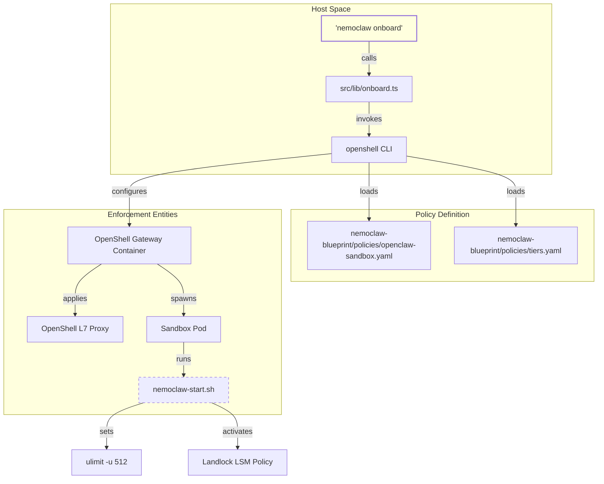
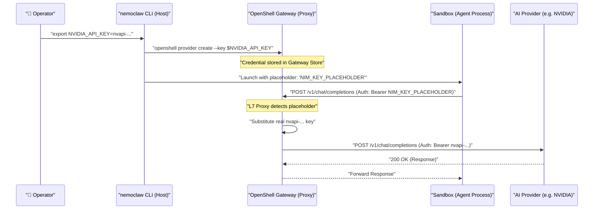

<!-- source: DeepWiki mcp.deepwiki.com · repo NVIDIA/skills · extra page NemoClaw Security Architecture · fetched 2026-10-30 -->

# NemoClaw Security Architecture

Relevant source files

The following files were used as context for generating this wiki page:

- [skills/NemoClaw/nemoclaw-user-configure-security/references/best-practices.md](skills/NemoClaw/nemoclaw-user-configure-security/references/best-practices.md)
- [skills/NemoClaw/nemoclaw-user-configure-security/references/credential-storage.md](skills/NemoClaw/nemoclaw-user-configure-security/references/credential-storage.md)
- [skills/NemoClaw/nemoclaw-user-deploy-remote/references/sandbox-hardening.md](skills/NemoClaw/nemoclaw-user-deploy-remote/references/sandbox-hardening.md)
- [skills/NemoClaw/nemoclaw-user-get-started/SKILL.md](skills/NemoClaw/nemoclaw-user-get-started/SKILL.md)
- [skills/NemoClaw/nemoclaw-user-reference/references/architecture.md](skills/NemoClaw/nemoclaw-user-reference/references/architecture.md)
- [skills/NemoClaw/nemoclaw-user-reference/references/network-policies.md](skills/NemoClaw/nemoclaw-user-reference/references/network-policies.md)

NemoClaw implements a four-layer, deny-by-default security model designed to sandbox untrusted AI agent workloads. This architecture ensures that even if an agent is compromised via prompt injection or malicious code execution, the impact is contained through strict network enforcement, filesystem immutability, process isolation, and credential abstraction.

## Security Model Overview

The security posture is established during the `nemoclaw onboard` process and enforced by the OpenShell gateway and the container runtime [skills/NemoClaw/nemoclaw-user-configure-security/references/best-practices.md:18-24]().

### The Four Layers of Defense

| Layer | Enforcement Point | Scope | Runtime Modifiable |
| :--- | :--- | :--- | :--- |
| **Network** | OpenShell Gateway | L4/L7 egress filtering, binary-scoped rules, and SSL termination. | Yes (via `openshell policy`) |
| **Filesystem** | Landlock LSM | Path-level read/write restrictions and system immutability. | No (requires restart) |
| **Process** | Container Runtime | Capability dropping, resource limits (`ulimit`), and privilege escalation prevention. | No (requires restart) |
| **Inference** | OpenShell Gateway | Credential isolation via placeholder substitution. | Yes (via `openshell provider`) |

**Sources:** [skills/NemoClaw/nemoclaw-user-configure-security/references/best-practices.md:75-104]()

## Network Enforcement (OpenShell Gateway)

NemoClaw utilizes the OpenShell gateway as a transparent L7 proxy that intercepts all sandbox egress [skills/NemoClaw/nemoclaw-user-reference/references/architecture.md:124-131]().

### Binary-Scoped Rules
Unlike traditional firewalls that filter by IP/Port, NemoClaw filters by the identity of the requesting binary. OpenShell identifies the calling binary by reading `/proc/<pid>/exe`, walking the process tree, and verifying a SHA256 hash of the executable [skills/NemoClaw/nemoclaw-user-configure-security/references/best-practices.md:126-129]().

### Policy Tiers and Presets
The network policy is defined in `nemoclaw-blueprint/policies/openclaw-sandbox.yaml` [skills/NemoClaw/nemoclaw-user-reference/references/network-policies.md:9-11](). Users select from three tiers during onboarding:
*   **Restricted:** Base sandbox only (Inference + Core tools).
*   **Balanced:** Adds dev tooling (npm, pypi, brew) and web search (Brave).
*   **Open:** Adds messaging (Slack, Discord) and productivity (Jira, Outlook).

**Sources:** [skills/NemoClaw/nemoclaw-user-reference/references/network-policies.md:81-85]()

### Operator Approval Flow
When an agent attempts to reach an unlisted endpoint, the request is blocked and queued for real-time operator approval via the TUI command `openshell term` [skills/NemoClaw/nemoclaw-user-reference/references/network-policies.md:105-113]().

## Filesystem Immutability (Landlock LSM)

NemoClaw uses Landlock Linux Security Module (LSM) to enforce fine-grained filesystem access controls within the sandbox [skills/NemoClaw/nemoclaw-user-deploy-remote/references/sandbox-hardening.md:91-94]().

### Sandbox Path Access
| Path | Access Level | Purpose |
| :--- | :--- | :--- |
| `/sandbox` | Read-Write | Agent home directory and workspace. |
| `/tmp` | Read-Write | Temporary files and logs. |
| `/usr`, `/lib`, `/etc` | Read-Only | Prevents tampering with system binaries or TLS trust stores. |

**Sources:** [skills/NemoClaw/nemoclaw-user-reference/references/network-policies.md:15-20](), [skills/NemoClaw/nemoclaw-user-deploy-remote/references/sandbox-hardening.md:72-82]()

## Process Isolation & Hardening

The sandbox image is hardened by removing unnecessary tools and restricting process-level privileges [skills/NemoClaw/nemoclaw-user-deploy-remote/references/sandbox-hardening.md:3-6]().

### Hardening Measures
1.  **Tool Purging:** Build toolchains (`gcc`, `make`) and network probes (`netcat`) are removed from the runtime image [skills/NemoClaw/nemoclaw-user-deploy-remote/references/sandbox-hardening.md:8-12]().
2.  **Resource Limits:** The entrypoint script `nemoclaw-start.sh` sets `ulimit -u 512` to prevent fork-bomb attacks [skills/NemoClaw/nemoclaw-user-deploy-remote/references/sandbox-hardening.md:23-27]().
3.  **Capability Drops:** All Linux capabilities are dropped (`--cap-drop=ALL`), and `no-new-privileges` is set to prevent `setuid` escalation [skills/NemoClaw/nemoclaw-user-deploy-remote/references/sandbox-hardening.md:34-42](), [skills/NemoClaw/nemoclaw-user-deploy-remote/references/sandbox-hardening.md:58-59]().

**Sources:** [skills/NemoClaw/nemoclaw-user-deploy-remote/references/sandbox-hardening.md:1-69]()

## Inference Credential Isolation

NemoClaw ensures that raw API keys (e.g., `NVIDIA_API_KEY`, `OPENAI_API_KEY`) never enter the sandbox environment [skills/NemoClaw/nemoclaw-user-reference/references/architecture.md:133-134]().

### The Substitution Mechanism
1.  **Registration:** Credentials are provided to the host-side `nemoclaw` CLI and registered with the OpenShell gateway using `openshell provider create` [skills/NemoClaw/nemoclaw-user-configure-security/references/credential-storage.md:8-9]().
2.  **Placeholders:** The agent inside the sandbox is configured with placeholder strings instead of real keys.
3.  **L7 Injection:** When the agent makes an inference request, the OpenShell L7 proxy intercepts the traffic and injects the real credential into the `Authorization` header at the network boundary [skills/NemoClaw/nemoclaw-user-reference/references/architecture.md:128-131]().

**Sources:** [skills/NemoClaw/nemoclaw-user-configure-security/references/credential-storage.md:1-32](), [skills/NemoClaw/nemoclaw-user-reference/references/architecture.md:122-135]()

## System Architecture Diagrams

### Logic to Code Entity Mapping: Security Initialization
This diagram maps the natural language "Onboarding" flow to the specific code entities and files that establish the security posture.

**Sources:** [skills/NemoClaw/nemoclaw-user-reference/references/network-policies.md:9-11](), [skills/NemoClaw/nemoclaw-user-reference/references/network-policies.md:90-91](), [skills/NemoClaw/nemoclaw-user-reference/references/architecture.md:124-131](), [skills/NemoClaw/nemoclaw-user-deploy-remote/references/sandbox-hardening.md:23-27]()

### Data Flow: Credential Isolation
This diagram illustrates how credentials move from the user to the gateway, bypassing the sandbox entirely.

**Sources:** [skills/NemoClaw/nemoclaw-user-configure-security/references/credential-storage.md:8-9](), [skills/NemoClaw/nemoclaw-user-reference/references/architecture.md:131-134]()

---

