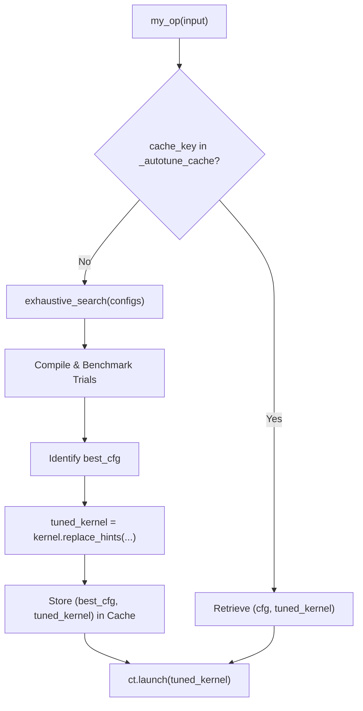
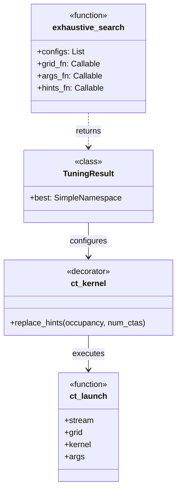

<!-- source: DeepWiki mcp.deepwiki.com · repo NVIDIA/skills · extra page cuTile Kernel Conversion & Autotuning · fetched 2026-10-30 -->

# cuTile Kernel Conversion & Autotuning

Relevant source files

The following files were used as context for generating this wiki page:

- [skills/TileGym/converting-cutile-to-julia/references/api-mapping.md](skills/TileGym/converting-cutile-to-julia/references/api-mapping.md)
- [skills/TileGym/converting-cutile-to-julia/references/critical-rules.md](skills/TileGym/converting-cutile-to-julia/references/critical-rules.md)
- [skills/TileGym/converting-cutile-to-triton/references/api-mapping.md](skills/TileGym/converting-cutile-to-triton/references/api-mapping.md)
- [skills/TileGym/converting-cutile-to-triton/references/performance-gotchas.md](skills/TileGym/converting-cutile-to-triton/references/performance-gotchas.md)
- [skills/TileGym/converting-cutile-to-triton/translations/workflow.md](skills/TileGym/converting-cutile-to-triton/translations/workflow.md)
- [skills/TileGym/cutile-autotuning/SKILL.md](skills/TileGym/cutile-autotuning/SKILL.md)
- [skills/TileGym/cutile-autotuning/references/hardware-constraints.md](skills/TileGym/cutile-autotuning/references/hardware-constraints.md)
- [skills/TileGym/cutile-autotuning/references/parameter-space-design.md](skills/TileGym/cutile-autotuning/references/parameter-space-design.md)
- [skills/TileGym/cutile-autotuning/references/search-strategies.md](skills/TileGym/cutile-autotuning/references/search-strategies.md)

This page provides technical guidance for converting cuTile kernels between Python, Triton, and Julia, as well as implementing robust autotuning strategies within the TileGym framework. It covers API mappings, performance optimization patterns, and hardware-specific constraints for NVIDIA architectures from Ampere (sm80) to Blackwell (sm120).

## 1. cuTile to Triton Conversion

Converting cuTile kernels to Triton requires mapping the high-level tile abstractions of cuTile to Triton's pointer-based or Tensor Memory Accelerator (TMA) based paradigms.

### 1.1 API Mapping & Workflow
The conversion process follows a strict validation loop to ensure correctness and performance parity.

| cuTile | Triton | Notes |
|--------|--------|-------|
| `import cuda.tile as ct` | `import triton.language as tl` | [skills/TileGym/converting-cutile-to-triton/references/api-mapping.md:37-37]() |
| `@ct.kernel` | `@triton.jit` | [skills/TileGym/converting-cutile-to-triton/references/api-mapping.md:38-38]() |
| `ct.bid(axis)` | `tl.program_id(axis)` | [skills/TileGym/converting-cutile-to-triton/references/api-mapping.md:47-47]() |
| `ct.matmul(a, b)` | `tl.dot(a, b)` | [skills/TileGym/converting-cutile-to-triton/references/api-mapping.md:107-107]() |
| `ct.astype(x, dtype)` | `x.to(dtype)` | [skills/TileGym/converting-cutile-to-triton/references/api-mapping.md:136-136]() |

### 1.2 The TMA Optimization Pattern
A critical performance gotcha in Triton conversion is the use of raw pointer offsets for 2D+ tiles. While cuTile handles TMA internally, Triton requires explicit descriptors for optimal performance on sm90+.

**TMA Descriptor Pattern:**
For any load with a 2D+ block shape (e.g., GEMM tiles), use `tl.make_tensor_descriptor` instead of `tl.load(ptr + offs)`. Failure to do so can result in a **5-20x (500%-2000%) performance regression** [skills/TileGym/converting-cutile-to-triton/references/performance-gotchas.md:7-7]().

### 1.3 Conversion Workflow (C2T)
The mandatory workflow for converting kernels is managed via a `todowrite` task list [skills/TileGym/converting-cutile-to-triton/translations/workflow.md:12-19]():

1.  **c2t-1**: Analyze test coverage.
2.  **c2t-2**: Apply API mapping.
3.  **c2t-3**: Test correctness (`pytest -k triton`).
4.  **c2t-4**: **MANDATORY** TMA optimization and alignment hints (`tl.assume`).
5.  **c2t-5**: Performance comparison vs cuTile.

**Sources:**
- [skills/TileGym/converting-cutile-to-triton/references/api-mapping.md:37-136]()
- [skills/TileGym/converting-cutile-to-triton/references/performance-gotchas.md:1-20]()
- [skills/TileGym/converting-cutile-to-triton/translations/workflow.md:7-41]()

---

## 2. cuTile to Julia Conversion

Converting to `cuTile.jl` involves moving from Python's dynamic environment to Julia's typed, 1-indexed system.

### 2.1 Critical Rules for Julia
1.  **1-based Indexing**: `ct.bid`, `ct.num_tiles`, and `permutedims` axes must be shifted by +1 [skills/TileGym/converting-cutile-to-julia/references/critical-rules.md:3-3]().
2.  **Explicit Broadcasting**: Julia requires the dot syntax (`.+`, `.*`) for shape-mismatched tiles, whereas Python cuTile auto-broadcasts [skills/TileGym/converting-cutile-to-julia/references/critical-rules.md:7-7]().
3.  **Kernel Return**: Julia kernels must explicitly end with `return nothing` [skills/TileGym/converting-cutile-to-julia/references/critical-rules.md:13-13]().
4.  **Parameter Wrapping**: Constants are defined as `param::Int` in the signature but must be wrapped as `ct.Constant(val)` at the `ct.launch` call site [skills/TileGym/converting-cutile-to-julia/references/critical-rules.md:11-11]().

### 2.2 API Mapping Table

| Python | Julia | Notes |
|--------|-------|-------|
| `ct.bid(0)` | `ct.bid(1)` | 1-indexed [skills/TileGym/converting-cutile-to-julia/references/api-mapping.md:36-36]() |
| `ct.load(arr, index=(i,j), shape=(m,n))` | `ct.load(arr; index=(i,j), shape=(m,n))` | Keyword arguments [skills/TileGym/converting-cutile-to-julia/references/api-mapping.md:46-46]() |
| `tile.astype(ct.float32)` | `convert(ct.Tile{Float32}, tile)` | Type system mapping [skills/TileGym/converting-cutile-to-julia/references/api-mapping.md:81-81]() |
| `ct.sum(tile, axis=0)` | `sum(tile; dims=1)` | Axis +1; keeps dims [skills/TileGym/converting-cutile-to-julia/references/api-mapping.md:152-152]() |

**Sources:**
- [skills/TileGym/converting-cutile-to-julia/references/api-mapping.md:1-168]()
- [skills/TileGym/converting-cutile-to-julia/references/critical-rules.md:1-61]()

---

## 3. Autotuning Implementation

The `exhaustive_search` API is used to find optimal parameters for cuTile kernels. Because cuTile JIT compilation is heavy (~0.5-1s per config), the search space is strictly limited to $\le 30$ configs [skills/TileGym/cutile-autotuning/SKILL.md:98-98]().

### 3.1 The Tune-Once/Cache/Launch Pattern
To eliminate runtime overhead, autotuning results are cached at the module level.

**Autotune Data Flow:**
The diagram below illustrates how `exhaustive_search` interacts with the cache and the GPU.

**Title: cuTile Autotune Execution Flow**

*Sources: [skills/TileGym/cutile-autotuning/SKILL.md:35-72](), [skills/TileGym/cutile-autotuning/references/search-strategies.md:12-38]()*

### 3.2 Parameter Space Design
The search dimensions depend on the kernel classification:

| Kernel Type | Dimensions to Tune |
|-------------|-------------------|
| **Memory-bound** (Elementwise, Norms) | `occupancy` only [1, 2, 4, 8] [skills/TileGym/cutile-autotuning/references/parameter-space-design.md:19-23]() |
| **Compute-bound** (Matmul, GEMM) | `TILE_M`, `TILE_N`, `TILE_K`, `num_ctas`, `occupancy` [skills/TileGym/cutile-autotuning/references/parameter-space-design.md:39-41]() |
| **FP8 Matmul** | `BLOCK_SIZE_M`, `occupancy`, `swap_ab` [skills/TileGym/cutile-autotuning/references/parameter-space-design.md:76-76]() |

### 3.3 Hardware Constraints
Architectural differences dictate the valid search space for `num_ctas` and tile sizes.

| Architecture | CGA (num_ctas > 1) | Max Tile Size | Notes |
|--------------|--------------------|---------------|-------|
| **sm100 (B200)** | Supported (1, 2, 4) | 512x512 | Large SHMEM [skills/TileGym/cutile-autotuning/references/hardware-constraints.md:20-26]() |
| **sm120 (5090)** | No benefit (use 1) | 256x256 | Smaller SHMEM [skills/TileGym/cutile-autotuning/references/hardware-constraints.md:46-54]() |
| **sm90 (H100)** | Supported (1, 2, 4) | 128x128 | First CGA support [skills/TileGym/cutile-autotuning/references/hardware-constraints.md:73-80]() |
| **sm80 (A100)** | Not supported | 128x128 | No TMA hardware [skills/TileGym/cutile-autotuning/references/hardware-constraints.md:89-97]() |

**Code Entity Mapping:**
The following diagram maps autotuning concepts to specific code entities in the `cuda.tile` package.

**Title: cuTile Autotuning Code Entities**

*Sources: [skills/TileGym/cutile-autotuning/SKILL.md:57-67](), [skills/TileGym/cutile-autotuning/references/search-strategies.md:20-37]()*

**Sources:**
- [skills/TileGym/cutile-autotuning/SKILL.md:1-120]()
- [skills/TileGym/cutile-autotuning/references/hardware-constraints.md:1-128]()
- [skills/TileGym/cutile-autotuning/references/parameter-space-design.md:1-115]()
- [skills/TileGym/cutile-autotuning/references/search-strategies.md:1-139]()

---

