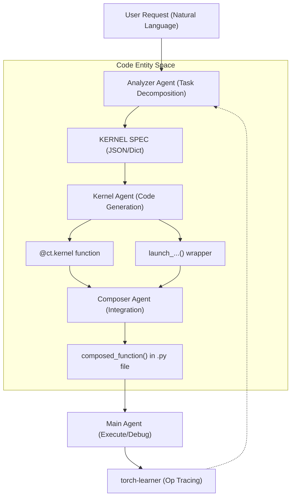
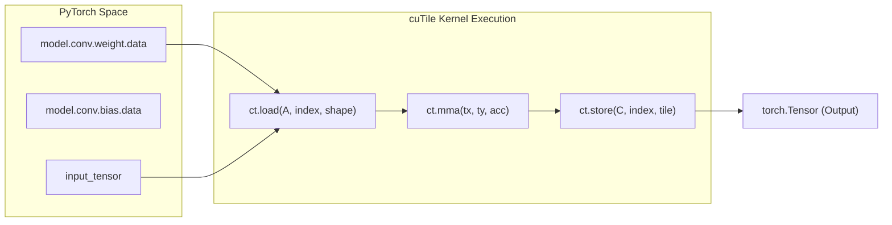

<!-- source: DeepWiki mcp.deepwiki.com · repo NVIDIA/skills · extra page cuTile Python Programming · fetched 2026-10-30 -->

# cuTile Python Programming

Relevant source files

The following files were used as context for generating this wiki page:

- [skills/TileGym/cutile-python/examples/convolution/README.md](skills/TileGym/cutile-python/examples/convolution/README.md)
- [skills/TileGym/cutile-python/examples/matmul/README.md](skills/TileGym/cutile-python/examples/matmul/README.md)
- [skills/TileGym/cutile-python/examples/normalization/README.md](skills/TileGym/cutile-python/examples/normalization/README.md)
- [skills/TileGym/cutile-python/guidelines/01_implementation_lessons.md](skills/TileGym/cutile-python/guidelines/01_implementation_lessons.md)
- [skills/TileGym/cutile-python/guidelines/02_code_generation_rules.md](skills/TileGym/cutile-python/guidelines/02_code_generation_rules.md)
- [skills/TileGym/cutile-python/guidelines/03_concepts.md](skills/TileGym/cutile-python/guidelines/03_concepts.md)
- [skills/TileGym/cutile-python/orchestration/analyzer_agent.md](skills/TileGym/cutile-python/orchestration/analyzer_agent.md)
- [skills/TileGym/cutile-python/orchestration/composer_agent.md](skills/TileGym/cutile-python/orchestration/composer_agent.md)
- [skills/TileGym/cutile-python/orchestration/kernel_agent.md](skills/TileGym/cutile-python/orchestration/kernel_agent.md)
- [skills/TileGym/cutile-python/orchestration/workflow.md](skills/TileGym/cutile-python/orchestration/workflow.md)
- [skills/TileGym/cutile-python/torch-learner/tracing_workflow.md](skills/TileGym/cutile-python/torch-learner/tracing_workflow.md)

This page provides a detailed technical reference for the cuTile Python Domain-Specific Language (DSL), a tile-based programming model for developing high-performance GPU kernels. It covers implementation rules, the multi-agent orchestration framework for kernel generation, and integration patterns with PyTorch.

## Overview and Purpose

cuTile is designed to bridge the gap between high-level Python productivity and low-level CUDA performance. It uses a "tile-based" abstraction where operations are performed on multi-dimensional registers (tiles) rather than individual elements [skills/TileGym/cutile-python/guidelines/01_implementation_lessons.md:3-6](). The programming model enforces specific constraints, such as power-of-2 tile dimensions, to ensure efficient hardware mapping [skills/TileGym/cutile-python/guidelines/03_concepts.md:3-9]().

### Core Programming Concepts

| Concept | Rule | Reference |
| :--- | :--- | :--- |
| **Indexing** | Use tile indices (block IDs), not element indices. | [01_implementation_lessons.md:3-11]() |
| **Tile Shapes** | Each dimension must be a power of 2 ($2^n$). | [03_concepts.md:3-6]() |
| **Data Movement** | `ct.load` (Global $\to$ Reg) and `ct.store` (Reg $\to$ Global). | [03_concepts.md:36-49]() |
| **Accumulators** | Use `ct.float32` for accumulation, then cast to output type. | [01_implementation_lessons.md:13-20]() |
| **Grid Limits** | Maximum total grid size is 65535. | [01_implementation_lessons.md:85-89]() |

Sources: [skills/TileGym/cutile-python/guidelines/01_implementation_lessons.md:3-89](), [skills/TileGym/cutile-python/guidelines/03_concepts.md:3-49]()

---

## Multi-Agent Orchestration Workflow

Complex kernel development is handled through a pipeline of specialized agents. This "Deep Agent" approach decomposes a high-level request into verifiable sub-tasks [skills/TileGym/cutile-python/orchestration/workflow.md:1-5]().

### The Orchestration Pipeline

The workflow transitions from natural language requirements to specific code entities across three main agent roles.

**Natural Language to Code Entity Mapping**

Sources: [skills/TileGym/cutile-python/orchestration/workflow.md:16-35](), [skills/TileGym/cutile-python/orchestration/analyzer_agent.md:3-14](), [skills/TileGym/cutile-python/orchestration/kernel_agent.md:3-15](), [skills/TileGym/cutile-python/orchestration/composer_agent.md:3-17]()

### Agent Roles and Responsibilities

1.  **Analyzer Agent**: Identifies operations in a PyTorch module, determines fusion opportunities (e.g., fusing Linear + Bias + ReLU), and maps data dependencies [skills/TileGym/cutile-python/orchestration/analyzer_agent.md:5-13](). It uses `torch-learner` traces to understand backend-specific math [skills/TileGym/cutile-python/orchestration/analyzer_agent.md:32-33]().
2.  **Kernel Agent**: Focuses on a single `KERNEL SPEC`. It designs tile sizes, calculates grid dimensions, and generates the `@ct.kernel` code [skills/TileGym/cutile-python/orchestration/kernel_agent.md:5-15]().
3.  **Composer Agent**: Assembles multiple kernels into a topological execution order. It writes "glue code" for intermediate tensor allocations and includes a `pytorch_reference` for validation [skills/TileGym/cutile-python/orchestration/composer_agent.md:5-17]().

---

## Implementation Rules and Lessons

### Code Generation Rules (DSL Primitives)
cuTile requires implementing complex functions from primitives. Many standard math functions do not exist directly in the `ct` namespace [skills/TileGym/cutile-python/guidelines/02_code_generation_rules.md:3-5]().

| Target Function | cuTile Implementation Pattern |
| :--- | :--- |
| `ct.sigmoid(x)` | `1.0 / (1.0 + ct.exp(-x))` |
| `ct.silu(x)` | `x * (1.0 / (1.0 + ct.exp(-x)))` |
| `ct.sign(x)` | `ct.where(x > 0, 1, 0) + ct.where(x < 0, -1, 0)` |
| `ct.softmax` | Combine `ct.max`, `ct.exp`, and `ct.sum` |
| `ct.transpose` | Load normally, then use `ct.transpose(tile)` (not `order='F'`) |

Sources: [skills/TileGym/cutile-python/guidelines/02_code_generation_rules.md:3-20](), [skills/TileGym/cutile-python/guidelines/01_implementation_lessons.md:91-102]()

### Critical Lessons
*   **Boolean Arithmetic**: Boolean tile arithmetic is unsupported. Cast results to `ct.int32` before multiplying or use `ct.where` [skills/TileGym/cutile-python/guidelines/01_implementation_lessons.md:104-116]().
*   **OOB Handling**: cuTile handles out-of-bounds (OOB) indices by returning safe defaults (zeros), but explicit `padding_value` is required for `ct.load` and `ct.gather` to avoid garbage memory in arithmetic [skills/TileGym/cutile-python/guidelines/01_implementation_lessons.md:129-141]().
*   **Reshaping for Matmul**: cuTile natively supports 2D and 3D matmul. Higher-dimensional tensors (e.g., 4D) must be reshaped to 3D (Batch*M, K, N) before calling `ct.matmul` [skills/TileGym/cutile-python/guidelines/01_implementation_lessons.md:37-54]().

---

## Data Flow: PyTorch to cuTile Integration

The integration involves capturing PyTorch state and mapping it to cuTile kernel arguments.

**PyTorch-to-cuTile Data Flow**

Sources: [skills/TileGym/cutile-python/examples/convolution/README.md:15-30](), [skills/TileGym/cutile-python/guidelines/01_implementation_lessons.md:59-78]()

### Working with Tensors
1.  **Extract Parameters**: Use `.data` to access raw tensors from PyTorch layers [skills/TileGym/cutile-python/examples/convolution/README.md:21-24]().
2.  **Grid Configuration**: Set grid dimensions based on the output tensor shape, using `ct.cdiv` for ceiling division [skills/TileGym/cutile-python/examples/convolution/README.md:36-38]().
3.  **Precision**: Standard practice is loading `float16` inputs and using `float32` for the `ct.mma` accumulator [skills/TileGym/cutile-python/guidelines/02_code_generation_rules.md:124-126]().

---

## Worked Examples Reference

The codebase provides optimized patterns for common operations.

### Convolution
*   **Tiling**: Avoid (1, 1) tile sizes for 2D/3D spatial dimensions as they are inefficient [skills/TileGym/cutile-python/examples/convolution/README.md:13]().
*   **Variants**: Examples cover 2D/3D regular and transpose convolutions, including grouped and dilated variants [skills/TileGym/cutile-python/examples/convolution/README.md:42-45]().

### Matrix Multiplication
*   **Split-K GEMM**: Implementation for cases where the reduction dimension (K) is large, splitting work across multiple thread blocks [skills/TileGym/cutile-python/examples/matmul/README.md:7]().
*   **GEMV**: Specialized matrix-vector multiplication [skills/TileGym/cutile-python/examples/matmul/README.md:5]().

### Normalization
*   **Group Norm**: Example provided for group normalization with bias [skills/TileGym/cutile-python/examples/normalization/README.md:5]().
*   **Layer/RMS Norm**: Reference implementations are located in `src/tilegym/ops/cutile/` [skills/TileGym/cutile-python/examples/normalization/README.md:7]().

Sources: [skills/TileGym/cutile-python/examples/convolution/README.md:1-45](), [skills/TileGym/cutile-python/examples/matmul/README.md:1-10](), [skills/TileGym/cutile-python/examples/normalization/README.md:1-7]()

---

