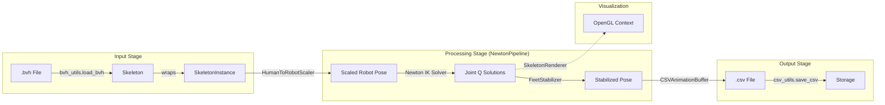

<!-- source: DeepWiki mcp.deepwiki.com · repo NVIDIA/soma-retargeter · page 1.1 Getting Started: Installation and Configuration · fetched 2026-10-26 -->

# Getting Started: Installation and Configuration

<details>
<summary>Relevant source files</summary>

The following files were used as context for generating this wiki page:

- [.gitignore](.gitignore)
- [.python-version](.python-version)
- [.vscode/launch.json](.vscode/launch.json)
- [app/__init__.py](app/__init__.py)
- [app/bvh_to_csv_converter.py](app/bvh_to_csv_converter.py)
- [pyproject.toml](pyproject.toml)
- [uv.lock](uv.lock)

</details>


This page provides a technical guide for setting up the SOMA Retargeter environment. It covers system requirements, dependency management via `uv` or `pip`, and the execution patterns for the BVH-to-CSV conversion pipeline.

## System Requirements and Environment

The SOMA Retargeter is built on modern Python and NVIDIA high-performance libraries. The project specifically targets **Python 3.12** as defined in the environment configuration `[.python-version:1-1]()`.

### Core Dependencies
The project leverages several specialized libraries for simulation, rendering, and GPU acceleration:
*   **Newton (`newton`)**: The core physics and IK solving engine `[pyproject.toml:12-12]()`.
*   **NVIDIA Warp (`warp-lang`)**: Used for GPU-accelerated kernels in skeletal animation, scaling, and rendering `[pyproject.toml:13-13]()`.
*   **USD Core (`usd-core`)**: Provides the foundation for loading skeletal meshes and bind poses `[pyproject.toml:20-20]()`.
*   **imgui-bundle**: Powers the interactive graphical user interface for the viewer `[pyproject.toml:19-19]()`.

## Installation

The project uses `pyproject.toml` for package definition and dependency management.

### Using uv (Recommended)
The project includes a `uv.lock` file for reproducible builds. `uv` is configured to use the NVIDIA PyPI index for `warp-lang` `[pyproject.toml:39-45]()`.

```bash
# Install dependencies and create virtual environment
uv sync
```

### Using pip
Standard installation is supported via `setuptools`. The package includes specific data files like configurations and USD assets `[pyproject.toml:30-32]()`.

```bash
pip install .
```

### Package Structure
The package is defined under the `soma_retargeter` namespace. The installation process excludes application scripts and raw assets from the library path while including configuration JSONs and model files `[pyproject.toml:25-32]()`.

## Execution Modes

The entry point for the system is `app/bvh_to_csv_converter.py`. It supports two primary modes of operation: **Interactive Viewer** and **Batch Headless**.

### Mode Selection Data Flow
The `Viewer` class determines its execution path based on the type of `viewer` object passed during initialization.

| Mode | Viewer Class | Description |
| :--- | :--- | :--- |
| **Interactive** | `newton.viewer.Viewer` | OpenGL-based UI with real-time rendering and manual controls `[app/bvh_to_csv_converter.py:63-64]()`. |
| **Batch** | `newton.viewer.ViewerNull` | Headless execution for recursive directory processing `[app/bvh_to_csv_converter.py:37-39]()`. |

### Configuration and Launch
The system is configured via JSON files. A default configuration is provided at `assets/default_bvh_to_csv_converter_config.json`.

#### Interactive Viewer Mode
Used for debugging and manual retargeting. It initializes the `SkeletonRenderer`, `SkeletalMeshRenderer`, and `CoordinateRenderer` `[app/bvh_to_csv_converter.py:86-89]()`.

**Launch Command:**
```bash
python app/bvh_to_csv_converter.py --config assets/default_bvh_to_csv_converter_config.json --viewer gl
```

#### Batch Mode
Used for processing large datasets. It calls `Viewer.batched_retargeting()` to recursively find BVH files and export them to CSV `[app/bvh_to_csv_converter.py:37-39]()`.

**Launch Command:**
```bash
python app/bvh_to_csv_converter.py --config assets/default_bvh_to_csv_converter_config.json --viewer null
```

### VS Code Integration
The repository includes a `launch.json` file with pre-configured debug targets for both modes `[.vscode/launch.json:1-25]()`.

**Sources:**
`[pyproject.toml:1-46]()`, `[.python-version:1-1]()`, `[app/bvh_to_csv_converter.py:30-95]()`, `[.vscode/launch.json:1-25]()`

## System Architecture: Initialization Flow

The following diagram illustrates how the `Viewer` class bridges the high-level application logic with the underlying Newton and Warp entities.

### Viewer Initialization Entity Mapping
"Natural Language Space" to "Code Entity Space"

```mermaid
graph TD
    subgraph "Application Logic"
        [MainEntry] --> |"instantiates"| V["Viewer Class"]
        V --> |"loads"| CFG["JSON Config"]
    end

    subgraph "Newton Engine Entities"
        V --> |"builds"| MB["newton.ModelBuilder"]
        MB --> |"creates"| M["newton.Model"]
        M --> |"manages"| S["newton.State"]
        V --> |"controls"| VW["newton.viewer.Viewer"]
    end

    subgraph "Rendering & Assets"
        V --> |"initializes"| SR["SkeletonRenderer"]
        V --> |"initializes"| MR["SkeletalMeshRenderer"]
        V --> |"uses"| SC["SpaceConverter"]
    end

    style V stroke-width:2px
    style M stroke-width:2px
    style SR stroke-width:2px
```
**Sources:**
`[app/bvh_to_csv_converter.py:30-95]()`, `[app/bvh_to_csv_converter.py:66-76]()`

## Data Flow: Input to Output

The retargeting pipeline transforms motion data from human-centric BVH files to robot-compatible CSV files.

### Conversion Pipeline Data Flow
"Natural Language Space" to "Code Entity Space"



### Key Functional Components

| Component | File Path | Role |
| :--- | :--- | :--- |
| **SpaceConverter** | `soma_retargeter/utils/space_conversion_utils.py` | Handles coordinate system remapping (e.g., Maya to Newton) `[app/bvh_to_csv_converter.py:35-35]()`. |
| **BVHImporter** | `soma_retargeter/assets/bvh.py` | Tokenizes and parses BVH hierarchy and motion data `[app/bvh_to_csv_converter.py:114-114]()`. |
| **ModelBuilder** | `newton.ModelBuilder` | Constructs the physical robot model from MJCF files `[app/bvh_to_csv_converter.py:66-76]()`. |
| **CSVAnimationBuffer** | `soma_retargeter/assets/csv.py` | Stores the final retargeted joint angles for export `[app/bvh_to_csv_converter.py:101-101]()`. |

**Sources:**
`[app/bvh_to_csv_converter.py:35-35]()`, `[app/bvh_to_csv_converter.py:100-123]()`, `[pyproject.toml:25-32]()`

---

